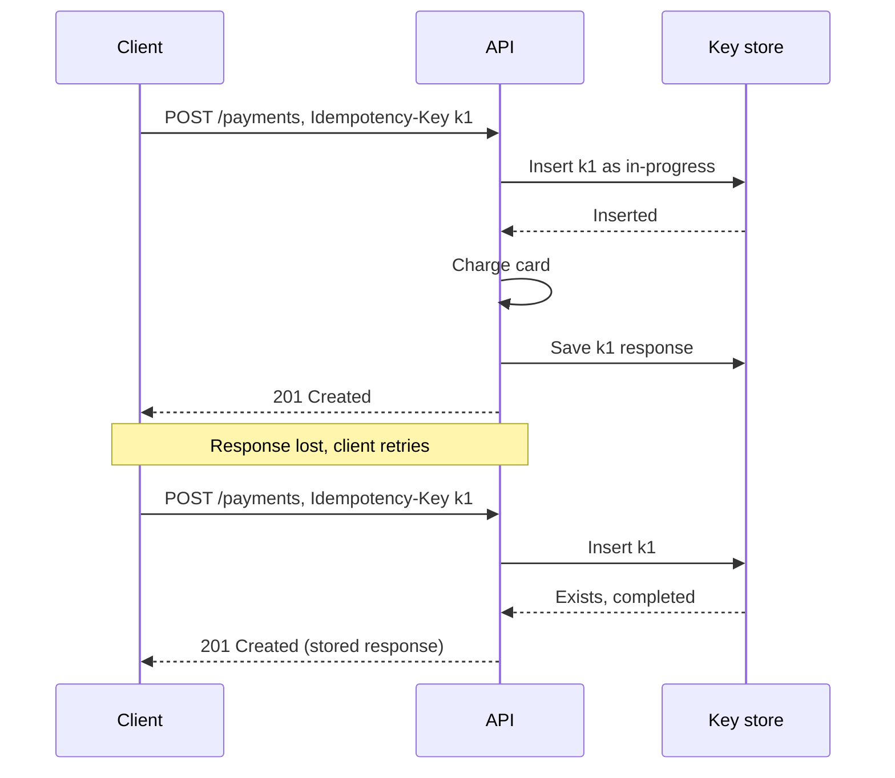

## TL;DR

- REST models resources with HTTP methods and status codes. It is the default for public APIs because every client, proxy, and cache understands it.
- gRPC sends Protocol Buffers over HTTP/2 with generated, typed clients and streaming. It suits internal service-to-service calls more than browsers.
- GraphQL lets each client ask for exactly the fields it needs from one endpoint. You pay for that flexibility with harder caching and the need to cap query cost.
- Use cursor pagination for large or changing lists, add a version only for breaking changes, and accept an idempotency key on any write a client might retry.
- On Azure, API Management handles versioning and policies, but its gRPC support depends on the gateway type and tier, so check before you commit.

## Why it matters

An API is the hardest part of a system to change. You can rewrite a service behind it in a quarter, but a mobile app version that shipped two years ago still calls the old contract, and you can't force every user to upgrade. Mistakes in naming, pagination, or error semantics live for as long as the oldest client does.

Two failure modes come from API design specifically. The first is unsafe retries. A client sends "charge $40", the network times out, and the client can't tell whether the charge happened. If it retries and the API can't recognize the retry, the customer pays twice. The second is unbounded responses. An endpoint that returns "all orders" works in testing with 50 rows and times out in production with 5 million.

## How it works

### REST

REST treats the system as a set of resources (`/orders/123`) and uses HTTP methods for operations on them. The method tells clients and proxies what is safe to retry.

| Method | Use | Safe | Idempotent |
| --- | --- | --- | --- |
| GET | Read a resource or collection | Yes | Yes |
| PUT | Create or replace at a known URL | No | Yes |
| DELETE | Remove | No | Yes |
| POST | Create in a collection, or run an action | No | No |
| PATCH | Partial update | No | Not guaranteed |

Status codes carry meaning that clients act on. 201 means created, 202 means accepted for async processing (return a `Location` header to poll), 409 means a conflict with current state, and 429 means slow down. An API that returns 200 with an error in the body defeats every generic retry and monitoring tool.

### gRPC

You define services and messages in a `.proto` file, and code generators build typed clients and servers in each language. Messages travel as compact binary Protocol Buffers over HTTP/2. Beyond plain request and response, gRPC supports server streaming, client streaming, and bidirectional streaming on one connection. Deadlines propagate across calls, so a downstream service knows when the original caller has given up.

The costs are tooling and reach. Browsers can't speak native gRPC, so web clients need a translating proxy. Binary payloads are harder to inspect in a debugger or a log. And because HTTP/2 multiplexes many calls on one long-lived connection, a layer 4 load balancer spreads load per connection rather than per call (see [networking essentials](./networking-essentials.md)).

### GraphQL

A GraphQL server publishes a typed schema. Clients send a query naming the fields they want, and the server returns exactly that shape. A mobile screen and a desktop dashboard can each fetch what they need in one round trip without the backend building a custom endpoint for each.

The costs land on the server. Each field has a resolver, and a naive implementation makes one database call per item in a list (the N+1 problem), so resolvers need batching. Queries usually go as POST to a single URL, which bypasses ordinary HTTP caching. And a client can write a deeply nested query that is expensive to run, so production servers limit depth or compute a cost per query and reject anything over budget.

| | REST | gRPC | GraphQL |
| --- | --- | --- | --- |
| Contract | OpenAPI document (optional) | `.proto` schema (required) | Schema (required) |
| Payload | Usually JSON | Binary Protocol Buffers | JSON |
| Streaming | Not built in (use SSE or WebSocket) | Client, server, and bidirectional | Subscriptions |
| HTTP caching | Works for GET | No | Hard |
| Browser support | Native | Needs a proxy | Native |
| Best fit | Public APIs, CRUD | Internal service calls | Many client shapes over one data graph |

### Pagination

**Offset pagination** (`?offset=4000&limit=50`) is simple and lets a user jump to page 81. Its cost grows with the offset, because the database reads and throws away 4,000 rows to return 50. It also drifts. If a new row is inserted at the top while a client pages, every later page shifts by one and the client sees a duplicate.

**Cursor pagination** returns an opaque token that encodes the last item's sort key. The next request continues from there, using an index seek rather than a scan.

```sql
-- cursor decodes to (created_at, id) of the last item returned
SELECT id, created_at, body FROM posts
WHERE (created_at, id) < (@cursor_created_at, @cursor_id)
ORDER BY created_at DESC, id DESC
LIMIT 50;
```

Each page costs the same no matter how deep the client goes, and inserts don't shift results. Include a unique column (the `id`) in the sort so ties don't skip rows. Make the cursor opaque (for example base64) so you can change its contents later without breaking clients. The price is no random access to page N, which most feeds and lists don't need.

### Versioning

Most changes shouldn't need a version. Adding an optional field or a new endpoint is backward compatible, as long as clients ignore fields they don't recognize. Version when a change breaks existing clients, such as removing or renaming a field, changing a type, or changing what a value means.

You can carry the version in the path (`/v2/orders`), a query string (`?api-version=2026-10-01`), a header, or the media type. The path is the easiest to see in logs and to route on. Whatever the scheme, run old and new versions side by side, measure who still calls the old one, and announce a removal date before turning it off. gRPC and GraphQL avoid most versions by evolving the schema in place. Never reuse a Protocol Buffers field number, and mark GraphQL fields deprecated before you remove them.

### Idempotency keys

The client generates a unique key, usually a UUID, for each logical operation and sends it in a header on every attempt. The server records the key before doing any work and returns the stored result for any repeat.



The details decide whether it works.

- **The insert must be atomic.** Use a unique constraint or a conditional create, so two concurrent retries can't both see "not found" and both charge.
- **Handle in-flight duplicates.** If a retry arrives while the first attempt is still running, return 409 and let the client try again later. The IETF draft for an `Idempotency-Key` header recommends this.
- **Reject key reuse with a different body.** Store a hash of the request. A matching key with a different hash is a client bug, and the same draft suggests 422.
- **Expire keys.** Keep them long enough to cover the client's retry window (for example 24 hours) and then delete them.

## Trade-offs

- **REST versus gRPC.** REST is universally reachable and easy to debug. gRPC gives typed contracts, smaller payloads, and streaming, and you pay with a proxy for browsers and more care in load balancing. A common split is REST or GraphQL at the edge and gRPC between internal services.
- **GraphQL versus purpose-built endpoints.** GraphQL removes the backend work of adding an endpoint for each new screen. It moves the cost into resolver batching, query-cost limits, and caching. It pays off when many clients need different views of the same data.
- **Offset versus cursor.** Offset gives page numbers and is fine for small admin tables. Cursor gives stable cost and correct results for large, changing lists.
- **Version in path versus header.** Path versions are visible and easy to route. Header versions keep URLs stable but hide the version from logs, caches, and people reading a URL.
- **Idempotency key retention.** A longer window covers slower retries but stores more records. Match it to the longest retry policy any client uses.

## On Azure

Azure API Management (APIM) sits in front of your APIs to handle keys, quotas, transformation, and versioning. Its tier and gateway type decide which API styles it can carry.

| Concern | Azure feature | What to know |
| --- | --- | --- |
| Breaking changes | APIM versions | Path, query string, or header scheme. Adding versioning to an existing API creates an "Original" version that keeps the old URL working. |
| Non-breaking changes | APIM revisions | Test a change on a revision, make it current, and roll back if needed |
| REST behind a global edge | Azure Front Door in front of APIM or your service | Front Door doesn't support gRPC |
| GraphQL | APIM pass-through or synthetic GraphQL | Pass-through works on every gateway type; synthetic GraphQL (APIM resolvers) works on classic, v2, and Consumption |
| gRPC | APIM self-hosted gateway, or Application Gateway for Containers on AKS | Not supported on APIM v2 tiers or Consumption |
| Idempotency key store | Azure Cosmos DB with TTL | Use the key as the item id; a second create with the same id in the same partition fails, and TTL deletes old keys |
| Duplicate messages | Azure Service Bus duplicate detection | Drops a message whose MessageId was seen within the window (default 10 minutes, up to 7 days); Standard and Premium only |

**Tier decision.** Developer has no SLA and is for non-production use. Availability zones exist only on Standard v2, Premium v2, and Premium (classic), and the v2 tiers take the zone setting only when you create the instance. Deploying one APIM instance across multiple regions is a Premium (classic) feature. If the gateway is on the critical path for a zone-redundant design, budget for Standard v2 or above, and for a multi-region design, budget for Premium (classic). On a tier without zones, the gateway is the one box that a single zone failure takes down.

**Gotcha: gRPC through APIM depends on the tier.** APIM passes gRPC through on the self-hosted gateway. On the managed classic gateway it is in preview, and only for classic instances created from January 2026 onward. The v2 tiers and Consumption don't support it. Teams that pick Standard v2 for cost and later add a gRPC service find there is no path through the gateway they bought. Decide on gRPC before you pick the tier.

**Idempotency with Cosmos DB.** Partition the keys container on the key itself, so each key is its own small logical partition and writes spread evenly. A create with an existing id fails with a conflict, which gives you the atomic check from the section above. A container-level TTL (in seconds) removes expired keys without a cleanup job.

Later levels cover API gateways as a building block, and idempotency and retries as a pattern. The [Azure service map](../04-azure/azure-service-map.md) shows where API Management sits next to Front Door and Application Gateway.

## Interview tips

- Write the API before drawing boxes, and keep it to one endpoint per functional requirement. Pick REST unless you can say why something else fits.
- Take the user's identity from the auth token. Putting `userId` in the request body lets any caller act as anyone.
- Put a cursor on every list endpoint without being asked. It shows you have thought about scale and changing data.
- For any write that moves money or creates something a user would notice twice, mention the idempotency key and where it is stored.
- If you propose gRPC, say it is for internal calls and mention the load-balancing consequence of long-lived HTTP/2 connections.
- If you propose GraphQL, name the N+1 problem and query-cost limits before the interviewer does.

## Further reading

- [Azure Architecture Center: RESTful web API design](https://learn.microsoft.com/azure/architecture/best-practices/api-design)
- [API Management gateways overview](https://learn.microsoft.com/azure/api-management/api-management-gateways-overview)
- [API Management versions](https://learn.microsoft.com/azure/api-management/api-management-versions)
- [Reliability in Azure API Management](https://learn.microsoft.com/azure/reliability/reliability-api-management)
- [Service Bus duplicate detection](https://learn.microsoft.com/azure/service-bus-messaging/duplicate-detection)
- [IETF draft: the Idempotency-Key HTTP header field](https://datatracker.ietf.org/doc/draft-ietf-httpapi-idempotency-key-header/)
- [Introduction to gRPC](https://grpc.io/docs/what-is-grpc/introduction/)
- [Hello Interview: API design](https://www.hellointerview.com/learn/system-design/core-concepts/api-design)
- [The Coding Gopher: gRPC Made Simple](https://thecodinggopher.substack.com/p/grpc-made-simple)
- [The Coding Gopher: GraphQL. The API Most Developers Misunderstand](https://thecodinggopher.substack.com/p/graphql-the-api-most-developers-misunderstand)

For how the API fits into an interview answer, see the [interview framework](./interview-framework.md).
