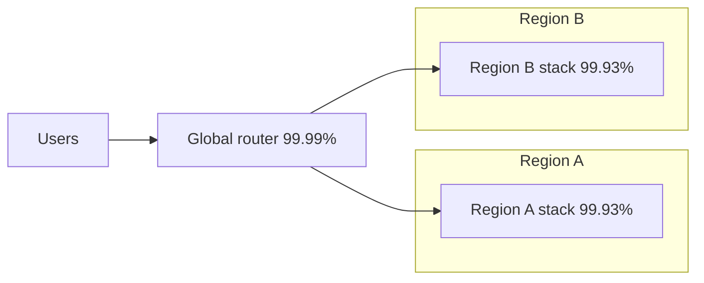

## TL;DR

- Availability is the share of time, or of requests, that the system serves correctly. Reliability is broader. It also covers not losing data and recovering within a known time.
- Each extra nine cuts allowed downtime by 10 times. 99.9% allows 43.2 minutes a month, and 99.99% allows 4.32.
- An SLI is a measurement, an SLO is your internal target for it, and an SLA is a contract with penalties. Set the SLO tighter than any SLA you sign.
- Components in series multiply their availabilities, so the chain is weaker than its weakest link. Redundant copies in parallel fail only when all of them fail.
- On Azure, availability zones protect against a datacenter failure and a second region protects against a regional one. Composite SLA math tells you whether you need either.

## Why it matters

Every dependency on the request path subtracts from availability. Ten dependencies at 99.9% each, all required for a request, give you about 99.0%. That is over 7 hours of downtime a month, from parts that each looked fine on their own. Teams that never do this multiplication find out from the first month's incident report.

Availability numbers also hide data loss. A database that fails over in 30 seconds looks great on an uptime chart. If it replicated asynchronously and the last 5 minutes of writes never reached the replica, customers lost orders. That is why reliability targets have two more numbers alongside the uptime percentage. The recovery time objective (RTO) is how long recovery may take, and the recovery point objective (RPO) is how much recent data you may lose.

## How it works

### The nines

| Availability | Downtime per year | Downtime per 30-day month | Downtime per week |
| --- | --- | --- | --- |
| 99% | 3.65 days | 7.2 hours | 1.68 hours |
| 99.9% | 8.76 hours | 43.2 minutes | 10.1 minutes |
| 99.95% | 4.38 hours | 21.6 minutes | 5.04 minutes |
| 99.99% | 52.6 minutes | 4.32 minutes | 1.01 minutes |
| 99.999% | 5.26 minutes | 25.9 seconds | 6.05 seconds |

Downtime is $(1 - \text{availability}) \times \text{period}$. The monthly column matches the Well-Architected Framework's reliability metrics table. Read the right-hand columns as an operations budget. At 99.99%, one slow deploy rollback can spend the whole month. At 99.999%, no human can respond in time, so recovery must be automatic.

### SLI, SLO, SLA

- **Service level indicator (SLI).** A measured ratio of good events to total events. For example, the fraction of requests that return a non-5xx status within 300 ms, measured at the load balancer. Measure as close to the user as you can, because a backend that is healthy behind a broken gateway still means users are down.
- **Service level objective (SLO).** The target for an SLI over a window. "99.9% of requests good over a rolling 28 days." One minus the SLO is the error budget. At 1 billion requests a month and a 99.9% SLO, you can fail 1 million requests. When the budget runs low, slow down risky releases.
- **Service level agreement (SLA).** A contract that promises a level of service and pays a penalty, usually service credits, when it is missed. Set it looser than your SLO, so you see trouble and fix it before it costs money.

### Composite availability

**In series**, every component must work, so availabilities multiply. A regional stack with an edge at 99.99%, an app tier at 99.95%, and a database at 99.99% gives $0.9999 \times 0.9995 \times 0.9999 \approx 99.93\%$. That is lower than any single part. The Well-Architected Framework states the same rule. Its example is $99.95\% \times 99.99999\% \approx 99.95\%$, which shows that a near-perfect dependency costs almost nothing while a weak one sets the ceiling.

**In parallel**, the system fails only when every copy fails, so unavailabilities multiply. Two independent regional stacks at 99.93% each give $1 - (0.0007 \times 0.0007) \approx 99.99995\%$. The global router sits in series in front of both, so the total is about $0.9999 \times 0.9999995 \approx 99.99\%$. The router now sets the ceiling.

These numbers are illustrations, not Azure SLAs. Real results come out lower, for three reasons.

- **Copies are not independent.** A bad deploy, a bad configuration push, or an expired certificate hits both regions at once. Parallel math assumes failures are unrelated.
- **Failover is not instant.** Detection, DNS or routing changes, and warm-up all count as downtime.
- **Partial failures count.** A region that serves errors to 10% of requests is not "down", but your SLI still pays for it.

### Techniques that buy availability

Redundancy only helps if traffic moves away from the failed copy. That takes health checks that test real dependencies, timeouts on every remote call, and retries with backoff and jitter so a brief failure doesn't turn into a retry storm. Graceful degradation (serving a cached feed when the ranking service is down) keeps the product partly useful instead of failing the whole request. Later levels cover these as resilience patterns.

## Trade-offs

- **Each nine costs more than the last.** Going from 99.9% to 99.99% usually means zone redundancy, automated failover, and on-call. Going to 99.999% usually means multiple regions, active-active data, and removing humans from recovery. Buy the nines the business will pay for.
- **Active-passive versus active-active.** A passive standby region is simpler and avoids write conflicts, but failover takes minutes and the standby may not work when needed. Active-active serves from both regions all the time, so you know both work, and you pay with multi-region data consistency.
- **Synchronous versus asynchronous replication.** Synchronous replication gives an RPO of zero and adds the replica round trip to every write. Asynchronous replication keeps writes fast and loses whatever hadn't replicated when the primary failed.
- **Velocity versus reliability.** A tighter SLO leaves a smaller error budget, which means fewer risky releases. The error budget makes this trade explicit instead of a recurring argument.
- **Retries help and hurt.** Retries hide brief failures from users. Unbounded retries multiply load on a struggling dependency and can turn a partial outage into a full one.

## On Azure

| Failure scope | Azure mechanism | What you configure |
| --- | --- | --- |
| One instance or VM | Multiple instances behind a load balancer with health probes | Instance count of at least 2; probes on a real health endpoint |
| One datacenter or zone | Availability zones, with zone-redundant resources (the service spreads them) or zonal ones (you pin and spread them yourself) | Zone redundancy on each resource; zone-redundant storage (ZRS) writes synchronously to three or more zones |
| One region | A second region, with Front Door or Traffic Manager routing between them | Geo-redundant storage, SQL Database active geo-replication, or Cosmos DB multi-region; all of these except multi-region Cosmos DB with Strong consistency replicate asynchronously |

**Zones first.** Zones sit within about 100 km of each other with round trips under about 2 ms, so synchronous replication across them is affordable. Zone-redundant resources fail over for you. With zonal resources, deploying copies in several zones and failing over between them is your job. Most workloads should be zone-redundant before they consider a second region.

**SKU decisions that change availability.** Several tiers lack zone support or an SLA entirely. API Management offers availability zones only on Standard v2, Premium v2, and Premium (classic), and its Developer tier has no SLA. The Basic SKU of Azure Load Balancer and the v1 SKU of Application Gateway are retired, so new designs use Load Balancer Standard and Application Gateway v2, both of which support zones. For data, choosing storage redundancy (LRS, ZRS, GRS, GZRS) is choosing your RPO. Geo-redundant options copy to the secondary region asynchronously, so a regional loss can drop recent writes.

**Composite SLA on Azure.** Each Azure service publishes its own SLA, and your application's availability is at most the product of the SLAs of everything on its critical path. Write the request path down, look up each service's current SLA, and multiply. Microsoft offers higher SLAs for some multi-region configurations. For example, Learn states that multi-region Azure Cosmos DB accounts get 99.999% read and write availability. Recovery points are published too. A Cosmos DB account in one region has an RPO under 240 minutes for a region-wide outage. Add a second region with a single write region, and the RPO drops under 15 minutes at Session, Consistent prefix, or Eventual consistency, and to zero with Strong.

**Gotcha: an SLA covers what it defines, not what your users see.** The Well-Architected Framework uses App Service as the example. Web Apps counts as available when it returns 200 OK for the covered case, and that financial guarantee doesn't extend to features such as Easy Auth or deployment slot switching. Read what each SLA counts as "available", treat everything outside it as best effort, and measure your own SLI at the edge. Service credits also don't come close to covering what an outage costs you.

[Regions, zones, and resiliency](../04-azure/regions-zones-and-resiliency.md) goes deeper on these settings.

## Interview tips

- Turn "highly available" into a number and a window early. "99.95% monthly, so about 22 minutes of downtime a month."
- Multiply your critical path out loud. It shows you understand why fewer synchronous dependencies means higher availability.
- Give RTO and RPO alongside availability for anything with data. "Asynchronous geo-replication, so RPO is seconds to minutes. That's acceptable for the feed and not for payments."
- When you add a second region, say what makes failover happen, how long it takes, and what happens to writes in flight.
- Name correlated failures. Saying "two regions, but one deploy pipeline" shows you know why parallel math overstates real availability.
- Connect to the [consistency](./consistency-and-cap.md) page. Multi-region availability and strong consistency pull against each other, and senior candidates say which one wins for each piece of data.

## Further reading

- [Well-Architected Framework: reliability targets and metrics](https://learn.microsoft.com/azure/well-architected/reliability/metrics)
- [Azure availability zones overview](https://learn.microsoft.com/azure/reliability/availability-zones-overview)
- [Azure Storage redundancy](https://learn.microsoft.com/azure/storage/common/storage-redundancy)
- [Azure SQL Database active geo-replication](https://learn.microsoft.com/azure/azure-sql/database/active-geo-replication-overview)
- [Azure Cosmos DB global distribution](https://learn.microsoft.com/azure/cosmos-db/distribute-data-globally)
- [Reliability in Azure API Management](https://learn.microsoft.com/azure/reliability/reliability-api-management)
- [Site Reliability Engineering: service level objectives](https://sre.google/sre-book/service-level-objectives/)

See also [scalability](./scalability.md) for how replicas add capacity as well as redundancy.
