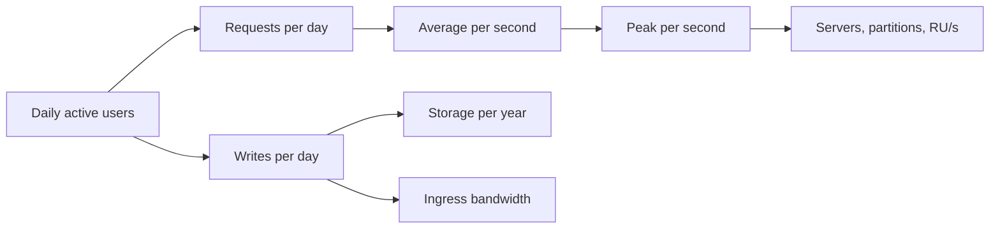

## TL;DR

- Estimate to choose between designs. The questions that matter are yes-or-no ones, such as whether the data fits in memory, whether one database can take the writes, and whether one partition can take the hottest key.
- Round hard. One day is about 10^5 seconds, so 1 million events per day is about 10 per second, and you only need the right power of ten.
- Average rate is total per day divided by 86,400. Size for the peak, which you state as a multiple of the average.
- Storage is items per day times bytes per item times retention, then times the number of copies you keep.
- On Azure, translate the result into the unit each service sells and limits (RU/s, throughput units, requests per second per storage account, IOPS per disk), and check per-partition limits as well as totals.

## Why it matters

Two numbers often decide an architecture. A system with 1,000 writes per second fits on one relational database with room to spare. At 1,000,000 writes per second you need partitioning, and every query that crosses partitions gets harder. A 50 GB working set fits in one cache node's memory, while 50 TB doesn't. You can't tell which side of those lines a problem sits on without doing the arithmetic.

Skipping the estimate fails in both directions. Over-engineering shards a database that would have fit on one server and pays the complexity cost forever. Under-engineering ships a design that falls over at launch because one partition, one account, or one disk hit its ceiling. In an interview, a quick estimate is also how you justify a component instead of asserting it.

## How it works

Work from users to rates to resources, and write each step down so the interviewer (or reviewer) can check it.

### Conversions worth memorizing

| Quantity | Exact | Use in estimates |
| --- | --- | --- |
| Seconds per day | 86,400 | ~10^5 |
| Seconds per month | ~2.6 million | ~2.5 × 10^6 |
| Seconds per year | ~31.5 million | ~3 × 10^7 |
| 1 million per day | ~11.6 per second | ~10 per second |
| 1 billion per day | ~11,600 per second | ~10^4 per second |
| KB, MB, GB, TB, PB | 10^3, 10^6, 10^9, 10^12, 10^15 bytes | Each step is ×1,000 |
| 1 Gbps | 125 MB/s | ~100 MB/s |

### Latency reference

The generic rows below come from the widely shared "Latency Numbers Every Programmer Should Know" list, whose figures date from about 2012. Hardware has improved since, SSDs most of all, so treat them as orders of magnitude. The gaps between tiers are what you reason with. The Azure rows are current published figures.

| Operation | Latency | Source |
| --- | --- | --- |
| L1 cache reference | 0.5 ns | Latency numbers list |
| Main memory reference | 100 ns | Latency numbers list |
| Compress 1 KB | 3 µs | Latency numbers list |
| Send 1 KB over a 1 Gbps network | 10 µs | Latency numbers list |
| Random 4 KB read from SSD | 150 µs | Latency numbers list |
| Read 1 MB sequentially from memory | 250 µs | Latency numbers list |
| Round trip within one datacenter | 500 µs | Latency numbers list |
| Read 1 MB sequentially from SSD | 1 ms | Latency numbers list |
| Spinning disk seek | 10 ms | Latency numbers list |
| Round trip between Azure availability zones | under ~2 ms | Azure availability zones overview |
| Azure Ultra Disk I/O | under 1 ms | Azure managed disk types |
| Azure Cosmos DB point read or write | under 10 ms at P99 | Azure Cosmos DB consistency levels |
| Azure round trip, East US to East US 2 | about 9 ms (P50) | Azure network latency statistics |
| Azure round trip, East US to West Europe | about 85 ms (P50) | Azure network latency statistics |
| Azure round trip, East US to Southeast Asia | about 224 ms (P50) | Azure network latency statistics |

Three ratios do most of the work. Memory is about 1,000 times faster than an SSD random read. A round trip inside a datacenter costs about as much as three SSD reads. A round trip across an ocean costs as much as 100 or more round trips inside a datacenter. The last ratio is why chatty protocols and synchronous cross-region writes hurt.

### Throughput reference (Azure limits)

| Resource | Limit | Source |
| --- | --- | --- |
| Cosmos DB logical partition | 10,000 RU/s and 20 GB | Cosmos DB partitioning |
| Cosmos DB physical partition | 10,000 RU/s and 50 GB | Cosmos DB partitioning |
| Cosmos DB point read of a 1 KB item | 1 RU (about 2 RU with Strong or Bounded staleness) | Cosmos DB request units |
| Event Hubs throughput unit | Ingress 1 MB/s or 1,000 events/s; egress 2 MB/s or 4,096 events/s; up to 40 per namespace | Event Hubs scalability |
| Event Hubs partition (Standard, planning figure) | ~1 MB/s ingress, ~2 MB/s egress | Event Hubs scalability |
| Storage account (general-purpose v2) | 40,000 requests/s in major regions, 20,000 elsewhere (default) | Storage scalability targets |
| Storage account ingress / egress | 60 / 200 Gbps in major regions (default) | Storage scalability targets |
| Storage account capacity | 5 PiB (default) | Storage scalability targets |
| Premium SSD v2 disk | 80,000 IOPS, 2,000 MB/s | Azure managed disk types |
| Ultra Disk | 400,000 IOPS, 10,000 MB/s | Azure managed disk types |

### Worked estimate for a photo-sharing app

Assumptions, stated up front:

- 100 million daily active users.
- 10% of users post one photo per day, so 10 million photos per day.
- Each user opens their feed 10 times per day, so 1 billion feed loads per day.
- A feed load shows 20 photos.
- An original photo averages 2 MB. Post metadata is about 1 KB.
- Peak traffic is 3 times the daily average (an assumption to confirm with real traffic data).

**Write rate.** 10 million / 86,400 s ≈ 116 posts/s on average, about 350/s at peak. One relational database handles this comfortably, so writes don't force partitioning by themselves.

**Feed read rate.** 1 billion / 86,400 s ≈ 11,600 loads/s on average, about 35,000/s at peak. Suppose each load is one point read of a precomputed feed document of about 1 KB (20 post IDs). In Cosmos DB with Session consistency, that is about 35,000 RU/s at peak. A physical partition serves at most 10,000 RU/s, so the container needs at least 4 physical partitions, and the partition key must spread load across users. With Strong consistency the same reads cost about twice as much, about 70,000 RU/s.

**Image requests.** 1 billion loads × 20 photos = 20 billion image fetches/day ≈ 231,000/s on average. One storage account's default limit is 40,000 requests/s. Serving images straight from Blob Storage overshoots that about 6 times on average and about 17 times at peak. So the design needs an edge cache, such as Azure Front Door, so that most image requests never reach the storage account.

**Storage.** 10 million × 2 MB = 20 TB/day of photos, or about 7.3 PB/year. One storage account's default 5 PiB (about 5.6 PB) fills in about nine months, so plan for several accounts from the start. Metadata is 10 million × 1 KB = 10 GB/day, about 3.7 TB/year, which is modest.

**Upload bandwidth.** 20 TB/day / 86,400 s ≈ 231 MB/s ≈ 1.9 Gbps average, about 5.6 Gbps at peak. That is well under one account's 60 Gbps default ingress in a major region.

Four of those five numbers changed the design. They showed that writes don't need partitioning, that feed reads need at least four Cosmos DB physical partitions, that images need an edge cache, and that photos need more than one storage account. The fifth confirmed that one account can take the upload traffic.

## Trade-offs

- **Precision versus speed.** An estimate within a factor of two is enough to choose between designs. Spending ten minutes on exact numbers costs time you need for the design itself.
- **Average versus peak.** Sizing for the average saves money and fails during the daily spike. Sizing for the peak is safe but idle most of the day, which is why elastic scaling and queues that absorb bursts exist.
- **Published limits versus measured capacity.** Service limits give a ceiling, not a promise of what your workload will reach. A Cosmos DB query that scans costs far more than 1 RU per item. Use limits to rule designs out, and load tests to rule them in.
- **Simple assumptions versus realistic ones.** Uniform traffic across users makes the math easy and hides hot keys. Call out where skew exists (a celebrity account, a viral post) even if you don't model it numerically.

## On Azure

Each Azure data service sells and limits capacity in its own unit. Convert your estimate into that unit early, because it tells you the tier, the partition count, and the bill.

| Your estimate | Azure unit | Decision it drives |
| --- | --- | --- |
| Point reads and writes per second | Cosmos DB RU/s | Provisioned versus autoscale throughput, and the minimum number of physical partitions |
| Events per second and MB/s ingested | Event Hubs throughput units | How many units to buy, and partitions to match consumer parallelism |
| Object requests per second | Requests/s per storage account | Whether you need an edge cache or several accounts |
| Disk IOPS and MB/s for a self-managed database | Managed disk type | Premium SSD v2 or Ultra Disk |
| Cross-zone or cross-region hops on a request path | Round-trip milliseconds | Whether synchronous replication fits the latency budget |

**SKU decision.** Consistency level is a capacity decision in Cosmos DB, not just a correctness one. Strong and Bounded staleness reads cost about twice the RU of Session, Consistent prefix, or Eventual reads, so the read side of your estimate doubles. For disks, Premium SSD v2 tops out at 80,000 IOPS per disk and Ultra Disk at 400,000. If the estimate lands between those numbers for a single node, the disk type is decided.

**Zone and region numbers.** Synchronous replication across zones adds about 2 ms per round trip, which most request budgets absorb. Synchronous replication across regions adds the region-pair round trip, from about 9 ms (East US to East US 2) to over 200 ms (East US to Southeast Asia). That is the number to bring when someone proposes strongly consistent writes across continents.

**Gotcha: limits apply per partition, account, and unit, not just in total.** A container provisioned at 100,000 RU/s still throttles a single logical partition at 10,000 RU/s. Event Hubs works the same way. Learn suggests planning on about 1 MB/s of ingress per partition on the Standard tier, so a partition key that routes a busy tenant's events to one partition holds that tenant near that rate, however many throughput units the namespace has. Estimate the hottest key as well as the total, and compare it with the per-partition limit.

Later levels cover sharding and partitioning, caching, and CDNs, which are the usual fixes when an estimate crosses one of these lines.

## Interview tips

- Say your assumptions before you compute. The interviewer can then correct an input instead of disputing your result.
- Round to one significant figure and use powers of ten. "About 10^4 reads per second" is precise enough.
- Compute only what changes a decision, and say what it changed. "35,000 RU/s at peak, so at least four physical partitions."
- Always check the hottest key against the per-partition limit. Totals rarely break a design. Skew does.
- Keep the [scalability](./scalability.md) and [availability](./availability-and-reliability.md) consequences in view. An estimate that says "one server" also says "one point of failure".

## Further reading

- [Latency Numbers Every Programmer Should Know](https://gist.github.com/jboner/2841832)
- [Azure network round-trip latency statistics](https://learn.microsoft.com/azure/networking/azure-network-latency)
- [Azure Cosmos DB request units](https://learn.microsoft.com/azure/cosmos-db/request-units)
- [Scalability targets for standard storage accounts](https://learn.microsoft.com/azure/storage/common/scalability-targets-standard-account)
- [Azure Event Hubs scalability](https://learn.microsoft.com/azure/event-hubs/event-hubs-scalability)
- [Azure managed disk types](https://learn.microsoft.com/azure/virtual-machines/disks-types)
- [Hello Interview: numbers to know](https://www.hellointerview.com/learn/system-design/core-concepts/numbers-to-know)
- [The Coding Gopher: The Memory Hierarchy Explained](https://thecodinggopher.substack.com/p/the-memory-hierarchy-explained)

The [interview framework](./interview-framework.md) page covers where estimation fits in a 45-minute answer.
