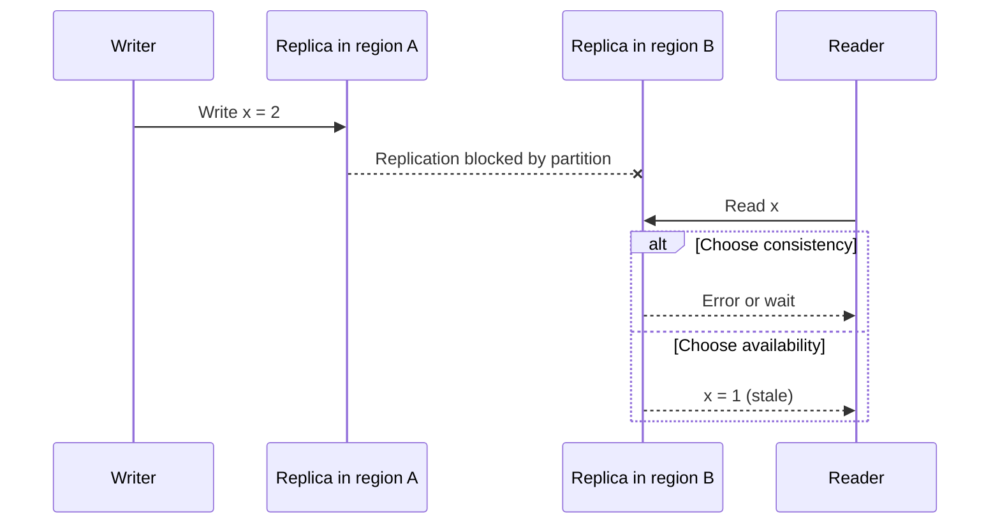

## TL;DR

- CAP says that during a network partition, a replicated system must either refuse some requests (stay consistent) or answer with possibly stale data (stay available). Without a partition, you can have both.
- PACELC adds the everyday case. Even with no partition, stronger consistency costs latency, because replicas must coordinate before answering.
- Consistency models form a spectrum. From strongest to weakest, the common ones are linearizable, bounded staleness, session (read-your-writes), consistent prefix, and eventual.
- Choose per piece of data, not per system. Balances and seat inventory need strong guarantees. Feeds and like counts can be eventual. Most user-facing data needs at least read-your-writes.
- Azure Cosmos DB exposes exactly these choices as five consistency levels. Strong and Bounded staleness reads cost about twice the RU, and Strong can't be combined with multi-region writes.

## Why it matters

The previous pages added replicas for [availability](./availability-and-reliability.md) and [scale](./scalability.md). Replicas disagree, at least briefly, and the consistency model decides which disagreements users can observe.

Each weak spot produces a recognizable bug. A user edits their profile, refreshes, and sees the old version, because the read went to a replica that hadn't caught up (no read-your-writes). A reply appears before the comment it answers, because the two writes reached a replica out of order (no consistent prefix). Two customers both buy the last seat, because each read "1 left" from a different replica (no linearizability). If you pick the model on purpose, you know which of these bugs can happen and design around them. If you don't, you find out from support tickets.

## How it works

### CAP, stated precisely

In the CAP theorem, **C** means linearizability. Every read returns the most recent completed write, as if there were one copy. **A** means every request to a working node gets a non-error response. **P** means the network can drop or delay messages between nodes.

Networks do partition, so P isn't optional. The real choice is what each side of a partition does while it can't talk to the other.

A CP system refuses or delays the read on B until it can confirm the latest value. An AP system answers with what B has. Neither is wrong. A bank ledger should refuse, and a social feed should answer.

CAP is narrower than it sounds. It only describes behavior during a partition, it treats consistency as all-or-nothing, and it says nothing about latency. That makes it a weak tool for most real decisions.

### PACELC

PACELC fills the gap. **If** there is a **P**artition, choose **A**vailability or **C**onsistency. **E**lse, choose **L**atency or **C**onsistency. The "else" half is the one you live with every day. Keeping replicas in agreement means waiting for acknowledgments, and across regions each wait is a round trip of tens to hundreds of milliseconds.

Systems in the Dynamo tradition favor availability and low latency (PA/EL) and reconcile conflicts later. Systems in the Spanner tradition favor consistency in both cases (PC/EC) and pay with latency on writes. Some databases let you choose per account or per request.

### The consistency spectrum

| Model | What a reader is guaranteed | What it prevents | Typical use |
| --- | --- | --- | --- |
| Linearizable (strong) | Sees the latest committed write, in one global order | Every anomaly below, including double-selling the last seat | Balances, inventory, locks, uniqueness checks |
| Bounded staleness | Lags the latest write by at most K versions or T seconds | Unbounded staleness | Dashboards and status pages that tolerate a known lag |
| Session | Within one session, reads see that session's own writes and never go backwards | "I saved it and it's gone" | Profiles, carts, settings, most user-facing data |
| Consistent prefix | Sees writes in the order they happened, with no gaps, possibly behind | Replies before posts, effects before causes | Activity streams, chat history |
| Eventual | Replicas converge once writes stop, with no ordering promise | Nothing until convergence | Like counts, view counts, recommendations |

Causal consistency sits between session and linearizable. It guarantees that anyone who sees a write also sees the writes it depended on. It is a useful mental model for social features even when the database doesn't name it.

### Quorums

Many replicated stores tune consistency with quorums. With $N$ replicas, a write waits for $W$ acknowledgments and a read queries $R$ replicas. If $R + W > N$, every read set overlaps every write set, so a read sees the latest acknowledged write. $N = 3$, $W = 2$, $R = 2$ is the classic balanced choice. $W = 3$, $R = 1$ makes reads fast and writes fragile, and $W = 1$ makes writes fast at the risk of losing a write if that one replica dies.

### When there are multiple writers

If two regions accept writes to the same item, they can conflict, and something must decide the result. Last-writer-wins by timestamp is simple and silently drops one write. Application-level merge keeps both and asks code (or a user) to reconcile. Conflict-free replicated data types (CRDTs) merge automatically for specific data shapes, such as counters and sets. Later levels cover multi-region active-active designs and CRDTs in depth.

## Trade-offs

- **Strong versus fast.** Linearizable writes across regions wait for cross-region round trips. Keep strong consistency for the small set of data where a wrong answer costs money or trust, and relax everything else.
- **Strong versus available.** During a partition, a strongly consistent system rejects requests on the minority side. If the product must keep accepting writes in every region during an outage, it must accept conflicts.
- **Session as the default.** Session consistency removes the most visible anomaly (losing your own write) at close to eventual cost. It is the right default for most user-facing data, as long as the session context actually follows the user.
- **Eventual plus conflict handling.** Eventual consistency is cheapest and most available, but every multi-writer item needs a conflict policy, and last-writer-wins loses data quietly.
- **One model per system versus one per operation.** A single strong model is easy to reason about and slow everywhere. Mixing models is faster but requires each engineer to know which guarantee each read has.

## On Azure

Azure Cosmos DB documents its five consistency levels against the PACELC trade-off and lets you set a default per account.

| Cosmos DB level | Guarantee | Generic model | Cost and latency notes |
| --- | --- | --- | --- |
| Strong | Linearizable reads | Linearizable | Reads cost about 2× RU. In an account with more than one region, writes take about $2 \times \text{round trip} + 10\ \text{ms}$ at P99, using the round trip between the two farthest regions. Not available with multiple write regions. |
| Bounded staleness | Reads lag by at most K versions or T time | Bounded staleness | Reads cost about 2× RU. Minimum K and T are 10 writes or 5 seconds in one region, 100,000 writes or 300 seconds across regions. |
| Session | Read-your-writes and write-follows-reads within a session token | Session | The default level for new accounts. Reads cost 1× RU. |
| Consistent prefix | Writes in one transactional batch become visible together and in order; single-document writes behave as eventual | Consistent prefix, for transactional batches | Reads cost 1× RU. |
| Eventual | No ordering guarantee; replicas converge | Eventual | Reads cost 1× RU and can go to any replica. |

Inside a region, Cosmos DB commits every write to a majority of a four-replica set (three replicas) whatever the level. The levels differ in which replicas a read consults and in how writes reach other regions. Below Strong, other regions receive writes asynchronously. Reads and writes are guaranteed under 10 ms at P99 at every level, apart from the cross-region write cost of Strong. Note the limit on Consistent prefix. Two separate single-document writes (a comment and its reply) have no ordering guarantee between them. Put them in one transactional batch, or read at Session or stronger, if order matters.

**Tier and configuration decisions.** The account default is the main lever. With Strong, every write in a multi-region account pays cross-region latency. For regions at East US and West Europe (about 85 ms P50 round trip), that is about $2 \times 85 + 10 = 180\ \text{ms}$ per write at P99, and you can't enable multi-region writes. Choosing multi-region writes for write availability means choosing Session or weaker. The traditional per-request override can only relax the account default. A newer read-consistency strategy option (preview, direct mode, recent Java and .NET SDKs) can request stronger reads per call, but overrides only change reads, and writes still replicate according to the account level.

**Other Azure stores sit at fixed points on the spectrum.**

| Store | Within a region | Across regions |
| --- | --- | --- |
| Azure SQL Database | Strong on the primary | Active geo-replication is asynchronous; secondaries are transactionally consistent but can lag |
| Azure Storage | ZRS writes synchronously to three or more zones before acknowledging | GRS and GZRS copy asynchronously; check the Last Sync Time before trusting the secondary |
| Azure Managed Redis | Primary with replica | Active geo-replication is eventually consistent, built on CRDTs, with no SLA on sync time |

**Gotcha: Session consistency only works if the session token follows the user.** Cosmos DB assigns a session token on each write, and the SDK client uses it to serve read-your-writes. In a stateless tier behind a load balancer, the read often lands on a different app instance (and a different client) than the write. Learn states that a client with no token for that partition reads as if the level were Eventual, and a re-created client starts with no tokens. Tokens are scoped to a partition. Return the token from the write and pass it on the follow-up read, or route the user's follow-up reads to the same client. Otherwise you are effectively running at Eventual and the profile-edit bug comes back.

The [data choices](../04-azure/data-choices.md) page compares these stores in more depth.

## Interview tips

- Don't open with "CAP says pick two". Say what happens during a partition for this specific data, then talk about the latency cost when there is no partition.
- Assign a consistency model per entity. "Seat holds are strongly consistent in one region. The event catalog and reviews are eventual. User settings are session."
- When you choose eventual consistency, name the anomaly users might see and why it's acceptable. "A like count may lag a few seconds, which nobody notices."
- For multi-region writes, state the conflict policy. "Last-writer-wins on profile fields is fine. Inventory goes through a single write region instead."
- On Cosmos DB, mention the RU cost of Strong and Bounded staleness reads and the multi-region write restriction. Both show you know the price, not just the menu.
- Connect to [back-of-the-envelope](./back-of-the-envelope.md) numbers. A cross-region round trip in milliseconds is what makes strong consistency expensive.

## Further reading

- [Azure Cosmos DB consistency levels](https://learn.microsoft.com/azure/cosmos-db/consistency-levels)
- [Manage consistency levels in Azure Cosmos DB](https://learn.microsoft.com/azure/cosmos-db/how-to-manage-consistency)
- [Azure Managed Redis active geo-replication](https://learn.microsoft.com/azure/redis/how-to-active-geo-replication)
- [Abadi, IEEE Computer (2012): the PACELC paper](https://www.cs.umd.edu/~abadi/papers/abadi-pacelc.pdf)
- [Jepsen: consistency models](https://jepsen.io/consistency)
- [Hello Interview: CAP theorem](https://www.hellointerview.com/learn/system-design/core-concepts/cap-theorem)
- [The Coding Gopher: The CAP Theorem](https://thecodinggopher.substack.com/p/the-cap-theorem)
- [The Coding Gopher: Understanding Strong vs. Eventual Consistency](https://thecodinggopher.substack.com/p/understanding-strong-vs-eventual)
