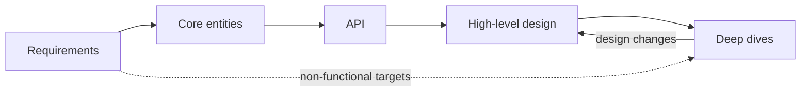

## TL;DR

- Run the interview in five stages (requirements, core entities, API, high-level design, deep dives). Say the plan out loud so the interviewer knows where you are going.
- Requirements produce two lists. Functional ones drive the high-level design, and non-functional ones drive the deep dives.
- Entities and the API are short stages. They fix the vocabulary and the contract before you draw boxes.
- Get a simple, working design on the board first, then spend the remaining time making it meet the hard numbers.
- At senior level, you pick the deep dives yourself and justify each choice against a requirement you wrote down.

## Why it matters

Design interviews are lost on pacing more often than on knowledge. One candidate spends 25 minutes on requirements and never draws a database. Another jumps into Kafka partition counts before there is a design that posts a photo. Both run out of time with nothing complete to evaluate.

A framework fixes that in two ways. It tells the interviewer what comes next, so they can steer you early instead of waiting for you to stall. It also works as a checklist, so you finish with a design that covers every requirement rather than one well-polished corner.

The same sequence works outside interviews. A design document that states requirements, names the entities, defines the API, sketches the architecture, and then argues the hard parts in depth is the document reviewers can approve.

## How it works



The solid path is the order you work in. The dotted line is the point of the whole exercise. Numbers you write in the first five minutes decide what you spend the last fifteen on.

### 1. Requirements

Split them into two lists and keep both visible on the board.

**Functional.** Three or four sentences of the form "users can...". For a photo-sharing app, users can upload a photo, follow other users, and view a feed of followed users' photos. Also write what you are leaving out (comments, search, direct messages) so the interviewer can object now rather than later.

**Non-functional.** Pick the three or four qualities that matter for this product and attach numbers. "Feed loads in under 300 ms at p99." "Uploads are never lost once acknowledged." "The feed may be a few seconds stale." "100 million daily active users, reads outnumber writes 100 to 1." The useful ones are comparative. Saying the system should be "available and consistent" commits you to nothing. Saying the feed favors availability while follower counts may lag commits you to a design.

Capacity math belongs here only when it changes a decision, for example whether the dataset fits on one machine. Otherwise say you will estimate when a choice depends on it. The [back-of-the-envelope](./back-of-the-envelope.md) page has the reference numbers.

### 2. Core entities

List the nouns the system stores and moves. For the photo app that is User, Photo, Follow, and FeedItem. Skip the full schema for now. Fields only matter once you know the access patterns, and you learn those in the next two stages.

### 3. API

Write one endpoint per functional requirement. REST is the default unless you have a reason to pick something else, and the [API design](./api-design.md) page covers when gRPC, GraphQL, or a WebSocket earns its place.

```text
POST /v1/photos                 -> 201 { photoId, uploadUrl }
POST /v1/users/{id}/follow      -> 204
GET  /v1/feed?cursor={c}        -> 200 { items[], nextCursor }
```

Two details signal experience. Take the caller's identity from the auth token, never from a `userId` in the body, or any client can act as anyone. Return a cursor on list endpoints, because offset pagination slows down and skips items as the feed changes.

### 4. High-level design

Walk each endpoint through the system, adding only the boxes it needs. Upload goes client to service to object storage plus a metadata row. Follow writes a row. Feed reads followed users' recent photos. Add schema fields as they become relevant, especially the key you partition or index on.

Notice bottlenecks as you go but don't fix them yet. "Building the feed at read time means a fan-in across every followed user. I'll come back to that." This keeps the design complete and gives you a list of deep-dive candidates.

### 5. Deep dives

Go back to the non-functional list. For each target the current design misses, state the problem, give two or three options, and pick one with a reason tied to the requirement. For the photo app, typical candidates are precomputing feeds on write (and handling users with millions of followers), keeping upload latency low with direct-to-storage uploads, and caching hot feeds.

### Suggested timing for 45 minutes

| Stage | Minutes | What is on the board when you finish |
| --- | --- | --- |
| Requirements | 5 | Functional list, non-functional numbers, out-of-scope list |
| Core entities | 2 | Four to six nouns |
| API | 5 | One endpoint per functional requirement |
| High-level design | 13 | A working diagram, with each endpoint traced through it |
| Deep dives | 15 | Two or three problems solved with named trade-offs |
| Buffer | 5 | Questions, or the interviewer's own deep dive |

Stretch the deep dives in a 60-minute slot, and keep the early stages the same length.

## Trade-offs

- **Structure versus flexibility.** A framework stops you from drifting, but interviewers sometimes want to jump ahead to the part they care about. Follow them. Note what you skipped and return to it if time allows.
- **Breadth versus depth.** A complete simple design beats a half-finished sophisticated one, because the interviewer can't score parts that don't exist. Depth is what separates senior from mid-level, though, so protect the deep-dive time.
- **Up-front estimates versus estimates on demand.** Estimating everything early burns minutes on numbers you never use. Estimating nothing risks a design that can't hold the data. Compute a number when a decision depends on it.
- **Simple first versus scale first.** Drawing the scaled design immediately looks confident but hides why each component exists. Starting simple and adding components in response to named bottlenecks shows the reasoning the interviewer is grading.

## On Azure

Most interviewers are cloud-neutral, so lead with the generic component and its property, then name the Azure service that provides it. "A partitioned key-value store with tunable consistency, such as Azure Cosmos DB." Each stage surfaces a different Azure decision.

| Stage | Azure decision it surfaces | Example |
| --- | --- | --- |
| Requirements | Zone-redundant in one region, or multi-region | An availability target that must survive a region outage needs a second region. Zones alone don't cover it. |
| Requirements | Which regions | Azure publishes inter-region round trips. East US to West Europe is about 85 ms at P50, so one global write region puts a floor under far-away users. |
| Core entities | Partition key | A Cosmos DB logical partition holds at most 20 GB and 10,000 RU/s, so a per-user key works and a per-country key does not. |
| API | Edge and gateway | Azure Front Door for global HTTP entry, and API Management when you need versioning, keys, and quotas. |
| High-level design | Service mapping | Map each box to a managed service. Later levels include an Azure service map page for this. |
| Deep dives | Tier and SKU | API Management offers availability zones only on Premium and Premium v2. A zone-redundant design rules out cheaper tiers. |

**Gotcha: service names in place of reasoning.** Saying "Cosmos DB" doesn't answer how the data is partitioned or what consistency a reader gets. If you name an Azure service, expect follow-up questions on its limits and be ready with the partition key, the consistency level, and the tier. If you can't answer those, describe the generic component instead.

## Interview tips

- State the five stages in your first minute. It costs ten seconds and lets the interviewer redirect you early.
- Keep the requirements list on the board and tick items off as the high-level design covers them.
- When you are stuck in a deep dive, reread the non-functional list. The next problem to solve is usually the target the design still misses.
- Check the clock when you finish the high-level design. If more than 25 minutes have gone, cut to the single most important deep dive.
- Volunteer the deep dives. At senior level the interviewer is checking whether you know which parts are hard, and waiting to be asked suggests you don't.
- Saying "this part is fine as it is, here's why" counts as a decision too. Not every box needs a deep dive.

## Further reading

- [Hello Interview: delivery framework](https://www.hellointerview.com/learn/system-design/in-a-hurry/delivery)
- [Hello Interview: core concepts](https://www.hellointerview.com/learn/system-design/in-a-hurry/core-concepts)
- [Azure application architecture fundamentals](https://learn.microsoft.com/azure/architecture/guide/)
- [Azure Cosmos DB partitioning](https://learn.microsoft.com/azure/cosmos-db/partitioning)
- [Azure network round-trip latency statistics](https://learn.microsoft.com/azure/networking/azure-network-latency)
- [The Coding Gopher: The Top 10 Most Common System Design Questions, Explained](https://thecodinggopher.substack.com/p/the-top-10-most-common-system-design)
