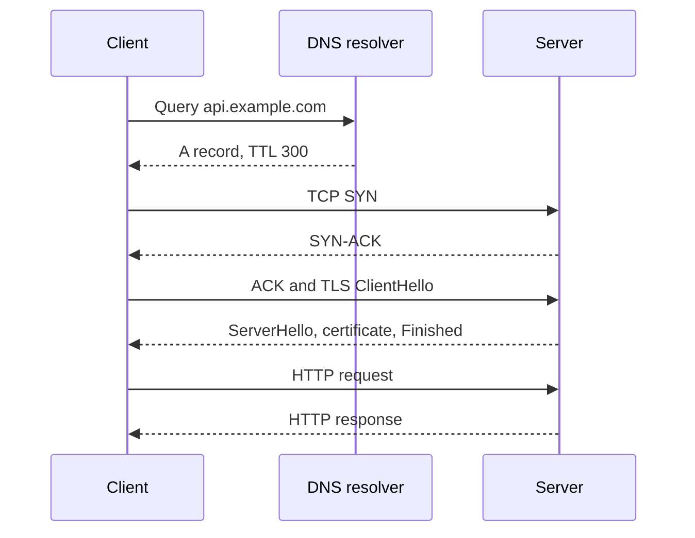

## TL;DR

- Before a request does any work, the client pays for a DNS lookup, a transport handshake, and a TLS handshake. Each costs round trips, and round trips are what distance makes expensive.
- TCP gives an ordered, reliable byte stream. UDP gives independent datagrams with no delivery guarantee, which suits real-time media and protocols that bring their own reliability, such as QUIC.
- TLS 1.3 completes a full handshake in one round trip, down from two in TLS 1.2. Its 0-RTT resumption saves another round trip but can be replayed, so only use it for idempotent requests.
- HTTP/2 multiplexes many requests over one TCP connection, but a single lost packet stalls all of them. HTTP/3 runs over QUIC on UDP and only stalls the stream that lost data.
- A layer 4 load balancer forwards connections by IP and port. A layer 7 load balancer terminates HTTP and routes on host, path, and headers. Pick by what you need to see in the traffic.

## Why it matters

Across long distances, latency is mostly a count of round trips. Between East US and West Europe, Azure measures a median round trip of about 85 ms. A fresh HTTPS connection over TCP and TLS 1.2 needs three round trips before the request leaves the client, so roughly 255 ms is gone before your service sees the request. With TLS 1.3 it drops to two round trips, about 170 ms. With HTTP/3 it drops to one, about 85 ms. No amount of server tuning recovers those milliseconds. Only fewer round trips or a shorter path does.

Networking choices also decide failure behavior. A DNS answer cached for an hour keeps clients pointed at a dead region for an hour. A layer 4 load balancer in front of gRPC services can pin every request from a busy client to one backend, because HTTP/2 sends them all over one long-lived connection. These failures don't show up in a design review unless someone knows the layer underneath.

## How it works

This is a first visit over HTTPS with TLS 1.3. The DNS lookup is usually answered from a nearby cache. The TCP handshake costs one round trip and the TLS handshake costs one more. HTTP/3 merges the transport and TLS handshakes into a single round trip.

### DNS

A client asks a recursive resolver, usually run by its ISP or network, to resolve a name. On a cache miss the resolver walks the hierarchy from the root servers to the top-level domain servers to the authoritative servers for the zone. Every answer carries a time to live (TTL), and every cache along the path keeps the answer that long.

The common record types are A and AAAA (an IPv4 or IPv6 address), CNAME (an alias to another name), NS (which servers are authoritative), and TXT (arbitrary text, often for domain verification).

DNS can steer traffic by returning different answers to different clients, for example the closest healthy region. That steering is coarse. It works per resolver rather than per request, and it only changes as fast as caches expire. Some clients and resolvers keep answers longer than the TTL says, so a DNS-only failover can take minutes to take full effect.

### TCP versus UDP

| | TCP | UDP |
| --- | --- | --- |
| Setup | Three-way handshake, one round trip | None |
| Delivery | Reliable, ordered byte stream | Independent datagrams, may be lost, duplicated, or reordered |
| Flow and congestion control | Built in | None (the application adds its own if needed) |
| Head-of-line blocking | One lost segment stalls everything behind it | None at the transport layer |
| Typical uses | HTTP/1.1, HTTP/2, database protocols, most RPC | DNS queries, voice and video, games, QUIC |

TCP's congestion control starts each new connection slowly and ramps up its sending rate. A fresh connection can't use the full bandwidth right away, which is one reason clients reuse connections and services keep pools of them. UDP fits when late data is worthless (a video frame that arrives after the next one) or when a higher-level protocol does reliability better for its own needs.

### TLS

TLS encrypts the connection and proves the server's identity with a certificate. TLS 1.3 removed older cipher suites and cut the full handshake to one round trip. A returning client can also send its first request in the opening flight, called 0-RTT early data. An attacker who captures that flight can replay it, so servers should only accept early data for requests that are safe to repeat.

Where you end TLS is a design decision. Terminate at the edge, and the edge can cache, inspect, and route on HTTP content. Re-encrypt from the edge to the backend if the internal network is not trusted. Mutual TLS (mTLS), where the client also presents a certificate, is common for service-to-service calls.

### HTTP/1.1, HTTP/2, HTTP/3

| | HTTP/1.1 | HTTP/2 | HTTP/3 |
| --- | --- | --- | --- |
| Transport | TCP | TCP | QUIC over UDP |
| Requests per connection | One at a time | Many multiplexed streams | Many multiplexed streams |
| Head-of-line blocking | Per connection, so browsers open several connections | At the TCP layer, a lost packet stalls all streams | Per stream only |
| Round trips before first request (new connection, TLS 1.3) | 2 | 2 | 1 |
| Header compression | None | HPACK | QPACK |
| Survives a network change | No, the connection breaks | No | Yes, connection IDs let the client migrate |

HTTP/2 fixed HTTP/1.1's one-request-at-a-time limit but moved the blocking down into TCP. On a lossy mobile link, one dropped packet holds up every stream on the connection. QUIC moves loss recovery per stream into user space on top of UDP, so other streams keep flowing. QUIC connection IDs also let a phone keep its connection when it switches from Wi-Fi to cellular. The cost is more CPU per byte than kernel TCP, plus networks that block or throttle UDP. Clients must be able to fall back to HTTP/2.

### Layer 4 versus layer 7

A **layer 4** load balancer sees IP addresses and ports. It picks a backend per connection or flow and forwards packets without reading them. It works for any TCP or UDP protocol, adds very little latency, and can't route on a URL.

A **layer 7** load balancer terminates the client connection, parses the HTTP request, and opens its own connection to a backend. It can route `/api` and `/static` to different pools, retry a failed request on another backend, enforce a web application firewall, and terminate TLS. It costs more CPU per request and is one more hop that can fail.

The difference matters most for long-lived connections. HTTP/2, gRPC, and WebSocket clients hold one connection open and send many requests over it. A layer 4 balancer assigns the whole connection to one backend, so load spreads by connection rather than by request. A few busy clients can overload a few backends while the rest sit idle. A layer 7 balancer spreads the individual requests.

## Trade-offs

- **TCP versus UDP.** TCP is the safe default and every middlebox understands it. UDP avoids handshake and head-of-line costs but makes you own reliability and congestion behavior, or adopt QUIC, which does both for you.
- **Short versus long DNS TTL.** A 30-second TTL lets failover take effect quickly but multiplies resolver traffic and lookup latency. A one-hour TTL is cheap and fast to resolve but strands clients during an outage. Use short TTLs on records you expect to fail over.
- **Edge TLS termination versus end-to-end encryption.** Terminating at the edge lets the edge cache and inspect, and it saves backend CPU. Re-encrypting to the backend closes the gap on the internal network for the cost of a second handshake per connection, usually amortized by connection reuse.
- **Layer 4 versus layer 7.** Layer 4 is faster and protocol-agnostic. Layer 7 sees requests, so it can route, retry, and filter. Many systems use both, with a layer 4 balancer in front of a fleet of layer 7 proxies.
- **HTTP/3 adoption.** It helps users on lossy, mobile, or distant networks the most. On a fast data center network it buys little and costs CPU, so it belongs at the edge, not between internal services.

## On Azure

| Need | Azure service | Layer | What it does |
| --- | --- | --- | --- |
| Host public DNS zones | Azure DNS | DNS | Authoritative DNS for your domains |
| Resolve names inside virtual networks | Azure Private DNS | DNS | Private zones that linked virtual networks can resolve |
| Resolve between on-premises and Azure | Azure DNS Private Resolver | DNS | Inbound and outbound endpoints for hybrid name resolution |
| Steer clients across regions with DNS | Traffic Manager | DNS | Answers with a healthy endpoint, for example the lowest-latency one |
| Global HTTP(S) entry with CDN and WAF | Azure Front Door Standard or Premium | Layer 7, global | Terminates client TLS at the edge, caches, routes to origins |
| Regional HTTP(S) load balancing with WAF | Application Gateway v2 (Standard_v2, WAF_v2) | Layer 7, regional | Path and host routing, HTTP/2, WebSocket, autoscaling |
| Ingress for AKS, including gRPC | Application Gateway for Containers | Layer 7, regional | Gateway API routes including gRPC, mTLS, WAF |
| Any TCP or UDP port | Azure Load Balancer Standard | Layer 4, regional | Pass-through flows with health probes |

**Front Door tier decision.** Front Door Premium adds Private Link connections to origins, Microsoft-managed WAF rule sets, and bot protection. Standard lacks all three. If your origins must have no public endpoint, you need Premium. Front Door (classic) accepts no new profiles and retires March 31, 2027, so new designs start on Standard or Premium. On TLS, Front Door supports 1.2 and 1.3 with a default minimum of 1.2, and it doesn't support client certificate authentication (mTLS) at the edge.

**Zone and region settings.** Front Door is a global service, so you don't pick zones for it. Inside each region, deploy Application Gateway v2 and Load Balancer Standard zone-redundant so one datacenter failure doesn't take out the entry point. Traffic Manager and Front Door both work across regions, but they fail over differently. Traffic Manager depends on DNS caches expiring, and clients that ignore the TTL keep using the old answer. Front Door routes each request at its edge, so it moves traffic faster.

**Gotcha: Front Door doesn't carry gRPC, and it speaks HTTP/1.1 to origins.** Clients can reach Front Door over HTTP/2, but Front Door talks to your origin over HTTP/1.1, and it doesn't support gRPC. A gRPC API placed behind Front Door fails. For gRPC on AKS, use Application Gateway for Containers. For a public gRPC or other non-HTTP protocol outside AKS, use Load Balancer Standard in front of your own proxies. Learn lists HTTP/2 but not HTTP/3 for Front Door client connections, so confirm current support before you promise HTTP/3 to mobile clients.

Later levels cover load balancing and CDNs as building blocks, and [networking and security](../04-azure/networking-and-security.md) covers the Azure side.

## Interview tips

- Do the round-trip math out loud. "Azure measures about 200 ms between Australia East and East US. A user in Sydney opening a connection to East US pays two of those round trips before the first request, so 400 ms. Terminating TCP and TLS at an edge near them cuts most of that."
- When you draw a load balancer, say which layer and why. "Layer 7, because I route `/upload` to a separate pool and want per-request balancing for HTTP/2."
- If the design uses gRPC or WebSockets, mention how connections are balanced. It shows you know long-lived connections defeat per-connection balancing.
- Don't propose DNS as your only failover mechanism for a tight recovery target. Name the TTL and the clients that ignore it.
- Bring up HTTP/3 where it helps (mobile clients, lossy networks, distant users) and skip it for internal traffic.

## Further reading

- [Azure load-balancing options](https://learn.microsoft.com/azure/architecture/guide/technology-choices/load-balancing-overview)
- [Azure Front Door overview](https://learn.microsoft.com/azure/frontdoor/front-door-overview)
- [End-to-end TLS with Azure Front Door](https://learn.microsoft.com/azure/frontdoor/end-to-end-tls)
- [Application Gateway for Containers](https://learn.microsoft.com/azure/application-gateway/for-containers/overview)
- [Azure DNS overview](https://learn.microsoft.com/azure/dns/dns-overview)
- [RFC 9000: QUIC](https://www.rfc-editor.org/rfc/rfc9000)
- [RFC 8446: TLS 1.3](https://www.rfc-editor.org/rfc/rfc8446)
- [Hello Interview: networking essentials](https://www.hellointerview.com/learn/system-design/core-concepts/networking-essentials)
- [The Coding Gopher: TCP vs. UDP Explained](https://thecodinggopher.substack.com/p/tcp-vs-udp-explained)
- [The Coding Gopher: dig Command in Linux](https://thecodinggopher.substack.com/p/dig-command-in-linux)

See also [what is system design](./what-is-system-design.md) for where these pieces sit in a full design, and [API design](./api-design.md) for the protocols that run on top of them.
