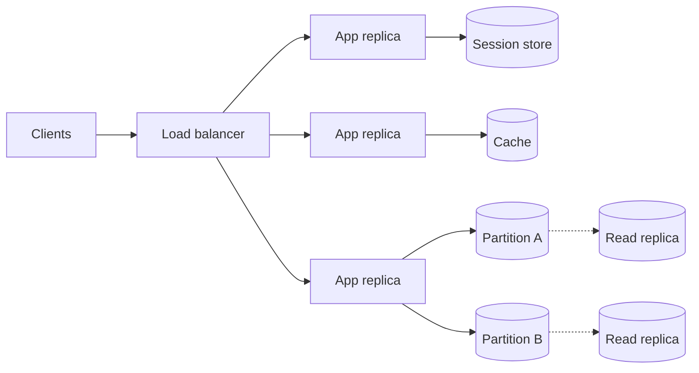

## TL;DR

- Scaling up (a bigger machine) is simple and runs into a ceiling. Scaling out (more machines) has no fixed ceiling but needs work that can be split across them.
- Make the service tier stateless by moving sessions and files into shared stores. Scaling it then means adding replicas behind a load balancer.
- The data tier is where scaling gets hard. Read replicas scale reads, partitioning scales writes and size, and caches absorb hot reads. Each brings its own failure mode.
- Autoscaling reacts to a metric after a delay. Keep a warm minimum for baseline load and know how long a scale-out takes.
- Find the bottleneck with numbers first. Adding replicas to a tier that isn't the bottleneck changes nothing except the bill.

## Why it matters

A system scales until its first bottleneck, and then latency climbs and requests fail. The bottleneck is rarely where people look first. Adding web servers to a site whose database is at 95% CPU makes things worse, because every new server opens its own pool of database connections and adds more contention to the database that was already struggling.

Scaling decisions are also hard to reverse. A partition key chosen on day one decides which queries are cheap for the life of the dataset. A service that keeps user sessions in memory can't scale out without either sticky sessions (which break when a node dies) or a rewrite. Getting the shape right early is cheaper than migrating later.

## How it works

Stateless replicas behind a load balancer handle compute. Shared state lives in a session store, a cache, and a partitioned database, each partition with replicas for reads.

### Vertical versus horizontal

Vertical scaling moves the workload to a larger machine with more cores, memory, or faster disks. Nothing in the application changes, which is why it should be the first move for a database that is merely busy. It stops working at the largest machine you can buy, it usually requires a restart, and one big machine is still one failure domain.

Horizontal scaling adds machines and splits the work between them. It is how systems grow past one machine, and it improves availability because losing one of twenty replicas costs 5% of capacity. It only works if the work can be split, which is easy for stateless request handling and hard for shared mutable data.

### Stateless services

A service is stateless when any replica can handle any request. That means no in-memory sessions, no files written to local disk that later requests need, and no in-process caches that must agree with each other. Move sessions to a shared store, files to object storage, and shared caches to a distributed cache. Then scaling is a replica count, and a crashed replica loses nothing except the requests it was serving at that moment.

Little's Law sizes the tier. Concurrent requests in flight equal throughput times latency. At 10,000 requests/s and 50 ms each, 500 requests are in flight at any moment. If one replica handles 50 concurrent requests well, you need 10 replicas, plus headroom for a failed zone.

### Scaling the data tier

**Read replicas.** Copy the database to followers and send reads to them. This scales reads almost linearly, and it does nothing for writes, because every write still goes to the primary and is replayed on every follower. Replicas lag behind the primary, so a user who writes and then reads from a replica may not see their own change. Route reads that must be fresh to the primary.

**Partitioning (sharding).** Split the data by a key so each partition holds a subset and takes a share of writes. This scales both writes and size, at three costs. Queries that span partitions get slow, transactions across partitions get hard, and a popular key (one celebrity account) concentrates load on one partition no matter how many you have. Choose a key with many distinct values that spreads both data and traffic.

**Caching.** Keep hot reads in memory in front of the database. A cache with a 95% hit rate cuts database reads by 20 times. The risks are stale data and the cold-cache stampede, where the cache restarts empty and every request falls through to a database sized for 5% of the traffic.

**Contention.** Some work doesn't parallelize. If every request updates one counter row, adding servers adds waiters for that row's lock. Spread the hot item (sharded counters, batching, or queues) before adding hardware.

### Autoscaling

An autoscaler watches a metric (CPU, concurrent requests, queue length) and changes the replica count to keep it near a target. Three properties decide whether it helps.

- **Lag.** It acts after the metric moves, then waits for new replicas to start. A spike that arrives faster than that lag still overloads the replicas you have.
- **Cooldown.** It waits before scaling in so it doesn't oscillate. Too short and it flaps, too long and you pay for idle replicas.
- **Bounds.** A minimum keeps warm capacity for baseline load and for zone failures. A maximum caps cost, and it also caps capacity during a real surge.

Scaling on queue length usually beats scaling on CPU for background workers, because queue length measures the work waiting rather than the work being done.

## Trade-offs

- **Up versus out.** Scaling up is simple and keeps strong consistency easy, but it has a ceiling and a single failure domain. Scaling out has no fixed ceiling and better fault isolation, and you pay with coordination and distributed state.
- **Read replicas versus cache.** Replicas serve any query but lag and cost a full copy of the database. A cache is cheaper per read and faster, but it only serves the keys you put in it and needs an invalidation story.
- **Partition key choice.** A key that matches the main access pattern (user ID for a per-user app) makes the main query a single-partition read. Every other query pays for a fan-out. There's no key that is best for every query.
- **Scale to zero versus warm minimum.** Scaling to zero saves money for idle workloads and adds a cold start to the first request after idle. User-facing paths usually keep a minimum.
- **Headroom versus cost.** Running at 50% utilization absorbs a zone failure and a spike without waiting for the autoscaler. Running at 80% is cheaper and leaves a much smaller margin.

## On Azure

| Tier | Scale up | Scale out | Limit that shapes the design |
| --- | --- | --- | --- |
| App Service | Move the plan to a larger pricing tier | Instance count, manual or autoscale | Basic up to 3 instances, Standard 10, Premium 30, Isolated (App Service Environment) 100 |
| Azure Container Apps | Larger CPU and memory per replica | KEDA-based scale rules on HTTP concurrency, TCP, CPU, memory, or event sources such as Service Bus | Defaults are 0 minimum and 10 maximum replicas; the maximum can go to 1,000 |
| AKS | Larger node VM size | Horizontal Pod Autoscaler for pods, cluster autoscaler for nodes | The cluster autoscaler adds nodes when pods are pending, not on CPU pressure |
| Azure SQL Database (Hyperscale) | More vCores | Up to 4 HA replicas and up to 30 named read replicas | Storage grows to 128 TB |
| Azure Cosmos DB | Not applicable | Partitions split automatically as throughput and data grow | A logical partition holds at most 20 GB and 10,000 RU/s |
| Azure Managed Redis | Larger memory size or a higher-performance tier | Clustered on every tier, keys spread across shards | Scaling down only reaches a subset of smaller SKUs |

**Tier and SKU decisions.** Run the estimate before you pick the plan. If peak load needs 25 App Service instances, Standard (capped at 10) is out, and you need Premium. For Container Apps, the default maximum of 10 replicas is a cost guard, not a capacity plan. Raise it to match your peak, or the app saturates at 10 while the autoscaler has nowhere to go. For Managed Redis, the tiers trade memory against vCPUs (Memory Optimized at 8:1, Balanced at 4:1, Compute Optimized at 2:1). Pick by whether the cache is limited by data size or by request rate.

**Zones.** Spread replicas across availability zones so a zone failure removes a third of capacity instead of all of it. Size the minimum replica count so the surviving zones can carry peak load while the autoscaler catches up. Azure Managed Redis places its primary and replica across zones by default where the region supports zones. Other data services expose zone redundancy as a setting, so check it on each resource rather than assuming it.

**Gotcha: scale-out lag on scale-from-zero.** Container Apps evaluates its HTTP scale rule on concurrent requests over a 15-second window, and custom KEDA scalers poll every 30 seconds by default. An app that scales to zero takes the polling delay plus container start time to serve its first request after idle. For user-facing APIs, set the minimum to at least one replica per zone you want covered. Save scale-to-zero for background processors fed by a queue, where a short delay costs nothing.

Later levels cover sharding and partitioning, replication, and caching as building blocks, and the Azure pages compare [compute](../04-azure/compute-choices.md) and [data](../04-azure/data-choices.md) choices.

## Interview tips

- Name the bottleneck with a number before you scale anything. "35,000 reads/s at peak is beyond one database, so I'll add a cache in front."
- Make the service tier stateless early and say where the state went. It turns every later scaling question into a question about the data tier.
- When you partition, state the key, why it spreads load, and what happens to the hottest key. Interviewers almost always ask about the celebrity user.
- Distinguish read scaling from write scaling. Read replicas and caches don't help a write-heavy workload.
- Mention autoscaling bounds and lag, not just "it autoscales". A senior answer says what happens during the 60 seconds before new replicas are ready.
- Use the [back-of-the-envelope](./back-of-the-envelope.md) numbers to justify each step, and connect replicas to [availability](./availability-and-reliability.md) and lag to [consistency](./consistency-and-cap.md).

## Further reading

- [Scaling in Azure Container Apps](https://learn.microsoft.com/azure/container-apps/scale-app)
- [Scale up an app in App Service](https://learn.microsoft.com/azure/app-service/manage-scale-up)
- [Cluster autoscaling in AKS](https://learn.microsoft.com/azure/aks/cluster-autoscaler-overview)
- [Azure SQL Database Hyperscale](https://learn.microsoft.com/azure/azure-sql/database/service-tier-hyperscale)
- [Azure Cosmos DB partitioning](https://learn.microsoft.com/azure/cosmos-db/partitioning)
- [Scale an Azure Managed Redis instance](https://learn.microsoft.com/azure/redis/how-to-scale)
- [The Coding Gopher: Database Connection Pooling Explained](https://thecodinggopher.substack.com/p/database-connection-pooling-explained)
- [The Coding Gopher: I/O Bound or CPU Bound?](https://thecodinggopher.substack.com/p/io-bound-or-cpu-bound)
- [Hello Interview: core concepts](https://www.hellointerview.com/learn/system-design/in-a-hurry/core-concepts)
