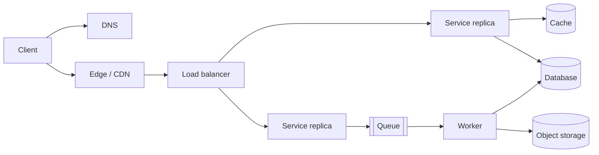

## TL;DR

- System design means choosing components, data flows, and failure behavior so a product meets its requirements at a target scale and cost.
- Functional requirements say what the system does. Non-functional requirements (latency, availability, consistency, durability, cost) decide almost every architectural choice.
- Most designs reuse the same small set of building blocks: DNS, an edge layer, load balancers, stateless services, databases, caches, queues, and object storage.
- Every component buys something and costs something. A design is good when its trades match the requirement the product cares about most.
- On Azure, each generic block maps to a managed service, and the Well-Architected Framework's five pillars give you a checklist for the non-functional side.

## Why it matters

One server with one database carries more traffic than most people expect. Three changes break that setup. Load grows past what one machine can handle. The business can no longer accept the downtime when that machine fails. Users spread across continents, and the speed of light puts a floor under latency. Each change pushes you to add machines, and once you do, data lives in more than one place, parts fail independently, and the network between them is slow and unreliable.

System design is making those changes on purpose. Teams that skip it add components in response to incidents. A cache gets added after the database melts, and a queue after a timeout cascade. The result runs until the next incident, and nobody can say what guarantee the system gives. Ask "can a user see a payment twice?" and you get a shrug.

The interview version compresses the same job. In 45 to 60 minutes, a senior candidate turns a vague prompt into requirements, picks an architecture that meets them, and defends the trade-offs under questioning. The [interview framework](./interview-framework.md) page covers how to pace that hour.

## How it works

### Requirements come first

Write two lists before drawing anything.

**Functional requirements** are the behaviors a user sees. "Users can post a photo." "Followers see new posts in their feed." Keep the list to the three or four behaviors that define the product. Everything else is out of scope until someone asks for it.

**Non-functional requirements** are the qualities. How fast, how available, how consistent, how much data, at what cost. These separate a right design from a wrong one. A feed that may run a few seconds stale permits caching and asynchronous fan-out. A ledger that must never double-spend forbids both on its write path. State them as numbers where you can. "p99 read latency under 200 ms." "99.95% monthly availability." "50 million daily active users."

### The common building blocks

Most request paths pass through the same handful of component types. The diagram shows a typical web system. Not every design needs every box, and each box should exist because a requirement asked for it.

| Component | Problem it solves | Failure mode it brings |
| --- | --- | --- |
| DNS | Turns a name into an address and can steer clients to a region | Cached answers keep sending clients to a dead endpoint until the TTL runs out |
| Edge / CDN | Serves cacheable content near users and terminates TLS close to them | Stale content after a deploy if nobody purges the cache |
| Load balancer | Spreads requests across replicas and drops unhealthy ones | A single point of failure unless it is redundant itself |
| Stateless service | Runs business logic so any replica can serve any request | Hidden local state (in-memory sessions, local files) quietly breaks this |
| Cache | Absorbs repeated reads at memory speed | Stale reads, and a cold or failed cache sends full load to the database |
| Database | Durable source of truth | The hardest tier to scale and usually the first bottleneck |
| Queue | Decouples producers from consumers and absorbs bursts | Duplicate deliveries, and a growing backlog can hide an outage |
| Object storage | Cheap, durable storage for large files | Much higher per-request latency than a database |

### Four questions on every design

Whatever the prompt, the same questions decide the architecture.

1. **Where does state live, and how many copies exist?** Stateless tiers scale by adding replicas. Stateful tiers need partitioning or replication, and replication raises the consistency question.
2. **What happens when each component fails?** Walk the diagram box by box. If losing one box takes down the product, that box needs a redundant twin or a degraded mode.
3. **Which requirement wins when two conflict?** Across regions, strong consistency costs latency. You can't maximize both, so the product decides.
4. **What does a request cost?** A design that meets every target at ten times the budget fails the review.

The rest of this section builds the vocabulary for answering them: [networking](./networking-essentials.md), [API design](./api-design.md), [estimation](./back-of-the-envelope.md), [scalability](./scalability.md), [availability](./availability-and-reliability.md), and [consistency](./consistency-and-cap.md).

## Trade-offs

- **Simple versus distributed.** A monolith on one database is easier to build, debug, and keep consistent. Splitting it buys independent scaling and deployment, and you pay with network calls, partial failures, and data spread across stores. Split when a measured bottleneck or a team boundary forces it.
- **Managed versus self-hosted.** Managed services take over patching, failover, and backups, but they cap configuration and charge per unit. Running open-source software on VMs or Kubernetes gives control and can cost less at very large scale. You also own every page at 3 a.m.
- **Consistency versus latency.** Keeping copies identical takes coordination, and coordination costs round trips. Relaxing it is faster but lets readers see old data. The [consistency and CAP](./consistency-and-cap.md) page covers where to draw that line.
- **Cost versus headroom.** Spare capacity absorbs spikes but you pay for it while idle. Autoscaling saves money, but it reacts in seconds to minutes, so a sharp spike can still overload you before new replicas arrive.

## On Azure

Each generic block has a managed Azure equivalent. Later levels give each its own page, including an [Azure service map](../04-azure/azure-service-map.md) and separate pages on [compute](../04-azure/compute-choices.md), [data](../04-azure/data-choices.md), and [messaging](../04-azure/messaging-choices.md) choices.

| Generic block | Azure service | What to know first |
| --- | --- | --- |
| DNS and DNS-based steering | Azure DNS, Traffic Manager | Traffic Manager steers clients across regions with DNS answers |
| Global edge and L7 entry | Azure Front Door (Standard or Premium) | Front Door (classic) retires March 31, 2027 |
| Regional L7 load balancer | Application Gateway v2 | The WAF_v2 SKU adds a web application firewall |
| L4 load balancer | Azure Load Balancer (Standard) | The Basic SKU is retired |
| Stateless compute | App Service, Azure Container Apps, AKS | Listed from least to most platform you operate |
| Relational database | Azure SQL Database, Azure Database for PostgreSQL | Pick by the engine your team and tooling already use |
| Distributed NoSQL | Azure Cosmos DB | Five tunable consistency levels, multi-region writes |
| Cache | Azure Managed Redis | Replaces Azure Cache for Redis, which retires September 30, 2028 |
| Message broker | Azure Service Bus | Queues for work items, topics for publish-subscribe, dead-letter queues |
| Event stream | Azure Event Hubs | Partitioned log that also speaks the Kafka protocol |
| Object storage | Azure Blob Storage | Large files, backups, and static content |

**A checklist for the non-functional side.** The [Azure Well-Architected Framework](../04-azure/well-architected-framework.md) groups system qualities into five pillars. They are Reliability, Security, Cost Optimization, Operational Excellence, and Performance Efficiency. Walk your design against each one before calling it done. The pass usually surfaces the requirement nobody asked about, and that is most often security or operations.

**Zones and regions shape the topology.** An Azure region contains availability zones, which are separate datacenter groups usually within 100 km of each other, with inter-zone round trips under about 2 ms. Zone-redundant deployment survives a datacenter failure at almost no latency cost. Surviving a full region outage takes a second region, and cross-region round trips run tens to hundreds of milliseconds. That gap forces the consistency decisions covered later in this section.

**Tiers remove options.** A SKU is not only a price. Azure Managed Redis Balanced B0 and B1 don't support active geo-replication, and API Management only offers availability zones on Premium and Premium v2. Check which tier includes the feature your design depends on before you price it.

**Gotcha: choosing services before requirements.** A design that opens with "we'll use Cosmos DB on AKS" has skipped the step that says whether it needs either. The Azure Architecture Center's compute flowchart is a good guard because it asks about your workload before it names a service.

## Interview tips

- Spend the first few minutes on requirements, and write the non-functional ones as numbers. A senior interviewer checks whether your design follows from them.
- Name the trade-off each time you add a component. "A cache here means feed reads can be up to 30 seconds stale, which this product accepts."
- Start with the simplest design that works, find its bottleneck with numbers, then add the one component that fixes it.
- Don't recite a list of components. Each box on the whiteboard should answer a requirement you wrote down.
- When you name an Azure service, say why it fits (the tier, the consistency level, zone redundancy). The name alone earns nothing.

## Further reading

- [Azure Well-Architected Framework](https://learn.microsoft.com/azure/well-architected/)
- [Azure Architecture Center: architecture styles](https://learn.microsoft.com/azure/architecture/guide/architecture-styles/)
- [Choose an Azure compute service](https://learn.microsoft.com/azure/architecture/guide/technology-choices/compute-decision-tree)
- [Azure availability zones overview](https://learn.microsoft.com/azure/reliability/availability-zones-overview)
- [Hello Interview: System Design in a Hurry](https://www.hellointerview.com/learn/system-design/in-a-hurry/introduction)
- [The Coding Gopher: The Top 10 Most Common System Design Questions, Explained](https://thecodinggopher.substack.com/p/the-top-10-most-common-system-design)
