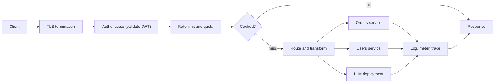

## TL;DR

- An API gateway is the single entry point for your APIs. It authenticates callers, enforces rate limits and quotas, routes to the right backend, and records what happened, so each service does not reimplement those concerns.
- Keep it thin. Cross-cutting policy belongs in the gateway; business logic and data joins do not.
- It sits on every request, so it must scale out, run across zones, and add only a few milliseconds.
- In 2026 many gateways also front LLM APIs: they meter tokens per caller, cache semantically similar prompts, and fail over between model deployments.
- On Azure this is API Management. The tier you pick decides zone redundancy, multi-region, private networking, and whether you can run the gateway next to your workloads.

## Why it matters

Once a product grows past one service, clients face a moving target: dozens of hostnames, each with its own auth scheme, error format, and version. Every service team also ends up writing the same code to validate tokens, throttle abusive callers, and log requests, and each copy has slightly different bugs. A gateway collapses that into one public contract and one place to enforce policy.

The failure modes it prevents are concrete. Without central rate limiting, one misbehaving partner can saturate a shared database. Without central token validation, a single service that forgets to check the `aud` claim accepts tokens minted for a different app. Without a stable facade, renaming or splitting a service breaks every mobile app that has not updated. The gateway is where [API design](../01-fundamentals/api-design.md) decisions such as versioning and error shapes become enforceable.

## How it works

A gateway runs each request through an ordered pipeline of policies. The order matters: reject unauthenticated and over-limit traffic before you spend backend capacity or cache memory on it.

### Authentication and coarse authorization

The gateway validates the bearer token on every request: signature, issuer, audience, expiry, and required scopes or roles. It caches the identity provider's signing keys, so validation is a local CPU operation, not a network call. Coarse checks ("this token has the `orders.read` scope") belong here. Fine-grained checks ("this user owns order 123") stay in the service, because only the service has the data. See [identity and auth](./identity-and-auth.md) for the token flows.

### Rate limiting and quotas

Rate limits protect capacity over short windows (100 requests per second per API key). Quotas enforce business contracts over long windows (1 million calls per month per subscription). Most gateways implement limits with a token bucket or sliding window keyed by subscription, user ID, or client IP, and return `429 Too Many Requests` with a `Retry-After` header.

Gateways run as many nodes, so counters are distributed. Either each node counts locally (fast, but the effective limit grows with node count), or nodes share counters through a store such as Redis (accurate, but adds a network hop per request). Treat gateway limits as approximate and design backends to shed load on their own.

### Routing and transformation

The gateway maps public paths to internal services (`/v2/orders/*` to the orders service), splits traffic for canaries, rewrites headers, and translates between protocols or payload shapes. A **backend for frontend** (BFF) variant gives each client type (mobile, web, partner) its own gateway or route set tuned to its needs.

Request aggregation (one client call fans out to three services and merges the result) is possible in most gateways. Use it sparingly. Every merge rule you write in gateway policy is business logic in a language with weak testing and no type system.

### Resilience and caching

Gateways apply timeouts, retry idempotent calls, and trip circuit breakers when a backend keeps failing, so a slow service fails fast instead of tying up gateway connections. Response caching for public, rarely changing GETs (a product catalog, a config document) can absorb a large share of read traffic. See [caching](./caching.md) for invalidation.

### LLM gateways

Model APIs change what "rate limit" means. Cost and capacity scale with tokens, not requests, so an AI gateway counts prompt and completion tokens per caller and enforces tokens-per-minute limits. It can cache completions by embedding similarity (a **semantic cache**), so "what's your refund policy?" and "how do refunds work?" share an answer. It also balances across model deployments: send traffic to reserved capacity first, spill to pay-as-you-go when the first returns 429, and stop sending to a deployment that keeps failing.

### Gateway, load balancer, or service mesh

| Component | Sees | Main job |
| --- | --- | --- |
| [Load balancer](./load-balancing.md) | Connections or HTTP requests | Spread traffic across identical instances |
| API gateway | API calls with identity and product context | Policy at the edge: auth, limits, routing, versioning, metering |
| Service mesh | Service-to-service calls inside the cluster | mTLS, retries, and telemetry between internal services |

Many designs use all three: a global load balancer in front, a gateway for north-south API traffic, and a mesh for east-west calls.

## Trade-offs

| You gain | You pay |
| --- | --- |
| One public contract that hides internal topology | An extra network hop, usually a few milliseconds, on every call |
| Auth, limits, and logging written once | A shared component that every team must change through, which can become an organizational bottleneck |
| Central place to version, deprecate, and meter APIs | A critical dependency: if the gateway is down, everything is down |
| Token metering and failover for LLM backends | Policy written in a gateway-specific language that is hard to test and port |
| Response caching at the edge of your services | Distributed rate limits that are approximate, not exact |

## On Azure

Azure API Management (APIM) is the managed gateway. It has a managed gateway, a developer portal, and policies for JWT validation (`validate-jwt`, and `validate-azure-ad-token` for Microsoft Entra tokens), rate limits (`rate-limit-by-key`), quotas (`quota-by-key`), caching, and transformation.

The tier decides the architecture:

| Tier | Availability zones | Multi-region | Fits |
| --- | --- | --- | --- |
| Consumption | No | No | Spiky, low-volume APIs; pay per call |
| Developer | No (single unit) | No | Dev and test only, not production |
| Basic v2, Standard (classic) | No | No | Small production APIs in one datacenter |
| Standard v2, Premium v2 | Yes | Not currently | Production in one region with zone resilience |
| Premium (classic) | Yes | Yes | Multi-region active-active gateways, self-hosted gateways |

Configuration choices that matter:

- **Self-hosted gateway.** A containerized gateway you run on Docker or Kubernetes next to your services, managed from the Azure instance. It applies to the Developer and Premium tiers only. Use it to keep traffic for on-premises or edge APIs local.
- **Workspaces.** Let separate teams own their APIs inside one instance. Available in Premium and Premium v2, and now in Basic v2 and Standard v2.
- **Caching.** The built-in cache is small and tied to the instance. For larger caches, for the Consumption tier, or for self-hosted gateways, attach an external Redis-compatible cache such as [Azure Managed Redis](./caching.md).
- **AI gateway.** The `llm-token-limit` policy sets tokens-per-minute limits or token quotas per key. Semantic caching needs Azure Managed Redis or another RediSearch-compatible cache. Backend pools load-balance across model deployments (round robin, weighted, priority, session-aware) with circuit breaker rules.
- **Placement.** Put Azure Front Door in front for global anycast and WAF, and keep APIM in a VNet so backends are never public.

The [Azure service map](../04-azure/azure-service-map.md) shows where API Management sits next to Front Door and Application Gateway.

Gotcha: APIM rate limit counters are kept per gateway and do not aggregate across the whole instance, so a multi-region Premium deployment enforces a "100 per minute" limit separately in each region. Learn also states that rate limiting is never completely accurate. If a limit is contractual, enforce it with a quota or in the backend, not only with `rate-limit-by-key`.

## Interview tips

- Draw the gateway, then say exactly which concerns it owns: auth, rate limiting, routing, metering. Then say what it does not own.
- When asked "isn't this a single point of failure?", answer with zones and multiple units in each region, and a global front end for multi-region.
- Explain where token validation happens and why it needs no network call (cached signing keys).
- For a rate limiter question, the gateway is the natural enforcement point, but the counter store and its accuracy are the real design. Be ready to discuss token bucket versus sliding window and local versus shared counters.
- For AI products, mention token-based limits and semantic caching. Interviewers in 2026 expect it.
- Trap: putting orchestration and data joins in the gateway. That builds a distributed monolith in a policy language.

## Further reading

- [API Management rate-limit-by-key policy](https://learn.microsoft.com/azure/api-management/rate-limit-by-key-policy)
- [AI gateway capabilities in API Management](https://learn.microsoft.com/azure/api-management/genai-gateway-capabilities)
- [Reliability in API Management](https://learn.microsoft.com/azure/reliability/reliability-api-management)
- [Self-hosted gateway overview](https://learn.microsoft.com/azure/api-management/self-hosted-gateway-overview)
- [Hello Interview: API Gateway](https://www.hellointerview.com/learn/system-design/deep-dives/api-gateway)
