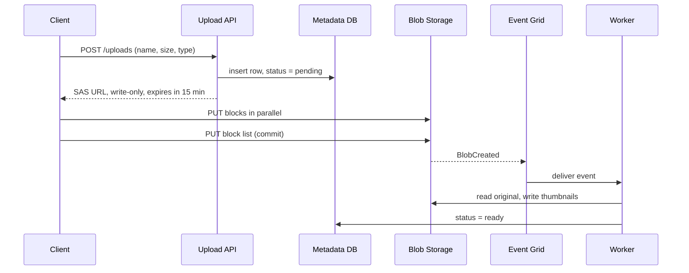

## TL;DR

- Object storage holds large, unstructured bytes (images, video, backups, logs) addressed by name. The database keeps only the metadata and the object's name.
- Clients upload and download directly against storage using a short-lived signed URL, so your API servers never carry the bytes.
- Large files go up in blocks, in parallel, and become visible only when the client commits the block list. A failed upload retries one block, not the whole file.
- Access tiers trade storage cost against access cost. Lifecycle rules move objects to cheaper tiers, or delete them, as they age.
- Hot objects are served through a CDN, not straight from the storage account.
- On Azure: Azure Blob Storage, with SAS tokens for signed URLs, hot, cool, cold, and archive tiers, lifecycle management, and LRS, ZRS, GRS, or GZRS redundancy.

## Why it matters

Almost every interview system stores files: photos in a social feed, videos on a streaming site, attachments in chat, documents in a file-sync service. Putting those bytes in a relational database makes rows huge, backups slow, and replication expensive, and every download ties up a database connection. Object storage is built for the opposite workload: cheap per gigabyte, high durability, and huge aggregate throughput.

The scale gap is large. A photo app with 10 million uploads a day at 2 MB each writes 20 TB a day, about 7 PB a year. The metadata for those photos (owner, caption, object name, size) is a few hundred bytes each, about 1 TB a year. The [back-of-the-envelope](../01-fundamentals/back-of-the-envelope.md) split is clear: bytes go to blob storage, metadata goes to a [database](./databases-sql-vs-nosql.md).

## How it works

### The data model

An Azure storage account holds containers, and a container holds blobs. The namespace is flat: `photos/2025/06/abc.jpg` is one name that happens to contain slashes, not a file in nested folders. Listing by prefix works, but renaming a "folder" means rewriting every blob under it. When you need real directories with atomic renames, for analytics engines in particular, turn on the hierarchical namespace that Data Lake Storage adds on top of Blob Storage.

Azure has three blob types:

- **Block blobs** for almost everything: files made of individually managed blocks, up to about 190.7 TiB.
- **Append blobs** for logs: blocks can only be added at the end.
- **Page blobs** for random-access files up to 8 TiB, such as virtual machine disks.

### Direct upload with a signed URL

Routing a 2 GB video through your API server wastes its bandwidth and memory and adds a hop. The valet key pattern avoids this. The client asks the API for permission; the API checks who the user is, records the pending upload, and returns a URL with a signature that grants a narrow, time-limited right: write this one blob, for the next 15 minutes. The client then talks to storage directly. Downloads work the same way with a read-only signature, which is how you serve private files without making the container public.

On Azure the signature is a shared access signature (SAS). Keep them short-lived and scoped to one blob and one permission, because anyone holding the URL can use it until it expires.

### Large uploads in blocks

A single PUT of a large file fails on a flaky connection and has to restart from zero. Block blobs avoid that:

1. The client splits the file into blocks (a few MiB to a few hundred MiB) and uploads each one with an ID. Blocks can go in parallel, and only a failed block is retried.
2. Uploaded blocks are staged, not visible.
3. The client commits a block list naming the blocks in order. Only then does the blob appear, all at once.

A block can be up to 4,000 MiB and a blob up to 50,000 blocks. The Azure SDKs do this splitting for you; the design point is that uploads are resumable and readers never see half a file.

### After the upload

The commit should trigger processing, not a client callback the client might never send. Blob Storage emits a `BlobCreated` event to Event Grid, and a worker generates thumbnails, transcodes video, or scans for malware, then flips the metadata row to `ready`. The upload SAS still allows writes until it expires, so turn on blob versioning, process one version ID, and record it on the row so downloads serve the bytes that passed the scan. Add a reconciliation job that cleans up rows stuck in `pending` and blobs with no row, because clients abandon uploads.

### Partitioning and naming

Azure's partition key for a blob combines the account name, container name, and blob name, so sequential or append-only names (ones that start with a timestamp, say) can concentrate traffic on a single partition. For workloads of small blobs or small blocks, Learn recommends a three-digit hash or a seconds value as early as possible in the name (`a7f/2025-06-01/photo.jpg`). Uploads with blobs or blocks larger than 256 KiB use high-throughput block blobs, which naming doesn't affect. The same hot-key idea is behind [sharding](./sharding-and-partitioning.md).

A single block blob targets up to 3,000 requests per second, and a standard account defaults to 20,000 requests per second, or 40,000 in a listed set of major regions. A viral image read millions of times will hit those limits, which is why hot objects sit behind a [CDN](./cdn-and-edge.md).

## Trade-offs

| Tier | Minimum storage period | Read latency | Fits |
| --- | --- | --- | --- |
| Hot | None | Milliseconds | Active content, recent uploads |
| Cool | 30 days | Milliseconds, higher access cost | Content read now and then |
| Cold | 90 days | Milliseconds, higher access cost still | Rarely read, still needs instant access |
| Archive | 180 days | Hours; must rehydrate first | Compliance copies, old backups |

- **Direct upload vs proxying.** Direct upload removes your servers from the data path, but you lose the chance to inspect bytes inline, so validation moves to the post-upload worker. A leaked SAS URL is usable until it expires; short expiry and narrow scope limit the damage.
- **Cheaper tiers are not free.** Cool, cold, and archive charge more per read and charge early deletion if you remove data before the minimum period. Archive reads can take up to 15 hours to rehydrate, so it can't serve a user waiting on a page.
- **Durability vs latency of geo-copies.** Geo-redundant options replicate asynchronously, so a regional outage can lose the last few writes. See [Replication](./replication.md).
- **Object vs file semantics.** Without the hierarchical namespace, renaming a folder rewrites every blob under it. Two writers on one blob overwrite each other unless they use a conditional write on the ETag or take a lease. Most designs treat objects as immutable and write each version under a new name.

## On Azure

**Azure Blob Storage** lives in a storage account. Choose redundancy per account:

| Option | Copies | Durability per year |
| --- | --- | --- |
| LRS | Within one datacenter in the primary region | 11 nines |
| ZRS | Across three or more availability zones in the primary region | 12 nines |
| GRS / GZRS | LRS or ZRS in the primary, plus async copy to a secondary region | 16 nines |

The secondary region in GRS or GZRS can't be read unless you fail over; RA-GRS and RA-GZRS add read access to it. The archive tier isn't supported on ZRS, GZRS, or RA-GZRS accounts.

**Tiers and lifecycle.** Set a tier per blob, or, when access patterns are unclear, let **smart tier** move block blobs between hot, cool, and cold based on last access. Smart tier is generally available in public cloud regions and needs a zone-redundant account (ZRS, GZRS, or RA-GZRS). **Lifecycle management** rules match blobs by creation, last-modified, or last-accessed time, then move them to a cooler tier, move them back to hot when accessed, or delete them. Policy changes can take up to 24 hours to take effect.

**Access control.** Microsoft recommends Microsoft Entra ID over the account key. Give services a managed identity and a data role such as Storage Blob Data Contributor, and disallow Shared Key access on the account. For client uploads, use a **user delegation SAS**, which is signed with Entra credentials instead of the account key; Microsoft recommends it wherever you use SAS.

**Protection.** Soft delete keeps deleted blobs restorable for a retention period you set. Immutable storage gives WORM (write once, read many) retention for compliance data.

**Delivery and events.** Azure Front Door caches blobs at the edge with the storage account as its origin. With the Premium tier, Front Door reaches the account over Private Link, so the account need not be exposed to the public internet. Blob Storage publishes `BlobCreated` and other events to Event Grid for post-upload processing.

[Data choices](../04-azure/data-choices.md) covers when data belongs in Blob Storage instead of a database.

## Interview tips

- Separate metadata from bytes in the first minute: a table row with the blob name, and the file in Blob Storage.
- Draw the signed-URL upload flow, including who issues the URL, its scope, and its expiry.
- For large files, say "block upload, parallel, resumable, committed at the end" before the interviewer asks about a 5 GB video.
- Trigger processing from the storage event, not the client, and mention cleanup of abandoned uploads.
- Put a CDN in front of public or hot reads and explain the per-blob request limit it avoids.
- Expect follow-ups: How do you keep the database row and the blob consistent? How do you make private content shareable for a limited time (read SAS)? How do you cut the storage bill (lifecycle to cool and archive)?
- Trap: streaming every upload through the API tier. It works in the demo and fails at the first large file.

## Further reading

- [Introduction to Azure Blob Storage](https://learn.microsoft.com/azure/storage/blobs/storage-blobs-introduction)
- [Valet Key pattern](https://learn.microsoft.com/azure/architecture/patterns/valet-key)
- [Grant limited access with shared access signatures](https://learn.microsoft.com/azure/storage/common/storage-sas-overview)
- [Blob versioning](https://learn.microsoft.com/azure/storage/blobs/versioning-overview)
- [Access tiers for blob data](https://learn.microsoft.com/azure/storage/blobs/access-tiers-overview)
- [Azure Storage redundancy](https://learn.microsoft.com/azure/storage/common/storage-redundancy)
- [Scalability and performance targets for Blob Storage](https://learn.microsoft.com/azure/storage/blobs/scalability-targets)
- [Hello Interview: Large blobs](https://www.hellointerview.com/learn/system-design/patterns/large-blobs)
- Related: [CDN and edge](./cdn-and-edge.md), [Message queues](./message-queues.md), [Back-of-the-envelope](../01-fundamentals/back-of-the-envelope.md)
