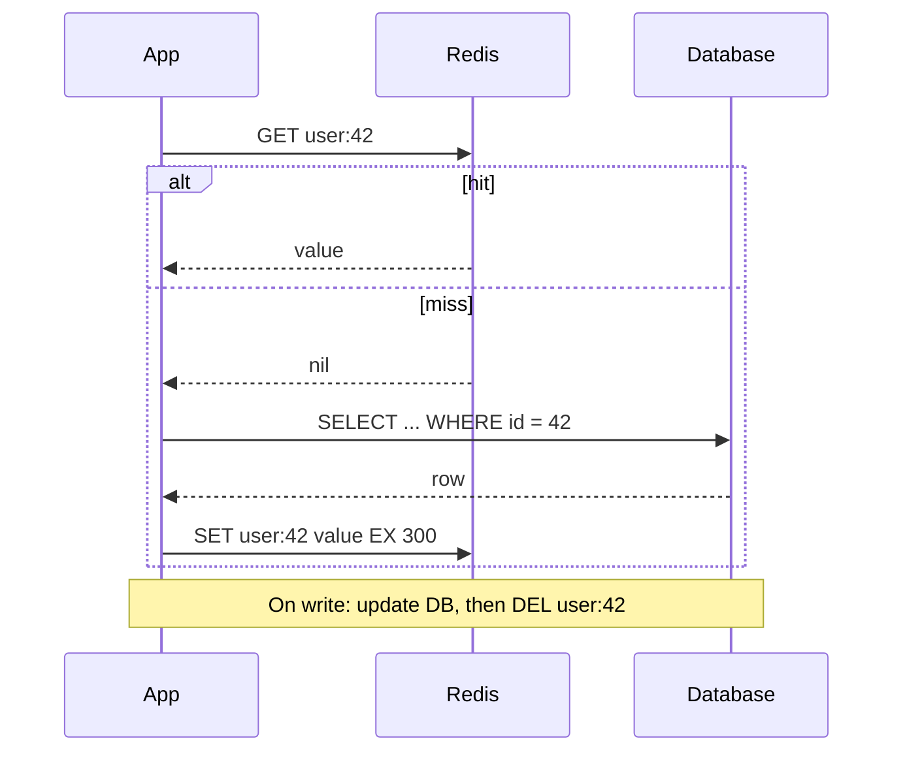

## TL;DR

- A cache keeps a copy of data in a faster store, closer to the reader. You trade freshness and memory for lower latency and less load on the source of truth.
- Cache-aside is the default: read from the cache, fall back to the database on a miss, and fill the cache. Write-through and write-behind move writes through the cache instead.
- Every cached value is stale for some window. Pick a TTL per data type based on how long a stale read is acceptable, and delete the key when you write.
- Eviction decides what goes when memory fills up. LRU with TTLs on every key is the safe starting point.
- Hot keys expiring at once can send a burst of misses to the database (a stampede). Coalesce misses, add jitter to TTLs, or refresh before expiry.
- On Azure: Azure Managed Redis for a shared application cache, Front Door for HTTP responses at the edge, and API Management for response caching at the gateway.

## Why it matters

Most systems read far more than they write, and the database is usually the first thing to saturate. A cache in front of it changes the arithmetic: at a 95% hit ratio, the database sees one read in twenty. That can be the difference between one database and a sharded fleet. Run the numbers with [back-of-the-envelope estimates](../01-fundamentals/back-of-the-envelope.md) before you add one: a cache that holds the working set is cheap, and one that misses most of the time adds a network hop and saves nothing.

Caches also cut latency: an in-memory lookup in the same region takes about a millisecond, while a query that joins and sorts can take tens.

The cost is [consistency](../01-fundamentals/consistency-and-cap.md). A copy can disagree with the source, so have an answer for how stale a read can be and what you do on write.

## How it works

Caches show up at every layer: the browser, the [CDN](./cdn-and-edge.md), the [API gateway](./api-gateway.md), the application process, a shared cache cluster, and the database's own buffer pool. This page covers the shared application cache, usually Redis.

### Read and write patterns

**Cache-aside (lazy loading).** The application owns both paths. On a read, it checks the cache and, on a miss, loads from the database and stores the result with a TTL. On a write, it writes the database and then deletes the cached key so the next read reloads it. Only data someone asked for gets cached, and a cache outage degrades to slower reads instead of failures. Learn's description of the pattern says plainly that it "doesn't guarantee consistency between the data store and the cache": between the write and the next read, a reader can still see the old value.

**Read-through.** Like cache-aside, but the cache layer loads from the database on a miss, so application code only talks to the cache.

**Write-through.** Every write goes to the cache and the database together, and the write succeeds only when both do. Reads after a write see the new value, and the cache is always warm for recently written data. Writes get slower, and you cache data that nobody may read.

**Write-behind (write-back).** The write lands in the cache and returns. A background process flushes changes to the database later, often in batches. Write latency drops and the database absorbs bursts as smooth batches. If the cache loses data before the flush, those writes are gone, so use this only for data you can afford to lose or rebuild, such as counters, view tallies, and presence.

**Write-around.** Writes go straight to the database and skip the cache. Combine it with cache-aside when most written data is never read back soon, such as logs and audit events.

### Invalidation and TTLs

Delete on write plus a TTL covers most cases. The delete makes the common path fresh, and the TTL bounds the damage when a delete is lost (a crash between the database commit and the `DEL`, or a write from a path that forgot to invalidate). Prefer deleting over updating the cached value: two concurrent writers that each `SET` can leave the older value in the cache, while two deletes converge.

Set the TTL from the business rule, not a default. A product price might tolerate 60 seconds of staleness, while a list of countries can live for a day. Learn's cache-aside guidance also warns against expiration periods that are too short, which make the application keep reloading data that didn't change.

### Eviction

When the cache is full, an eviction policy chooses what to drop. LRU (least recently used) evicts what nobody touched for the longest time and fits most workloads. LFU (least frequently used) protects items that are popular over time but not in the last minute. TTL-based policies evict keys closest to expiry. Size the cache to hold the working set, measure the hit ratio, and grow it while hits keep rising.

### Stampedes and hot keys

A stampede (thundering herd, dogpile) happens when a popular key expires and hundreds of concurrent requests miss at once, all query the database for the same row, and pile up behind it. Four defenses, usually combined:

1. **Coalesce misses.** Only one request per key loads from the database while the others wait for its result. Inside one process this is a "single flight" map of in-progress loads. Across processes, take a short lock with `SET key:lock 1 NX EX 5` and have the losers wait briefly or serve stale data.
2. **Serve stale while revalidating.** Store a soft expiry inside the value and a longer hard TTL on the key. After the soft expiry, one request refreshes it in the background while everyone else gets the slightly old value.
3. **Refresh early, probabilistically.** Each reader refreshes with a probability that rises as expiry approaches, so one request usually reloads the key before it expires.
4. **Add jitter.** Randomize TTLs by 10 to 20% so keys written together don't expire together.

A hot key that saturates one cache shard is a related problem. Add a small in-process cache with a short TTL in front of the shared cache, or copy the key under several suffixed names and read a random one.

## Trade-offs

| Pattern | Read after write | Write latency | Failure risk | Use for |
| --- | --- | --- | --- | --- |
| Cache-aside | Stale until delete or TTL | Database only | Cache down means slower reads | General default |
| Read-through | Same as cache-aside | Database only | Cache layer becomes a dependency | Simpler app code |
| Write-through | Fresh | Cache plus database | Write fails if either fails | Read-after-write data that is read often |
| Write-behind | Fresh in cache | Cache only | Data loss if the cache fails before the flush | Counters and other loss-tolerant writes |
| Write-around | Stale until TTL | Database only | Next read always misses | Write-heavy, rarely read data |

- **Local versus distributed cache.** An in-process cache skips the network hop, but every instance holds its own copy and needs its own invalidation. A shared cache costs a round trip and keeps one copy.
- **Caching is not a fix for a slow query.** If the miss path takes 2 seconds, users on a cold cache still wait 2 seconds. Fix the query or the [index](./indexing.md) first.
- **The cache is not the database.** If losing the cache would lose data, you've built a write-behind store without saying so. Decide on purpose.

## On Azure

**Azure Managed Redis** is the shared application cache. It runs on Redis Enterprise software and comes in four tiers. Memory Optimized has a high memory-to-vCPU ratio (8:1), Balanced and Compute Optimized trade memory for more CPU, and Flash Optimized moves less frequently accessed data from RAM to NVMe storage to hold more data per dollar. Zone redundancy is on by default.

Design points to know:

- **Clustering policy.** OSS clustering exposes shards to a cluster-aware client and scales best. Enterprise clustering puts a single proxy endpoint in front of the shards, which keeps older clients working, but that proxy node can become a bottleneck. Enterprise is also the only policy that supports the RediSearch module. Non-clustered applies only to caches of 25 GB or smaller.
- **Eviction.** The default policy is `volatile-lru`, which evicts only keys that have a TTL. If your keys have no TTL, nothing is evicted and writes start failing when memory runs out. For a pure cache, Learn suggests `allkeys-lru`. Each instance also reserves about 20% of its memory as a buffer for replication and failover, so size for that.
- **Persistence.** RDB snapshots or an AOF log written once per second can rebuild the cache after an outage.
- **Active geo-replication** groups up to five instances across regions, each acting as a local primary. It can't be combined with data persistence.
- **Retirement.** Azure Cache for Redis Enterprise and Enterprise Flash retire on March 31, 2027, and Basic, Standard, and Premium on September 30, 2028. New designs should use Azure Managed Redis.

Other cache layers: Azure Front Door caches HTTP responses at the edge (see [CDN and edge](./cdn-and-edge.md)), and API Management can cache responses at the gateway, including semantic caching of LLM completions backed by Azure Managed Redis (see [API gateway](./api-gateway.md)).

## Interview tips

- Say where the cache sits and what it holds: "Redis in front of the user table, keyed by user ID, 5-minute TTL, delete on write."
- Name the pattern and its staleness window before the interviewer asks. If they push on read-your-own-writes, read the user's own data from the database after an edit, or write-through for that path.
- Bring up the hit ratio and the miss path. A cache is a load reducer, so say what happens to the database on a cold start or after a cache failover.
- For hot items (a celebrity profile, a flash sale), mention stampede protection and hot-key spreading without being prompted.
- Expect follow-ups: How do you invalidate across regions? What happens when Redis is down (fall back to the database with a circuit breaker and rate limits)? Why not cache everything?
- Trap: write-behind for money or orders. The interviewer is waiting for you to notice the data loss window.

## Further reading

- [Cache-Aside pattern](https://learn.microsoft.com/azure/architecture/patterns/cache-aside)
- [What is Azure Managed Redis?](https://learn.microsoft.com/azure/redis/overview)
- [Azure Managed Redis architecture](https://learn.microsoft.com/azure/redis/architecture)
- [Memory management best practices for Azure Managed Redis](https://learn.microsoft.com/azure/redis/best-practices-memory-management)
- [Hello Interview: Caching](https://www.hellointerview.com/learn/system-design/core-concepts/caching)
- [Hello Interview: Redis deep dive](https://www.hellointerview.com/learn/system-design/deep-dives/redis)
- [The Coding Gopher: A deep dive into Redis](https://thecodinggopher.substack.com/p/a-deep-dive-into-redis)
- Related: [CDN and edge](./cdn-and-edge.md), [Databases: SQL vs NoSQL](./databases-sql-vs-nosql.md), [Consistency and CAP](../01-fundamentals/consistency-and-cap.md)
