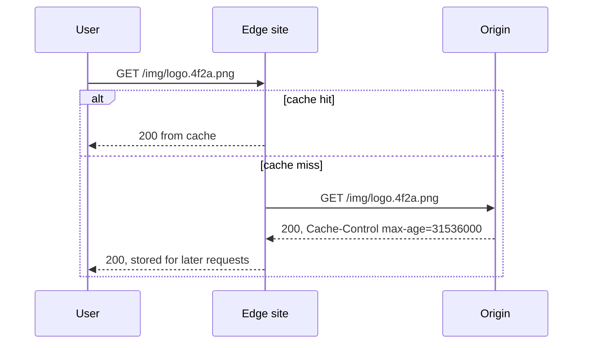

## TL;DR

- A content delivery network (CDN) serves responses from edge locations near users. A cache hit avoids a long round trip to your origin and a request your servers never see.
- The edge now does more than cache files. It terminates TLS close to the user, runs a web application firewall, absorbs DDoS traffic, and routes requests to the healthiest origin.
- Correctness comes from two things you control: the cache key and the `Cache-Control` headers your origin sends.
- Invalidate by publishing new URLs (fingerprinted file names), not by purging. Purges are slow and easy to get wrong.
- On Azure the CDN is Azure Front Door Standard or Premium. Front Door (classic) and Azure CDN Standard from Microsoft (classic) are both retiring.

## Why it matters

Physics sets a floor on latency. Light in fiber covers roughly 200 km per millisecond, so a user in Sydney talking to a server in Virginia (about 16,000 km away) waits around 160 ms for each round trip before any server work happens. A new HTTPS connection needs a TCP handshake and a TLS handshake before the first request, so the first byte can take three or four round trips. Serving from an edge site in the same city cuts each round trip to a few milliseconds.

The second payoff is load. Images, video segments, JavaScript bundles, and software downloads are most of the bytes a product serves. If 95% of those requests hit the edge cache, the origin handles 1 in 20 requests and a twentieth of the bandwidth bill. A CDN also spreads a traffic spike (a launch, a viral post, a flood of attack traffic) across hundreds of edge sites instead of focusing it on one region.

## How it works

### Getting to the nearest edge

Most modern CDNs announce the same IP addresses from every edge site (anycast), so internet routing delivers each user to a nearby site. Some use DNS to hand out the address of a nearby site instead. Either way, the user's TCP and TLS handshakes complete at the edge, a few milliseconds away. The edge then reuses warm, long-lived connections over the provider's backbone to reach the origin, which speeds up even uncacheable API calls.

### The cache key

The edge stores each response under a cache key, usually the host plus path plus some or all of the query string. Getting the key right is the main design task:

- Too broad (ignoring a query parameter that changes the response) and users get each other's content.
- Too narrow (including a tracking parameter such as `utm_source`) and every variation is a separate miss, so the hit ratio collapses.
- Responses that vary by a header, such as `Accept-Encoding` or `Accept-Language`, need that header reflected in the key or in a `Vary` header.

Never cache responses that depend on cookies or the `Authorization` header unless the key includes them. Caching a personalized page under a shared key is a privacy incident, not a performance bug.

### Freshness and `Cache-Control`

The origin tells caches what to do:

| Directive | Meaning |
| --- | --- |
| `max-age=N` | Any cache may reuse the response for N seconds |
| `s-maxage=N` | Shared caches (the CDN) use N instead of `max-age` |
| `no-store` | Never store it |
| `private` | Browsers may store it; shared caches must not |
| `no-cache` | Store it, but revalidate with the origin before each reuse |
| `stale-while-revalidate=N` | Serve the stale copy for up to N seconds while fetching a fresh one in the background |
| `immutable` | The content at this URL never changes; skip revalidation |

### Invalidation

The reliable pattern is **versioned URLs**. Build tools put a content hash in each asset's name (`app.3f9a1c.js`), the HTML references the new name on each deploy, and assets get `max-age=31536000, immutable`. Old and new versions coexist, and nothing needs purging. The HTML page itself gets a short TTL (seconds to minutes) or `no-cache` so users pick up new asset names quickly.

Purge (explicit invalidation) is for mistakes: a leaked file, a wrong price. It takes minutes to reach every edge site, and a broad purge sends a burst of misses to an origin that may not be sized for it.

### Caching dynamic content

Short TTLs make dynamic data cacheable. A product page or a leaderboard that is cached for 5 seconds at each edge site turns 10,000 requests per second for the same URL into a handful of origin requests per second, and no user sees data more than 5 seconds old. Request collapsing (sending one origin fetch for many simultaneous misses on the same key) protects the origin when a hot key expires.

### Tiered caching

With hundreds of edge sites, each one misses independently, so a long-tail object may be fetched from the origin hundreds of times. Some CDNs add a mid-tier cache (an origin shield) that edge sites check before the origin. Where the CDN has no shield, you get the same effect by putting a regional cache or object storage in front of an expensive origin.

### Security at the edge

Because every request passes through the edge, it is the natural place to drop bad traffic: a WAF with managed rule sets for common attacks, rate limits per client IP, geo-filtering, and bot detection. Lock the origin so it accepts traffic only from the CDN; otherwise attackers bypass the edge and hit the origin directly.

## Trade-offs

| You gain | You pay |
| --- | --- |
| Tens to hundreds of milliseconds saved per round trip for distant users | Another layer whose cache state you must reason about during incidents |
| Most static bytes served without touching the origin | Stale content for up to the TTL; purges take minutes |
| TLS, WAF, and DDoS absorption near the user | Edge configuration changes propagate in minutes, not seconds |
| Spike absorption for viral or launch traffic | Per-request and per-GB edge pricing on top of origin costs |
| Faster uncacheable calls through warm backbone connections | A wrong cache key can leak one user's data to another |

## On Azure

Azure Front Door Standard and Premium are the CDN and global HTTP entry point. Microsoft is retiring the older products: Azure Front Door (classic) retires on March 31, 2027, and Azure CDN Standard from Microsoft (classic) retires on September 30, 2027. New designs should start on Front Door Standard or Premium.

| Concern | Front Door setting |
| --- | --- |
| Edge footprint | 192 edge locations across 109 metro cities |
| Cache key | Per route: ignore query string, use query string, ignore specified parameters, or include specified parameters |
| Freshness | Honors `s-maxage`, then `max-age`, then `Expires`; respects `private`, `no-cache`, and `no-store` |
| Methods | Only GET responses are cacheable; everything else is proxied |
| Compression | gzip and Brotli at the edge |
| Edge logic | Rules engine: route and cache overrides, request and response header changes, redirects, URL rewrites |
| Origins | Autodiscovery for App Service and Storage; any other Azure or external backend as a custom host |
| TLS | Front Door-managed certificates for subdomains and apex domains, or your own certificates |

**Standard or Premium.** Premium adds Private Link connections to origins (the origin needs no public endpoint), the Microsoft-managed WAF rule set, and bot protection. Choose Premium for anything public that handles logins or payments, or whenever the origin must stay off the internet.

**Origin protocol.** Clients can use HTTP/1.1 or HTTP/2, but Front Door talks to origins over HTTP/1.1. That rules out gRPC through Front Door. Put gRPC behind a regional layer 7 balancer instead (see [load balancing](./load-balancing.md)).

**No shared mid-tier cache.** Learn states that each Front Door edge site manages its own cache. Expect some origin traffic even for popular objects, and size the origin for misses from many sites at once after a deploy or purge.

**Operations.** A configuration change can take up to 15 minutes to propagate, and a purge completes within about 10 minutes with at most 100 URLs per request. Plan releases around versioned URLs so you rarely need either.

Gotcha: if caching is enabled on a route and the origin sends no `Cache-Control` or `Expires` header, Front Door picks a random cache duration between one and three days. An API route that forgot its headers can serve stale responses for days. Always send explicit headers, and send `no-store` for anything personalized.

## Interview tips

- Put the CDN in front of anything users download: images, video, static web assets, and large files from [blob storage](./blob-storage.md). Say what hit ratio you expect and how it changes origin sizing.
- Explain how you invalidate. "Fingerprinted asset names with a one-year TTL, short TTL on HTML" is the answer interviewers look for.
- Mention short-TTL caching of hot dynamic responses with request collapsing when the problem has a read hot spot (a celebrity profile, a flash-sale page).
- Expect follow-ups: How does a user reach the nearest edge (anycast or DNS)? What happens on a cache miss storm after a purge? How do you keep the origin from being attacked directly?
- Trap: caching authenticated responses under a shared key. State which routes are cacheable and why.
- Tie latency claims to round-trip math from [networking essentials](../01-fundamentals/networking-essentials.md), not adjectives.

## Further reading

- [Caching with Azure Front Door](https://learn.microsoft.com/azure/frontdoor/front-door-caching)
- [Compare Azure Front Door and Azure CDN tiers](https://learn.microsoft.com/azure/frontdoor/front-door-cdn-comparison)
- [Azure Front Door rules engine actions](https://learn.microsoft.com/azure/frontdoor/front-door-rules-engine-actions)
- [Azure Front Door (classic) retirement FAQ](https://learn.microsoft.com/azure/frontdoor/classic-retirement-faq)
- [Hello Interview: Caching](https://www.hellointerview.com/learn/system-design/core-concepts/caching)
- Related: [Caching](./caching.md), [Load balancing](./load-balancing.md)
