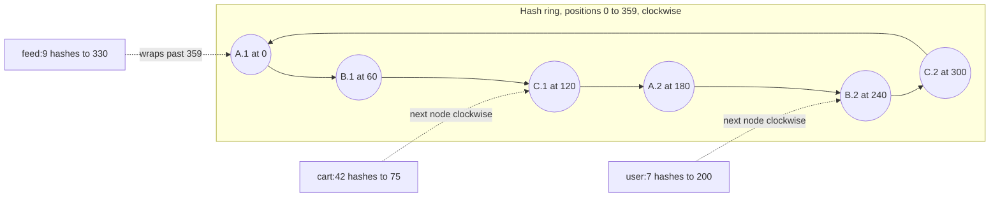

## TL;DR

- Consistent hashing maps keys and nodes onto the same circular hash space (the ring). Each key belongs to the first node clockwise from its position.
- Adding or removing a node only moves the keys in one arc of the ring, about 1/N of the data. With `hash(key) mod N`, changing N moves almost every key.
- With one position per node, arcs are uneven and a failed node dumps its whole load on one neighbor. Virtual nodes (many positions per physical node) fix both.
- Store replicas on the next distinct nodes clockwise to get replication for free from the same structure.
- Alternatives: fixed hash slots (Redis Cluster), rendezvous hashing, and jump hashing solve the same problem with different trade-offs.
- On Azure, managed services (Cosmos DB, Azure Managed Redis, Event Hubs) do the key placement for you. You implement consistent hashing when you shard your own fleet.

## Why it matters

Any time you spread keys over a changing set of servers (cache nodes, database shards, chat servers holding WebSocket connections), you need a key-to-server function that survives membership changes. The obvious one, `hash(key) mod N`, fails badly. Going from 10 to 11 servers changes the result for about 10 of every 11 keys. For a cache, that's a sudden 90% miss rate and a [stampede](./caching.md) on the database. For a sharded store, it's a migration of almost all data.

Learn's sharding pattern says it directly: with plain hashing, adding or removing a shard reassigns most keys and triggers large-scale data migration, and consistent hashing arranges the hash space so only a small fraction of keys move. It's a standard interview topic because it connects [sharding](./sharding-and-partitioning.md), caching, and [load balancing](./load-balancing.md) with one idea.

## How it works

### The ring

Pick a hash function with a large output space, for example 32 bits, and bend the range into a circle so the largest value wraps to zero. Hash each node's ID to a position on the ring. To place a key, hash it and walk clockwise to the first node. In code, the ring is a sorted array of node positions, and a lookup is a binary search: O(log V) for V positions.

Here three physical servers (A, B, C) each own two virtual nodes. Server C owns the arcs (60, 120] and (240, 300].

### Adding and removing nodes

When a new node joins at position 90, it takes over the keys between the previous node (60) and itself. Every other key stays where it was. When a node leaves, its keys move to the next node clockwise. Either way, about 1/N of keys move, and only to or from the changed node.

### Virtual nodes

With one position per server, the gaps between positions are random, so some servers own much bigger arcs than others. When a server fails, its entire arc lands on a single neighbor, which can then overload and fail too.

Virtual nodes (vnodes, or tokens) give each physical server many positions, typically 100 to 256. Each server then owns many small arcs scattered around the ring, so:

- **Load evens out.** In a quick simulation with 10 servers and 200,000 keys, one position per server left the busiest server at 2.5 times the average. With 100 virtual nodes each, the busiest was within 7% of average.
- **Failures spread.** A failed server's many small arcs go to many different successors, so the load lands on the whole cluster instead of one neighbor.
- **Capacity can be weighted.** Give a server with twice the memory twice as many virtual nodes.

The cost is a bigger ring to store and search, which is cheap even with thousands of entries.

### Replication on the ring

To keep R copies, store each key on the first R distinct physical servers clockwise from its position (skip virtual nodes that belong to a server already chosen). This list is the key's preference list. Dynamo-style databases such as Apache Cassandra combine this placement with quorum reads and writes; see [Replication](./replication.md).

### Hot keys

Consistent hashing balances keys, not traffic. One viral key still lands on one server. Fixes sit on top of the ring: replicate hot keys to several servers and read from any, add a local cache, or use consistent hashing with bounded loads, which sends a key to the next server when its owner is above a load cap.

### Alternatives

- **Fixed hash slots.** Hash keys into a fixed number of slots (Redis Cluster uses 16,384), then assign slots to nodes. Moving a slot is an explicit operation, and the slot map is small enough for every client to hold.
- **Rendezvous (highest random weight) hashing.** For each key, score every node with `hash(key, node)` and pick the highest. Moves the same 1/N of keys and needs no virtual nodes, but each lookup costs O(N).
- **Jump consistent hash.** A few lines of arithmetic map a key to one of N buckets with minimal movement and no memory. Buckets must be numbered 0 to N-1, so you can add or remove only at the end.

## Trade-offs

| Approach | Keys moved when N changes | Balance | Lookup cost | Notes |
| --- | --- | --- | --- | --- |
| `hash mod N` | Almost all | Even | O(1) | Fine only if N never changes |
| Ring, one position per node | About 1/N | Uneven | O(log N) | Failure overloads one neighbor |
| Ring with virtual nodes | About 1/N | Close to even | O(log V) | The common choice |
| Fixed hash slots | Only the slots you move | Even if slots are balanced | O(1) | Needs a slot map and a rebalance step |
| Rendezvous hashing | About 1/N | Even | O(N) | Simple, good for small N |

- **Membership must agree.** Every client has to see the same ring. Distribute it through a coordination service or gossip, and expect brief disagreement during changes.
- **Moving keys still costs.** Consistent hashing limits how many keys move; it doesn't move them. A cache just takes misses, while a database has to stream data to the new node before it serves it.

## On Azure

Most Azure data services place keys for you, so you choose a good key instead of building a ring:

- **Azure Cosmos DB** uses hash-based partitioning to place logical partitions on physical partitions and splits them as you grow. See [Sharding and partitioning](./sharding-and-partitioning.md).
- **Azure Managed Redis** uses fixed hash slots: the key space is split into 16,384 slots spread across shards. With the OSS clustering policy, all keys in a multi-key command must map to the same hash slot, so group related keys with a hash tag such as `{user:42}:cart`. See [Caching](./caching.md).
- **Azure Event Hubs** hashes a partition key to a partition. On tiers that let you add partitions, the mapping of partition keys to partitions changes when you do, which is the `mod N` problem in practice; plan the partition count up front. See [Event streaming](./event-streaming.md).

You build consistent hashing yourself when you route to a fleet you run: self-hosted cache nodes on virtual machines, or a pool of chat servers in Azure Kubernetes Service where each conversation should land on the same server. Azure Load Balancer and Application Gateway route by connection or session affinity, not by your application key, so key-based routing lives in your client library or a routing tier you own.

## Interview tips

- Start with why `mod N` fails, with a number: "Going from 10 to 11 nodes remaps about 90% of keys."
- Draw the ring, place three nodes and two keys, then add a node and show which keys move.
- Bring up virtual nodes before the interviewer asks about uneven load or cascading failure.
- Separate key balance from traffic balance, and have a hot-key answer ready.
- Expect follow-ups: How do clients learn the ring? How do you add a node to a database (not a cache) without serving missing data? Why does Redis use slots instead of a ring?
- Trap: claiming consistent hashing balances load perfectly. Without virtual nodes it doesn't, and with them it balances keys, not requests.

## Further reading

- [Sharding pattern](https://learn.microsoft.com/azure/architecture/patterns/sharding)
- [Azure Managed Redis architecture](https://learn.microsoft.com/azure/redis/architecture)
- [Scale an Azure Managed Redis instance](https://learn.microsoft.com/azure/redis/how-to-scale)
- [Event Hubs features and terminology](https://learn.microsoft.com/azure/event-hubs/event-hubs-features)
- [Hello Interview: Consistent hashing](https://www.hellointerview.com/learn/system-design/core-concepts/consistent-hashing)
- [The Coding Gopher: Consistent hashing for dummies](https://thecodinggopher.substack.com/p/consistent-hashing-for-dummies)
- Related: [Sharding and partitioning](./sharding-and-partitioning.md), [Caching](./caching.md), [Load balancing](./load-balancing.md)
