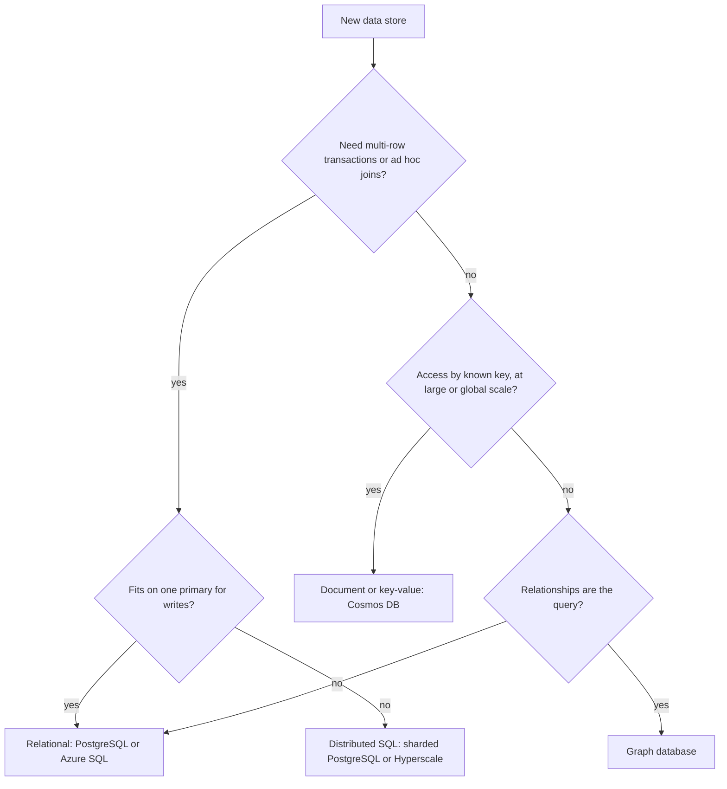

## TL;DR

- Relational databases store normalized tables, join them at query time, and give you ACID transactions across any rows. They scale up first, then out with replicas, then with sharding.
- NoSQL databases (key-value, document, wide-column, graph) model data around known access patterns and partition it across machines from day one. You get horizontal scale and predictable latency in exchange for fewer cross-item guarantees.
- Choose from access patterns, consistency needs, and scale. A relational database is the right default until a requirement rules it out.
- The categories blur: PostgreSQL stores JSON documents, and Cosmos DB offers ACID transactions within one partition key.
- On Azure: Azure SQL Database and Azure Database for PostgreSQL flexible server for relational, Azure Cosmos DB for globally distributed NoSQL, and Azure DocumentDB for MongoDB workloads.

## Why it matters

The database is the hardest component to change later. It decides your data model, which queries are cheap, which [consistency guarantees](../01-fundamentals/consistency-and-cap.md) you can offer, and how far you can [scale](../01-fundamentals/scalability.md) before a re-architecture. Every other box in the diagram can be swapped in a sprint. Migrating a live database takes quarters.

Interviewers don't want "SQL for structured data, NoSQL for scale." They want a choice tied to the workload: "Orders need multi-row transactions and ad hoc reporting, so PostgreSQL. The activity feed is append-heavy, read by user ID, and needs to grow without limit, so Cosmos DB partitioned by user."

## How it works

### Relational databases

Data lives in tables with a fixed schema. You normalize it so each fact is stored once (a customer row, an order row pointing to the customer, line items pointing to the order) and join at read time. SQL is declarative: the query planner picks indexes and join order. A transaction can touch any rows in the database and is atomic, consistent, isolated, and durable (ACID). Most engines use multiversion concurrency control (MVCC), so readers don't block writers.

Strengths: flexible queries you didn't plan for, strong integrity (foreign keys, unique constraints, check constraints), and mature tooling. The weakness is scale-out. A single primary handles all writes, so once you outgrow the biggest machine you add [read replicas](./replication.md), then [shard](./sharding-and-partitioning.md), and each step takes away some of what made SQL convenient (cross-shard joins and transactions).

### NoSQL databases

"NoSQL" covers several families that share one idea: give up general-purpose joins and multi-item transactions to make distribution simple.

| Family | Data shape | Typical queries | Examples |
| --- | --- | --- | --- |
| Key-value | Opaque value per key | Get and put by key | Redis, Cosmos DB for Table |
| Document | JSON document per ID | By ID, by partition key plus filters | Cosmos DB for NoSQL, MongoDB |
| Wide-column | Rows of sparse columns, sorted by clustering key | Range scans within a partition | Apache Cassandra |
| Graph | Vertices and edges | Traversals ("friends of friends") | Cosmos DB for Apache Gremlin |

You model data around the reads you'll run. Data that is read together is stored together: an order document embeds its line items, a user's feed is partitioned by user ID. Every item carries a partition key, the database hashes it to pick a machine, and queries that include the partition key go to one machine. Queries without it fan out to every partition and cost more as you grow.

### Modeling the same data both ways

Take an e-commerce order. Relationally, it's three tables: `customers`, `orders`, and `order_items`, with foreign keys. Showing an order joins `orders` to `order_items`. Reporting revenue by product is one `GROUP BY`.

In a document store partitioned by `customerId`, the order is one document with the items embedded. Showing an order is a single point read. Listing a customer's orders is a query within one partition. Revenue by product across all customers is a cross-partition scan, so you'd maintain it separately (a change feed into an analytics store or a counter document). The document model makes the planned reads cheap and the unplanned ones expensive.

### Transactions and consistency

Relational databases default to strong consistency on the primary and let you choose isolation levels. NoSQL systems usually scope transactions to one partition: Cosmos DB supports full ACID transactions with snapshot isolation for operations within the same logical partition key. Across partitions, you design for eventual consistency with idempotent writes, outbox tables, or sagas. Distributed NoSQL databases also let you pick read consistency per request or per account, from strong to eventual.

## Trade-offs

| Dimension | Relational | NoSQL (document, key-value) |
| --- | --- | --- |
| Schema | Enforced by the database; migrations required | Flexible per item; enforced by the application |
| Queries | Any query, planner chooses | Fast for designed access paths; fan-out for the rest |
| Transactions | Across any rows | Usually within one partition |
| Write scale | One primary, then sharding | Horizontal by partition key |
| Joins | Native | Denormalize or join in the application |
| Cost model | Provisioned compute and storage | Often throughput-based (per request unit) |
| Failure modes | Primary failover, replica lag | Hot partitions, cross-partition query cost |

- **Denormalization moves work to writes.** Embedding the customer's name in every order makes reads cheap, but a name change now updates many documents.
- **Schemaless still has a schema.** It's enforced by every reader instead of the database. Version your documents.
- **"Scale" is often the wrong reason.** A tuned PostgreSQL primary with read replicas handles more load than most interview systems need. Bring up NoSQL when you have a concrete reason: global multi-region writes, unbounded growth by key, or single-digit-millisecond reads at very high request rates.
- **Polyglot persistence is normal.** Most real systems use a relational database for the core records, a cache, a [search index](./search.md), and object storage for files.

## On Azure

**Azure SQL Database** is a fully managed relational database that always runs the latest stable version of the SQL Database Engine, the same engine family as SQL Server. The vCore purchasing model has three service tiers: General Purpose (remote storage, budget workloads), Business Critical (local SSD and up to three secondary replicas that can serve reads), and Hyperscale (up to 128 TB of data, with decoupled storage and separate read replicas). The DTU-based model instead sells a fixed blend of compute, memory, and I/O in three service tiers. Serverless compute scales with demand, bills per second, and can auto-pause idle databases.

**Azure Database for PostgreSQL flexible server** is managed open-source PostgreSQL. Compute comes in three tiers: Burstable, General Purpose, and Memory Optimized. Zone-redundant high availability keeps a synchronous standby in another zone, read replicas scale reads, and the pgvector extension adds vector search. Elastic clusters add horizontal sharding of PostgreSQL across nodes; use them for new distributed PostgreSQL work, because Azure Cosmos DB for PostgreSQL is on a retirement path and no longer recommended for new projects.

**Azure Cosmos DB** is a globally distributed NoSQL database with several APIs: NoSQL (native JSON documents), MongoDB, Apache Cassandra, Apache Gremlin (graph), and Table (key-value). Design points:

- **Request units (RU/s).** Every operation costs RUs. A point read of a 1 KB item costs 1 RU, and queries, writes, and indexing cost more. You provision throughput manually, let autoscale adjust it, or use serverless and pay per RU consumed.
- **Partition key.** Cosmos DB uses hash-based partitioning. Each logical partition (all items with one partition key value) holds up to 20 GB and serves up to 10,000 RU/s, so pick a key with many distinct values and even traffic. See [Sharding and partitioning](./sharding-and-partitioning.md).
- **Limits and indexing.** Items can be up to 2 MB. Every property is indexed by default, which makes ad hoc filters work but costs RUs on every write. See [Indexing](./indexing.md).
- **Consistency.** Five levels, from strong to eventual. Session consistency, which gives each client read-your-writes, is the most widely used. Accounts with multiple write regions can't use strong consistency.

**Azure DocumentDB** (with MongoDB compatibility) is a fully managed, open-source, MongoDB-compatible database for teams that already use MongoDB drivers and tools.

A common Azure layout: Azure SQL Database or PostgreSQL for accounts, orders, and payments; Cosmos DB for high-volume per-user data such as carts, sessions, feeds, and device state; [Azure Managed Redis](./caching.md) in front of both.

## Interview tips

- Start from access patterns. List the top three reads and writes with their rates, then pick the store. Say it out loud: "Read by order ID, list by customer, need atomic inventory decrement."
- Default to relational and say why you'd leave it. That shows judgment instead of fashion.
- When you pick NoSQL, name the partition key immediately and explain why its traffic is even. A hot partition is the first thing the interviewer will look for.
- Mention the cross-partition query cost and how you'd handle a query the model didn't plan for (a secondary store, a change feed, or a [search index](./search.md)).
- Expect follow-ups: How do you keep a denormalized copy in sync? What happens to the primary during failover? How would you run a transaction that spans two partitions?
- Trap: "NoSQL doesn't support transactions." Many do, within a partition. Say what scope the guarantee covers.

## Further reading

- [Compare vCore and DTU-based purchasing models of Azure SQL Database](https://learn.microsoft.com/azure/azure-sql/database/purchasing-models)
- [Compute options in Azure Database for PostgreSQL](https://learn.microsoft.com/azure/postgresql/compute-storage/concepts-compute)
- [Request units in Azure Cosmos DB](https://learn.microsoft.com/azure/cosmos-db/request-units)
- [Partitioning and horizontal scaling in Azure Cosmos DB](https://learn.microsoft.com/azure/cosmos-db/partitioning)
- [What is Azure DocumentDB?](https://learn.microsoft.com/azure/documentdb/overview)
- [Hello Interview: Data modeling](https://www.hellointerview.com/learn/system-design/core-concepts/data-modeling)
- [Hello Interview: PostgreSQL deep dive](https://www.hellointerview.com/learn/system-design/deep-dives/postgres)
- [The Coding Gopher: Relational vs NoSQL databases](https://thecodinggopher.substack.com/p/relational-vs-nosql-databases)
- Related: [Indexing](./indexing.md), [Replication](./replication.md), [Consistency and CAP](../01-fundamentals/consistency-and-cap.md)
