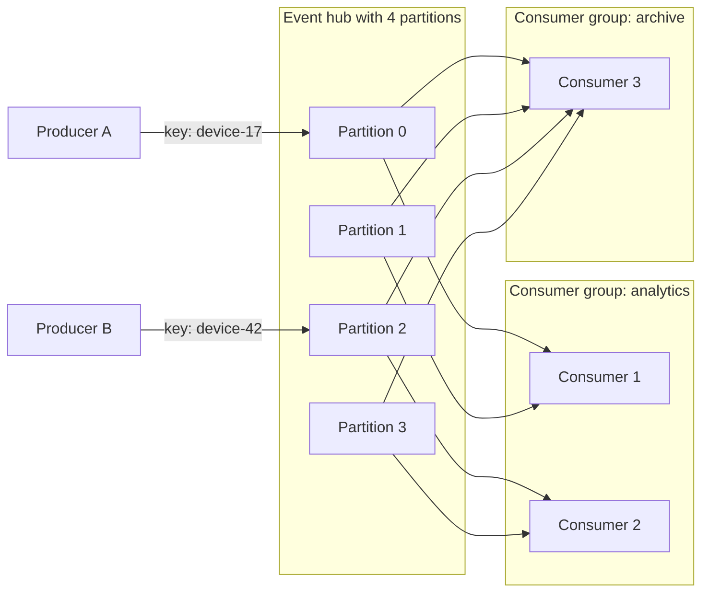

## TL;DR

- An event stream is an append-only log split into partitions. Producers append events, and the log keeps them for a retention period whether or not anyone has read them.
- Consumers track their own position (offset) in each partition. Many independent consumer groups can read the same events, and any of them can rewind and replay.
- Events with the same partition key land in the same partition and stay in order. Order across partitions isn't guaranteed.
- The partition count caps how many consumers in one group can read in parallel, and changing it later reshuffles keys. Size it up front.
- Use a stream for high-volume telemetry, change data capture, analytics pipelines, and fan-out to many readers. Use a [queue](./message-queues.md) for individual tasks that one worker should do once.
- On Azure: Event Hubs, with a Kafka-compatible endpoint, Capture to storage, and tiers from Basic to Dedicated.

## Why it matters

Some data is a firehose: clicks, telemetry from millions of devices, every row change in a database, every ride location update. You need to ingest it at hundreds of thousands of events per second, feed several systems from it (analytics, search indexing, fraud detection, an archive), and let a new system start reading next month from last week's data. A queue deletes each message once it's processed, so it can't do that. A log can.

Streams also decouple teams. The producer appends events about what happened ("OrderPlaced") without knowing who consumes them. New consumers subscribe without touching the producer, which is how event-driven architectures grow without a web of point-to-point calls. Interviewers bring up streaming in designs for metrics, ad click aggregation, ride-sharing location tracking, and news feeds; see the [interview framework](../01-fundamentals/interview-framework.md) for where it fits in a design.

## How it works

### The log and partitions

A partition is an ordered, append-only sequence of events. Each event gets an offset (its position) and is never modified. A stream (a Kafka topic or an event hub) has a fixed number of partitions spread across brokers, so writes and reads scale with the partition count.

The producer chooses a partition by key. The broker hashes the partition key, so every event for `device-17` lands in the same partition, in the order sent. Events without a key are spread round-robin. Pick the key the way you'd pick a [shard key](./sharding-and-partitioning.md): high cardinality and even traffic, and aligned with the ordering you need. If a single key gets a large share of traffic, its partition becomes the bottleneck.

### Consumer groups and offsets

A consumer group is one logical reader, such as the analytics service. The partitions are divided among the group's instances, and each partition is read by one instance at a time. That is what preserves per-partition order, and it's why the number of partitions is the maximum number of parallel consumers in a group. A group with more instances than partitions leaves some idle.

Each group tracks its own offset per partition and saves it periodically (checkpointing), so a restarted consumer resumes where it left off. Different groups don't affect each other: the archive group can be hours behind while analytics is real time. When an instance joins or leaves, the group rebalances partitions among the survivors.

### Delivery semantics

If a consumer processes events and crashes before checkpointing, it reprocesses them on restart. That is at-least-once delivery, the common default, so make processing idempotent: write results keyed by event ID, or use upserts. Checkpointing before processing gives at-most-once and loses events on a crash. Exactly-once processing needs transactional writes of output and offset together (Kafka transactions) or an idempotent sink.

### Retention and compaction

The log keeps events for a time-based retention period (a day to months) regardless of whether they've been read. That allows replay: fix a bug in a consumer, reset its offset, and reprocess. For longer history, copy the stream to object storage.

Log compaction is the alternative for keyed state. Instead of deleting by age, the broker keeps only the latest event for each key and drops older ones. A compacted topic of `user-id -> profile` acts like a table that new consumers can rebuild from the start.

### Stream processing

Consumers often aggregate rather than handle events one by one: count clicks per ad per minute, or join payments with orders within a 10-minute window. Stream processors (Kafka Streams, Apache Flink, Spark Structured Streaming) manage windows, state, and late-arriving events. In interviews, it's enough to say "windowed aggregation keyed by ad ID, with state checkpointed so a restart doesn't double count."

## Trade-offs

| | Event stream | Message queue |
| --- | --- | --- |
| Consumption | Many groups read every event | Each message goes to one consumer |
| After processing | Event stays until retention expires | Message is deleted |
| Replay | Reset the offset | Not possible |
| Ordering | Per partition | Per session or group, if supported |
| Parallelism | Capped by partition count | Add consumers freely |
| Per-message handling | No per-message ack, dead-lettering, or delay | Locks, retries, dead-letter queue, scheduling |
| Throughput | Very high, sequential I/O | Lower per entity |

- **One slow event blocks its partition.** Consumers read in order, so a poison event stalls everything behind it. Catch failures, park bad events in a side topic or storage, and move on.
- **Partition count is hard to change.** More partitions add parallelism but cost resources; changing the count remaps keys and breaks per-key order during the change.
- **Consumer lag is the key metric.** If lag keeps growing, consumers can't keep up; add instances (up to the partition count) or make processing faster.

## On Azure

**Azure Event Hubs** is the managed event streaming service. An event hub is the stream; a namespace contains event hubs and sets the tier and capacity.

| | Basic | Standard | Premium | Dedicated |
| --- | --- | --- | --- | --- |
| Capacity unit | Throughput units (up to 40) | Throughput units (up to 40) | Processing units (up to 16) | Capacity units (10, more by request) |
| Partitions per event hub | 32, fixed | 32, fixed | 100, can increase | Up to 1,024, can increase |
| Max retention | 1 day | 7 days | 90 days | 90 days |
| Consumer groups per event hub | 1 | 20 | 100 | 1,000 |
| Max event size | 256 KB | 1 MB | 1 MB | 20 MB |
| Kafka endpoint, Capture | No | Yes | Yes | Yes |

- **Throughput units.** In Basic and Standard, each throughput unit allows up to 1 MB per second or 1,000 events per second in, and up to 2 MB per second or 4,096 events per second out. Auto-inflate adds throughput units as load grows.
- **Partitions.** In Basic and Standard, you can't change the partition count after creation. In Premium and Dedicated, you can increase it but not decrease it, and the mapping of partition keys to partitions changes when you do.
- **Kafka endpoint.** Existing Kafka clients (version 1.0 and later) can usually connect by updating the connection string to point at the event hub's Kafka endpoint. Kafka Streams is in public preview in Premium and Dedicated.
- **Capture** automatically writes the stream to Azure Blob Storage or Azure Data Lake Storage in Apache Avro format, which gives you long-term history without a consumer you have to run.
- **Log compaction** keeps only the latest event per partition key, and isn't supported in the Basic tier.
- **Disaster recovery.** Geo-disaster recovery replicates metadata only (the namespace configuration), so events in flight stay in the failed region. Geo-replication in Premium and Dedicated replicates both data and metadata.

Event Hubs pairs with [Blob storage](./blob-storage.md) for Capture and checkpoints. For discrete events that trigger handlers (a file uploaded), use Event Grid; for business messages with locks and dead-lettering, use Service Bus. See [Message queues](./message-queues.md) and [messaging choices](../04-azure/messaging-choices.md).

## Interview tips

- Say why it's a stream and not a queue: multiple consumers, replay, or very high volume.
- Name the partition key and the partition count, and connect the count to peak consumer parallelism and throughput (for example, "32 partitions, 1 MB/s each at peak").
- State the ordering guarantee precisely: per key, because a key maps to one partition.
- Bring up at-least-once processing and how your consumer handles duplicates, and what happens to a poison event.
- Expect follow-ups: How do you handle a hot key? How do you reprocess a day of events after a bug? How long do you retain data, and where does older data go?
- Trap: adding consumers to fix lag past the partition count. Extra consumers in a group sit idle.

## Further reading

- [Event Hubs features and terminology](https://learn.microsoft.com/azure/event-hubs/event-hubs-features)
- [Compare Event Hubs tiers](https://learn.microsoft.com/azure/event-hubs/compare-tiers)
- [Event Hubs scalability](https://learn.microsoft.com/azure/event-hubs/event-hubs-scalability)
- [Event Hubs for Apache Kafka](https://learn.microsoft.com/azure/event-hubs/azure-event-hubs-apache-kafka-overview)
- [Event Hubs Capture](https://learn.microsoft.com/azure/event-hubs/event-hubs-capture-overview)
- [Hello Interview: Kafka deep dive](https://www.hellointerview.com/learn/system-design/deep-dives/kafka)
- Related: [Message queues](./message-queues.md), [Sharding and partitioning](./sharding-and-partitioning.md), [Scalability](../01-fundamentals/scalability.md)
