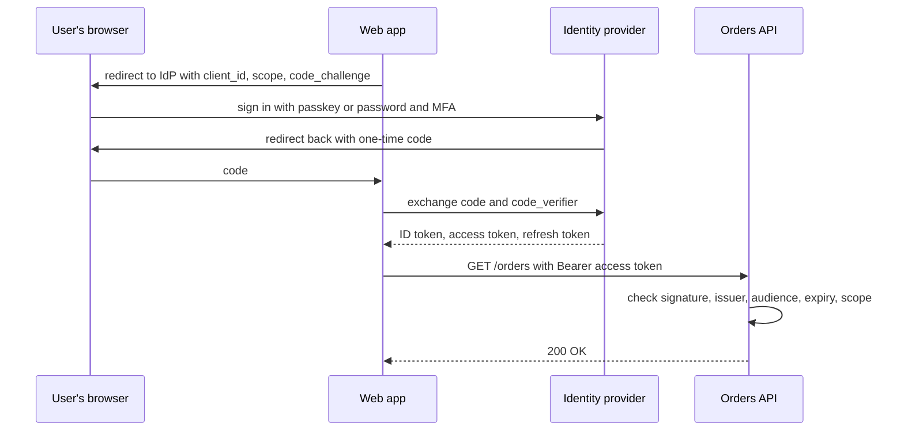

## TL;DR

- Authentication (AuthN) proves who the caller is. Authorization (AuthZ) decides what that caller may do. Design them as separate steps.
- Don't build login yourself. Send users to an identity provider with OpenID Connect (OIDC) to sign them in and OAuth 2.0 to get access tokens for your APIs.
- Browser, mobile, and single-page apps use the authorization code flow with PKCE. Background services with no user use the client credentials flow.
- APIs validate access tokens locally: signature against the provider's published keys, then issuer, audience, and expiry, then scopes or roles. No call to the provider per request.
- Access tokens are short-lived and refresh tokens get new ones. Shorter lifetimes revoke access faster but cost more token traffic.
- Services authenticate to each other with platform-managed identities, not passwords in config.
- On Azure: Microsoft Entra ID for employees and apps, Microsoft Entra External ID for customers, managed identities and workload identity federation for services, and Key Vault for the secrets you can't avoid.

## Why it matters

Every design has users, and most have more than one service. Interviewers expect you to say where a request gets authenticated, what the token carries, and how service A proves itself to service B. Weak answers either skip auth or have every service check a password against the user table.

Auth is also where breaches come from. A leaked storage key, an API that accepts a token minted for a different API, or a session that can't be revoked when an employee leaves are all design mistakes. They're cheaper to prevent on the whiteboard than in an incident.

## How it works

### AuthN and AuthZ

Authentication ends with an identity: user 42, signed in with a passkey, from tenant Contoso. Authorization asks a separate question for each action: can user 42 read order 17? Coarse checks ("has the `orders.read` scope", "is in the Admin role") can run at the [API gateway](./api-gateway.md). Fine-grained checks ("owns this order", "was shared this document") need data, so they run in the service that owns that data.

### OIDC and OAuth 2.0

The identity provider (IdP) owns passwords, MFA, passkeys, account recovery, and lockout. Your app redirects to it and gets tokens back. Three token types matter:

| Token | Who reads it | What it says |
| --- | --- | --- |
| ID token (OIDC) | The client app | Who signed in; proof of authentication |
| Access token (OAuth 2.0) | The API named in its audience | What this client may do on this API, for this user |
| Refresh token | The IdP only | Lets the client get new access tokens without another sign-in |

Pick the flow by client type:

- **Authorization code with PKCE** for web apps, single-page apps, and mobile. The code goes through the browser, but only the client that started the flow holds the verifier needed to redeem it, so an intercepted code is useless.
- **Client credentials** for daemons and service accounts, where the app acts as itself with no user.
- **On-behalf-of** when a middle-tier API calls another API and must pass the user's identity and permissions down the chain.
- **Device code** for input-constrained devices such as a smart TV: the user finishes sign-in in a browser on another device, such as a phone.

### Validating a JWT access token

Most access tokens are JSON Web Tokens: a header, a JSON payload of claims, and a signature, each base64url-encoded. An API validates one in this order:

1. **Signature.** Fetch the IdP's public signing keys from its OpenID discovery document, cache them, and verify the signature. This proves the IdP issued the token and nobody changed it.
2. **Issuer** (`iss`) is the tenant you trust.
3. **Audience** (`aud`) is this API. Skipping this lets a token minted for another API work here, which is the confused deputy problem.
4. **Expiry** (`exp`, `nbf`) is current, with a little clock-skew allowance.
5. **Permissions.** Delegated tokens carry scopes in `scp`; app roles, used for app-only access, arrive in `roles`. Check the one this endpoint needs.

Because validation is local, a single API instance can check thousands of tokens a second with no round trip to the IdP. Clients, on the other hand, should treat access tokens as opaque and never parse them.

### Sessions vs tokens

| | Server-side session | Self-contained token (JWT) |
| --- | --- | --- |
| Client holds | Random session ID in an HttpOnly cookie | The signed token |
| Each request | Look up the session in a shared store (often Redis) | Verify signature and claims locally |
| Revocation | Delete the session; takes effect at once | Valid until expiry unless you add a denylist |
| Fits | Browser apps behind your own backend | APIs, mobile clients, service calls |

A common combination is a backend-for-frontend: the browser holds only a session cookie, and the backend keeps the OAuth tokens and attaches them to API calls. Tokens never reach browser JavaScript.

### Service-to-service identity

Services need identities too. From worst to best:

- **Shared secrets or API keys in config.** They leak through logs and repos, never expire, and are hard to rotate.
- **Client credentials with a secret or certificate.** Better, but someone still stores and rotates it.
- **Platform-managed identity.** The platform issues and rotates the credential, and the code asks the local runtime for a token. Nothing to leak.
- **Workload identity federation.** A workload outside the platform (a CI job, a Kubernetes pod) presents a token from its own issuer, and the IdP exchanges it for an access token based on a configured trust. Again, no stored secret.

Secrets that remain, such as a third-party API key, go in a secrets store with access control and audit, read at startup or through a reference, never committed to the repo.

## Trade-offs

- **Token lifetime.** Short access tokens limit the damage of a stolen token and pick up permission changes sooner, but every client refreshes more often. Long ones are cheaper and riskier. Event-based revocation (below) relaxes this.
- **Stateless vs stateful.** JWT validation scales without a shared store but can't revoke instantly. Sessions revoke instantly but add a lookup to every request. See [Caching](./caching.md) for the store.
- **Where to authorize.** Validating at the gateway gives one consistent check and rejects bad traffic early. Services should still validate the token themselves, so a request that bypasses the gateway, or a compromised neighbor, gets nothing for free.
- **Role checks vs per-object checks.** Roles (RBAC) are simple and fit "admins can delete". Sharing models ("anyone I shared this folder with") need per-object relationships, which means a lookup and often a dedicated authorization service.
- **Build vs buy.** Running your own password store means owning hashing, MFA, recovery, and breach response. A managed IdP removes that work, and you accept its token formats and limits.

## On Azure

**Microsoft Entra ID** is the identity provider for employees, internal apps, and Azure itself (a workforce tenant). It speaks OIDC and OAuth 2.0 and supports authorization code with PKCE, client credentials, on-behalf-of, and device code flows.

- **Token lifetimes.** Access tokens get a random default lifetime between 60 and 90 minutes (75 on average), which spreads refresh traffic over time. Refresh tokens last 24 hours for single-page apps and 90 days for most other clients, and replace themselves with a new one on each use.
- **Conditional Access** (requires Microsoft Entra ID P1) combines signals such as the user or group, IP location, and device, and can block access or require MFA, a specific authentication strength, or a compliant device.
- **Continuous access evaluation.** For apps that support it, critical events (account disabled or deleted, password reset) revoke sessions in near real time, with up to 15 minutes of propagation. Tokens in these sessions can then live up to 28 hours, because revocation no longer depends on expiry.
- **Passkeys (FIDO2)** give phishing-resistant sign-in.

**Microsoft Entra External ID** is the customer identity (CIAM) product: an external tenant for consumers and business customers, with self-service sign-up, sign-in, and password reset, and sign-in with social or enterprise identities. Azure AD B2C is no longer sold to new customers as of May 1, 2025, so new consumer apps start on External ID.

**Managed identities** give Azure resources an Entra identity with no credentials to manage, at no extra cost. A system-assigned identity is tied to one resource and deleted with it. A user-assigned identity is a standalone resource you can attach to several resources, which suits a fleet of identical instances. Grant the identity a role, such as Storage Blob Data Contributor on a [storage account](./blob-storage.md), and the code gets tokens from the platform.

**Workload identity federation** lets GitHub Actions, Kubernetes workloads, and other external issuers get Entra tokens without stored secrets.

**Azure Key Vault** stores secrets, keys, and certificates. Use Azure RBAC for data-plane access; it's the recommended model and, starting with API version 2026-02-01, the default for new vaults. Apps read it through their managed identity.

**Azure API Management** validates tokens at the gateway with the `validate-jwt` policy (JWTs from an identity provider) or `validate-azure-ad-token` (Entra tokens), before requests reach the backends.

[Networking and security](../04-azure/networking-and-security.md) shows how identity, Key Vault, and private networking fit into one design.

## Interview tips

- Name the IdP and the flow in one sentence: "Users sign in through Entra External ID with the authorization code flow and PKCE; the app calls our APIs with access tokens."
- Say what the API checks on each token: signature, issuer, audience, expiry, scope. Mention the audience check by name.
- Separate coarse authorization at the gateway from ownership checks in the service.
- For service-to-service, say "managed identity, no secrets" and show which role it gets.
- Expect follow-ups: How do you log a user out everywhere (revoke refresh tokens, short access tokens, or continuous access evaluation)? What happens when the IdP is down (cached signing keys keep validation working; new sign-ins fail)? How do you rotate signing keys (validate against every key in the published set)?
- Trap: storing a JWT in browser local storage for a high-value app. Any script injection can read it; a backend-held token behind an HttpOnly cookie is safer.

## Further reading

- [Access tokens in the Microsoft identity platform](https://learn.microsoft.com/entra/identity-platform/access-tokens)
- [Authorization code flow](https://learn.microsoft.com/entra/identity-platform/v2-oauth2-auth-code-flow)
- [Client credentials flow](https://learn.microsoft.com/entra/identity-platform/v2-oauth2-client-creds-grant-flow)
- [Permissions and consent overview](https://learn.microsoft.com/entra/identity-platform/permissions-consent-overview)
- [What are managed identities for Azure resources?](https://learn.microsoft.com/entra/identity/managed-identities-azure-resources/overview)
- [Workload identity federation](https://learn.microsoft.com/entra/workload-id/workload-identity-federation)
- [External ID overview](https://learn.microsoft.com/entra/external-id/external-identities-overview)
- Related: [API gateway](./api-gateway.md), [API design](../01-fundamentals/api-design.md), [Blob storage](./blob-storage.md)
