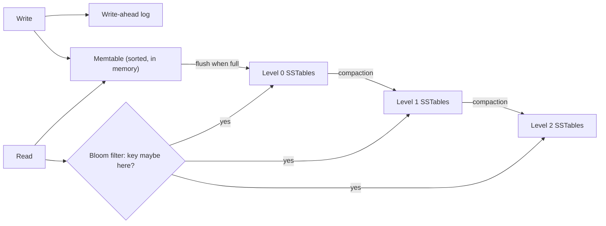

## TL;DR

- An index is a second, sorted copy of some columns that points back to the rows. It turns a full scan into a lookup, and every write pays to keep it current.
- B-trees keep keys sorted in fixed-size pages and update them in place. They are the default in relational databases and are strong at point reads and range scans.
- LSM trees buffer writes in memory, flush them as sorted immutable files, and merge those files in the background. They take high write rates at the cost of extra read work and compaction.
- Secondary indexes cover columns other than the primary key. In a partitioned database, they are either local to each partition or global across them.
- In a composite index, column order decides which queries it can serve: equality columns first, then the range or sort column.
- On Azure: Azure SQL Database uses B+ tree rowstore and columnstore indexes, PostgreSQL adds GIN and vector indexes, and Cosmos DB indexes every property by default.

## Why it matters

Most "the database is slow" problems are missing or wrong indexes. A query that filters 100 million rows by `user_id` reads every row without an index and a handful of pages with one. Fixing that is cheaper than [caching](./caching.md) the result or [sharding](./sharding-and-partitioning.md) the table, so check indexes before you reach for either.

Indexes also explain why storage engines behave the way they do. When an interviewer asks why Cassandra handles write-heavy workloads well, or why a table with ten indexes has slow inserts, the answer is the index structure. Knowing B-trees and LSM trees lets you reason about [databases](./databases-sql-vs-nosql.md) you haven't used.

## How it works

### B-trees

A B-tree (most engines use the B+ tree variant) stores keys in sorted order across fixed-size pages. The root page holds separator keys that point to child pages, and the leaf pages hold the keys plus either the row itself or a pointer to it. Leaves link to their neighbors, so a range scan finds the first key and walks sideways.

The fan-out is what makes it fast. An 8 KB page holds hundreds of keys, so a tree with a fan-out of 500 indexes 125 million rows in three levels and 62 billion in four. The upper levels stay in memory, so a lookup costs one or two disk reads.

Writes update pages in place. Inserting into a full page splits it in two. Random keys (like UUIDv4) scatter inserts across the whole tree and cause more splits and cache misses than increasing keys, which always append to the rightmost leaf.

### LSM trees

A log-structured merge tree optimizes for writes. Each write goes to a write-ahead log for durability and to an in-memory sorted table (the memtable). When the memtable fills, the engine flushes it to disk as an immutable sorted file (an SSTable). Background compaction merges SSTables into larger, non-overlapping files in levels, discarding overwritten and deleted values.

Writes are sequential appends, which disks and SSDs handle well. Reads may have to check the memtable and several levels, so engines keep a Bloom filter per file to skip files that can't contain the key. RocksDB, Cassandra, and many time-series stores use LSM trees.

### Clustered, secondary, and covering indexes

A clustered index stores the table rows themselves in index order; a table has at most one. A secondary (nonclustered) index stores the indexed columns plus a pointer back to the row, so a query that needs other columns does a second lookup per row. A covering index includes every column the query needs (SQL Server and PostgreSQL call the extras included columns), so the second lookup disappears.

In a [partitioned](./sharding-and-partitioning.md) database, a secondary index is either local (each partition indexes only its own rows, so a query without the partition key asks every partition) or global (one index partitioned by the indexed value, so lookups go to one place but every write may update a remote index, often asynchronously).

### Composite indexes

A composite index sorts by the first column, then by the second within each value of the first, and so on. An index on `(customer_id, created_at)` serves:

- `WHERE customer_id = 42` (prefix match)
- `WHERE customer_id = 42 AND created_at > '2026-01-01'` (equality, then range)
- `WHERE customer_id = 42 ORDER BY created_at DESC LIMIT 20` (no sort step)

It does not help `WHERE created_at > '2026-01-01'` on its own, because those rows are scattered across every customer. Put equality columns first and the range or sort column last.

### Other index types

- **Hash indexes** answer equality only, with no ranges.
- **Inverted indexes** map each term to the documents that contain it, for full-text search. See [Search](./search.md).
- **Geospatial indexes** (geohash, quadtrees, R-trees) answer "within this area" queries.
- **Vector indexes** (HNSW, IVF, DiskANN) find approximate nearest neighbors among embeddings.

## Trade-offs

| | B-tree | LSM tree |
| --- | --- | --- |
| Write path | Random in-place page updates | Sequential appends, then compaction |
| Write throughput | Good | Higher |
| Point reads | One path from root to leaf | Memtable plus several levels, helped by Bloom filters |
| Range scans | Walk linked leaves | Merge across levels |
| Space | Free space in partly filled pages | Old versions until compaction |
| Background work | Page splits, occasional rebuilds | Continuous compaction that competes for I/O |
| Typical engines | SQL Server, PostgreSQL, MySQL InnoDB | RocksDB, Cassandra |

- **Every index slows writes.** Each insert updates the table and every index on it. Learn's SQL index guide puts it directly: don't create indexes speculatively; monitor usage and remove unused ones.
- **Selectivity matters.** An index on a boolean column rarely helps, because half the table matches. A filtered or partial index on just the rare value can.
- **Indexes cost memory.** If the working set of indexes no longer fits in RAM, lookups start hitting disk and latency jumps.
- **Global secondary indexes lag.** If they're updated asynchronously, a read right after a write can miss.

## On Azure

**Azure SQL Database.** Rowstore indexes are organized as B+ trees, with one clustered index per table and many nonclustered ones. Included columns make covering indexes, filtered indexes cover a well-defined subset of rows, and columnstore indexes compress data by column for analytics. Automatic tuning can recommend or apply index changes; by default, `FORCE_LAST_GOOD_PLAN` is enabled while `CREATE_INDEX` and `DROP_INDEX` are disabled, so index changes stay a decision you make.

**Azure Database for PostgreSQL flexible server.** Standard PostgreSQL index types apply: B-tree by default, GIN for JSONB and full-text, GiST for geometric data. For vectors, pgvector supports IVFFlat and HNSW. The IVFFlat index builds faster and uses less memory than HNSW, but gives up some query performance. A third type, DiskANN, is only supported in Azure Database for PostgreSQL flexible server.

**Azure Cosmos DB.** The default indexing policy indexes every property of every item and enforces range indexes, so any filter works without setup. That costs RUs on every write, and excluding paths you never query reduces the latency and RU charge of write operations. Queries that have an `ORDER BY` clause with two or more properties require a composite index, and the index paths must match the sequence of properties in the `ORDER BY`. Vector indexes come in three types: `flat` (up to 505 dimensions), `quantizedFlat`, and `diskANN` (up to 4,096 dimensions). Vector policies are immutable after creation.

**Azure AI Search** builds inverted indexes for full-text search and HNSW indexes for vectors. See [Search](./search.md).

## Interview tips

- When you write a query in the design, write its index next to it: "Feed reads use `(user_id, created_at DESC)`."
- Explain composite index order with a concrete query. "Equality first, then range" is the line interviewers listen for.
- If the workload is write-heavy (metrics, logs, events), bring up LSM-based stores and why they absorb writes better.
- In a sharded design, say whether a secondary index is local or global, and what a query that lacks the shard key costs.
- Expect follow-ups: Why not index every column? How do you add an index to a billion-row table without downtime (online index builds, building on a replica)? Why is my `LIKE '%term%'` slow?
- Trap: proposing an index on a low-cardinality column such as `status` and expecting it to speed up a query that matches most rows.

## Further reading

- [SQL Server and Azure SQL index architecture and design guide](https://learn.microsoft.com/sql/relational-databases/sql-server-index-design-guide)
- [Indexing policies in Azure Cosmos DB](https://learn.microsoft.com/azure/cosmos-db/index-policy)
- [Optimize performance when using pgvector](https://learn.microsoft.com/azure/postgresql/extensions/how-to-optimize-performance-pgvector)
- [Automatic tuning in Azure SQL Database](https://learn.microsoft.com/azure/azure-sql/database/automatic-tuning-overview)
- [Hello Interview: Database indexing](https://www.hellointerview.com/learn/system-design/core-concepts/db-indexing)
- [The Coding Gopher: ACID, indexes, sharding, and 6 other database concepts](https://thecodinggopher.substack.com/p/acid-indexes-sharding-and-6-other)
- Related: [Databases: SQL vs NoSQL](./databases-sql-vs-nosql.md), [Search](./search.md), [Scalability](../01-fundamentals/scalability.md)
