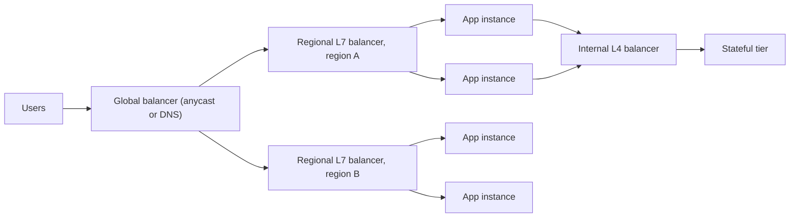

## TL;DR

- A load balancer gives clients one stable address in front of many interchangeable instances, so you can add, remove, and lose instances without clients noticing.
- Layer 4 balancers route connections by hashing IP addresses and ports. Layer 7 balancers terminate TLS, read the HTTP request, and route each request by host, path, or header.
- Global balancing picks a region (by DNS or anycast). Regional balancing picks an instance. Production designs stack both.
- Health checks and connection draining decide whether users see errors during failures and deploys. The algorithm matters less than people think.
- On Azure: Front Door for global HTTP, Traffic Manager for global DNS steering, Application Gateway for regional HTTP, and Azure Load Balancer for TCP and UDP.

## Why it matters

[Horizontal scaling](../01-fundamentals/scalability.md) only works if traffic actually reaches the new instances. Without a load balancer, clients hold a list of server addresses, and every change to that list (a scale-out, a crashed VM, a deploy) becomes a client problem. A load balancer turns a fleet into a single endpoint and moves the routing decision to one place you control.

It is also your first line of [availability](../01-fundamentals/availability-and-reliability.md). A balancer that probes each instance and stops sending traffic to the broken ones turns a dead server from an outage into a capacity dip. The failure you are designing against is a sick instance that still accepts connections: it returns 500s or hangs for 30 seconds, and a naive balancer keeps feeding it a fair share of users.

## How it works

### Layer 4 versus layer 7

A **layer 4** balancer sees TCP or UDP packets. It hashes fields such as source IP, source port, destination IP, destination port, and protocol (the five-tuple) to pick a backend, then forwards every packet of that flow to the same place. It never decrypts traffic, so it adds microseconds, handles millions of flows, and works for any protocol: databases, game servers, MQTT, raw gRPC.

A **layer 7** balancer terminates TLS and parses HTTP. Because it sees each request, it can route `/api/*` to one pool and `/images/*` to another, retry an idempotent GET on a different backend, add headers, enforce a web application firewall, and balance individual HTTP/2 streams. It pays for that with CPU per request, a few milliseconds of latency, and the operational burden of holding your TLS certificates.

The distinction matters most for long-lived connections. A layer 4 balancer balances *connections*, not requests. If 1,000 clients each open one gRPC or WebSocket connection and then send wildly different volumes, the backends that drew the chatty clients run hot while others idle. A layer 7 balancer that understands HTTP/2 can spread the requests inside one connection across many backends.

### Choosing a backend

| Algorithm | How it picks | Use it when |
| --- | --- | --- |
| Round robin | Next backend in order | Requests cost about the same and instances are identical |
| Weighted round robin | Round robin, scaled by weight | Mixed instance sizes, or shifting 5% of traffic to a canary |
| Least connections or least outstanding requests | Backend with the fewest in-flight requests | Request cost varies a lot (search queries, report generation) |
| Power of two choices | Sample two backends at random, take the less loaded | Many balancer nodes with stale load data; avoids herding onto one "least loaded" box |
| Hash (source IP, header, or key) | Same input always maps to the same backend | You need affinity, such as a cache shard per user |

Plain hashing with $\operatorname{hash}(\text{key}) \bmod N$ remaps almost every key when $N$ changes. If affinity matters across scale events, use [consistent hashing](./consistent-hashing.md), which moves only about $1/N$ of the keys.

### Health checks

Balancers find broken instances in two ways. **Active probes** call an endpoint such as `/healthz` every few seconds and eject an instance after a run of failures. **Passive checks** (outlier detection) watch real traffic and eject an instance whose error rate or latency spikes.

Keep the probe shallow. If `/healthz` queries the database and the database has a 10-second hiccup, every instance fails its probe at once, the balancer ejects the whole pool, and a brief blip becomes a full outage. Probe whether *this process* can serve, and let dependency failures surface as errors the client can retry. Separate liveness ("restart me") from readiness ("don't send me traffic yet"), so an instance that is warming its cache does not get traffic before it can serve it.

### Affinity and draining

Sticky sessions pin a user to one instance with a cookie or an IP hash. They let you keep session state in process memory, but that state dies with the instance, and sticky users keep hammering a hot node while new instances sit idle. Prefer stateless app servers that keep sessions in a shared cache or database, and treat stickiness as a performance hint, not a correctness requirement.

During a deploy or scale-in, **connection draining** stops new requests to an instance and gives in-flight requests time to finish (commonly 30 to 300 seconds) before the instance is removed. Without it, every deploy drops a slice of requests.

### Global balancing

Two techniques pick a region:

- **DNS-based** steering answers each DNS lookup with the address of a healthy, nearby region. It works for any protocol, but resolvers and clients cache answers for the record's TTL (and some ignore TTL entirely), so failover takes minutes and is uneven.
- **Anycast** advertises one IP address from many edge locations. Internet routing delivers each client to the nearest one, and the edge proxies the request to a healthy region. Failover happens at the proxy in seconds, with no DNS change.

The balancer itself must not be a single point of failure. Managed balancers run as many nodes across [availability zones](../01-fundamentals/availability-and-reliability.md), and anycast lets an edge location fail without clients changing addresses.

## Trade-offs

| Choice | You gain | You pay |
| --- | --- | --- |
| Layer 4 | Any protocol, very low latency, huge flow counts, no TLS keys at the balancer | Balances connections not requests; no path routing, retries, or WAF |
| Layer 7 | Per-request routing, retries, header rewrites, WAF, HTTP/2 stream balancing | CPU and latency per request; holds certificates; HTTP-only |
| DNS global steering | Works for any protocol; no proxy in the data path | Failover bounded by DNS caching; no per-request control |
| Anycast global proxy | Fast failover, edge TLS termination, caching and WAF at the edge | HTTP-only; another hop and another bill; origin must trust only the proxy |
| Sticky sessions | In-memory session state works | Uneven load, lost sessions on instance failure, slower scale-in |
| Deep health checks | Catch broken dependencies | One shared dependency failing ejects the whole fleet |

## On Azure

Azure splits load balancing along two axes: global versus regional, and HTTP(S) versus everything else. The [Azure load-balancing decision guide](https://learn.microsoft.com/azure/architecture/guide/technology-choices/load-balancing-overview) walks the same tree.

| Need | Service | Layer and scope | Notes |
| --- | --- | --- | --- |
| Public web app or API in one or more regions | Azure Front Door (Standard or Premium) | L7, global, anycast | Routing methods: latency (the default), priority, weighted, and session affinity. Also caches and runs WAF at the edge. |
| Global steering for non-HTTP endpoints | Traffic Manager | DNS, global | Routing methods: priority, weighted, performance, geographic, multivalue, subnet. Not a proxy, so it never sees traffic. |
| Regional HTTP routing, private apps, WAF in the VNet | Application Gateway v2 (Standard_v2 or WAF_v2) | L7, regional | Autoscaling, zone redundancy, path-based routing, WebSocket, HTTP/2. |
| Ingress for AKS | Application Gateway for Containers | L7, regional | Configured through the Kubernetes Gateway API or Ingress; Azure runs the data plane outside the cluster. |
| TCP or UDP, internal tiers, VM scale sets | Azure Load Balancer Standard | L4, regional | Five-tuple hash by default. Session persistence by client IP or by client IP and protocol. |
| One anycast IP across regional L4 balancers | Azure Load Balancer, global tier | L4, global | Pass-through, keeps the client IP; frontends must be public. |

Decisions that change the design:

- **Retired SKUs.** Basic Load Balancer was retired on September 30, 2025, and the Application Gateway v1 SKUs retired on April 28, 2026. Design on Standard Load Balancer and Application Gateway v2.
- **Front Door or Traffic Manager for global failover.** Traffic Manager depends on DNS caching, so the decision guide notes it can't fail over as quickly as Front Door. Use Front Door for HTTP and keep Traffic Manager for protocols Front Door does not carry.
- **Zones.** Set Load Balancer frontends to zone-redundant; Learn recommends zone-redundant over zonal for all workloads. Deploy Application Gateway v2 across zones.
- **A common stack.** Front Door (WAF, TLS, global routing) in front of a regional Application Gateway or Application Gateway for Containers, with an internal Standard Load Balancer for non-HTTP tiers. Lock origins so they accept traffic only from Front Door.

The [Azure service map](../04-azure/azure-service-map.md) puts these balancers next to the gateway, CDN, and compute options.

Gotcha: when a Load Balancer health probe fails, the balancer stops sending *new* connections to that instance, but established TCP connections continue. A hung instance with long-lived connections keeps its clients until they time out, so pair probes with client-side timeouts and reconnect logic.

## Interview tips

- Say which layer you mean. "An L7 balancer in each region behind a global anycast front end" is a design; "a load balancer" is a box.
- When the interviewer asks whether the balancer is a single point of failure, explain that managed balancers are replicated across zones and that anycast and DNS give you a second layer across regions.
- Bring up health checks before the algorithm. Name the shallow-versus-deep trade-off and how you avoid ejecting the whole fleet.
- For WebSockets, gRPC, or chat, point out that L4 balances connections, so load drifts. Mention least-connections, connection limits per instance, and periodic reconnects.
- Expect follow-ups: How do you deploy without dropping requests (draining, readiness probes)? How fast is regional failover (seconds with anycast, minutes with DNS)? Where does TLS terminate, and is traffic re-encrypted to the backend?
- Trap: relying on sticky sessions to hold state. Move session state to a cache so any instance can serve any user.

## Further reading

- [Azure load-balancing options decision guide](https://learn.microsoft.com/azure/architecture/guide/technology-choices/load-balancing-overview)
- [Azure Load Balancer distribution modes](https://learn.microsoft.com/azure/load-balancer/distribution-mode-concepts)
- [Azure Front Door routing methods](https://learn.microsoft.com/azure/frontdoor/routing-methods)
- [How Traffic Manager works](https://learn.microsoft.com/azure/traffic-manager/traffic-manager-how-it-works)
- [Hello Interview: Networking Essentials](https://www.hellointerview.com/learn/system-design/core-concepts/networking-essentials)
- Related: [API gateway](./api-gateway.md), [CDN and edge](./cdn-and-edge.md), [Networking essentials](../01-fundamentals/networking-essentials.md)
