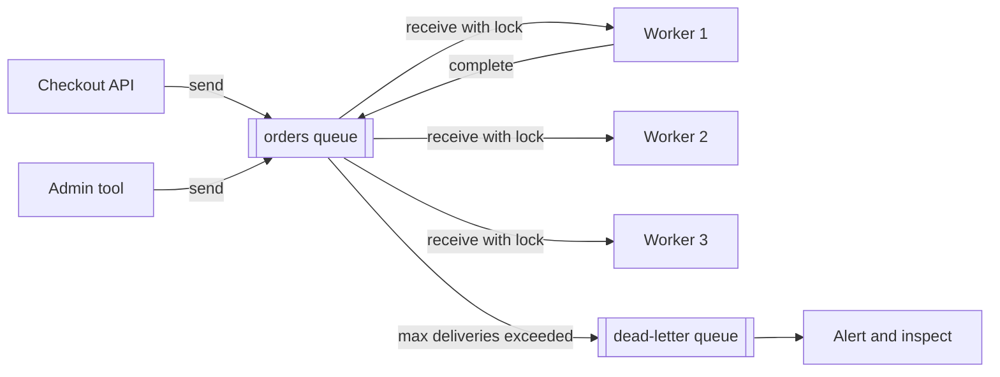

## TL;DR

- A message queue sits between a producer and a consumer. The producer hands off work and moves on, and consumers process it at their own pace.
- On a queue, each message goes to one of several competing consumers. On a pub/sub topic, each subscription gets its own copy.
- Brokers deliver at least once. A consumer that crashes mid-message gets it again, so every consumer must be idempotent.
- Failed messages are retried a limited number of times and then moved to a dead-letter queue for inspection, so one bad message can't block the rest.
- Ordering is per key at best. Global ordering means one consumer at a time.
- On Azure: Service Bus for business messaging (queues, topics, sessions, dead-lettering), Storage queues for simple, very large backlogs, and Event Grid for routing discrete events to handlers.

## Why it matters

Synchronous calls couple services in time: if the email service is slow, checkout is slow, and if it's down, checkout fails. Put a queue between them and checkout only needs the queue to be up. The email service can be down for an hour and catch up afterward. That decoupling is one of the main tools for [availability](../01-fundamentals/availability-and-reliability.md).

Queues also absorb bursts. A flash sale might produce 20,000 orders per second for two minutes while the fulfillment system handles 2,000 per second. The queue holds the backlog and workers drain it, which is the queue-based load leveling pattern. And because consumers scale independently of producers, you can add workers when the queue grows instead of sizing every service for peak, which is how queues help you [scale](../01-fundamentals/scalability.md).

In interviews, queues show up whenever work is slow (video transcoding, report generation), unreliable (third-party APIs), or fan-out (notify every follower).

## How it works

### Message lifecycle

1. The producer sends a message. The broker persists it (and usually replicates it) before acknowledging, so the producer knows it won't be lost.
2. A consumer receives the message. The broker doesn't delete it; it locks it (or hides it) for a set period so other consumers skip it.
3. The consumer processes it and then completes (acknowledges) it, and the broker deletes it.
4. If the consumer crashes or the lock expires first, the message becomes visible again and another consumer gets it. The broker counts each delivery.
5. After too many failed deliveries, the broker moves the message to a dead-letter queue. A poison message (one that always fails) stops cycling, and the rest of the queue keeps flowing.

### Delivery guarantees

- **At most once.** The broker deletes the message when it hands it out. A crash loses the message. Acceptable only for data you can drop, such as some telemetry.
- **At least once.** The lock-and-complete cycle above. A crash after the work but before the acknowledgment causes a redelivery, so duplicates happen. This is the default everywhere.
- **Exactly once** is something the whole system achieves, not the broker alone. You get it with at-least-once delivery plus an idempotent consumer.

Make consumers idempotent by keying side effects on a message ID: record processed IDs in the same database transaction as the work, use upserts instead of inserts, or pass an idempotency key to downstream APIs. Brokers can also drop duplicate sends within a time window (duplicate detection), which protects against a producer that retries a send after a timeout.

### Publishing reliably: the outbox

A service that writes to its database and then sends a message can crash between the two, leaving the database updated and no message sent. The transactional outbox fixes this. Write the business row and an outbox row in the same database transaction, and have a relay process read the outbox and publish to the broker. The relay may publish twice, which idempotent consumers already handle.

### Ordering

A queue with many consumers processes messages in parallel, so they complete out of order. When order matters for related messages (all events for one order, all edits to one document), group them by a key and have one consumer handle each key at a time. Service Bus calls these groups sessions; other brokers use message group IDs or partitions. Ordering across all messages means a single consumer, which caps throughput at what one worker can do.

### Pub/sub

A topic delivers a copy of each message to every subscription. Each subscription behaves like its own queue, with its own consumers, locks, and dead-letter queue. Add a subscription to add a new reaction to an event (send an email, update search, award points) without changing the producer. Subscriptions can filter, so the shipping service only receives `OrderPaid` messages.

### Delays and retries

Retry transient failures with exponential backoff and jitter. For longer waits, schedule the message for later delivery instead of holding the lock. Keep the lock duration longer than the typical processing time, and renew it for long jobs so the message isn't handed to a second worker mid-job.

## Trade-offs

| Choice | Gain | Cost |
| --- | --- | --- |
| Async through a queue | Decoupling, burst absorption, independent scaling | Eventual completion; the caller can't get the result in the same response |
| At-least-once | No lost messages | Duplicates; consumers must be idempotent |
| Per-key ordering (sessions) | Correct order for related messages | Parallelism limited by the number of active keys; a hot key is a bottleneck |
| Long lock duration | Fewer duplicate deliveries | Slower recovery when a consumer dies |
| Low max delivery count | Poison messages leave quickly | Transient failures may dead-letter good messages |

- **Queues hide backlogs.** A queue that grows forever is an outage in slow motion. Alert on queue depth and on the age of the oldest message.
- **Dead-letter queues need owners.** Messages there are failed business operations; someone must inspect, fix, and resubmit them.
- **A queue is not a log.** Once a message is completed, it's gone. If several systems need to replay history, use [event streaming](./event-streaming.md).

## On Azure

| Service | Model | Use it for |
| --- | --- | --- |
| Azure Service Bus | Brokered queues and topics, high-value messages | Orders, payments, workflows; anything that needs dead-lettering, sessions, or transactions |
| Azure Storage queues | Simple queue over HTTP or HTTPS | Large, simple work backlogs at low cost |
| Azure Event Grid | Event routing, push or pull | Reacting to discrete events, such as a blob created or a resource changed |
| Azure Event Hubs | Partitioned event stream | Telemetry and streams; see [Event streaming](./event-streaming.md) |

**Azure Service Bus** comes in three tiers. Basic supports queues only. Standard adds topics and subscriptions, sessions, transactions, and duplicate detection on shared capacity. Premium provides dedicated messaging units, messages up to 100 MB, Private Link, and Geo-Replication. Zone-redundant deployments are supported in all tiers. Key behaviors:

- Peek-lock receive with a default lock duration of 1 minute, up to 5 minutes, renewable by the client.
- A message that fails delivery more than the max delivery count (10 by default) moves to the dead-letter queue.
- Duplicate detection drops repeated message IDs within a window that defaults to 10 minutes and can be up to 7 days.
- Sessions give exclusive, ordered handling of related messages; Learn's comparison lists Service Bus as at least once, with optional ordering and exactly-once delivery using sessions.
- Scheduled delivery sets a time when a message becomes available, which is how you implement delayed retries.
- A queue or topic holds up to 80 GB in Premium, or in Standard with partitioning enabled.

**Azure Storage queues** are part of a storage account. A message can be up to 64 KB, the default time-to-live is seven days, and a single queue handles up to 2,000 messages per second. Learn recommends them over Service Bus when you need to store more than 80 GB of messages in a queue. There are no topics, sessions, or built-in dead-lettering, so track dequeue counts and move poison messages yourself.

**Azure Event Grid** routes events to handlers by push delivery, or lets subscribers read them by pull delivery. It supports the CloudEvents 1.0 specification and MQTT for devices. Delivery is at least once with no ordering guarantee. Failed deliveries retry up to 30 attempts within a default 1,440-minute TTL; dead-lettering to a storage account is off by default, so turn it on, or undeliverable events are dropped.

[Messaging choices](../04-azure/messaging-choices.md) covers the tier limits and delivery guarantees that decide between these four.

## Interview tips

- Put a queue wherever work is slow, unreliable, or bursty, and say which of the three it solves.
- Say "at least once, so the consumer is idempotent" and explain the idempotency key in one sentence.
- Bring up the dead-letter queue and who monitors it before the interviewer asks about poison messages.
- For ordering questions, name the key you order by and accept that ordering is per key, not global.
- Expect follow-ups: How do you guarantee a database write and a message send both happen (outbox)? How do workers scale (on queue depth)? What happens when the consumer is down for a day?
- Trap: claiming the broker gives exactly-once processing. Duplicates still reach your code after a crash.

## Further reading

- [Compare Azure messaging services](https://learn.microsoft.com/azure/service-bus-messaging/compare-messaging-services)
- [Service Bus queues and Storage queues compared](https://learn.microsoft.com/azure/service-bus-messaging/service-bus-azure-and-service-bus-queues-compared-contrasted)
- [Message transfers, locks, and settlement in Service Bus](https://learn.microsoft.com/azure/service-bus-messaging/message-transfers-locks-settlement)
- [Service Bus dead-letter queues](https://learn.microsoft.com/azure/service-bus-messaging/service-bus-dead-letter-queues)
- [Event Grid message delivery and retry](https://learn.microsoft.com/azure/event-grid/delivery-and-retry)
- [Hello Interview: Long-running tasks](https://www.hellointerview.com/learn/system-design/patterns/long-running-tasks)
- Related: [Event streaming](./event-streaming.md), [API design](../01-fundamentals/api-design.md), [Availability and reliability](../01-fundamentals/availability-and-reliability.md)
