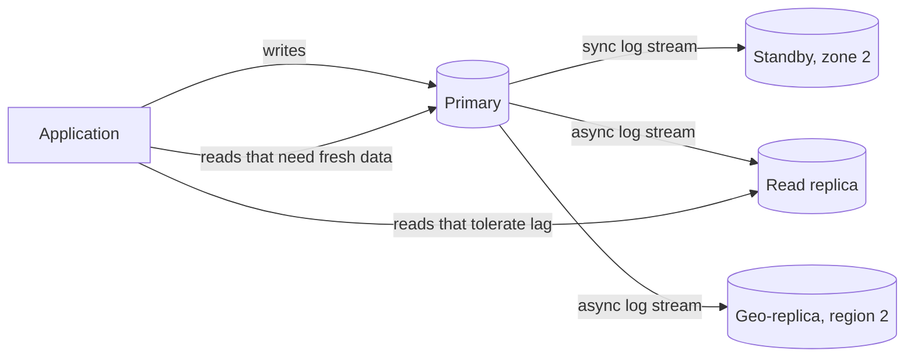

## TL;DR

- Replication keeps copies of the same data on several machines so you survive failures, serve more reads, and put data near users.
- Single-leader replication sends every write through one primary and ships its log to followers. It is the default for relational databases.
- Multi-leader and leaderless replication accept writes in more than one place, which adds write availability and locality but forces you to resolve conflicts.
- Synchronous replication loses nothing on failover but adds latency to every write. Asynchronous replication is fast but can lose the last few seconds of writes, and replicas lag.
- Failover is where replication goes wrong: detection, promotion, and redirecting clients each take time, and a stale leader that keeps writing causes split brain.
- On Azure: Azure SQL Database replicas and failover groups, PostgreSQL flexible server HA and read replicas, and Cosmos DB multi-region accounts.

## Why it matters

A single database server is a single point of failure, and a single region is one disaster away from an outage. Replication is how you meet an [availability target](../01-fundamentals/availability-and-reliability.md) and a recovery point objective (RPO): how much recent data you can afford to lose. It is also the first step in [scaling](../01-fundamentals/scalability.md) reads, long before you need [sharding](./sharding-and-partitioning.md).

Replication is also where [consistency](../01-fundamentals/consistency-and-cap.md) trade-offs stop being theory. The moment a read can hit a copy that hasn't received the latest write, users see their own comment disappear or a balance jump backward. Interviewers want to hear that you know which reads tolerate that and which don't.

## How it works

### Single-leader replication

One node, the leader (primary), accepts all writes. It appends each change to its log (the write-ahead log in PostgreSQL, the transaction log in SQL Server) and streams the log to followers (replicas), which apply the changes in the same order. Reads can go to the leader or to any follower.

### Synchronous and asynchronous

With **synchronous** replication, the leader waits for a follower to confirm the write before acknowledging the client. If the leader dies, the follower has every committed write, so the RPO is zero. The cost is latency (each commit waits a round trip) and availability (if the synchronous follower is down, writes stall unless the system falls back).

With **asynchronous** replication, the leader acknowledges right away and ships the log in the background. Writes stay fast, and followers can be far away, but a follower is always some milliseconds to seconds behind. If the leader fails, writes that hadn't shipped are lost.

Production systems usually mix both: one synchronous standby in another availability zone for zero-loss failover, and asynchronous replicas for reads and for other regions, where a synchronous round trip would be too slow.

### Replication lag and what users see

Async replicas cause three classic anomalies:

- **Read-your-writes.** A user posts a comment, the page reloads from a replica that hasn't seen it, and the comment is missing. Fix: read the user's own recent changes from the leader, or track the log position of their last write and wait for a replica that has caught up.
- **Monotonic reads.** Two requests hit two replicas with different lag, so data appears and then disappears. Fix: pin each user to one replica.
- **Consistent prefix.** A reader sees an answer before the question because the writes landed on different partitions. Fix: write causally related data to the same partition.

### Failover

When the leader fails, the system has to detect it (usually a missed heartbeat after a timeout), pick the most up-to-date follower, promote it, and point clients at it (by DNS, a listener, or a proxy). Each step costs time, and a short timeout causes unnecessary failovers during brief network blips.

The dangerous case is split brain. The old leader was only unreachable, not dead, and it keeps accepting writes. Systems prevent it by fencing: revoking the old leader's lease or blocking its writes before the new one takes over. With async replication, failover also discards writes the old leader had acknowledged but not shipped.

### Multi-leader replication

Each region has its own leader that accepts local writes and replicates them to the others asynchronously. Users write with local latency, and a region can keep accepting writes while cut off. The price is write conflicts: two regions update the same item concurrently. Resolve them with last-writer-wins on a timestamp (simple, silently drops one write), merge functions or CRDTs (data types that merge deterministically), or application logic. Better yet, avoid conflicts by giving each item a home region that takes all its writes.

### Leaderless replication

Any replica accepts writes. The client (or a coordinator) sends each write to N replicas and waits for W acknowledgments, and reads from R replicas and takes the newest version. If W + R > N, every read overlaps at least one replica that has the latest write. Replicas that missed writes catch up through read repair and background anti-entropy. Apache Cassandra works this way.

## Trade-offs

| Topology | Write latency | Write availability | Conflicts | Typical use |
| --- | --- | --- | --- | --- |
| Single-leader, sync standby | Higher (one extra round trip) | Lost while failing over | None | Transactional databases |
| Single-leader, async replicas | Low | Lost while failing over | None, but stale reads and possible loss on failover | Read scaling, cross-region DR |
| Multi-leader | Low and local | High | Must resolve | Multi-region active-active |
| Leaderless quorum | Tunable by W | High | Must resolve (versions) | Write-heavy, always-on stores |

- **RPO versus latency.** Zero data loss across regions means a synchronous cross-region round trip on every write. Most designs accept a small RPO across regions and zero within a region.
- **Read replicas don't scale writes.** Every replica applies every write. When writes are the bottleneck, you need [partitioning](./sharding-and-partitioning.md).
- **More replicas, more lag risk.** A replica that falls behind under load serves older data; monitor lag and take lagging replicas out of rotation.

## On Azure

**Azure SQL Database** replicates at several levels:

- **Within a region.** Business Critical runs a primary plus up to three secondary replicas. Read scale-out is enabled by default on new Premium, Business Critical, and Hyperscale databases, and connections with `ApplicationIntent=ReadOnly` go to a read-only replica. Hyperscale has zero to four HA replicas and up to 30 named replicas for read workloads.
- **Across regions.** Active geo-replication asynchronously replicates the transaction log to up to four geo-secondaries.
- **Failover groups** add a read-write listener (a DNS CNAME that always points to the current primary) and a read-only listener, so applications don't change connection strings after failover. The recommended policy is customer managed; with the Microsoft-managed policy, the grace period can't be set below one hour and failover can result in data loss.

**Azure Database for PostgreSQL flexible server.** High availability synchronously commits each write to both the primary and a standby (in another zone when zone-redundant), and fails over in 60 to 120 seconds with zero data loss. Read replicas are updated asynchronously with PostgreSQL's native physical replication; you can place them in other regions and promote one to a read-write server for disaster recovery.

**Azure Cosmos DB** transparently replicates data to every region associated with the account. With a single write region, the other regions serve reads. Multiple write regions require the Business Critical tier; every region then accepts writes, conflicts are resolved by last-writer-wins on the `_ts` timestamp by default (or a custom numeric property in the API for NoSQL), and strong consistency isn't available. The consistency level sets the RPO for a region outage: less than 15 minutes for session, consistent prefix, and eventual, and zero for strong. Service-managed failover can take an hour or more to trigger, so Learn recommends a forced failover for faster recovery.

Blob Storage replicates within and across regions too (LRS, ZRS, GRS, GZRS); see [Blob storage](./blob-storage.md).

## Interview tips

- State the topology and mode: "Primary with a synchronous standby in a second zone, async read replicas, and an async geo-replica in a paired region."
- Give the RPO and RTO it implies, and connect them to the business: zero loss for payments, seconds of loss acceptable for likes.
- Bring up read-your-writes as soon as you add read replicas, and say how you route those reads.
- For multi-region writes, explain how you avoid or resolve conflicts. "Last writer wins" is acceptable for a profile picture, not for an account balance.
- Expect follow-ups: What happens to in-flight writes during failover? How do you prevent split brain? How do clients find the new primary?
- Trap: claiming replicas add write capacity. They add read capacity and availability only.

## Further reading

- [Active geo-replication in Azure SQL Database](https://learn.microsoft.com/azure/azure-sql/database/active-geo-replication-overview)
- [Failover groups in Azure SQL Database](https://learn.microsoft.com/azure/azure-sql/database/failover-group-sql-db)
- [High availability in Azure Database for PostgreSQL](https://learn.microsoft.com/azure/postgresql/high-availability/concepts-high-availability)
- [Read replicas in Azure Database for PostgreSQL](https://learn.microsoft.com/azure/postgresql/read-replica/concepts-read-replicas)
- [Reliability in Azure Cosmos DB](https://learn.microsoft.com/azure/reliability/reliability-cosmos-db)
- [Conflict resolution types in Azure Cosmos DB](https://learn.microsoft.com/azure/cosmos-db/conflict-resolution-policies)
- [The Coding Gopher: Understanding strong vs eventual consistency](https://thecodinggopher.substack.com/p/understanding-strong-vs-eventual)
- Related: [Consistency and CAP](../01-fundamentals/consistency-and-cap.md), [Databases: SQL vs NoSQL](./databases-sql-vs-nosql.md), [Availability and reliability](../01-fundamentals/availability-and-reliability.md)
