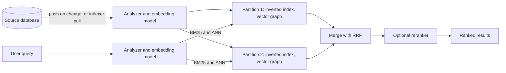

## TL;DR

- A search engine answers "which documents match these words, best first". A database index can't do that well: `LIKE '%beach%'` scans every row and returns matches unranked.
- The core structure is an inverted index: each term maps to the list of documents that contain it. Text goes through an analyzer (split into words, lowercase, stem) at both index and query time.
- Keyword ranking uses BM25. Vector search ranks by meaning using embeddings and approximate nearest-neighbor search. Hybrid search runs both and merges the lists with Reciprocal Rank Fusion (RRF).
- The search index is a derived copy of your data. The database stays the source of truth, and the index lags it by seconds to minutes.
- Partitions split the index to hold more data; replicas copy it to serve more queries and survive failures.
- On Azure: Azure AI Search, with push or indexer-based ingestion, BM25, HNSW vector search, hybrid RRF, and a semantic ranker.

## Why it matters

Interview prompts that mention "search" (posts by keyword, products in a catalog, restaurants near me, files in a drive) need more than a B-tree. A [database index](./indexing.md) answers exact matches and prefix ranges. It doesn't find "beach" in the middle of a description, match "running" to "run", tolerate a typo, or rank a listing that mentions the term five times above one that mentions it once.

Adding a search engine also adds a second copy of the data, and that changes the design: you need a pipeline that keeps it updated, a plan for when it lags, and a way to rebuild it. Interviewers probe those parts as often as the ranking.

## How it works

### The inverted index

Take three documents:

1. "Cheap hotel near the beach"
2. "Beach house with ocean view"
3. "Hotel with free parking"

The analyzer lowercases the text, splits it into terms, and drops stop words such as "the" and "with". The index stores each term with its posting list, the IDs of the documents that contain it (plus positions, for phrase queries):

| Term | Documents |
| --- | --- |
| beach | 1, 2 |
| cheap | 1 |
| hotel | 1, 3 |
| ocean | 2 |
| parking | 3 |

A query for "beach hotel" reads two posting lists, `{1, 2}` and `{1, 3}`, and scores the union. Document 1 contains both terms and ranks first. The lookup cost depends on the posting lists for the query terms, not on the total number of documents. In Azure AI Search there's one inverted index for each searchable field.

The analyzer must match at index time and query time. If documents are stemmed ("parking" stored as "park") and queries aren't, searches miss. Language-specific analyzers handle stemming and stop words for each language.

### Ranking with BM25

BM25 scores a document for a query from three signals:

- **Term frequency.** More occurrences score higher, with diminishing returns, so repeating a word 50 times doesn't win.
- **Inverse document frequency.** Rare terms count more than common ones. "Parking" says more about a document than "hotel" does in a hotel catalog.
- **Length normalization.** A match in a short title counts more than the same match in a long page.

Production systems add business signals on top: freshness, popularity, distance, or whether the user follows the author.

### Vector and hybrid search

Keyword search misses paraphrase: "budget lodging by the sea" shares no terms with document 1. Vector search fixes that. An embedding model turns each document (or chunk of a long document) and each query into a vector, and the engine returns the documents whose vectors are nearest to the query's. Checking every vector is exact but slow at scale, so engines build an approximate nearest-neighbor (ANN) structure such as HNSW, a layered graph that finds near neighbors in far fewer comparisons and occasionally misses the true nearest.

Hybrid search runs the keyword query and the vector query in parallel and merges the two ranked lists with RRF. Each document scores `1/(rank + k)` in each list it appears in, summed, with `k` usually 60. A document ranked 1st by keywords and 3rd by vectors scores 1/61 + 1/63 ≈ 0.0323 and beats one ranked 2nd by keywords alone (1/62 ≈ 0.0161). RRF uses only positions, so it doesn't need BM25 scores and vector similarities to be on the same scale. A reranker model can then reorder the top few dozen results.

### Keeping the index in sync

The search index is eventually consistent with the database (see [Consistency and CAP](../01-fundamentals/consistency-and-cap.md)). Two ways to feed it:

- **Push.** The application or a pipeline sends documents to the index API when data changes. Use change data capture or an outbox and an [event stream](./event-streaming.md) so a crash between the database write and the index write doesn't lose updates. Lag is seconds.
- **Pull.** An indexer polls the source on a schedule and picks up changed rows. Simpler, but lag is the polling interval.

Design for the lag. After a user edits a listing, show the detail page from the database, not from search. Keep the ability to rebuild the whole index from the source, because analyzer and schema changes usually require reindexing.

### Scaling: partitions and replicas

Partitions split the index, much like [sharding](./sharding-and-partitioning.md): each holds a slice of the documents. A query goes to every partition, each returns its top results, and a coordinator merges them. More partitions hold more data and speed up indexing. Replicas are full copies of the index; more replicas serve more queries per second and keep search up when one copy fails.

## Trade-offs

| Approach | Good at | Weak at |
| --- | --- | --- |
| Keyword (BM25) | Exact terms, names, product codes, error messages | Synonyms and paraphrase |
| Vector (ANN) | Meaning, paraphrase, questions in natural language | Exact identifiers and rare terms; needs an embedding model at index and query time |
| Hybrid with RRF | Both of the above | More work per query and more index storage |

- **Dedicated engine vs database full-text search.** PostgreSQL has built-in full-text search, and the pgvector extension adds vector similarity search. At modest scale that avoids a second system and the sync pipeline. A dedicated engine wins on relevance tuning, facets, typo tolerance, and scale.
- **Approximate vs exact vectors.** HNSW is fast but can miss a true nearest neighbor. Exhaustive search is exact but scans every vector, which suits small sets or measuring ANN recall.
- **Freshness vs indexing cost.** Pushing every change keeps lag low but adds write load to the index. Polling batches the work and accepts minutes of lag.
- **Replicas vs partitions.** Add replicas when queries are slow under load or you need availability; add partitions when the index outgrows storage or indexing is slow. Both cost money.

## On Azure

**Azure AI Search** is the managed search engine.

- **Tiers.** Free for tutorials and development; Basic for small production workloads, up to 3 replicas; Standard 1, 2, and 3, the default tiers, which scale partitions and replicas; Standard 3 High Density for many small indexes in multitenant apps; Storage Optimized (L1, L2) for large, less frequently updated indexes at lower cost per TB but typically higher query latency. A serverless pricing model is in preview.
- **Capacity.** Billing is in search units, where search units = replicas × partitions, up to 36 per service. Standard allows up to 12 replicas and 12 partitions. Learn's rule of thumb: partitions for storage, replicas for throughput.
- **Availability.** One replica is the primary and takes all writes; the others serve reads. The SLA requires two replicas for read-only workloads and three or more for read-write. AI Search tries to place replicas in different availability zones when the region supports them.
- **Ingestion.** Push documents through the API in batches of up to 1,000 documents or 16 MB. Or use an indexer, which pulls from sources such as Azure SQL Database, Cosmos DB, and Blob Storage on a schedule from 5 minutes to 24 hours and resumes from where it left off when the source supports change detection. AI enrichment and integrated vectorization (chunking and embedding during indexing) require the indexer path.
- **Ranking.** BM25 is the scoring algorithm on all services created after July 2020. Vector fields use HNSW or exhaustive KNN. Hybrid queries run keyword and vector search in parallel and merge with RRF. The semantic ranker reranks the top 50 results with multilingual deep learning models adapted from Bing.
- **Schema changes.** For production, build and test a new index side by side, then swap with an index alias so application code doesn't change.
- **Agentic retrieval.** For chat and agent apps, agentic retrieval can use an LLM to break a complex question into focused subqueries, run them in parallel, rerank each, and combine the best results into one response for the model to answer from. The 2026-04-01 REST API supports it for production; some capabilities remain in preview.

If the data already lives in Azure Database for PostgreSQL and the search needs are simple, its full-text search and pgvector may be enough.

## Interview tips

- Say early that the database is the source of truth and the search index is a derived, eventually consistent copy, then draw the sync pipeline.
- Explain the inverted index with a two-document example; it takes 30 seconds and shows you know why search is fast.
- Name the ranking: BM25 for keywords, embeddings and ANN for meaning, RRF to combine.
- Size it: document count times average size gives partitions, peak queries per second gives replicas.
- Expect follow-ups: How fresh are results after an edit? How do you reindex with no downtime (build a new index, then switch over with an alias)? How do you rank by distance or recency?
- Trap: running search queries against the primary database with `LIKE`. It works on 10,000 rows and falls over on 100 million.

## Further reading

- [Full-text search](https://learn.microsoft.com/azure/search/search-lucene-query-architecture)
- [BM25 relevance scoring](https://learn.microsoft.com/azure/search/index-similarity-and-scoring)
- [Hybrid search overview](https://learn.microsoft.com/azure/search/hybrid-search-overview)
- [Vector relevance and ranking](https://learn.microsoft.com/azure/search/vector-search-ranking)
- [Estimate capacity for query and index workloads](https://learn.microsoft.com/azure/search/search-capacity-planning)
- [Data import and ingestion](https://learn.microsoft.com/azure/search/search-what-is-data-import)
- [Hello Interview: Elasticsearch](https://www.hellointerview.com/learn/system-design/deep-dives/elasticsearch)
- [Hello Interview: Vector databases](https://www.hellointerview.com/learn/system-design/deep-dives/vector-databases)
- Related: [Indexing](./indexing.md), [Event streaming](./event-streaming.md), [Sharding and partitioning](./sharding-and-partitioning.md)
