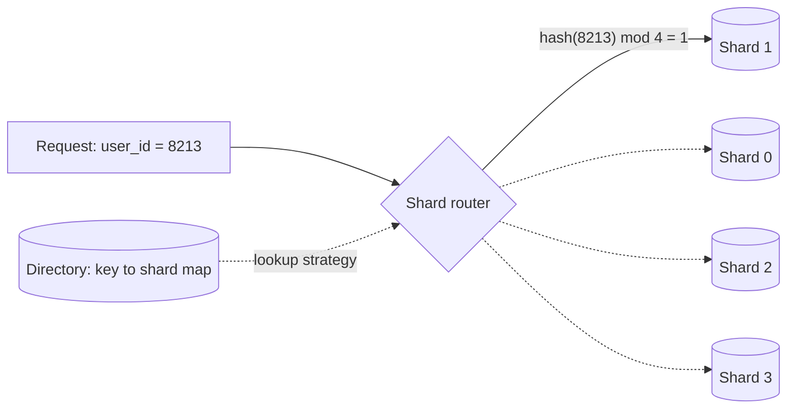

## TL;DR

- Partitioning splits a dataset into pieces. Sharding is horizontal partitioning across machines: each shard holds a subset of rows, so storage and write throughput grow with the number of shards.
- The shard key is the decision that matters. A good key spreads data and traffic evenly and keeps each common query on one shard.
- Range, hash, directory (lookup), and geographic sharding trade query flexibility, balance, and control against each other.
- Sharding costs you cross-shard queries, cross-shard transactions, rebalancing, and hot partitions. Exhaust vertical scaling and read replicas first.
- On Azure: Cosmos DB partitions every container by a partition key, PostgreSQL elastic clusters shard PostgreSQL with Citus, and Azure SQL Database offers shard map tooling (or Hyperscale, which delays the need).

## Why it matters

[Replication](./replication.md) scales reads, but every replica still applies every write and stores every row. When one machine can't absorb the write rate or hold the data, you have to split the data. Run the numbers with [back-of-the-envelope estimates](../01-fundamentals/back-of-the-envelope.md): 50,000 writes per second or tens of terabytes is usually where a single primary runs out.

Sharding is also hard to undo. The shard key decides which queries are cheap for years. Interviewers expect you to name the key, explain why its traffic is even, and say what happens to queries that don't include it.

## How it works

### Three kinds of partitioning

- **Horizontal (sharding).** Split rows: users A to M on one shard, N to Z on another. Every shard has the same schema.
- **Vertical.** Split columns: keep hot, small fields (name, status) in one store and large, rarely read fields (biography, settings blob) in another.
- **Functional.** Split by business area: orders in one database, catalog in another, often one per service. This is how microservices partition data, and it usually comes before sharding.

### Sharding strategies

- **Range.** Each shard owns a contiguous key range (IDs 1 to 1M, 1M to 2M; or dates). Range scans stay on one shard, but sequential keys send every new write to the last shard, which becomes a hot spot.
- **Hash.** Hash the key and map the hash to a shard. Data spreads evenly and the router needs no state, but range queries hit every shard. With plain `hash mod N`, changing N moves almost every key; Learn's sharding pattern notes that rebalancing is difficult without [consistent hashing](./consistent-hashing.md).
- **Directory (lookup).** A map records which shard holds each key or tenant. You get full control (move one big tenant to its own shard) at the cost of a lookup on every request and a map that must be highly available and cached.
- **Geographic.** Shard by region or country to keep data near users and meet data residency rules.

### Choosing a shard key

A good shard key has:

1. **High cardinality.** Many distinct values, so data can spread across many shards. `country` has about 200 values; `user_id` has millions.
2. **Even traffic.** No single value takes a large share of reads or writes. A celebrity's user ID or a viral post can overload one shard even when data is balanced.
3. **Query alignment.** The common queries include the key, so each touches one shard. For a chat app, shard messages by `conversation_id`, not by `message_id`, so loading a conversation reads one shard.
4. **No monotonic growth.** Timestamps and auto-increment IDs send all new writes to one shard under range sharding. Hash them, or prefix them with a high-cardinality value.

When no single field works, combine fields (`tenant_id` plus `user_id`), or add a small random suffix to a hot key (write sharding) and read all suffixes back when needed.

### Routing, rebalancing, and cross-shard work

Something has to map keys to shards: a client library, a proxy, or the database itself. Managed distributed databases hide this; with hand-rolled sharding, it's your code.

Rebalancing is easier if you create many more logical partitions than machines (say, 1,024 virtual shards on 8 nodes) and move whole logical partitions between nodes as you grow. Keys never change partition; only the partition-to-node map does.

Queries that lack the shard key become scatter-gather: send to every shard, merge the results, and wait for the slowest. Secondary indexes are either local to each shard or global and maintained separately (see [Indexing](./indexing.md)). Transactions across shards need two-phase commit or a saga of compensating steps, so design the data model so the common transactions stay within one shard.

## Trade-offs

| Strategy | Distribution | Range queries | Adding shards | Best for |
| --- | --- | --- | --- | --- |
| Range | Uneven if keys are skewed or sequential | One shard | Split a range | Time-series reads by range, ordered scans |
| Hash | Even | Every shard | Moves data unless you use virtual shards or consistent hashing | Point lookups by ID |
| Directory | Whatever you assign | Depends on the map | Update the map, move data | Multitenant SaaS with uneven tenants |
| Geographic | By user population | Within a region | Add a region | Residency rules, regional latency |

- **Shard late, but plan early.** Pick IDs and access patterns that would shard cleanly even while you run on one database.
- **Joins disappear.** Data that is joined together must share a shard key, or be denormalized.
- **Operations multiply.** Backups, schema migrations, and monitoring now run per shard, and one slow shard sets your tail latency.

## On Azure

**Azure Cosmos DB** partitions every container. You choose a partition key, and items with the same value form a logical partition. Cosmos DB uses hash-based partitioning to distribute logical partitions across physical partitions, and it automatically creates new physical partitions by splitting existing ones as throughput or data grows, without affecting availability. The limits to design around:

- A logical partition stores up to 20 GB and serves up to 10,000 RU/s. A single hot key hits that ceiling no matter how much you provision for the container.
- A physical partition stores up to 50 GB.
- When one key value could exceed 20 GB (a large tenant), use hierarchical partition keys, up to three levels, such as `tenantId`, then `userId`.
- Partition merge, which reduces the number of physical partitions in place (useful after you delete data or lower RU/s), is in preview.

**Azure Database for PostgreSQL elastic clusters** are a managed offering of the open-source Citus extension. They support two sharding models: row-based sharding (distribute each table by a column such as `tenant_id`) and schema-based sharding (each tenant or microservice gets its own schema, placed on one node). Queries that include the distribution column route to a single node. Elastic clusters are the path for new work that needs distributed PostgreSQL.

**Azure SQL Database.** Hyperscale grows a single database to 128 TB, which removes the storage reason to shard for many systems. When you do shard, the elastic database client library keeps a shard map manager (a special database that records which shard holds which keys) with list mappings (specific tenant IDs to a database) or range mappings (a range of tenant IDs to a database), and routes each query to the right database.

Partitioning shows up elsewhere too: Event Hubs partitions ([Event streaming](./event-streaming.md)) and the Blob Storage partition key of account, container, and blob name ([Blob storage](./blob-storage.md)).

## Interview tips

- Say why you need to shard, with numbers. "One PostgreSQL primary handles our 5,000 writes per second" is a valid reason not to.
- Name the shard key, then test it aloud against the top three queries and the hottest key you can imagine.
- Bring up the celebrity or hot-tenant problem before the interviewer does, and have a fix (dedicated shard via a directory, write sharding, or a cache in front).
- Explain how you add capacity: virtual shards or consistent hashing, and moving data online.
- Expect follow-ups: How do you query by a field that isn't the shard key? How do you run a transaction across two users on different shards? How do you reshard without downtime?
- Trap: sharding by timestamp for a write-heavy table. All current writes land on one shard.

## Further reading

- [Sharding pattern](https://learn.microsoft.com/azure/architecture/patterns/sharding)
- [Architecture strategies for data partitioning](https://learn.microsoft.com/azure/well-architected/design-guides/partition-data)
- [Partitioning and horizontal scaling in Azure Cosmos DB](https://learn.microsoft.com/azure/cosmos-db/partitioning)
- [Elastic clusters in Azure Database for PostgreSQL](https://learn.microsoft.com/azure/postgresql/elastic-clusters/concepts-elastic-clusters)
- [Shard map management in Azure SQL Database](https://learn.microsoft.com/azure/azure-sql/database/elastic-scale-shard-map-management)
- [Hello Interview: Sharding](https://www.hellointerview.com/learn/system-design/core-concepts/sharding)
- [The Coding Gopher: An intro to database sharding](https://thecodinggopher.substack.com/p/an-intro-to-database-sharding)
- Related: [Consistent hashing](./consistent-hashing.md), [Replication](./replication.md), [Scalability](../01-fundamentals/scalability.md)
