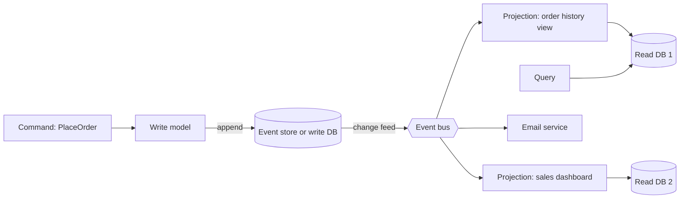

## TL;DR

- **Event-driven architecture.** Services announce what happened ("OrderPlaced") and other services react. The producer does not know or wait for the consumers. You gain decoupling and fan-out, and you pay with eventual consistency and harder debugging.
- **CQRS** (command query responsibility segregation). Use one model for writes, shaped for validation and invariants, and other models for reads, shaped for each query. The read models are updated from the write side's changes.
- **Event sourcing.** Store the sequence of events as the system of record and derive current state by replaying them. You get a full audit history and time travel, at the cost of schema evolution pain and a harder mental model.
- The three combine well but are independent. Most systems need the first, some need the second, and few need the third.
- On Azure, route discrete events with Azure Event Grid, stream high volumes with Azure Event Hubs, carry business commands with Azure Service Bus, and build read models from the Azure Cosmos DB change feed.

## Why it matters

When an order is placed, five things should happen: charge the card, reserve stock, email the customer, update the sales dashboard, and feed the recommendation model. If the order service calls all five synchronously, it is only as available as the least available of them, it must change whenever a sixth consumer appears, and its latency is the sum of theirs. Publishing one `OrderPlaced` event and letting each consumer subscribe removes all three problems.

Reads and writes also pull a data model in opposite directions. Writes want normalized data and strict invariants ("stock never goes negative"). Reads want denormalized, precomputed shapes ("top 10 products in my region with their ratings"). A single model compromises both. CQRS lets each side have the shape it needs.

Some domains also care about how the state was reached, not just what it is: a ledger, an audit trail, a shopping cart whose abandoned items feed marketing. Overwriting a row discards that history. Event sourcing keeps it.

## How it works

### Events, messages, and streams

Not every asynchronous payload is the same thing, and picking the wrong broker usually starts with blurring them.

| Kind | Example | Sender expects | Typical broker |
| --- | --- | --- | --- |
| Discrete event | "Blob created", "order shipped" | Nothing; anyone may react | Push-based pub/sub with filtering |
| Event stream | Clicks, telemetry, GPS pings | Nothing; consumers read at their own pace and can rewind | Partitioned log |
| Command message | "Charge this card" | One consumer must process it exactly once in effect | Queue with locks and dead-lettering |

Events are named in the past tense and describe facts. Commands are imperative and can be rejected. If a "consumer" must act for the business process to succeed, you are sending a command; treat it like one, with ownership and failure handling, as in [multi-step processes](./multi-step-processes.md).

Two event styles also matter. A **thin event** carries IDs ("order 123 changed") and consumers call back for details, which keeps payloads small but couples consumers to the producer's API. A **fat event** carries the state consumers need, which removes the callback but turns the event schema into a public contract. Version the schema and add fields rather than renaming them.

### CQRS

The write side receives commands, validates them against current state, and records changes. The read side keeps one or more read models, each a denormalized table, search index, or cache shaped for one screen or query. A projector consumes the write side's changes and updates each read model.

CQRS does not require two databases. The lightest form is separate code paths and DTOs against one store. The next step is a materialized view in the same database. The full form puts read models in different stores: a search index for text queries, a Redis sorted set for a leaderboard, a wide document for a profile page. See [scaling reads](./scaling-reads.md) for where this fits among other read strategies.

The cost is lag. A user who saves a change and is redirected to a page built from a read model may not see it yet. Handle it explicitly: return the new state from the command, read your own writes from the write side for a short window, or show "updating".

### Event sourcing

Instead of updating a row, append an event to the entity's stream.

1. Load the stream for `cart-42`: `ItemAdded(book)`, `ItemAdded(pen)`, `ItemRemoved(pen)`.
2. Replay them to rebuild current state: one book.
3. Validate the command against that state and append new events, with an expected stream version for optimistic concurrency. If another writer appended first, the append fails and you retry.
4. Projectors subscribe to the stream and update read models. That is CQRS, which event sourcing nearly always needs because querying raw events is slow.

**Snapshots.** Long streams are slow to replay, so periodically store the computed state at version N and replay only later events. The stream stays the source of truth.

**Schema evolution.** Events are immutable and live forever. Old event versions must still be readable, usually through upcasters that convert old shapes on read. A bug that wrote wrong events is fixed by appending correcting events, not by editing history.

**Event store vs. message broker.** A log-based broker distributes events well but usually cannot load "all events for entity 42" efficiently or reject an append on a version conflict. Keep the event store in a database that can, and use the broker to fan out.

**Personal data.** "Never delete" collides with deletion requests. Keep personal data out of events, or encrypt it with a per-user key you can destroy.

## Trade-offs

| Choice | You gain | You pay |
| --- | --- | --- |
| Synchronous calls | Immediate consistency, simple tracing | Availability and latency coupled to every callee |
| Event-driven | Decoupling, fan-out, independent scaling | Eventual consistency, schema contracts, harder end-to-end debugging |
| Single model | One source, no lag | Queries and invariants compete for one shape |
| CQRS | Each side tuned to its job | Projectors to run, read lag to explain, more stores |
| State-based storage | Familiar, easy to query and fix | History lost unless you add audit tables |
| Event sourcing | Full history, replay, new projections from old data | Upcasting, snapshots, privacy deletion, a team that knows the model |

## On Azure

| Need | Azure service | What matters |
| --- | --- | --- |
| Discrete events and routing | Azure Event Grid | Pub/sub with event-type and attribute filtering, push to webhooks and Azure services, pull delivery, and MQTT. Built-in system events from Azure services. At-least-once delivery with no ordering guarantee. |
| High-volume streams | Azure Event Hubs | Partitioned log. Retention up to 1 day (Basic), 7 days (Standard), or 90 days (Premium, Dedicated). Kafka-compatible endpoint on Standard and above. Capture writes the stream to Blob Storage or Data Lake Storage in Avro, with no extra charge on Premium and Dedicated. |
| Commands and business messages | Azure Service Bus | Queues and topics with sessions for ordering, duplicate detection, and dead-lettering. |
| Event store and projection source | Azure Cosmos DB change feed | Ordered per partition key, retained as long as the items exist, read in parallel by partition key range. The change feed processor gives at-least-once processing. |
| Read models | Azure Cosmos DB, Azure AI Search, Azure Managed Redis | One store per query shape. |

Microsoft's own comparison sums it up as Event Grid for reactive event routing, Event Hubs for big data streaming, and Service Bus for enterprise transactional messaging. A common design uses all three: Event Grid announces that a blob arrived, Event Hubs ingests telemetry, and Service Bus carries the order commands.

[Messaging choices](../04-azure/messaging-choices.md) covers the tier limits and delivery guarantees behind that split.

**Gotcha.** The Cosmos DB change feed in its default latest version mode shows only the most recent version of each item. If a document is updated twice in quick succession, a projector may see only the second update. For event sourcing, model every change as a new item (append-only, never update), or use all versions and deletes mode. Deletes and TTL expirations also appear only in all versions and deletes mode.

**Gotcha.** Event Hubs keeps events for a bounded window, so it is not an event store by itself. Use Capture or a database for long-term history and treat the hub as the distribution layer.

## Interview tips

- Say which of the three you mean. "Event-driven with a CQRS read model, not event sourced" is a precise and common answer.
- Draw the event bus and name the events in the past tense. Mark which consumers are critical and which are best effort.
- Raise read-after-write lag before the interviewer does, and say how the UI handles it.
- Only propose event sourcing when the domain needs history (finance, audit, collaborative editing). Mention snapshots and schema versioning when you do.
- Match the broker to the payload: queue for commands, pub/sub for discrete events, log for streams. See [message queues](../02-building-blocks/message-queues.md) and [event streaming](../02-building-blocks/event-streaming.md).
- Tie lag back to [consistency and CAP](../01-fundamentals/consistency-and-cap.md).

## Further reading

- [Event-driven architecture style](https://learn.microsoft.com/azure/architecture/guide/architecture-styles/event-driven)
- [CQRS pattern](https://learn.microsoft.com/azure/architecture/patterns/cqrs)
- [Event Sourcing pattern](https://learn.microsoft.com/azure/architecture/patterns/event-sourcing)
- [Materialized View pattern](https://learn.microsoft.com/azure/architecture/patterns/materialized-view)
- [Choose between Azure messaging services](https://learn.microsoft.com/azure/service-bus-messaging/compare-messaging-services)
- [Change feed design patterns in Azure Cosmos DB](https://learn.microsoft.com/azure/cosmos-db/change-feed-design-patterns)
- [Event Hubs quotas and limits](https://learn.microsoft.com/azure/event-hubs/event-hubs-quotas)
- [The Coding Gopher: Understanding Strong vs. Eventual Consistency](https://thecodinggopher.substack.com/p/understanding-strong-vs-eventual)
