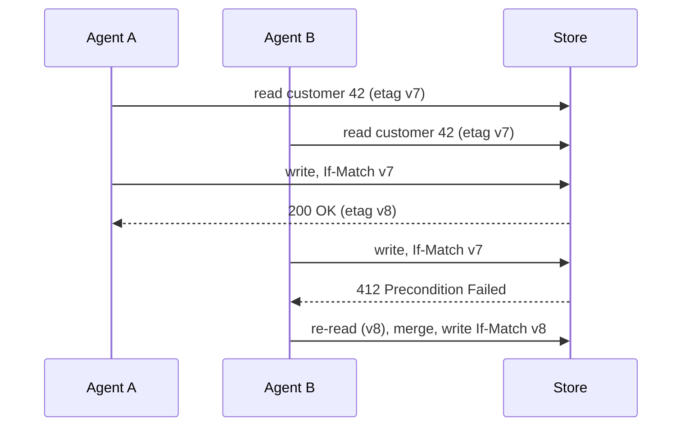
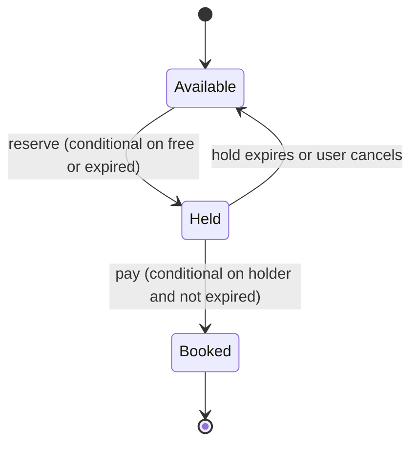

## TL;DR

- Contention is many requests running read, check, then write against the same record at the same time. Without protection you get lost updates and oversold inventory.
- Push the check into the database first. A single conditional statement (`UPDATE ... WHERE available > 0`) is atomic and needs no lock you manage yourself.
- Use pessimistic locks when conflicts are frequent and the critical section is short. Use optimistic concurrency (a version number or ETag) when conflicts are rare.
- Reach for a distributed lock only when the protected thing spans systems, and pair it with a lease and a fencing token.
- When a human sits between "pick" and "pay", hold the item with a reservation that expires. Never hold a database lock across user think time.

## Why it matters

Take a flash sale with 3 units of a console left and 500 buyers clicking at once. Each request reads `available = 3`, checks it is above zero, and writes `available = 2`. Under concurrency, dozens of requests read the same 3 before any of them writes. They all pass the check, they all charge a card, and the counter ends up at 2 or at a negative number depending on how the writes interleave. That is the lost-update anomaly. Your code is correct for one user and wrong for two.

The same bug shows up as two agents editing one customer record (the second save silently erases the first), two drivers accepting the same ride, and two workers processing the same job. Each fix below closes the gap between the read and the write in a different way. The cost of each fix is mostly about what happens when requests do collide: who waits, who retries, and who gets told no.

## How it works

### Make the database do the check

If the whole decision fits in one row, write it as one statement and let the database's row lock do the work for the few microseconds the statement runs.

```sql
UPDATE inventory
SET available = available - 1
WHERE sku = 'console-x' AND available > 0;
-- 1 row affected: you got a unit. 0 rows: sold out.
```

This handles thousands of buyers correctly, holds the lock for one statement, and needs no retry loop. Most document stores have an equivalent, such as a conditional patch that fails when a predicate is false. Try this before anything else on this page. It stops working when the decision needs data from several rows or from a different system.

### Pessimistic locking

Lock the rows first, then read, decide, and write inside one transaction. Other writers block until you commit.

```sql
BEGIN;
SELECT status FROM seats WHERE id IN (17, 18) ORDER BY id FOR UPDATE;
-- check both are free, then:
UPDATE seats SET status = 'sold', order_id = 991 WHERE id IN (17, 18);
COMMIT;
```

It is correct by construction and simple to reason about. The failure modes are operational:

- **Deadlocks.** Request A locks seat 17 and waits for 18 while B holds 18 and waits for 17. The database kills one. Always lock rows in a consistent order (the `ORDER BY id` above) and retry the victim.
- **Long lock holds.** Calling a payment API inside the transaction holds the lock for the network round trip and every retry. Throughput on that row drops to one request per call duration. Keep only database work inside the lock.
- **Pile-ups on hot rows.** Waiting requests hold connections. A popular row can exhaust the connection pool and take down unrelated endpoints.

`FOR UPDATE SKIP LOCKED` (PostgreSQL, and `READPAST` in SQL Server) lets a request skip rows someone else holds. It suits "give me any free seat in this section" and job queues built on tables.

### Optimistic concurrency

Read without locking, remember the version, and make the write conditional on the version not having changed.

```sql
UPDATE accounts SET balance = 70, version = 8
WHERE id = 42 AND version = 7;
-- 0 rows: someone else wrote first. Reload and retry, or report a conflict.
```

HTTP has the same idea built in. A `GET` returns an `ETag`, and a later `PUT` sends `If-Match: <etag>`. If the resource changed, the server answers `412 Precondition Failed`.



Optimistic concurrency never blocks and holds no locks, so it scales well when collisions are rare, such as profile edits or configuration documents. Under heavy contention it degrades badly. If 500 buyers race for one row, 499 lose each round and retry, and the work grows with the square of the crowd. Switch to a conditional write, a lock, or a queue when retries start to dominate.

### Isolation levels decide what you can skip

Most databases default to read committed, which allows the read-then-write race above. Serializable isolation makes the database detect it and abort one transaction, which also catches write skew (two on-call doctors each see the other is on duty and both go off call). It costs more aborts and retries under load. Know which level your database runs by default and say it in the design.

### Distributed locks

Use a distributed lock when the thing you protect is not a row in one database, such as "only one worker rebuilds tenant 7's search index" or "only one instance runs the nightly billing job". A lock service hands out a lease with a time limit.

```text
SET lock:tenant:7 <random-token> NX PX 30000   # acquire for 30 s if absent
```

Release with a compare-and-delete, so you never delete a lock that expired and passed to someone else:

```lua
if redis.call("GET", KEYS[1]) == ARGV[1] then
  return redis.call("DEL", KEYS[1])
end
return 0
```

Leases expire so a crashed holder cannot block everyone forever. That creates the hard case. A holder pauses for 40 seconds (a garbage collection pause, a VM migration), its lease expires, a second worker takes the lock, and then the first wakes up and writes. The fix is a fencing token, a number that increases with every grant. The holder sends it with each write, and the storage rejects any token lower than the highest it has seen. If the storage cannot check a token, the lock gives you mutual exclusion most of the time, which is fine for avoiding duplicate work and not fine for correctness.

### Reservations with a TTL

Ticketing, hotel rooms, and limited-stock checkouts have a human in the middle. Picking a seat to finishing payment takes minutes. Model the hold as data instead of a lock.



1. Reserve with a conditional write: set `status = held`, `holder = user`, `expires_at = now + 10 min`, only if the seat is available or its hold has expired.
2. Confirm with another conditional write: set `status = booked` only if `holder = user` and `expires_at > now`.
3. Clean up expired holds with a TTL or a sweeper. Correctness comes from the `expires_at` check in steps 1 and 2, not from how fast cleanup runs.

The user sees a countdown, other buyers see the seat as taken, and nothing blocks in the database.

### Hot rows

Every technique above still funnels writes for one key through one place. When a single counter takes thousands of writes per second, split it. Keep 10 inventory buckets of 100 units each and pick one at random, or put the units into a queue that buyers pop from. [Scaling writes](./scaling-writes.md) covers this in depth.

## Trade-offs

| Approach | Use when | You gain | You pay |
| --- | --- | --- | --- |
| Atomic conditional write | The decision fits in one row or one partition | No locks to manage, no retries | Only works for simple predicates |
| Pessimistic lock | Conflicts are common and the critical section is short | Correctness without retry loops | Blocking, deadlocks, pool exhaustion on hot rows |
| Optimistic concurrency | Conflicts are rare | No blocking, works over HTTP with ETags | Retry storms under contention |
| Serializable isolation | Invariants span rows (write skew) | The database finds the anomalies | More aborts; you still write retry code |
| Distributed lock | The resource spans systems | Coordination across services | A lock service to run; needs fencing for correctness |
| Reservation with TTL | A human or slow step sits between claim and commit | No long-held locks; clear UX | A state machine and an expiry path to build and test |

## On Azure

| Store | Contention tools | What to watch |
| --- | --- | --- |
| Azure SQL Database | Conditional `UPDATE`, `UPDLOCK` and `ROWLOCK` hints, `READPAST`, `SERIALIZABLE` | Read committed snapshot is on by default, so a plain `SELECT` never blocks a writer and the read-then-write race stays open |
| Azure Database for PostgreSQL flexible server | `SELECT ... FOR UPDATE`, `SKIP LOCKED`, serializable isolation | Long transactions bloat row versions as well as holding locks |
| Azure Cosmos DB for NoSQL | `_etag` with `If-Match` (412 on conflict), conditional patch with a filter predicate, transactional batch and stored procedures within one logical partition | Transactions never span logical partitions, so put records that change together under one partition key |
| Azure Managed Redis | `SET NX PX` leases, Lua compare-and-delete, `INCR` to mint fencing tokens | Redis replicates to replicas asynchronously, so a failover can lose a lock |
| Azure Blob Storage | Blob leases of 15 to 60 seconds or infinite, renewed by the holder | The standard way to do leader election among instances |

**Cosmos DB.** Every item has a server-generated `_etag` that changes on each write. Send it as `If-Match` on replace or patch and Cosmos DB rejects stale writes with HTTP 412. Use container TTL to garbage-collect expired reservations. An expired item stops appearing in queries right away, but the physical delete runs on leftover request units and can lag, which is another reason to check `expires_at` in your conditions.

[Data choices](../04-azure/data-choices.md) compares these stores and their consistency settings.

**Gotcha.** With multi-region writes on Cosmos DB, the ETag check only runs against the local region. Two regions can accept conflicting writes to the same item, and the default conflict resolution policy is last writer wins on the `_ts` timestamp. If an invariant must never break (one seat, one buyer), route those writes to a single write region or partition ownership by region.

## Interview tips

- Spot the race out loud. When the design has "check stock, then charge", say "this is a read-then-write race" before the interviewer does.
- Lead with the simplest correct answer: a conditional write or a row lock in a relational database. Mention distributed locks only when the data is spread across systems.
- Say how you behave under contention, not just whether you are correct. "Optimistic is fine for profile edits; for a flash sale I would use a conditional decrement on bucketed counters."
- Expect the follow-up "what if the lock holder dies?" Answer with lease expiry, then raise the paused-holder problem yourself and solve it with fencing tokens.
- For booking problems, describe the reservation state machine and its expiry. Interviewers look for "no locks across user think time".
- Tie the choice to [consistency](../01-fundamentals/consistency-and-cap.md). Strong guarantees on one hot key cost throughput and availability.

## Further reading

- [Hello Interview: Dealing with Contention](https://www.hellointerview.com/learn/system-design/patterns/dealing-with-contention)
- [Transactions and optimistic concurrency control in Azure Cosmos DB](https://learn.microsoft.com/azure/cosmos-db/database-transactions-optimistic-concurrency)
- [Transaction locking and row versioning guide (SQL Server and Azure SQL)](https://learn.microsoft.com/sql/relational-databases/sql-server-transaction-locking-and-row-versioning-guide)
- [Lease Blob operation](https://learn.microsoft.com/rest/api/storageservices/lease-blob)
- [Leader Election pattern](https://learn.microsoft.com/azure/architecture/patterns/leader-election)
- [The Coding Gopher: Blind Writes in Distributed Systems](https://thecodinggopher.substack.com/p/blind-writes-in-distributed-systems)
