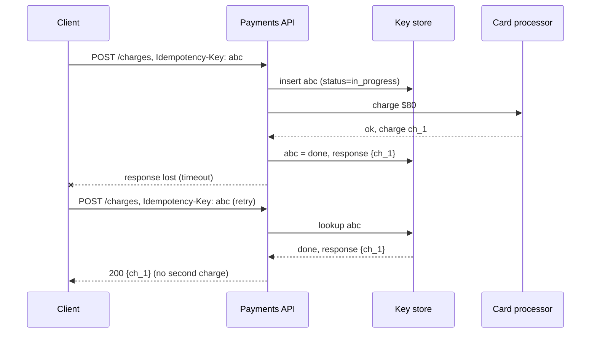

## TL;DR

- A call over the network has three outcomes, not two: it succeeded, it failed, or you don't know. Timeouts land in the third bucket, and the only way forward is to try again.
- Retrying is safe only if the operation is idempotent: doing it twice has the same effect as doing it once. "Set balance to \$50" is idempotent. "Add \$50" is not.
- Make non-idempotent operations safe with an idempotency key. The client generates a unique key per logical action, and the server stores the key with the result so a repeat returns the stored result instead of acting again.
- Queues and event systems deliver at least once. Consumers must deduplicate by message ID or make their writes naturally idempotent.
- On Azure, use Azure Service Bus duplicate detection for the broker side, Azure Cosmos DB conditional creates and unique keys for the store side, and TTL to expire old keys.

## Why it matters

A user taps "Pay". The request reaches the payment service, which charges the card, and the response is lost when the phone switches cell towers. The app sees a timeout and retries. Without idempotency, the customer is charged twice. With it, the second request returns the first charge.

Duplicates come from every layer, not just impatient clients. Load balancers and gateways retry upstream calls. SDKs retry on connection resets. Message brokers redeliver when a consumer's lock expires before it acknowledges. Event publishers resend when they are not sure the first send landed. Each of these is the right behavior for availability, and each turns into double work unless the receiver can recognize a repeat.

"Exactly-once delivery" across a network is not something you can buy. What you can build is at-least-once delivery plus idempotent processing, which gives exactly-once effects. Interviewers probe this on any design that moves money, sends messages, or changes inventory.

## How it works

### Idempotent by design

Many operations can be made idempotent through their shape, with no extra machinery:

- **Set, don't increment.** `status = shipped` can repeat safely. `count = count + 1` cannot, unless it is keyed by the event that caused it.
- **Client-chosen IDs.** The client generates the order ID. A repeated `PUT /orders/{id}` or a create that fails on a duplicate ID cannot produce a second order.
- **Conditional writes.** "Update only if version is 7" applies once. A retry sees version 8 and becomes a no-op, the same mechanism as optimistic locking in [handling contention](./handling-contention.md).
- **Upserts.** Insert-or-replace by a natural key converges on one row.

HTTP gives you a head start. `GET`, `PUT`, and `DELETE` are defined as idempotent. `POST` and `PATCH` are not, so those are where keys are needed. See [API design](../01-fundamentals/api-design.md).

### Idempotency keys

1. The client creates a unique key (a UUID) for each logical action, such as one checkout attempt, and sends it with every retry of that action.
2. The server atomically inserts the key with status `in_progress`. If the insert succeeds, it does the work. If the key already exists, the request is a repeat.
3. When the work finishes, the server stores the response next to the key.
4. A repeat with status `done` returns the stored response. A repeat with status `in_progress` gets a `409 Conflict` or waits, because the first attempt is still running.
5. Store a hash of the request body with the key. A repeat whose body differs is a client bug, so reject it rather than return a response to a different question.
6. Expire keys after a window longer than any client retries (24 hours is common).

The atomic insert is the important part. A check-then-insert in two steps lets two simultaneous retries both see "no key" and both charge the card. Use a unique constraint, a conditional create, or Redis `SET key value NX EX 86400`.

Store the key in the same database transaction as the business change when you can. If they live in different systems, a crash between "charged" and "recorded" leaves a key stuck in `in_progress`. Then the recovery path must ask the downstream system what happened (most payment processors accept your idempotency key too, so pass it through).

### Deduplicating consumers

A message consumer applies the same idea with the message ID as the key:

1. Receive the message and read its ID (or a business key such as `orderId + eventType`).
2. In one transaction, check a `processed_messages` table for the ID, apply the change, and insert the ID.
3. Acknowledge the message. If the ack is lost and the message comes back, step 2 finds the ID and skips it.

This is the idempotent consumer pattern, and it is the receiving half of the [transactional outbox](./multi-step-processes.md). Side effects outside your database (emails, calls to third parties) need their own key or a "sent" flag checked before sending.

### Retrying safely

Idempotency makes retries safe. Retry policy decides whether they help.

| Retry | Do not retry |
| --- | --- |
| Timeouts and connection resets | `400` validation errors |
| `429 Too Many Requests` (after `Retry-After`) | `401` and `403` |
| `502`, `503`, `504` | `404` and `409` (the answer will not change) |
| Broker "server busy" errors | Errors your code caused, such as a serialization bug |

Retry at one layer only. If the client, the gateway, and the service each make three attempts, one failing call becomes $3^3 = 27$ calls to the struggling dependency. Space retries with exponential backoff and random jitter, cap the attempts, and stop when the caller's deadline passes. The details, along with circuit breakers that stop retrying a dependency that is down, are in [resilience patterns](./resilience-patterns.md).

## Trade-offs

| Choice | You gain | You pay |
| --- | --- | --- |
| No retries | Simple, no duplicates | Every transient blip becomes a user-visible error |
| Retries without idempotency | Fewer errors | Double charges, duplicate emails, wrong counters |
| Naturally idempotent writes | No extra storage or lookups | API shape constraints (client IDs, sets instead of increments) |
| Idempotency key store | Works for any operation | A write per request, key expiry, handling of `in_progress` |
| Broker-side deduplication | Producers can resend freely | Only covers the broker hop, within a time window, with a throughput cost |
| Consumer-side deduplication | Covers every source of duplicates | A processed-ID table that grows until you expire it |

## On Azure

| Need | Azure feature | What matters |
| --- | --- | --- |
| Drop duplicate sends at the broker | Azure Service Bus duplicate detection | Standard and Premium only, not Basic. Must be enabled when the queue or topic is created. Uses the application-set `MessageId` (plus partition key on partitioned entities). Window defaults to 10 minutes, from 20 seconds up to 7 days. |
| Atomic "first one wins" insert | Azure Cosmos DB create | Creating an item whose `id` already exists in the logical partition returns `409 Conflict`. Use the idempotency key as the `id`. |
| Uniqueness on another field | Azure Cosmos DB unique keys | Defined only at container creation and enforced within a logical partition. |
| Expire old keys | Azure Cosmos DB TTL | Set a per-item TTL. Expired items disappear from reads right away, and deletion runs in the background with spare RUs. |
| Conditional updates | Azure Cosmos DB ETags | `If-Match` with the item's `_etag` returns `412 Precondition Failed` if someone else wrote first. |
| Fast key checks | Azure Managed Redis | `SET key value NX EX seconds` claims a key atomically. Treat it as a cache in front of the durable record, not the only copy. |
| Events that arrive more than once | Azure Event Grid | Delivers at least once, with no ordering guarantee, so handlers must deduplicate by event `id`. |

[Messaging choices](../04-azure/messaging-choices.md) compares the delivery guarantees of each Azure broker.

**Gotcha.** Service Bus duplicate detection only works if the `MessageId` is derived from the business action, such as `order-12345-placed`. If the producer generates a fresh GUID on each send attempt, every retry looks new and nothing is dropped. Microsoft's guidance is to tie the ID to a context that can be reconstructed after a failure. A large window also slows the entity, since every send is checked against the stored IDs, so keep it as short as your producer's retry horizon.

**Gotcha.** Broker deduplication does not make consumers idempotent. A message can still be delivered twice when a consumer's lock expires or its acknowledgment fails, so the consumer needs its own check.

## Interview tips

- When you draw a write that crosses the network, say "the client retries with an idempotency key" before you are asked.
- Explain the three outcomes of a call and why a timeout forces a retry.
- Describe the key store precisely: atomic insert, stored response, request hash, `in_progress` state, expiry.
- Say "at-least-once delivery plus idempotent consumers" whenever a queue appears, and name the dedup key.
- Expect "what if two retries arrive at the same moment?" The answer is the atomic insert, not a read followed by a write.
- Tie it back to the delivery guarantees in [message queues](../02-building-blocks/message-queues.md) and the failure modes in [availability and reliability](../01-fundamentals/availability-and-reliability.md).

## Further reading

- [Idempotent Consumer pattern](https://learn.microsoft.com/azure/architecture/patterns/idempotent-consumer)
- [Retry pattern](https://learn.microsoft.com/azure/architecture/patterns/retry)
- [Web API implementation: preserve HTTP method semantics and implement idempotency](https://learn.microsoft.com/azure/architecture/best-practices/api-implementation)
- [Service Bus duplicate message detection](https://learn.microsoft.com/azure/service-bus-messaging/duplicate-detection)
- [Unique key constraints in Azure Cosmos DB](https://learn.microsoft.com/azure/cosmos-db/unique-keys)
- [Event Grid message delivery and retry](https://learn.microsoft.com/azure/event-grid/delivery-and-retry)
- [The Coding Gopher: What is an "Upsert"?](https://thecodinggopher.substack.com/p/what-is-an-upsert)
