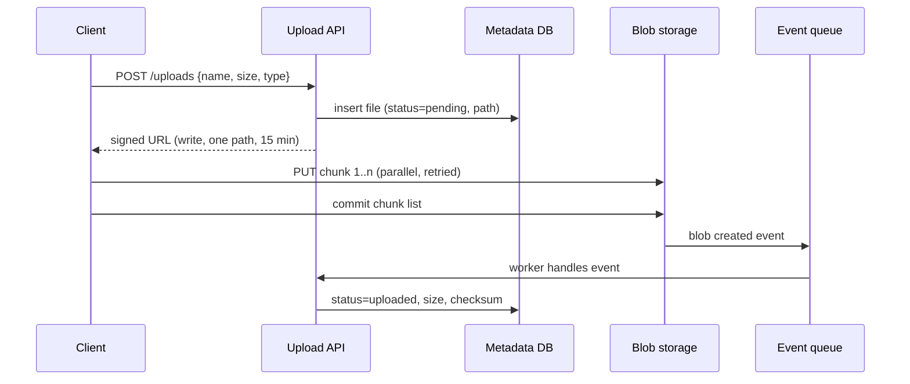

## TL;DR

- Keep large files off your app servers and out of your database. Clients upload to and download from blob storage directly, and your API only hands out permission and tracks metadata.
- Grant that permission with a short-lived signed URL scoped to one object and one action (the valet key pattern).
- Upload big files in chunks. Each chunk retries on its own, chunks go up in parallel, and a final commit makes the file appear atomically. That is what makes uploads resumable.
- Track each file as a metadata row with a status. A storage event, not the client's word, moves it from `pending` to `uploaded`.
- On Azure, use block blobs with a user delegation SAS, Event Grid `BlobCreated` events filtered to committed writes, and Azure Front Door for downloads.

## Why it matters

Route a 4 GB video upload through an API server and several things go wrong at once. The server holds a connection, a thread or buffer, and possibly a temp file for the minutes the upload takes. Load balancer and gateway timeouts are often shorter than the upload. Every byte crosses your network twice, once in and once out to storage, and you pay for both. If the phone switches from Wi-Fi to cellular at 95%, the user starts over. At a few hundred concurrent uploads, the API tier spends all its capacity shuffling bytes and none serving requests.

Storing the bytes in the database is worse. Backups, replicas, and restores all slow down with the blob volume, and the database's buffer pool fills with video instead of index pages. The fix is to separate the control path (small JSON requests to your API) from the data path (large byte streams between the client and storage). This page is about building that split correctly, including the consistency gap it opens between your database and your storage.

## How it works

### Direct upload with a signed URL

1. The client asks your API to start an upload and sends the file name, size, and content type.
2. The API checks quota and permissions, picks the storage path itself (`uploads/{userId}/{uuid}`), and inserts a metadata row with `status = pending`.
3. The API returns a signed URL that allows writes to that one path and expires in minutes.
4. The client uploads straight to storage.
5. Storage emits an event when the object exists. A worker validates it (size, content type, checksum, malware scan) and flips the row to `uploaded`.

The server chooses the path so a client cannot overwrite someone else's file or pick a name that collides. The URL carries the minimum permission (write, not read or delete) and the shortest lifetime that covers a slow upload. Validate size and type after the upload, when the event arrives, because the client controls the bytes it sends no matter what it declared.

### Chunked, parallel, resumable uploads

A single `PUT` of 4 GB fails as a unit. Split the file into blocks instead.

- The client cuts the file into blocks (8 MiB to 100 MiB is typical) and uploads each with a block ID.
- Four to eight blocks upload at once, which fills the client's bandwidth on high-latency links.
- A failed block retries alone. Losing the network costs one block, not the whole file.
- When all blocks are up, the client sends the ordered list of block IDs. Storage stitches them into the final object in one atomic step, so readers never see a half-written file.

Resuming is a matter of remembering progress. The client stores the upload ID and which blocks succeeded (in local storage on a browser or a file on desktop), or asks storage for the list of uncommitted blocks it already has, and sends only the rest. The open-source tus protocol standardizes this exchange if you want an off-the-shelf client.

Pick the block size from the file size. If storage caps a blob at 50,000 blocks, a 1 TiB file needs blocks of at least about 21 MiB. Smaller blocks retry faster; larger blocks mean fewer requests.

### Keeping metadata and storage consistent

The database and the blob store do not share a transaction, so they will disagree sometimes.

| Failure | What you see | Fix |
| --- | --- | --- |
| Client gets a URL and never uploads | `pending` row with no blob | A sweeper deletes `pending` rows older than a day |
| Upload finishes but the event is lost | Blob exists, row stays `pending` | The sweeper checks storage before deleting; events are retried at least once |
| Client claims success that never happened | Row says done, no blob | Never mark done from the client's call alone; mark it from the storage event or a `HEAD` check |
| Row deleted but blob remains | Orphan bytes you pay for | Delete the blob from the same worker, plus lifecycle rules on the `uploads/` prefix |

Write the metadata row first, as `pending`, so every blob has a known owner. Make the event handler [idempotent](./idempotency-and-retries.md), because storage events arrive at least once.

### Downloads

Serve reads through a CDN. Public files get long cache lifetimes. Private files get a short-lived signed read URL, issued after your API checks access. Support HTTP range requests so video players can seek and download managers can resume. Large media goes further and is cut into segments for adaptive streaming, but the access model is the same. See [CDN and edge](../02-building-blocks/cdn-and-edge.md).

### After the upload

Thumbnails, transcoding, text extraction, and virus scanning take seconds to hours. Put them behind a queue fed by the storage event, as in [long-running tasks](./long-running-tasks.md), and show the user a processing state.

## Trade-offs

| Choice | You gain | You pay |
| --- | --- | --- |
| Proxy uploads through the API | Simple auth and validation in one place | Server bandwidth, memory, and timeouts; no resume |
| Signed direct upload | API tier stays small; storage scales the data path | Two systems to keep consistent; validation moves after the upload |
| Single-request upload | One call, simplest client | Restart from zero on failure; slow on high-latency links |
| Chunked upload | Resume, parallelism, per-chunk retries | Client logic for chunking and progress; a commit step |
| Long-lived signed URLs | Fewer refreshes for slow uploads | A leaked URL works longer |
| CDN for private files | Fast global reads | Signed URL design and cache-key care so one user's link never serves another |

## On Azure

| Concern | Azure feature | What matters |
| --- | --- | --- |
| Object storage | Azure Blob Storage block blobs | Up to 50,000 committed blocks of up to 4,000 MiB each, about 190.7 TiB per blob. Upload with Put Block, commit with Put Block List. |
| Upload permission | User delegation SAS | Signed with Microsoft Entra credentials instead of the account key, which Microsoft recommends. The user delegation key lasts at most seven days, so these tokens are short-lived by design. |
| Browser uploads | CORS rules on the storage account | Up to five CORS rules per storage service. Without one, browser uploads fail on the preflight. |
| Completion signal | Azure Event Grid `Microsoft.Storage.BlobCreated` | Delivered at least once to a Function, a Service Bus queue, or a webhook. |
| Malware check | Microsoft Defender for Storage | On-upload malware scanning of new and modified blobs. |
| Downloads | Azure Front Door | Storage accounts are a built-in origin type. |
| Durability | Storage redundancy | ZRS keeps synchronous copies across three or more zones in a region. GZRS adds an asynchronous copy in a second region. |
| Cost over time | Access tiers and lifecycle management | Hot, Cool (30-day minimum), Cold (90-day minimum), and Archive (180-day minimum, retrieval in hours). Move old uploads down automatically. |

**SAS design.** Issue a user delegation SAS per upload, scoped to the single blob path with create and write permissions and an expiry of 15 to 60 minutes. Uncommitted blocks stay on the server and are garbage-collected after a week with no Put Block or Put Block List activity, which gives clients a generous resume window. Refresh the SAS when a resumed upload needs more time rather than issuing a long-lived one up front.

**Gotcha.** `BlobCreated` can fire for operations that do not mean "the file is complete". Filter the Event Grid subscription to the `PutBlob`, `PutBlockList`, `CopyBlob`, and `FlushWithClose` API calls so the event fires only after the data is fully committed. Without the filter, your processor can pick up a blob before its data is fully committed and transcode or scan an incomplete file.

## Interview tips

- Say "the API never touches the bytes" early, then explain the signed URL and its scope: one path, one verb, short expiry.
- Separate control path from data path when you draw it. Interviewers look for two arrows to storage that bypass the app tier.
- Bring up resumable uploads before you are asked. Mention chunk size, parallelism, and that the commit is atomic.
- Expect "how do you know the upload finished?" The answer is a storage event, not a client callback, plus a sweeper for the cases where events go missing.
- Expect "what about downloads of private files?" Answer with access checks in the API, short-lived signed read URLs, and a CDN with range support.
- Connect it to [blob storage](../02-building-blocks/blob-storage.md) fundamentals and to [scaling reads](./scaling-reads.md) for hot files.

## Further reading

- [Hello Interview: Handling Large Blobs](https://www.hellointerview.com/learn/system-design/patterns/large-blobs)
- [Valet Key pattern](https://learn.microsoft.com/azure/architecture/patterns/valet-key)
- [Grant limited access with shared access signatures](https://learn.microsoft.com/azure/storage/common/storage-sas-overview)
- [Put Block List](https://learn.microsoft.com/rest/api/storageservices/put-block-list)
- [Scalability and performance targets for Blob Storage](https://learn.microsoft.com/azure/storage/blobs/scalability-targets)
- [Reacting to Blob Storage events](https://learn.microsoft.com/azure/storage/blobs/storage-blob-event-overview)
- [The Coding Gopher: Partitioning, Sharding, and Chunking Explained](https://thecodinggopher.substack.com/p/partitioning-sharding-and-chunking)
