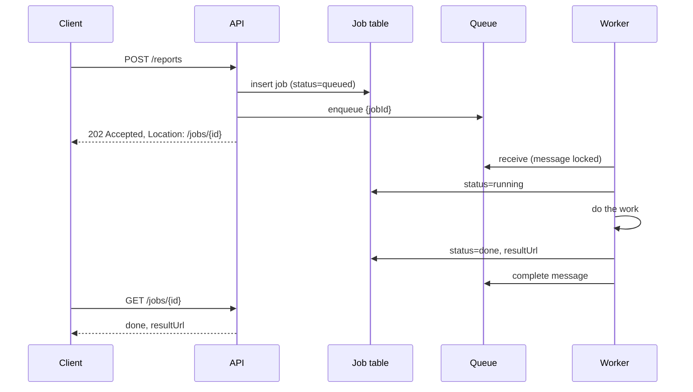

## TL;DR

- If a request triggers work that takes more than a second or two (video transcoding, report generation, sending 10,000 emails), do not do it inside the request. Accept the job, put it on a queue, and return right away.
- Workers pull jobs from the queue, do the work, and record the result. Add workers to go faster; the queue absorbs bursts in the meantime.
- Give the client a job ID and a way to learn the outcome: a status endpoint to poll, a push notification, or a webhook.
- Plan for workers dying mid-job. The queue must redeliver unfinished work, the job must be safe to run twice, and poison messages must land in a dead-letter queue.
- On Azure, use Azure Service Bus for the queue and Azure Container Apps jobs or Azure Functions for the workers.

## Why it matters

A synchronous request ties up a connection, a thread or event-loop slot, and the user's patience for as long as the work takes. Load balancers, gateways, and browsers all have timeouts, and many sit between 30 seconds and a few minutes. Work that runs longer than the shortest timeout in the chain fails even when the server finishes it, because nobody is left to receive the answer. The client retries, and now the work runs twice.

Slow work in the request path also couples capacity. A spike of report requests exhausts the web servers, so login and browse requests fail too. Separating the two lets each scale on its own: web servers scale on request rate, workers scale on queue depth.

Interviewers bring this up whenever a design includes something slow: uploads that need processing, batch exports, AI inference, payment settlement, bulk notifications. The expected answer is "async job with a queue", followed by the details that make it reliable.

## How it works

### Accept, enqueue, return

The API validates the request, writes a job record (`queued`), sends a small message with the job ID, and returns `202 Accepted` with a link to the job's status. Keep the message small: the job ID and the parameters, or a pointer to them. Large inputs go to blob storage, and the message carries the reference (the claim-check pattern).

Writing the job row and sending the message are two separate operations. If the process crashes after the insert and before the send, the row sits in `queued` with no message, and no worker ever sees it. Close the gap with a sweeper that re-enqueues `queued` jobs older than a few minutes, or with a [transactional outbox](./multi-step-processes.md) that records the message in the same transaction as the row.

### Workers and delivery

Workers run as a separate pool. Each one receives a message, processes it, and acknowledges it. The receive uses a lock or visibility timeout rather than a delete:

1. The queue hides the message from other workers for a lock period.
2. The worker processes the job and then completes (deletes) the message.
3. If the worker crashes, the lock expires and another worker gets the message.
4. If a message fails too many times, the queue moves it to a dead-letter queue for a human or a repair job.

This gives at-least-once delivery. A job can run twice when a worker finishes but crashes before acknowledging, or when the lock expires during a slow job. Make the job [idempotent](./idempotency-and-retries.md): check the job status before starting, write results under a deterministic name, and make side effects such as charging a card or sending an email check a key first.

For jobs longer than the lock period, the worker renews the lock while it works. For very long jobs (hours), split them into steps and checkpoint progress in the job record so a restarted worker resumes rather than starting over.

### Telling the client

| Method | How | Good for |
| --- | --- | --- |
| Polling | Client calls `GET /jobs/{id}` every few seconds, honoring a `Retry-After` header | Simple clients, jobs of seconds to minutes |
| Push | Worker publishes completion; the client's open WebSocket or SSE stream receives it | Interactive apps that already hold a [real-time connection](./real-time-updates.md) |
| Webhook | Worker calls a URL the client registered | Server-to-server integrations |
| Email or notification | Out-of-band message | Jobs of hours, where the user leaves |

### Scaling and priority

Scale workers on queue depth or on the age of the oldest message, not on CPU. Age is the better signal for users, because it measures how long they are waiting. Use separate queues for separate priorities or tenants, so a bulk export of a million rows cannot delay a password reset email. Cap concurrency per worker based on what the job uses (memory for video, connections for database-heavy jobs), and cap total workers at what downstream systems can absorb. This is the queue-based load leveling idea from [resilience patterns](./resilience-patterns.md): the queue holds the burst, and workers drain it at a rate the system can survive.

## Trade-offs

| Choice | You gain | You pay |
| --- | --- | --- |
| Synchronous request | One round trip, simple code, immediate errors | Timeouts, tied-up servers, retries that duplicate work |
| Queue plus workers | Fast responses, independent scaling, crash recovery | A job record, status API, idempotent workers, and eventual results |
| Polling for status | Works everywhere, stateless | Wasted requests, delay up to one poll interval |
| Push or webhook | Instant notification | Connection infrastructure or a callback contract to secure and retry |
| Long-lived workers | No startup cost, warm caches | Pay for idle capacity |
| Per-job containers | Isolation, any runtime, long jobs | Startup latency per job |
| Single queue | Simple | One noisy producer delays everyone |

## On Azure

| Need | Azure service | What matters |
| --- | --- | --- |
| Queue with locks and dead-lettering | Azure Service Bus queues | Peek-lock receive with a default lock of one minute, renewable by the client or by the SDK's automatic lock renewal. After the max delivery count (default 10) the message moves to the dead-letter queue. Messages up to 256 KB on Standard, and up to 100 MB over AMQP on Premium. |
| Simple, high-volume queue | Azure Queue Storage | Lease-based receive, messages up to 64 KB, no ordering guarantee and no duplicate detection. Cheap for plain work queues. |
| Workers that run to completion | Azure Container Apps jobs | Trigger types are Manual, Schedule (cron), and Event. Event jobs use KEDA scalers to decide how many executions to run, and each execution typically handles one event. Replica timeout, retry limit, and polling interval (default 30 seconds) are configurable. |
| Event-driven function workers | Azure Functions with a Service Bus trigger | Flex Consumption and Premium default to a 30-minute timeout and can be configured unbounded. The legacy Consumption plan caps at 10 minutes. |
| Async HTTP status endpoints | Durable Functions | The built-in HTTP API returns `202 Accepted` with a `Location` header and a `statusQueryGetUri` for polling. |
| Large inputs and results | Azure Blob Storage | Store the payload, put the URL in the message. |

**Choosing a worker.** Use Functions when each job is short and you want per-message triggers with little code. Use Container Apps jobs when a job needs its own container, a long run, or a runtime Functions does not cover, such as an ffmpeg pipeline. Use a long-running Container Apps app that reads the queue in a loop when jobs are small, frequent, and benefit from warm state.

[Compute choices](../04-azure/compute-choices.md) compares Functions, Container Apps, and the other hosts in more depth.

**Gotcha.** An HTTP-triggered function has 230 seconds to respond regardless of the function timeout, because of the default idle timeout of the Azure load balancer in front of it. Longer work must return early and continue in the background, which is the pattern on this page. Microsoft's guidance is the Durable Functions async pattern, or deferring the work and returning immediately.

**Gotcha.** If processing outlasts the Service Bus lock and nobody renews it, the message reappears and a second worker starts the same job while the first is still running. Turn on automatic lock renewal in the SDK with a maximum duration longer than your slowest job, and keep the job idempotent anyway.

## Interview tips

- When you see a slow step in your design, say "I'd make this async" and draw the queue and workers right away.
- Name the status model: `queued`, `running`, `done`, `failed`, with timestamps. It answers "how does the user know?" before it is asked.
- Explain the failure path without being prompted: lock expiry, redelivery, idempotent jobs, retry limits, dead-letter queue.
- Scale workers on queue age or depth. Mention separate queues for priority classes.
- Expect "what if the job takes six hours?" Answer with checkpoints, smaller steps, and per-job containers. If the job has many steps with their own failure handling, hand off to [multi-step processes](./multi-step-processes.md).
- Tie the queue choice back to [message queues](../02-building-blocks/message-queues.md) and its delivery guarantees.

## Further reading

- [Hello Interview: Managing Long Running Tasks](https://www.hellointerview.com/learn/system-design/patterns/long-running-tasks)
- [Asynchronous Request-Reply pattern](https://learn.microsoft.com/azure/architecture/patterns/async-request-reply)
- [Queue-Based Load Leveling pattern](https://learn.microsoft.com/azure/architecture/patterns/queue-based-load-leveling)
- [Competing Consumers pattern](https://learn.microsoft.com/azure/architecture/patterns/competing-consumers)
- [Claim-Check pattern](https://learn.microsoft.com/azure/architecture/patterns/claim-check)
- [Jobs in Azure Container Apps](https://learn.microsoft.com/azure/container-apps/jobs)
- [Azure Functions hosting options](https://learn.microsoft.com/azure/azure-functions/functions-scale)
- [Service Bus message transfers, locks, and settlement](https://learn.microsoft.com/azure/service-bus-messaging/message-transfers-locks-settlement)
- [The Coding Gopher: Synchronous vs. Asynchronous Explained](https://thecodinggopher.substack.com/p/synchronous-vs-asynchronous-explained)
