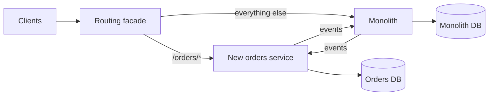

## TL;DR

- A monolith is one deployable unit. Microservices are many small services, each owning one business capability and its data, deployed independently.
- Microservices solve organizational and scaling problems: many teams shipping without stepping on each other, and parts of the system with very different load or failure profiles. They create distributed systems problems in exchange: network failures, partial outages, data consistency across services, and much more operational work.
- The usual best start is a modular monolith: one deployable with strict internal module boundaries. Split modules out when a concrete reason appears.
- The worst outcome is a distributed monolith: services that must deploy together and call each other synchronously for every request. You pay the costs of both and get the benefits of neither.
- On Azure, run a monolith on Azure App Service or Azure Container Apps, run most microservices on Azure Container Apps, and choose Azure Kubernetes Service (AKS) when you need the Kubernetes API.

## Why it matters

Interviewers ask about this in two ways. Directly: "would you build this as microservices?" Indirectly: you draw six service boxes and they ask how those services share data, what happens when one is down, and how a request is traced across them. Both questions test whether you treat service boundaries as a decision with costs, not a default.

The costs are real. Every function call that becomes a network call can now time out, fail halfway, or arrive twice. A join between two tables becomes two API calls and an in-memory merge. A transaction across two tables becomes a [saga](./multi-step-processes.md). Debugging a slow request means correlating logs across a dozen processes. Teams that split early, before they understand the domain, usually draw the boundaries wrong, and moving a boundary between services is far harder than moving code between modules.

## How it works

### The spectrum

| Shape | Deployables | Boundaries enforced by | Fits |
| --- | --- | --- | --- |
| Monolith | One | Discipline | Small teams, early products, unclear domain |
| Modular monolith | One | Module APIs, build rules, separate schemas per module | Most products until several teams share the code |
| Microservices | Many | The network | Many teams, components with very different scaling, isolation, or compliance needs |

A modular monolith gets most of the design benefit of microservices. Each module has a public interface, owns its tables, and cannot reach into another module's internals (enforce this with build rules or architecture tests). Calls between modules are in-process function calls, so there are no network failures, and cross-module transactions still work. If a module later needs to become a service, its boundary is already clean.

### Reasons to split a service out

- **Team autonomy.** Several teams need to ship on their own schedules. Conway's law says a system's structure mirrors the communication structure of the organization that builds it, so service boundaries that match team boundaries reduce coordination.
- **Different scaling profiles.** Image processing needs GPUs and scales with uploads. The catalog API needs memory and scales with browsing. Scaling the whole monolith for one hot path wastes money.
- **Fault isolation.** A memory leak in report generation should not take down checkout.
- **Different technology or compliance.** A payments component with PCI scope, or an ML service that needs Python while the rest is Java.
- **Different release cadence.** A pricing engine that changes daily next to an accounting core that changes quarterly.

If none of these apply, the split adds cost without benefit.

### Drawing boundaries

Split by business capability, not by technical layer. "Orders", "inventory", and "payments" are good services. "Database service" and "validation service" are not, since every feature would change all of them. Domain-driven design calls these capability boundaries bounded contexts: areas where a term like "product" has one consistent meaning.

Tests for a boundary:

- **Data ownership.** Each service owns its data, and no other service reads its tables directly. Shared tables are the most common way a set of services turns back into one tightly coupled system.
- **Change together, deploy together.** If two services almost always change in the same pull request, they are one service.
- **Chattiness.** If rendering one page requires a chain of synchronous calls A to B to C to D, latency and failure probability add up along the chain. Merge the services, or replicate the data each one needs through events (see [event-driven architecture](./event-driven-cqrs-event-sourcing.md)).

### What microservices require

Splitting is the easy part. Running many services needs a platform:

- Service discovery and load balancing between services.
- An [API gateway](../02-building-blocks/api-gateway.md) for external clients, so they do not call internal services directly.
- Distributed tracing, with a trace ID propagated through every call and message.
- [Resilience patterns](./resilience-patterns.md) on every service-to-service call: timeouts, retries, circuit breakers.
- Contract versioning so a service can change its API without breaking callers.
- Independent CI/CD pipelines, and a way to run or stub dependencies locally.

### Migrating with the strangler fig

Do not rewrite the monolith in one release. Put a routing facade (a gateway or reverse proxy) in front of it. Move one capability at a time into a new service, route its traffic to the new service, and sync the data it needs through events until the monolith no longer touches it. Then delete the old code. The monolith shrinks until it is gone or until what remains is fine as it is. Every step is reversible by changing a route.

## Trade-offs

| Factor | Monolith or modular monolith | Microservices |
| --- | --- | --- |
| Development speed early | Fast: one repo, one build, in-process calls | Slow: contracts, pipelines, and platform first |
| Development speed with many teams | Slows as teams contend for one codebase and release train | Teams ship independently |
| Scaling | Scale everything together | Scale each service on its own profile |
| Failure isolation | One bug can take down the process | Failures contained, if you add resilience patterns |
| Data consistency | Local transactions | Sagas and eventual consistency |
| Operations | One thing to deploy, monitor, and debug | Many deployables, distributed tracing, service mesh or equivalent |
| Latency | Function calls | Network hops on every boundary |
| Cost of a wrong boundary | Move code between modules | Migrate data and APIs between services |

## On Azure

| Need | Azure service | What matters |
| --- | --- | --- |
| Host a monolith or a few services | Azure App Service (including Web App for Containers) | Fully managed HTTP hosting that prioritizes simplicity over control, with scaling, traffic splitting, and network integration. |
| Host most microservices | Azure Container Apps | Runs on Kubernetes without exposing it. Built-in Layer 7 ingress, traffic splitting across revisions, internal ingress with DNS-based service discovery, and autoscaling on any KEDA scaler, with most apps able to scale to zero. |
| Full Kubernetes control | Azure Kubernetes Service (AKS) | Access to the Kubernetes API and the CNCF ecosystem. You take on more operations: node patching, upgrades, and guardrails. |
| Service-to-service building blocks | Dapr on Azure Container Apps | Managed Dapr APIs for service invocation with automatic mTLS, pub/sub, state management, bindings, actors, secrets, and configuration. |
| External entry point | Azure API Management | Routes external calls to services. Also the routing facade for a strangler fig migration. |
| Tracing across services | Application Insights with the Azure Monitor OpenTelemetry Distro | Correlates telemetry for one request across services. The application map shows how services call each other. |

**Choosing compute.** Microsoft's container service guide frames it as simplicity versus control. App Service is the simplest, Container Apps sits in the middle, and AKS gives the most control at the highest operational cost. A team without dedicated platform engineers should start at Container Apps or App Service and move to AKS only for a concrete need such as custom operators or service mesh configuration.

**Gotcha.** Dapr service invocation and pub/sub make calls look local, but they are still network calls. Each still needs a timeout, retries for idempotent operations, and a plan for partial failure. Dapr component resiliency policies (retries, timeouts, circuit breakers; in preview on Container Apps) help, but they do not remove the design work.

## Interview tips

- In most interviews, draw logical services because they make the design readable. Then say how you would deploy them: "These start as modules in one deployable and split when the teams or load require it."
- Give a concrete reason for every service boundary you draw. "Separate because uploads scale differently from reads" is a good reason. "Separate because microservices" is not.
- Say who owns each piece of data, and never draw two services writing the same table.
- Name the distributed monolith as the failure mode to avoid, and give its signs: lockstep deploys, shared databases, long synchronous call chains.
- For a legacy system, propose the strangler fig rather than a rewrite.
- Connect boundaries to [scalability](../01-fundamentals/scalability.md) and to consistency in [consistency and CAP](../01-fundamentals/consistency-and-cap.md).

## Further reading

- [Microservices architecture style](https://learn.microsoft.com/azure/architecture/guide/architecture-styles/microservices)
- [Use domain analysis to model microservices](https://learn.microsoft.com/azure/architecture/microservices/model/domain-analysis)
- [Strangler Fig pattern](https://learn.microsoft.com/azure/architecture/patterns/strangler-fig)
- [Choose an Azure container service](https://learn.microsoft.com/azure/architecture/guide/choose-azure-container-service)
- [Microservice APIs powered by Dapr in Azure Container Apps](https://learn.microsoft.com/azure/container-apps/dapr-overview)
- [Azure Container Apps overview](https://learn.microsoft.com/azure/container-apps/overview)
