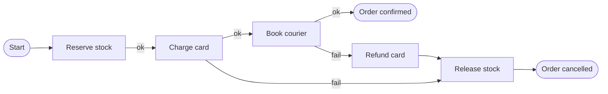

## TL;DR

- A checkout that reserves stock, charges a card, and books a courier spans three services and three databases. No single transaction covers it, and any step can fail after earlier steps succeeded.
- A saga splits the process into local transactions, one per service. Each step that can be undone has a compensating action, and a failure runs the compensations for completed steps in reverse order.
- Coordinate with an orchestrator (one component drives every step) or with choreography (services react to each other's events). Orchestration is easier to reason about once you pass three or four steps.
- Use a durable workflow engine for orchestration so the process survives crashes. Use a transactional outbox so "save my change" and "tell the others" cannot disagree.
- On Azure, use Durable Functions or the Durable Task SDKs backed by the Durable Task Scheduler, and Azure Service Bus or the Azure Cosmos DB change feed for events.

## Why it matters

Inside one database, a transaction makes a multi-step change all-or-nothing. Split the data across services and that guarantee disappears. Picture checkout: inventory reserves the item, payments charges \$80, shipping fails because the address is undeliverable. Now the customer is charged for an order that will never ship, and the item is held for nobody. Without a plan, someone fixes that by hand.

The classic answer, two-phase commit, asks every participant to prepare and then commit together. It needs every database and broker to support the protocol, it holds locks while it waits for the slowest participant, and a coordinator failure at the wrong moment leaves participants stuck holding those locks. Third-party APIs such as a payment provider will never join your transaction. So most systems accept that the process is eventually consistent and make the intermediate states explicit and recoverable.

The second failure is quieter. A service updates its database and then publishes an event. If it crashes between the two, the database says "order placed" and nobody else ever hears about it. Every multi-step design needs an answer for this dual write.

## How it works

### Sagas and compensation

A saga is a sequence of local transactions. Each step commits in its own service and either triggers the next step or, on failure, triggers compensations for the steps already done.

A compensation is a new forward action with the opposite business effect, not a rollback. A refund is not an erased charge: the customer sees both lines on the statement. Some actions cannot be compensated at all. You cannot unsend an email or unship a parcel. Order the steps around that:

1. **Compensable steps first.** Reserve stock, place a payment hold. These can be undone.
2. **The pivot.** The point of no return, such as capturing the payment. Once it succeeds, the saga only moves forward.
3. **Retryable steps last.** Send the confirmation email, notify the warehouse. These must eventually succeed, so make them [idempotent](./idempotency-and-retries.md) and retry them until they do.

Prefer reservations to immediate effects where you can (hold the funds, hold the seat, as in [handling contention](./handling-contention.md)), because cancelling a hold is cheaper and cleaner than reversing a completed action.

### Orchestration vs. choreography

| | Orchestration | Choreography |
| --- | --- | --- |
| Who decides the next step | One orchestrator that calls each service and records progress | Each service, by reacting to events from the previous one |
| Where the process is written down | In one place, as code or a workflow definition | Spread across every subscriber |
| Coupling | Orchestrator knows every participant | Services know event types, not each other |
| Debugging | Read the workflow's history | Reconstruct the flow from traces across services |
| Good for | Processes with many steps, branches, timeouts, or compensation | Short flows of two or three steps, or broadcast-style reactions |

Choreography looks decoupled until someone asks "what happens when shipping fails?" and the answer lives in four codebases. Orchestration puts the process, its timeouts, and its compensations in one readable place. A common split: orchestrate the core business process, and let other services react to its published events through choreography.

### Durable execution

An orchestrator that keeps state in memory loses the process when it crashes. A durable workflow engine fixes that by recording every step's result in a history log. When the orchestrator restarts, it replays its code from the top, and calls whose results are already in the history return the recorded value instead of running again. The process resumes exactly where it was, even days later.

That model gives you durable timers ("cancel the order if payment hasn't arrived in 30 minutes"), waits for external events (a human approval, a webhook from the payment provider), and per-step retry policies. The price is a coding rule: orchestrator code must be deterministic. It cannot read the clock, generate random IDs, or call the network directly, because a replay would get different answers. Those things go in activities, whose results the engine records.

### The transactional outbox

To avoid the dual write, write the event into the same database transaction as the business change, then publish it separately.

1. In one local transaction, update the order row and insert an `OrderPlaced` row into an `outbox` table (or container).
2. A relay process reads new outbox rows, publishes them to the broker, and marks them sent.
3. If the relay crashes after publishing but before marking, it publishes again on restart.

The outbox converts "maybe never sent" into "sent at least once". Consumers must therefore deduplicate by event ID. The relay can poll the outbox table or tail the database's change log (change data capture), which avoids polling and keeps events in commit order.

### Isolation between sagas

Sagas give up isolation. Another request can read an order after stock was reserved but before payment failed. Mitigations from the saga literature:

- **Semantic lock.** Mark records with a status such as `PENDING` so other operations treat them carefully.
- **Reread before updating.** Check that the data has not changed, like the optimistic concurrency in [handling contention](./handling-contention.md).
- **Commutative updates.** Design steps so order does not matter, such as increments instead of overwrites.

## Trade-offs

| Choice | You gain | You pay |
| --- | --- | --- |
| Distributed transaction (2PC) | Atomic commit across participants | Blocking locks, coordinator failure modes, needs protocol support everywhere |
| Saga | Each service stays autonomous and available | Intermediate states are visible; you write and test compensations |
| Orchestration | Process logic in one place, clear status and history | A central component that changes whenever the process changes |
| Choreography | Loose coupling, easy to add listeners | Process logic scattered; cyclic event chains are easy to create |
| Durable workflow engine | Crash recovery, timers, retries for free | Determinism rules, versioning work when changing in-flight workflows |
| Transactional outbox | Events never lost relative to the data | An extra table, a relay, at-least-once delivery to handle |

## On Azure

| Need | Azure service | What matters |
| --- | --- | --- |
| Code-first orchestration | Durable Functions | Orchestrator, activity, and entity functions in C#, JavaScript, TypeScript, Python, PowerShell, or Java. Supports durable timers, `WaitForExternalEvent` for approvals, and compensation with ordinary try/catch. |
| Orchestration outside Functions | Durable Task SDKs | The same model for apps on Azure Container Apps, Azure Kubernetes Service (AKS), App Service, or virtual machines. |
| Workflow state backend | Durable Task Scheduler | Microsoft's recommended storage provider for both Durable Functions and the Durable Task SDKs. |
| Outbox on a document database | Azure Cosmos DB transactional batch and change feed | A batch is atomic within one logical partition, so store the business document and its events under the same partition key. The change feed is ordered per partition key and is read by the change feed processor with a lease container. |
| Event delivery between steps | Azure Service Bus | Sessions keep FIFO order per session ID (for example, per order). Duplicate detection drops messages that reuse a `MessageId` within the detection window. |

**Microsoft's reference outbox.** The Azure Architecture Center sample writes the business object and its events in one Cosmos DB transactional batch, tails the change feed, publishes to Service Bus with the partition key as the session ID, and turns on Service Bus duplicate detection to absorb re-publishes after a relay restart.

[Compute choices](../04-azure/compute-choices.md) covers where to host the orchestrator, whether Functions, Container Apps, or AKS.

**Gotcha.** Durable Functions retry policies default to a backoff coefficient of 1 (a constant interval) and no retry timeout, so retries continue until the attempt count runs out. Set the coefficient (2 is common), the maximum attempts, and a retry timeout on each activity call rather than accepting defaults.

**Gotcha.** Orchestrator replay makes `DateTime.UtcNow`, `Guid.NewGuid()`, environment variables, and direct HTTP calls unsafe in orchestrator code. Use `context.CurrentUtcDateTime`, generate IDs in activities, and make outbound calls from activities or the durable HTTP APIs. A nondeterministic orchestrator takes a different path on replay than it took the first time.

## Interview tips

- When a flow crosses services, say "there's no shared transaction here, so I'll use a saga" and list each step with its compensation.
- Point out the pivot step and explain why irreversible actions (sending email, capturing payment) come last.
- Pick orchestration for anything with more than a couple of steps and say why: one place to see status, timeouts, and failures.
- Mention the dual-write problem and the outbox before the interviewer finds it in your diagram.
- Expect "what if a compensation fails?" Answer with retries, idempotent compensations, and a dead-letter path that alerts a human.
- Link the coordination to the [message queues](../02-building-blocks/message-queues.md) carrying the events and to [long-running tasks](./long-running-tasks.md) for slow individual steps.

## Further reading

- [Hello Interview: Multi-step Processes](https://www.hellointerview.com/learn/system-design/patterns/multi-step-processes)
- [Saga distributed transactions pattern](https://learn.microsoft.com/azure/architecture/patterns/saga)
- [Compensating Transaction pattern](https://learn.microsoft.com/azure/architecture/patterns/compensating-transaction)
- [Implement the Transactional Outbox pattern by using Azure Cosmos DB](https://learn.microsoft.com/azure/architecture/databases/guide/transactional-outbox-cosmos)
- [Durable Functions overview](https://learn.microsoft.com/azure/azure-functions/durable/durable-functions-overview)
- [Orchestrator function code constraints](https://learn.microsoft.com/azure/azure-functions/durable/durable-functions-code-constraints)
- [Durable Task Scheduler](https://learn.microsoft.com/azure/azure-functions/durable/durable-task-scheduler/durable-task-scheduler)
- [The Coding Gopher: The Outbox Design Pattern](https://thecodinggopher.substack.com/p/the-transactional-outbox-pattern)
