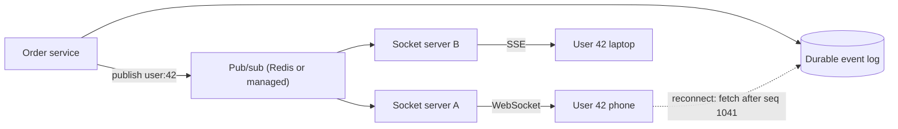

## TL;DR

- Real-time delivery has two hops. The first carries an event from its source to the server that holds the user's connection. The second carries it from that server to the client. Design them separately.
- Pick the simplest transport that meets the latency target: polling, SSE for server-to-client streams, WebSockets for chatty two-way traffic, webhooks for server-to-server push.
- Persistent connections make servers stateful. You need a way to find the server holding a given user's socket, usually pub/sub fan-out or a managed connection service.
- A socket gives you low latency, not durability. Give every message a sequence number and let clients fetch what they missed after a reconnect.
- On Azure, terminate browser connections on Azure Web PubSub or Azure SignalR Service instead of running your own socket fleet. Azure Front Door does not carry SSE.

## Why it matters

HTTP is request-response. The client asks, the server answers, and the server has no way to speak first. Any feature where the server learns something before the client does (a chat message, a driver's location, a price tick, a finished job, an LLM token) needs a way around that.

The naive fix is to poll fast. One million open apps polling every second is one million requests per second, and almost every response says "nothing new". Slow the poll to save money and users see stale data. The real-time patterns trade that waste for long-lived connections, which bring their own failures: servers that hold state, deploys that drop a million sockets at once, reconnect storms, and messages lost while a client was briefly offline.

## How it works

### Hop two: server to client

Five techniques cover nearly every design. They differ in who can send, how long a connection lives, and how much infrastructure they disturb.

| Technique | Direction | Connection | Typical latency | Use it for |
| --- | --- | --- | --- | --- |
| Short polling | Client pulls | New request every N seconds | Up to N seconds | Dashboards, job status, anything where 2 to 10 seconds of delay is fine |
| Long polling | Client pulls, server delays the answer | Request held open until data or a timeout (about 30 s) | Near real time | Environments where proxies break anything else |
| Server-Sent Events (SSE) | Server to client | One HTTP response that never ends | Milliseconds | Notifications, feeds, live scores, LLM token streams |
| WebSockets | Both ways | Upgraded TCP connection, full duplex | Milliseconds | Chat, multiplayer, collaborative editing, presence |
| Webhooks | Server to server | One HTTP POST per event | Seconds | Telling another company's system that something happened |

**Short polling** is stateless, cacheable, and works through every proxy. Its cost is $\text{clients} / \text{interval}$ requests per second. Ten thousand clients polling every 5 seconds is 2,000 requests per second, which a small fleet handles. Start here when the requirement says "updates within a few seconds".

**Long polling** holds the request until there is data or a timeout fires, then the client asks again. Latency drops to near zero, but each waiting client pins a connection. Events that arrive between one response and the next request get lost unless the client sends a cursor (`?after=msg_1042`) and the server replays from it.

**SSE** is a single HTTP response with `Content-Type: text/event-stream` that the server keeps writing `data:` lines into. The browser's `EventSource` reconnects on its own and sends a `Last-Event-ID` header, so resuming from a cursor is built into the protocol. It is one-way; the client sends anything else with normal requests. Under HTTP/2 and HTTP/3 many streams share one connection, so the old six-connections-per-domain browser limit stops mattering. Most LLM chat APIs stream tokens this way.

**WebSockets** start as an HTTP request with `Upgrade: websocket`, get a `101 Switching Protocols` reply, and then exchange frames in both directions over the same TCP connection. Per-message overhead is a few bytes, which matters when a client sends 20 cursor positions a second. The cost is state. Every load balancer and proxy on the path must allow long-lived connections, idle timeouts must be longer than your heartbeat interval, and every deploy closes every socket on the drained servers.

**Webhooks** are push between servers. The provider POSTs a signed payload to a URL the subscriber registered. A sound webhook system signs payloads (an HMAC header the receiver verifies), retries with backoff when the receiver fails, and confirms that the receiver owns the URL before sending anything to it. Receivers must treat every delivery as a possible duplicate, as covered in [idempotency and retries](./idempotency-and-retries.md).

### Hop one: source to the right server

With polling, any server can answer any client because the data lives in a shared store. With SSE or WebSockets, user 42's connection lives on exactly one server. When an order service emits "order 9 shipped" for user 42, something has to get that event to that server.

There are four common ways to route.

1. **Pub/sub fan-out.** Each socket server subscribes to a channel per connected user or per topic (`user:42`, `doc:abc`). Producers publish to the channel and only subscribed servers receive it. Redis pub/sub is the usual choice. It is fire-and-forget, so a server that blips loses messages. Pair it with the replay path below.
2. **Connection registry.** Store `userId -> serverId` in a key-value store when a client connects, and have producers send directly to that server. Routing is precise, but crashed servers leave stale entries, so give each entry a TTL that heartbeats refresh.
3. **Consistent hashing.** Producers compute the user's server from a hash of the user ID instead of looking it up. Scaling the fleet moves a slice of users, who must reconnect. See [consistent hashing](../02-building-blocks/consistent-hashing.md).
4. **A managed connection service.** A service holds the sockets, and your stateless app calls an API such as "send to user 42" or "send to group doc:abc". The service owns routing, scaling, and heartbeats.

### Missed messages and reconnects

A socket delivers at most once. Phones change networks, laptops sleep, and servers restart. Treat the push channel as a latency optimization and keep a pull path for correctness. Give each message a per-stream sequence number, store messages in a durable log or table, and have the client send its last-seen sequence on reconnect. The server replays the gap and then switches to live delivery.

When a deploy drains a server holding 50,000 sockets, all 50,000 clients reconnect within a second unless each adds random jitter to its retry delay. Drain gradually during deploys, and send heartbeats every 20 to 30 seconds so dead peers and silent proxy timeouts surface fast. [Resilience patterns](./resilience-patterns.md) covers jittered backoff in detail.

## Trade-offs

| Choice | You gain | You pay |
| --- | --- | --- |
| Short polling | Stateless servers, HTTP caching, trivial scaling | Latency equal to the interval; wasted requests when nothing changes |
| Long polling | Low latency with plain HTTP | A held connection per client; cursor bookkeeping to avoid gaps |
| SSE | Simple server code, auto-reconnect with resume, works over HTTP/2 and HTTP/3 | One direction only; some proxies buffer or time out streaming responses |
| WebSockets | Two-way, low overhead per message | Stateful servers, sticky routing, deploy-time reconnect storms, custom heartbeat logic |
| Webhooks | No polling between companies | Receivers must be public, verify signatures, and deduplicate |
| Managed connection service | No socket fleet to scale or patch | Per-unit and per-message cost; a vendor API between you and the client |

## On Azure

| Need | Azure service | What matters in the design |
| --- | --- | --- |
| Browser or mobile WebSockets at scale | Azure Web PubSub | Each unit holds 1,000 concurrent connections; one resource scales to 1 million. Supports raw WebSockets, Socket.IO, and MQTT over WebSocket. Your app sends to users and groups through a REST API or SDK. |
| Existing ASP.NET Core SignalR app | Azure SignalR Service | Default mode keeps your hub server and proxies client connections through the service. Serverless mode drives messages from Azure Functions or REST calls with no hub server. SignalR falls back to SSE and long polling on its own. |
| Fan-out between your own socket servers | Azure Managed Redis (pub/sub) | Fire-and-forget. Back it with a durable log for replay. |
| Durable, replayable event log | Azure Event Hubs | Clients or servers resume from an offset after a gap. See [event streaming](../02-building-blocks/event-streaming.md). |
| Outbound webhooks | Azure Event Grid push delivery | At-least-once delivery, a 30-second response timeout, exponential backoff for up to 30 attempts or 1,440 minutes by default, then optional dead-lettering to Blob Storage. Event Grid requires the endpoint to complete a validation handshake. |
| Edge in front of sockets | Azure Front Door or Azure Application Gateway | Front Door Standard and Premium carry WebSockets with a 5-minute idle timeout and a 2-hour maximum connection life. Application Gateway supports WebSockets natively on every size. |

**Tier choice.** Web PubSub and SignalR Service both reserve autoscale, zone redundancy, and geo-replication for the Premium tier. If the design states "survive a zone failure", the tier is Premium. Plan to scale up before units reach 80% utilization, which is the Web PubSub guidance.

**Connection flow.** Clients call your API to get a short-lived access URL (the negotiate step), then connect straight to the Web PubSub or SignalR endpoint. Your app servers stay stateless and never hold a client socket. Events from the order service go to an Azure Function or a worker that calls "send to user". This removes hop one from your code.

**Gotcha.** Azure Front Door does not support Server-Sent Events, and caps WebSocket use at 3,000 concurrent connections per profile with a 2-hour lifetime. If you stream LLM tokens over SSE behind Front Door, the stream breaks. Route SSE through Application Gateway or straight to the origin, and send high-volume WebSocket clients to Web PubSub's own endpoint rather than through Front Door.

The [Azure service map](../04-azure/azure-service-map.md) compares Front Door and Application Gateway as entry points.

## Interview tips

- Name both hops out loud. Picking "WebSockets" answers half the question. The next one is "how does the event find the right server?"
- Justify the transport by direction and frequency. A notification bell, a live feed, or a streamed AI answer is one-way, so "clients only receive, so SSE" beats "WebSockets because real time".
- State the delivery guarantee. Say that pushes are best-effort, every message carries a sequence number, and reconnecting clients fetch the gap from storage.
- Expect "what happens during a deploy?" Answer with connection draining, jittered client reconnects, and a managed service that does not restart when your code does.
- Expect "how many servers?" A single tuned server holds tens of thousands of idle WebSockets; memory per connection and fan-out bandwidth set the limit, not CPU. Work the numbers with [back-of-the-envelope estimates](../01-fundamentals/back-of-the-envelope.md).
- For presence ("who is online"), say heartbeats write `lastSeen` with a TTL into a key-value store. Do not derive presence from socket state on one server.

## Further reading

- [Hello Interview: Real-time Updates](https://www.hellointerview.com/learn/system-design/patterns/realtime-updates)
- [The Coding Gopher: Polling vs. Long Polling vs. SSE vs. WebSockets vs. Webhooks](https://thecodinggopher.substack.com/p/polling-vs-long-polling-vs-sse-vs)
- [The Coding Gopher: Intro to Webhooks](https://thecodinggopher.substack.com/p/intro-to-webhooks)
- [What is Azure Web PubSub?](https://learn.microsoft.com/azure/azure-web-pubsub/overview)
- [Service mode in Azure SignalR Service](https://learn.microsoft.com/azure/azure-signalr/concept-service-mode)
- [Azure Front Door WebSocket](https://learn.microsoft.com/azure/frontdoor/standard-premium/websocket)
- [Event Grid message delivery and retry](https://learn.microsoft.com/azure/event-grid/delivery-and-retry)
