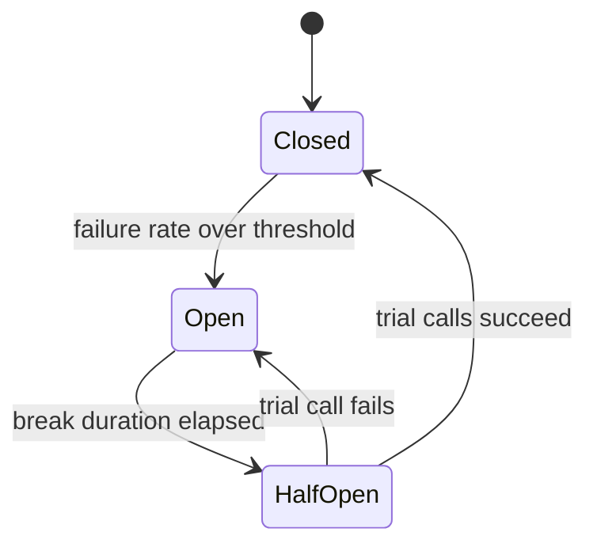

## TL;DR

- Most outages spread. A dependency gets slow, callers pile up waiting on it, their threads and connections run out, and their callers fail next. Resilience patterns stop the spread.
- **Timeouts** bound how long you wait. **Retries** with exponential backoff and jitter recover from brief blips without stampeding.
- **Circuit breakers** stop calling a dependency that is clearly down, so it can recover and callers fail fast.
- **Bulkheads** give each dependency or tenant its own pool, so one bad actor cannot drain shared capacity.
- **Load shedding** and **backpressure** refuse or slow work at the edge when the system is full, instead of accepting it and timing out later.
- On Azure, use the .NET standard resilience handler (or the equivalent in your SDK), Azure API Management backend circuit breakers and rate limits, Azure Front Door WAF rate limiting, and Azure Service Bus queues for load leveling. Test with Azure Chaos Studio.

## Why it matters

Picture a product page that calls a recommendations service. Recommendations has a bad deploy and starts answering in 30 seconds instead of 50 milliseconds. The product service has 200 worker threads and no timeout, so within seconds all 200 are waiting on recommendations. Now the product page fails for everyone, even though product data is fine. Clients retry, tripling the traffic. The recommendations service, which might have recovered after a rollback, is buried under retries and stays down. One non-essential feature has taken out the site.

Every step of that story has a named fix. Interviewers ask "what happens when this dependency is slow?", and the answer is a short list of these patterns applied at specific arrows in your diagram. The goal is graceful degradation: the product page renders without recommendations rather than not at all.

## How it works

### Timeouts

Every network call needs a timeout, and the default in many clients is effectively infinite. Set it from the dependency's latency distribution: a bit above its p99 under normal load. A call that normally takes 50 ms and occasionally 300 ms might get 1 second.

Use a deadline for the whole request too. If the user-facing request has a 2-second budget and 1.5 seconds are gone, a downstream call should get at most the remaining 0.5 seconds, including its retries. Propagate the deadline in a header so each service knows how much time is left. Inner timeouts must be shorter than outer ones, or the outer caller gives up while the inner call is still consuming resources.

### Retries with backoff and jitter

Retry only transient failures (timeouts, connection resets, `429`, `503`), and only when the operation is [idempotent](./idempotency-and-retries.md).

- **Exponential backoff.** Wait 100 ms, then 200, 400, 800, up to a cap. Each wait gives the dependency more room.
- **Jitter.** Pick a random delay between zero and the backoff value. Without jitter, every client that failed at the same moment retries at the same moment, and the retries arrive as synchronized waves.
- **Cap attempts and time.** Three to five attempts, and never past the request deadline.
- **Honor `Retry-After`.** A throttling server is telling you when it will have capacity.
- **Retry at one layer.** Three layers each making three attempts turn one failure into $3^3 = 27$ calls. Retry close to the failing call and let outer layers fail fast.
- **Retry budget.** Allow retries only while they stay below a fraction of total traffic, such as 10%. When the dependency is fully down, retries stop adding load.

### Circuit breakers

A circuit breaker wraps calls to one dependency and tracks recent outcomes.

- **Closed.** Calls pass through. Failures are counted over a sliding window.
- **Open.** The failure rate crossed the threshold. Calls fail immediately without touching the network, so callers return quickly and the dependency gets no load.
- **Half-open.** After a break duration, a few trial calls go through. Success closes the circuit. Failure opens it again.

When the circuit is open, return a fallback: cached data, a default, or a reduced response. "Recommendations unavailable" is a fallback. A blank page is not. Pair the breaker with a minimum throughput so three failures at 3 a.m. do not trip it.

### Bulkheads

Ships divide their hulls so one breach floods one compartment. In software, give each dependency its own connection pool, thread pool, or concurrency limit. If recommendations is slow, it can exhaust its 20 slots but not the 200 shared ones that payments also needs. The same idea applies to tenants (a noisy tenant gets its own queue or quota) and to infrastructure (separate node pools or app plans for critical and batch workloads).

### Load shedding and rate limiting

When demand exceeds capacity, serving everyone slowly means serving nobody well, since requests time out after consuming resources. Reject the excess early and cheaply instead.

- **Rate limiting** caps each client: 100 requests per minute per API key, returning `429` with `Retry-After`. It protects you from one heavy client. See [API gateway](../02-building-blocks/api-gateway.md).
- **Load shedding** caps the whole service: when concurrency, queue length, or latency crosses a limit, return `503` immediately. Shed the least important work first. Health checks and checkout outrank analytics beacons and prefetches.
- **Admission control** at the edge is cheapest. A request rejected at the gateway costs microseconds. One rejected after three service hops cost all three.

### Backpressure and load leveling

Backpressure means a slow consumer signals producers to slow down rather than letting work pile up without limit. Bounded queues are the mechanism. When the buffer is full, the producer blocks, gets an error, or drops work, and the pressure travels upstream to where it can be handled. An unbounded in-memory queue just converts an overload into an out-of-memory crash with a delay.

For spiky write traffic, put a durable queue between the front end and the processor (queue-based load leveling). The front end accepts requests at any rate, and workers drain the queue at the rate the database can handle. This is the shape of [long-running tasks](./long-running-tasks.md) and [scaling writes](./scaling-writes.md).

### Putting them together

A typical outbound call stacks the patterns from outside in: rate limiter or bulkhead, total deadline, retry with jitter, circuit breaker, per-attempt timeout. Order matters. The circuit breaker sits inside the retry so each attempt is counted, and the per-attempt timeout sits innermost so a hung attempt is cut off and retried.

## Trade-offs

| Pattern | Protects against | Costs |
| --- | --- | --- |
| Timeouts | Threads stuck on hung calls | Too short fails healthy slow requests; too long ties up resources |
| Retries | Brief network blips, failovers | Extra load on a struggling dependency; duplicate work without idempotency |
| Circuit breaker | Hammering a dead dependency; slow failures | Rejects some calls that would have succeeded; thresholds to tune per dependency |
| Bulkhead | One dependency or tenant draining shared capacity | Idle reserved capacity; more pools to size |
| Load shedding | Collapse under overload | Some users get errors on purpose; needs priority classes |
| Backpressure and queues | Producers outrunning consumers | Added latency; queue depth to monitor; producers must handle refusal |
| Fallbacks | User-visible failure | Stale or partial data; fallback paths that rarely run and may be broken |

## On Azure

| Need | Azure feature | What matters |
| --- | --- | --- |
| Client-side timeouts, retries, breakers | `Microsoft.Extensions.Http.Resilience` standard resilience handler | One call adds five strategies: rate limiter (1,000 permits), total timeout (30 s), retry (up to 3 retries, exponential with jitter, 2 s base delay), circuit breaker (10% failure ratio, 100 minimum calls, 30 s sampling, 5 s break), and attempt timeout (10 s). |
| Breaker in front of a backend | Azure API Management backend circuit breaker | Trips on a count or percentage of failure status codes in a window, then returns `503` until the trip duration ends, and can honor the backend's `Retry-After`. Not available on the Consumption tier, and each gateway instance trips on its own counts. |
| Per-client limits | API Management `rate-limit-by-key` | Limits calls per key (subscription, IP, user claim) per period and returns `429`. Counts are approximate and tracked per gateway, not across regions. |
| Edge limits | Azure Front Door WAF rate limit rules | Threshold per one-minute or five-minute window, counted per socket IP address by default. Less effective against attacks spread across many IPs. |
| Database throttling | Azure Cosmos DB `429` responses | The response includes `x-ms-retry-after-ms`. The SDKs retry 429s automatically, typically up to nine times, so throttling can appear in metrics before your code sees it. |
| Load leveling | Azure Service Bus queues | Durable buffer between spiky producers and steady consumers. |
| Consumer concurrency cap | Azure Functions Service Bus trigger | `maxConcurrentCalls` (default 16 per instance) bounds how hard each instance hits downstream systems. |
| Failure testing | Azure Chaos Studio | Experiments inject service-direct faults (VM shutdown, SQL Database failover, Redis cache flush) and agent-based faults (CPU and memory pressure). The newer Workspaces and Scenarios model is in preview. |

[Regions, zones, and resiliency](../04-azure/regions-zones-and-resiliency.md) covers the zone and region redundancy these patterns sit on top of.

**Gotcha.** API Management's backend circuit breaker honors `Retry-After`. Azure OpenAI can return `429` with a very long `Retry-After` (Microsoft's example is one day), which would keep the circuit open that long. Microsoft calls this out for Azure OpenAI backends, so set the rules with that in mind.

**Gotcha.** Cosmos DB SDK retries and your own retry policy stack. If you wrap SDK calls in another retry loop, a throttled partition sees both layers. Tune the SDK's throttling retry options instead of adding a second layer.

## Interview tips

- When you add a dependency to the diagram, say its timeout and what happens when it fails. "Recommendations has a 300 ms timeout and a circuit breaker; on failure we render the page without them."
- Say "exponential backoff with jitter" and explain why jitter matters. It is a common follow-up.
- Use the 27-calls example to show you know retries amplify load.
- Distinguish rate limiting (per client, fairness) from load shedding (whole service, survival).
- Mention which features degrade first. Interviewers like a priority order.
- Close the loop with testing: inject faults in staging and in production game days. Link it to [availability and reliability](../01-fundamentals/availability-and-reliability.md).

## Further reading

- [Retry pattern](https://learn.microsoft.com/azure/architecture/patterns/retry)
- [Circuit Breaker pattern](https://learn.microsoft.com/azure/architecture/patterns/circuit-breaker)
- [Bulkhead pattern](https://learn.microsoft.com/azure/architecture/patterns/bulkhead)
- [Throttling pattern](https://learn.microsoft.com/azure/architecture/patterns/throttling)
- [Rate Limiting pattern](https://learn.microsoft.com/azure/architecture/patterns/rate-limiting-pattern)
- [Queue-Based Load Leveling pattern](https://learn.microsoft.com/azure/architecture/patterns/queue-based-load-leveling)
- [Retry Storm antipattern](https://learn.microsoft.com/azure/architecture/antipatterns/retry-storm/)
- [Build resilient HTTP apps in .NET](https://learn.microsoft.com/dotnet/core/resilience/http-resilience)
- [Backends in API Management](https://learn.microsoft.com/azure/api-management/backends)
