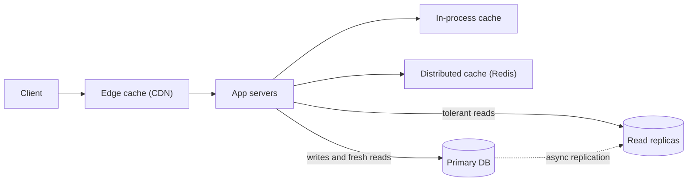

## TL;DR

- Most products read far more than they write, often 10 to 100 reads per write. The primary database is usually the first thing to saturate.
- Scale reads in this order: make each query cheaper, add read replicas, add a cache, then serve from the edge. Each step is cheaper per request than the one before and staler.
- Every layer past the primary returns old data some of the time. Decide which reads need read-your-writes and route only those to fresh sources.
- Caches fail in three named ways: stampedes when a hot key expires, hot keys that melt one cache node, and invalidation races that pin stale values. Have an answer for each.
- On Azure, the levers are Azure SQL read scale-out, PostgreSQL read replicas, Azure Cosmos DB regions and its integrated cache, Azure Managed Redis, and Azure Front Door caching.

## Why it matters

Picture a product page that runs 40 queries per view (product, price, stock, reviews, seller, recommendations). At 500 page views per second the database handles 20,000 queries per second, and its CPU climbs to 90%. Adding web servers makes it worse, because each new server opens more connections to the same database. Latency rises, connection pools fill, and requests start timing out on pages that have nothing to do with products.

Writes in that system might be 50 per second. The problem is almost entirely reads, and reads are the easier half to scale because a read does not have to change shared state. You can copy the data to more places. The cost of copying is freshness. A design that scales reads is really a design that decides, read by read, how stale an answer is allowed to be.

## How it works

### Step 1: make each read cheaper

Before you copy data anywhere, cut the work per read.

- **Index for the query you run.** A covering index turns a scan of 10 million rows into a few page reads. See [indexing](../02-building-blocks/indexing.md).
- **Kill N+1 queries.** Loading 50 posts and then each post's author one at a time is 51 round trips. One `WHERE id IN (...)` or a join makes it two.
- **Denormalize hot aggregates.** Store `comment_count` on the post row and update it on write, instead of running `COUNT(*)` on every view.
- **Precompute expensive views.** A materialized view or a background job that writes the finished result turns a 200 ms aggregation into a key lookup.

This step is free in infrastructure and often buys a 10x headroom gain. Interviewers notice when you skip it.

### Step 2: read replicas

A replica receives the primary's changes, usually asynchronously, and serves reads. Five replicas give you roughly five times the read capacity for queries that tolerate a little lag. Replicas also isolate workloads, so a heavy reporting query runs on a replica and leaves the primary alone. See [replication](../02-building-blocks/replication.md).

The price is replication lag, typically milliseconds to seconds and worse under write bursts. The visible bug is read-your-writes. A user edits their display name, the page reloads from a replica, and the old name comes back. Fixes, from simplest:

1. Send that user's reads to the primary for a few seconds after they write (track a `last_write_at` in their session).
2. Record the primary's log position after the write and read from a replica only once it has applied that position.
3. Use a database that offers session consistency and pass the session token along with the user's requests.

### Step 3: caching

A cache stores the answer instead of the data. With cache-aside, the app checks the cache, falls back to the database on a miss, and writes the result back with a TTL. On writes, the app updates the database and then deletes the cache key. See [caching](../02-building-blocks/caching.md) for the strategies.

The hit ratio is what matters. At 20,000 reads per second, a 95% hit ratio sends 1,000 to the database. Raising it to 99% sends 200. The last few points of hit ratio are worth more than the first fifty.

Caches add three failure modes you should name:

- **Stampede.** A key read 5,000 times a second expires, and 5,000 requests miss at once and all query the database. Fix it with request coalescing (one request recomputes while the others wait for its result), a short lock on miss, or refreshing the value before it expires.
- **Hot key.** A celebrity's profile lives on one cache shard, which hits 100% CPU while the others idle. Fix it with a small in-process cache with a 1 to 5 second TTL in front of Redis, or by storing copies under several keys (`user:42#1` to `user:42#8`) and reading one at random.
- **Invalidation race.** Request A misses and reads the old value from a lagging replica. Request B writes and deletes the key. A then writes its old value into the cache, where it stays until the TTL ends. Keep TTLs short enough to bound the damage, fill the cache from the primary for keys that change often, or include a version in the key.

### Step 4: the edge

Public, identical responses (images, scripts, product pages for anonymous users, API responses that do not vary by user) belong in a CDN. The origin sees one request per edge location per TTL instead of one per user. Control it with `Cache-Control: s-maxage` for shared caches. For personalized pages, cache the shared parts and fetch the personal parts separately. See [CDN and edge](../02-building-blocks/cdn-and-edge.md).

### Choosing freshness per read

Write down, per read path, how stale is acceptable. A product description can be minutes old. A stock count on the product page can be seconds old, but the stock check at checkout must hit the primary. A user's own settings page needs read-your-writes. This list tells you which layer serves each read and is a stronger interview answer than "add Redis".

## Trade-offs

| Technique | Read capacity gain | Staleness | Cost and complexity |
| --- | --- | --- | --- |
| Query and schema fixes | Often 10x, sometimes far more | None | Engineering time; denormalized fields must be kept in sync |
| Read replicas | Linear in replica count | Replication lag, seconds or more under load | Full copies of the data; lag-aware routing |
| Distributed cache | Very high for repeated keys | Up to the TTL, or longer after an invalidation race | Another tier to run; stampede and hot-key handling |
| In-process cache | Highest; no network hop | Up to the TTL, per server | Memory per server; servers disagree briefly |
| CDN | Massive for public content | Up to the TTL; purges take time | Only for responses that are the same for many users |

The trap is jumping to caching for a workload whose reads rarely repeat. If each user reads mostly their own data once, hit ratios stay low and replicas or better indexes do more.

## On Azure

| Layer | Azure service | What changes the design |
| --- | --- | --- |
| Edge cache | Azure Front Door Standard or Premium | Honors `Cache-Control`, including `private` and `no-store`. Without the header, it picks a cache duration between one and three days. |
| Distributed cache | Azure Managed Redis | Choose Memory Optimized, Balanced, or Compute Optimized by memory-to-vCPU need, or Flash Optimized for large, colder datasets. Azure Cache for Redis Basic, Standard, and Premium retire on September 30, 2028, and Enterprise on March 31, 2027, so new designs use Azure Managed Redis. |
| Relational replicas | Azure SQL Database | Premium, Business Critical, and Hyperscale enable read scale-out by default. Add `ApplicationIntent=ReadOnly` to a connection string to land on a read-only replica. Hyperscale adds up to 30 named replicas per primary for isolating read workloads. |
| Relational replicas | Azure Database for PostgreSQL flexible server | Up to five asynchronous read replicas. Microsoft documents lag of seconds to minutes, and hours under sustained heavy writes. |
| Globally distributed reads | Azure Cosmos DB | Add read regions near users. Session consistency gives read-your-writes within a client session. The integrated cache in a dedicated gateway serves repeated point reads and queries without spending request units. |

**Tier choice.** On Azure SQL Database, Premium and Business Critical already run secondary replicas at the same compute size as the primary for high availability. Read scale-out lets reporting and analytics queries use one of them. If you chose Business Critical for availability, point read-only traffic there before you add a cache for it. General Purpose has no readable secondary, so the same workload would need a geo-replica or a cache.

**Gotcha.** Two Cosmos DB settings quietly turn off what you paid for. The integrated cache only serves reads at session or eventual consistency; a read at bounded staleness or strong bypasses it and pays full request units. And session tokens live in the client SDK instance. A user whose next request lands on a different app server, or on a freshly started one, reads with eventual consistency unless you pass the session token back with the request.

## Interview tips

- Start with the read-to-write ratio and the hot read paths. "Feed reads are 100x writes, so I optimize for reads" frames everything after it.
- Walk the ladder in order: indexes and denormalization, replicas, caches, CDN. Skipping straight to a cache invites "why is the query slow in the first place?"
- Name the consistency cost at each step and give one concrete read that cannot be stale, such as a balance at checkout.
- Expect "what happens when a hot key expires?" and "what about a celebrity?" Answer with request coalescing and key replication or a local cache.
- Use numbers. Show how a hit ratio change moves database load, using [back-of-the-envelope estimates](../01-fundamentals/back-of-the-envelope.md).
- If writes become the bottleneck, say so and move to [scaling writes](./scaling-writes.md). Replicas do not help writes.

## Further reading

- [Hello Interview: Scaling Reads](https://www.hellointerview.com/learn/system-design/patterns/scaling-reads)
- [Use read-only replicas to offload read-only query workloads (Azure SQL)](https://learn.microsoft.com/azure/azure-sql/database/read-scale-out)
- [Read replicas in Azure Database for PostgreSQL](https://learn.microsoft.com/azure/postgresql/read-replica/concepts-read-replicas)
- [Azure Cosmos DB integrated cache](https://learn.microsoft.com/azure/cosmos-db/integrated-cache)
- [Consistency levels in Azure Cosmos DB](https://learn.microsoft.com/azure/cosmos-db/consistency-levels)
- [Caching with Azure Front Door](https://learn.microsoft.com/azure/frontdoor/front-door-caching)
- [What is Azure Managed Redis?](https://learn.microsoft.com/azure/redis/overview)
- [The Coding Gopher: The N+1 Database Query Problem Explained](https://thecodinggopher.substack.com/p/the-n1-database-query-problem-explained)
- [The Coding Gopher: Why Scaling Redis is Harder Than You Think](https://thecodinggopher.substack.com/p/why-scaling-redis-is-harder-than)
