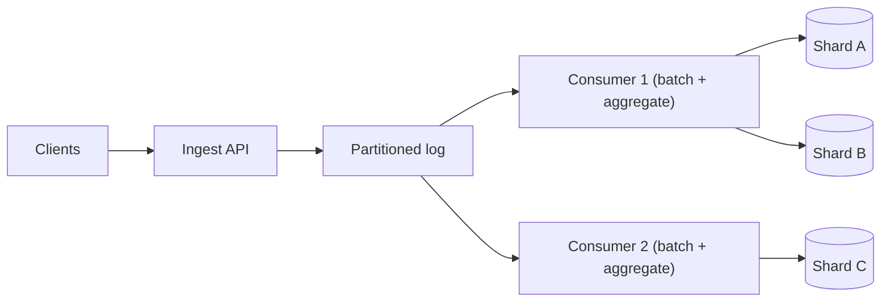

## TL;DR

- Reads can be copied to more places. Writes must land in one authoritative place and be durable, so scaling them means splitting where they land.
- Work through the levers in order: make each write cheaper (batching, fewer indexes, append-only storage), partition so writes spread across nodes, buffer bursts in a log, and write less by aggregating first.
- The partition key decides whether partitioning works. Pick a high-cardinality key that matches the main access pattern, and plan for hot keys from day one.
- A queue in front of the database smooths bursts but makes writes asynchronous. Say what the client sees between "accepted" and "stored".
- On Azure, the numbers that shape the design are Cosmos DB's 10,000 RU/s per physical partition, Event Hubs' 1 MB/s per throughput unit, and fixed partition counts on Event Hubs Standard.

## Why it matters

Take a delivery app where 1 million couriers send a GPS ping every 4 seconds. That is 250,000 writes per second before any orders, ratings, or payments. A single relational primary on good hardware handles on the order of 10,000 to 50,000 small transactional writes per second (a rough figure; indexes, row size, and durability settings move it a lot). You are short by an order of magnitude, and read replicas do nothing because every replica must apply every write too.

When writes outgrow a node, the symptoms come in a predictable order. Commit latency climbs as the log disk saturates. Lock waits grow on popular rows. Replicas fall behind because they replay the same write volume on similar hardware. Then requests time out and clients retry, which adds more writes. The fixes below either make each write cost less or spread writes over machines that do not need to talk to each other.

## How it works

### Make each write cheaper

Before splitting the database, shrink the work per write.

- **Batch.** Inserting 500 rows in one statement and one commit pays for one log flush instead of 500. Many databases group concurrent commits for the same reason.
- **Trim indexes.** Every secondary index is another write per row. A table with six indexes does seven writes per insert. Drop indexes nothing queries.
- **Use append-friendly storage.** Log-structured merge (LSM) engines such as Cassandra and RocksDB turn random updates into sequential appends and compact later. They take very high write rates at the cost of slower, more variable reads.
- **Scale up first.** A larger machine with faster disks is the cheapest way to double write capacity, and it keeps transactions simple. Know the ceiling and plan the next step before you hit it.

### Partition the writes

Sharding splits the data by a key, so each node owns a slice and handles that slice's writes. Ten shards give roughly ten times the write capacity if traffic spreads evenly. See [sharding and partitioning](../02-building-blocks/sharding-and-partitioning.md) and [consistent hashing](../02-building-blocks/consistent-hashing.md) for the mechanics.

The partition key is the most important decision on this page.

- **High cardinality.** Millions of distinct values (`user_id`, `order_id`, `device_id`) spread load. Values like `country` or `status` create a few giant partitions.
- **Even traffic.** A key with many values can still be skewed. A `created_date` key sends every current write to today's partition.
- **Matches the common access path.** If most writes and reads are per user, key by user so each operation touches one partition. Operations that span partitions need scatter-gather reads or cross-shard transactions, both of which are slow and fragile.

A common compromise is a compound key such as `tenant_id` then `user_id`. It keeps a tenant's data together for queries while letting a large tenant spread across nodes.

### Split hot keys

Some keys are hot no matter how good the scheme is. A viral post takes 40,000 likes per second, and all of them hit one counter on one partition.

- **Salt the key.** Write to `likes:post9:{0..15}`, picking a suffix at random. Reads sum the 16 sub-counters. As long as the sub-keys hash to different partitions, write capacity on that key rises up to 16x, and reads get a little more expensive.
- **Aggregate in memory.** Each app server counts likes for a second and writes one increment. A thousand servers turn 40,000 writes into at most 1,000.
- **Turn updates into appends.** Record each like as an event and compute the count asynchronously. The event log scales by partition, and the count is eventually consistent.

### Buffer bursts with a log

Put a durable, partitioned log (Kafka or a managed equivalent) between the API and the database. The API appends and returns `202 Accepted` in a few milliseconds. Consumers read at a rate the database can sustain, batching as they go. A traffic spike becomes a growing backlog instead of an overloaded database. See [event streaming](../02-building-blocks/event-streaming.md) and [message queues](../02-building-blocks/message-queues.md).

You pay with asynchrony. The client gets "accepted" before the write is queryable, so the product must tolerate that gap, or the client must poll for a status. The log also needs its own capacity plan, and consumers must be idempotent because the log redelivers after failures. See [idempotency and retries](./idempotency-and-retries.md).

### Write less

The cheapest write is the one you skip.

- **Keep only the latest value.** For courier locations, overwrite one key per courier in an in-memory store and persist a sample (one point every 30 seconds) for history. 250,000 writes per second to durable storage becomes about 33,000.
- **Pre-aggregate.** For ad clicks, count per ad per second in the stream processor and write one row per ad per second, not one per click.
- **Sample.** For metrics and logs, keep 1% of debug events and 100% of errors.

## Trade-offs

| Technique | Write gain | What you give up |
| --- | --- | --- |
| Batching and fewer indexes | 2x to 10x | Slightly higher per-item latency; some queries get slower |
| Scaling up | Up to the largest machine | Cost grows faster than capacity; a hard ceiling |
| Sharding | Roughly linear in shard count | Cross-shard queries and transactions; resharding is a project |
| Hot-key salting | Linear in salt count for that key | Reads must fan in across sub-keys |
| Log buffering | Absorbs bursts many times the steady rate | Writes become asynchronous; another system to run |
| Aggregation and sampling | Often 10x to 1,000x | Loss of per-event detail; counts lag |

Sharding is the step teams regret doing early. It is hard to undo and makes every cross-entity feature harder. Exhaust the cheaper levers and size the shard count for several years of growth when you do it.

## On Azure

| Need | Azure service | What shapes the design |
| --- | --- | --- |
| Partitioned operational store | Azure Cosmos DB for NoSQL | Each physical partition serves up to 10,000 RU/s and stores up to 50 GB. Each logical partition (one partition key value) is limited to 20 GB and, through its physical partition, 10,000 RU/s. Hierarchical partition keys allow up to three levels, so one large tenant can exceed 20 GB. |
| Sharded PostgreSQL | Azure Database for PostgreSQL elastic clusters | A managed Citus cluster with row-based or schema-based sharding. Azure Cosmos DB for PostgreSQL is on a retirement path and not recommended for new projects. |
| Write buffer and event log | Azure Event Hubs | On Standard, each throughput unit takes up to 1 MB/s or 1,000 events/s of ingress and 2 MB/s of egress, with up to 40 per namespace. Partitions per event hub: 32 on Standard, 100 on Premium, 1,024 on Dedicated. Exceeding capacity throttles producers with a `ServiceBusy` error. |
| Hot counters and latest-value state | Azure Managed Redis | `INCR` on salted keys or overwrite-in-place, flushed to durable storage on a timer. |

**Cosmos DB partition keys.** Throughput divides evenly across physical partitions. If one key takes most of the traffic, that partition returns 429 (rate limited) while the container's average utilization looks healthy. Choose a key with many distinct values and even traffic, and use a synthetic or hierarchical key when no natural field qualifies.

[Data choices](../04-azure/data-choices.md) and [messaging choices](../04-azure/messaging-choices.md) cover the store and stream tiers in more depth.

**Gotcha.** On Event Hubs Standard you cannot add partitions after creation; dynamic partition increases exist only on Premium and Dedicated. Even there, adding partitions changes which partition a key hashes to, which breaks per-key ordering for keyed producers. Size the partition count for peak consumer parallelism on day one.

## Interview tips

- Do the arithmetic first. "250,000 writes per second is about 20 times what one primary handles" justifies every later step. See [back-of-the-envelope estimates](../01-fundamentals/back-of-the-envelope.md).
- Say the partition key and why. Then name the hot-key case for that key and how you split it.
- If you add a queue, say what the API returns and how the client learns the write landed. Interviewers probe the gap between accepted and stored.
- Distinguish throughput from contention. Many writes to different keys is a partitioning problem; many writes to one key is a [contention](./handling-contention.md) problem.
- Expect "how do you reshard?" Mention consistent hashing or many small virtual partitions mapped to fewer nodes, so moving data means reassigning partitions rather than rehashing every row.
- Do not reach for multi-region writes as a scaling tool. It raises availability and lowers latency but brings conflict resolution, covered in [consistency and CAP](../01-fundamentals/consistency-and-cap.md).

## Further reading

- [Hello Interview: Scaling Writes](https://www.hellointerview.com/learn/system-design/patterns/scaling-writes)
- [Partitioning and horizontal scaling in Azure Cosmos DB](https://learn.microsoft.com/azure/cosmos-db/partitioning-overview)
- [Hierarchical partition keys in Azure Cosmos DB](https://learn.microsoft.com/azure/cosmos-db/hierarchical-partition-keys)
- [Scaling with Event Hubs](https://learn.microsoft.com/azure/event-hubs/event-hubs-scalability)
- [Dynamically add partitions to an event hub](https://learn.microsoft.com/azure/event-hubs/dynamically-add-partitions)
- [Elastic clusters in Azure Database for PostgreSQL](https://learn.microsoft.com/azure/postgresql/elastic-clusters/concepts-elastic-clusters)
- [The Coding Gopher: Partitioning, Sharding, and Chunking Explained](https://thecodinggopher.substack.com/p/partitioning-sharding-and-chunking)
- [The Coding Gopher: An Intro to Database Sharding](https://thecodinggopher.substack.com/p/an-intro-to-database-sharding)
