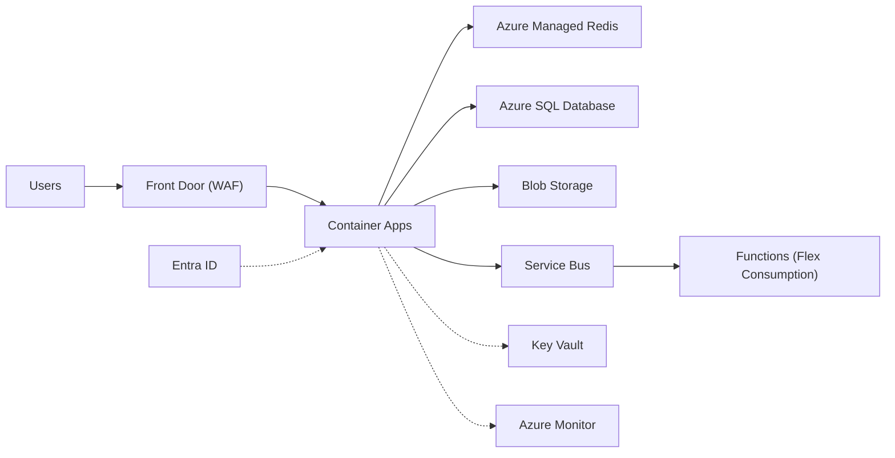

## TL;DR

- Design with generic building blocks first, then map each block to an Azure service. The block decides the behavior, and the service decides the limits, tiers, and failure modes.
- Most blocks have two or three Azure candidates. The choice usually turns on scope (global or regional), protocol (HTTP or not), and how much you want to run yourself.
- Prefer current products. Azure Managed Redis replaces the retiring Azure Cache for Redis tiers, Azure Front Door Standard/Premium replaces classic CDN and Front Door (classic), and Microsoft Entra External ID replaces Azure AD B2C for new customers.
- Name the tier in an interview or a design review. "Service Bus Premium" and "Service Bus Standard" have different message size limits, isolation, and price.

## Why it matters

A whiteboard design says "queue" or "cache". A production design on Azure has to say which queue, which tier, and what happens when a zone fails. Teams that skip this step find the limits late, often in a load test or an incident. Typical surprises: a 256 KB message cap on Service Bus Standard, a 64 KB cap on Storage queues, a DNS-based failover that takes minutes because clients cache records, or a cache tier that is being retired.

This page is the index for the rest of the Azure level. Each row points to the generic concept in [Building blocks](../02-building-blocks/load-balancing.md) and to the Azure page that goes deeper.

## How it works

Read the map in two passes. First, pick the generic block from the requirements: a stream when consumers need replay, a queue when each message must be handled once by one worker, a cache when reads dominate and staleness is acceptable. Second, narrow the Azure candidates with three questions.

1. **Scope.** Does traffic or data cross regions? Front Door and Traffic Manager are global; Application Gateway is regional; Azure Load Balancer offers both a regional and a cross-region topology.
2. **Protocol.** Is it HTTP(S)? Layer-7 services (Front Door, Application Gateway, API Management) understand paths, headers, and TLS. Layer-4 and DNS services (Load Balancer, Traffic Manager) do not.
3. **Operating model.** Do you need the open-source API with no servers to patch? Event Hubs speaks the Kafka protocol, Azure Managed Redis speaks Redis, and Azure Database for PostgreSQL runs PostgreSQL. Self-hosting the same software on AKS gives you control and all of the on-call work.

The diagram shows a typical web workload with each block labeled by its Azure service.

### The map

| Building block | Azure service(s) | Pick when | Concept |
| --- | --- | --- | --- |
| Global HTTP entry and CDN | Azure Front Door Standard or Premium | Users are spread across regions and you want edge caching, TLS at the edge, WAF, and fast failover between regional origins. Premium adds Private Link to origins and the managed WAF rule set. | [CDN and edge](../02-building-blocks/cdn-and-edge.md) |
| Regional L7 load balancer | Application Gateway (with WAF); Application Gateway for Containers for AKS | HTTP(S) traffic enters a VNet in one region and you need path routing, TLS offload, or WAF close to the app. | [Load balancing](../02-building-blocks/load-balancing.md) |
| L4 load balancer | Azure Load Balancer | TCP or UDP traffic, very low latency, or non-HTTP protocols. Use the Standard SKU (Basic retired on 30 September 2025) with zone-redundant frontend IPs. | [Load balancing](../02-building-blocks/load-balancing.md) |
| DNS-based global routing | Traffic Manager | Non-HTTP endpoints across regions. Failover speed is bounded by DNS caching, so it is slower than Front Door. | [Load balancing](../02-building-blocks/load-balancing.md) |
| API gateway | Azure API Management | You need auth, rate limits, transformation, versioning, and a developer portal for HTTP APIs. Its AI gateway policies add token limits for LLM backends. | [API gateway](../02-building-blocks/api-gateway.md) |
| Cache | Azure Managed Redis | Hot reads, sessions, rate-limit counters, leaderboards. Pick the tier by memory-to-vCPU ratio. Do not start new work on Azure Cache for Redis. | [Caching](../02-building-blocks/caching.md) |
| Queue | Service Bus; Storage queues | Service Bus for ordered (sessions), transactional, deduplicated work with dead-lettering. Storage queues for cheap, very large backlogs of small messages. | [Message queues](../02-building-blocks/message-queues.md) |
| Stream | Event Hubs | High-throughput append-only events, many consumer groups, replay within retention, Kafka clients. | [Event streaming](../02-building-blocks/event-streaming.md) |
| Event routing | Event Grid | React to state changes (a blob was created, a resource changed) with push or pull delivery and CloudEvents. | [Event-driven, CQRS, event sourcing](../03-patterns/event-driven-cqrs-event-sourcing.md) |
| Blob store | Azure Blob Storage; Data Lake Storage | Files, media, backups, logs. Enable the hierarchical namespace (Data Lake Storage) for analytics engines that need directories. | [Blob storage](../02-building-blocks/blob-storage.md) |
| Relational DB | Azure SQL Database; Azure Database for PostgreSQL or MySQL flexible server; SQL Managed Instance | Joins, constraints, transactions. SQL Database Hyperscale grows to 128 TB. Managed Instance fits SQL Server lift and shift. | [SQL vs NoSQL](../02-building-blocks/databases-sql-vs-nosql.md) |
| Document or multimodel DB | Azure Cosmos DB; Azure DocumentDB | Cosmos DB for single-digit-millisecond key access, tunable consistency, and multi-region writes. DocumentDB when you want MongoDB compatibility on open-source foundations. | [SQL vs NoSQL](../02-building-blocks/databases-sql-vs-nosql.md) |
| Search | Azure AI Search | Full-text, vector, and hybrid queries in one index, plus agentic retrieval for RAG. | [Search](../02-building-blocks/search.md) |
| Identity | Microsoft Entra ID; Entra External ID; managed identities | Entra ID for employees and workloads, External ID for customer sign-up and sign-in, managed identities for service-to-service calls without secrets. | [Identity and auth](../02-building-blocks/identity-and-auth.md) |
| Secrets and keys | Azure Key Vault | Certificates, keys, and the secrets that cannot be replaced by a managed identity. | [Networking and security](./networking-and-security.md) |
| Observability | Azure Monitor (Log Analytics, Application Insights, managed Prometheus, Managed Grafana) | Every workload. Application Insights takes OpenTelemetry traces, metrics, and logs. | [Observability](./observability.md) |
| Compute | App Service, Functions, Container Apps, AKS, VM Scale Sets | See the decision tree. | [Compute choices](./compute-choices.md) |

## Trade-offs

**Managed service or self-hosted open source.** Event Hubs with the Kafka endpoint removes broker operations, but you get Event Hubs semantics and limits, not every Kafka feature. Running Kafka on AKS gives full control and makes you responsible for upgrades, rebalancing, and disk failures. The same split applies to Redis and PostgreSQL. Default to the managed service unless a hard requirement (a plugin, a version, a protocol feature) rules it out, and write that requirement down.

**One service or best fit per block.** A single Cosmos DB account can hold documents, act as a cache, and drive downstream work through its change feed. That cuts the number of services to run, but each extra role competes for the same request units. Separate services cost more to operate and isolate failure and cost.

**Global entry choices.** Front Door fails over between origins at the HTTP layer, driven by its own health probes. Traffic Manager depends on clients honoring DNS TTLs, and many do not. Use Traffic Manager only for non-HTTP traffic or as an outer layer.

**Queues.** Service Bus gives ordering, transactions, and duplicate detection. Storage queues give scale and low cost with no ordering guarantee. Picking Storage queues for a payments flow means writing ordering and dedupe logic yourself.

**Stacking load balancers.** Front Door in front of Application Gateway is common when you need global routing plus a regional WAF or private backends. Each hop adds latency and a place to misconfigure health probes, so add the second layer only when the first can't do the job.

## On Azure

The tier decisions that most often change a design:

| Decision | Why it changes the design | Source |
| --- | --- | --- |
| Front Door Standard vs Premium | Only Premium reaches origins over Private Link, so only Premium lets you close public access to App Service or storage origins. | [Private Link with Front Door](https://learn.microsoft.com/azure/frontdoor/private-link) |
| Service Bus Standard vs Premium | Standard caps messages at 256 KB. Premium allows up to 100 MB over AMQP and runs on dedicated resources. | [Service Bus quotas](https://learn.microsoft.com/azure/service-bus-messaging/service-bus-quotas) |
| Event Hubs tier | Retention is 1 day on Basic, 7 on Standard, and 90 on Premium and Dedicated. Basic has no Kafka endpoint. | [Event Hubs quotas](https://learn.microsoft.com/azure/event-hubs/event-hubs-quotas) |
| Managed Redis tier | Memory Optimized (8:1 memory to vCPU), Balanced (4:1), Compute Optimized (2:1), and Flash Optimized (RAM plus NVMe). Active geo-replication is not available on Flash Optimized. | [Azure Managed Redis overview](https://learn.microsoft.com/azure/redis/overview) |
| App Service plan | Zone redundancy needs Premium v2, v3, or v4 with at least two instances. | [Reliability in App Service](https://learn.microsoft.com/azure/reliability/reliability-app-service) |

Zone and region settings live on each service, not on the subscription. Check every row of your map against [Regions, zones, and resiliency](./regions-zones-and-resiliency.md). For the deeper choices, see [Data choices](./data-choices.md), [Messaging choices](./messaging-choices.md), and [Cost optimization](./cost-optimization.md).

**Gotcha: retirements.** Azure Cache for Redis Basic, Standard, and Premium retire on 30 September 2028, and Enterprise and Enterprise Flash on 31 March 2027 ([retirement FAQ](https://learn.microsoft.com/azure/azure-cache-for-redis/retirement-faq)). Azure CDN Standard from Microsoft (classic) retires on 30 September 2027 ([FAQ](https://learn.microsoft.com/azure/cdn/classic-cdn-retirement-faq)), and Front Door (classic) on 31 March 2027 ([FAQ](https://learn.microsoft.com/azure/frontdoor/classic-retirement-faq)). Azure AD B2C stopped being sold to new customers on 1 May 2025 ([B2C overview](https://learn.microsoft.com/azure/active-directory-b2c/overview)). A design that starts on any of these is a migration you have already scheduled.

## Interview tips

- Say the generic block first, then the service and tier: "a durable queue, Service Bus Premium, because messages can reach 2 MB and we need sessions for per-order ordering."
- Give one limit per service you name. Interviewers probe whether you know where a service stops: 256 KB on Service Bus Standard, 20 GB per logical partition in Cosmos DB, 230 seconds for an HTTP-triggered Function to respond.
- When asked "why not X", compare on the three questions above (scope, protocol, operating model) instead of on brand.
- If you are unsure of a number, say so and say how you would check. That reads better than a confident wrong limit.

## Further reading

- [Load balancing options](https://learn.microsoft.com/azure/architecture/guide/technology-choices/load-balancing-overview) (Azure Architecture Center)
- [Choose an Azure data store](https://learn.microsoft.com/azure/architecture/guide/technology-choices/data-options)
- [Compare Azure messaging services](https://learn.microsoft.com/azure/service-bus-messaging/compare-messaging-services)
- [Choose an Azure compute service](https://learn.microsoft.com/azure/architecture/guide/technology-choices/compute-decision-tree)
- [Azure API Management tier comparison](https://learn.microsoft.com/azure/api-management/api-management-features)
- [Key technologies](https://www.hellointerview.com/learn/system-design/in-a-hurry/key-technologies) (Hello Interview)
