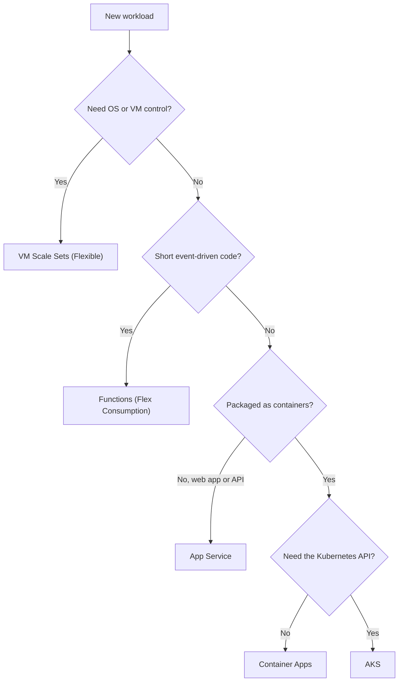

## TL;DR

- Pick the most managed option that meets your requirements, and move down the stack only for a specific need: OS control, the Kubernetes API, or a runtime the higher layers do not support.
- **App Service** for web apps and APIs from code or a container. **Functions on Flex Consumption** for short event-driven work that should scale to zero. **Container Apps** for containerized microservices and jobs without running Kubernetes. **AKS** when you need the Kubernetes API or its ecosystem. **VM Scale Sets** when you need the VM itself.
- Flex Consumption is the recommended serverless Functions plan. The original Consumption plan is now legacy, and Linux Consumption retires on 30 September 2028.
- Any HTTP-triggered function must respond within 230 seconds, whatever the plan's timeout. Long work goes behind a queue.

## Why it matters

Compute is the choice that drags the rest of the design with it. It decides how you deploy, how fast you scale, what idle costs, which networking features exist, and who is paged when a node fails. Moving later is expensive: a team that starts on AKS for a single web API carries a cluster upgrade cadence, node pools, and ingress for years. A team that starts on Functions for a 20-minute video transcode hits the HTTP limit and the plan timeout in the first load test.

## How it works

The Azure Architecture Center publishes a compute decision tree with two entry points. **Migrate** splits into lift and shift (VMs) and cloud-optimized (rehosting onto a platform service). **Build new** asks whether you need full control, HPC, event-driven code, managed web hosting, or container orchestration. The simplified version for new workloads:

### App Service

Managed hosting for web apps and APIs, from code (.NET, Java, Node.js, Python, PHP) or from a container (Web App for Containers). You scale an App Service plan by instance count and size. Deployment slots let you warm a new version and swap it in. Zone redundancy requires a Premium v2, v3, or v4 plan with at least two instances on a scale unit that supports zones.

### Azure Functions on Flex Consumption

Flex Consumption is Linux only and does not run custom containers. It adds what the old Consumption plan lacked: VNet integration, optional always-ready instances to remove cold starts on hot paths, and per-function scaling, so an HTTP function and a queue function in the same app scale independently. Instance memory sizes are 512 MB (0.25 core), 2,048 MB (1 core, the default), and 4,096 MB (2 cores). An app can scale out to 1,000 instances, against 200 on the legacy Consumption plan.

Timeouts depend on the plan. Consumption defaults to 5 minutes with a 10-minute maximum. Flex Consumption, Premium, Dedicated, and Container Apps hosting default to 30 minutes and can be unbounded. HTTP triggers are capped at 230 seconds regardless, because of the default idle timeout of Azure Load Balancer.

### Azure Container Apps

Container Apps runs on Kubernetes but gives no access to the Kubernetes API. You get revisions with traffic splitting, Dapr, scheduled and event-driven jobs, and scaling on HTTP, events, CPU or memory, or any KEDA scaler. Replicas per revision default to a minimum of 0 and a maximum of 10, configurable up to 1,000. Apps that scale only on CPU or memory cannot scale to zero, because there is no signal to wake them.

Environments use workload profiles. The Consumption profile scales to zero and bills per use, including serverless GPUs. Dedicated profiles run on reserved compute in your own pool, which suits steady load and GPU workloads. A Flexible profile is in preview. Container Apps can also host Azure Functions when you need Functions triggers in a container.

### AKS

Full Kubernetes with a managed control plane. Choose it when you need the Kubernetes API: operators, custom controllers, service meshes, Helm charts you do not own, or a platform team that standardizes on Kubernetes. AKS Automatic manages node provisioning, scaling, and patching for you at the cost of fewer topology options. AKS Standard gives full control. The Architecture Center's production baseline is at least six nodes: three in the system pool and three in each user pool.

### VM Scale Sets

Use Flexible orchestration, the recommended mode. It supports up to 1,000 VMs, spreads them across zones or fault domains, and can mix Spot and regular instances in one set. The orchestration mode cannot be changed after creation. Pick scale sets for software that needs kernel modules, a specific OS image, licensed agents, or GPU drivers you manage yourself.

## Trade-offs

| | App Service | Functions (Flex) | Container Apps | AKS | VM Scale Sets |
| --- | --- | --- | --- | --- | --- |
| Unit you deploy | App or container | Function app | Container | Pods | VM image |
| Scale to zero | No | Yes | Yes (not on CPU or memory rules) | No (nodes stay) | No |
| Kubernetes API | No | No | No | Yes | No |
| Ops burden | Low | Lowest | Low | High | Highest |
| Typical fit | Web apps, APIs | Event handlers, glue | Microservices, jobs, workers | Platforms, complex topologies | Legacy, custom OS, HPC |

**Scale to zero vs latency.** Scale-to-zero saves money and adds a cold start on the first request. Flex Consumption's always-ready instances and Container Apps' minimum replicas trade some of the savings back for latency on hot paths.

**Control vs operations.** Each step down the table hands you more knobs and more pages. On AKS you own node image upgrades, Kubernetes version upgrades, ingress, and capacity planning for pods. On Container Apps you give up custom controllers in exchange for none of that.

**Programming model lock-in.** Functions code uses triggers and bindings, which do not run elsewhere unchanged. Containers on Container Apps or AKS move between hosts with config changes. For a small event handler the Functions model saves real code; for a core service, the container is the safer contract.

**Fixed vs elastic cost.** App Service plans and AKS node pools bill while idle. Flex Consumption and Container Apps Consumption bill for use. A service at steady high load is often cheaper on reserved capacity than on per-execution billing; see [Cost optimization](./cost-optimization.md).

## On Azure

| Service | Tier that changes the design | Zone redundancy | Gotcha |
| --- | --- | --- | --- |
| App Service | Premium v2, v3, or v4 for zone redundancy | At least 2 instances on a zone-capable scale unit | A plan on a scale unit without zone support must be recreated |
| Functions | Flex Consumption for new serverless apps | Flex Consumption, Premium, and Dedicated support it; Consumption does not | 230 s HTTP response cap |
| Container Apps | Consumption vs Dedicated workload profile | Set when you create the environment; it can't be changed later | CPU or memory scaling disables scale to zero |
| AKS | Automatic vs Standard | Node pools across zones plus pod spread constraints | One replica on a three-zone pool is still one zone |
| VM Scale Sets | Flexible orchestration | Zones you select, or automatic zone placement | Orchestration mode is permanent |

**Gotcha: long requests.** The 230-second HTTP limit applies even when a Function's own timeout is unbounded. For work longer than a few seconds, accept the request, put a message on Service Bus, return 202 with a status URL, and run the work in a queue-triggered function or a Container Apps job. See [Long-running tasks](../03-patterns/long-running-tasks.md) and [Messaging choices](./messaging-choices.md).

**Gotcha: legacy plan defaults.** Tutorials and templates written before Flex Consumption still create Consumption plan apps. Check the plan on every new function app; a Linux Consumption app created now is a migration due by September 2028.

## Interview tips

- Justify compute with a requirement, not a preference. "Container Apps, because we need scale to zero on queue depth and the team doesn't want to run Kubernetes" beats "Kubernetes, because it scales."
- Mention the cold start and how you would remove it on the hot path (always-ready instances, minimum replicas).
- If you pick AKS, name what you own: upgrades, node pools, ingress, autoscaling of both pods and nodes.
- Separate request handling from long work. Interviewers often add "the job takes 10 minutes" to see if you move it off the request path.

## Further reading

- [Choose an Azure compute service](https://learn.microsoft.com/azure/architecture/guide/technology-choices/compute-decision-tree) (Architecture Center decision tree)
- [Choose an Azure container service](https://learn.microsoft.com/azure/architecture/guide/choose-azure-container-service)
- [Azure Functions Flex Consumption plan](https://learn.microsoft.com/azure/azure-functions/flex-consumption-plan) and [hosting options](https://learn.microsoft.com/azure/azure-functions/functions-scale)
- [Azure Container Apps overview](https://learn.microsoft.com/azure/container-apps/overview) and [scaling](https://learn.microsoft.com/azure/container-apps/scale-app)
- [VM Scale Set orchestration modes](https://learn.microsoft.com/azure/virtual-machine-scale-sets/virtual-machine-scale-sets-orchestration-modes)
- [Scalability](../01-fundamentals/scalability.md) and [Microservices vs monolith](../03-patterns/microservices-vs-monolith.md)
