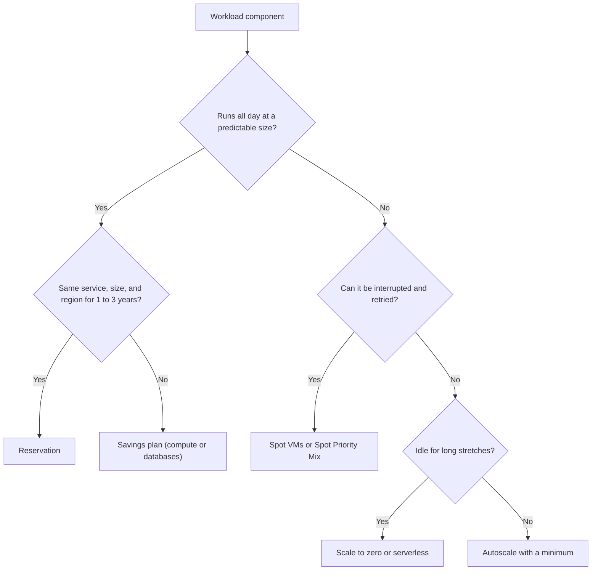

## TL;DR

- Cost optimization means paying for what the workload needs, not the lowest possible bill. The Well-Architected Framework puts it plainly: "A cost-optimized workload isn't necessarily a low-cost workload."
- Steady baseline: commit. **Reservations** (1 or 3 years, up to 72% off pay-as-you-go) give the deepest discount for a specific resource, size, and region. **Savings plans** (compute or databases) commit to an hourly spend that applies across eligible services and regions.
- Variable load: pay per use. Autoscale, scale to zero (Container Apps, Functions Flex Consumption), SQL Database serverless auto-pause, and Cosmos DB autoscale.
- Interruptible work: **Spot VMs**. No SLA, 30 seconds of eviction notice, variable price by region and SKU.
- Data: blob access tiers with lifecycle rules, and Log Analytics table plans.
- Visibility: Cost Management budgets and anomaly detection, tags for allocation, and Azure Advisor cost recommendations. Budgets alert; they don't stop anything.

## Why it matters

A cloud bill is the sum of design decisions: SKU sizes, replica counts, zone and region redundancy, log verbosity, and how long data stays hot. Each choice is cheap to make on a whiteboard and expensive to unwind once data and traffic depend on it.

Cost also trades against the other pillars. Zone redundancy, a second region, and full-fidelity tracing all cost money, and the Well-Architected Framework expects you to make those trades on purpose. Estimating load first, with the method in [Back-of-the-envelope estimation](../01-fundamentals/back-of-the-envelope.md), tells you which pricing model each component fits.

Interviewers rarely ask for prices. They ask whether you can tell which parts of a design run all day, which spike, and which can be interrupted, and whether you know the pricing model for each.

## How it works

Most designs use several branches at once: a reserved baseline, autoscale above it, and Spot for batch.

### Commitment discounts

| | Reservation | Savings plan |
| --- | --- | --- |
| Commitment | A specific resource, size, and region | A dollar amount per hour |
| Term | 1 or 3 years | 1 or 3 years |
| Discount | Up to 72% off pay-as-you-go; deeper than a savings plan for the same resource | Applies across eligible services and regions |
| Covers | VMs (compute only), and many other services such as storage capacity | Compute plan: VMs, App Service, Functions Premium, Container Instances, Dedicated Host, Container Apps, Spring Apps Enterprise. Databases plan: SQL Database, SQL Managed Instance, PostgreSQL, MySQL, Cosmos DB, DocumentDB, and SQL Server on VM licenses |
| Unused capacity | Reserved hours with no matching resource are lost and don't carry forward | Unused hourly commitment expires; it doesn't roll over |

Both are billing discounts. Nothing about the running resource changes. You can trade reservations in for a savings plan when your usage shifts.

A VM reservation covers compute only, not Windows, other software, networking, or storage. **Azure Hybrid Benefit** covers the license side: with Windows Server core licenses under active Software Assurance or qualifying subscriptions, your Windows VMs run at a reduced cost instead of the pay-on-demand Windows Server rate.

### Elastic pricing

- **Autoscale** in Azure Monitor scales Virtual Machine Scale Sets, App Service web apps, API Management, and other services on metric rules (for example, add a VM above 70% average CPU). Predictive autoscale uses machine learning for scale sets with cyclical load.
- **Azure Container Apps** defaults to a minimum of 0 replicas, so idle apps cost nothing for compute. The default maximum is 10, configurable up to 1,000.
- **Functions Flex Consumption** scales to zero and bills on execution time. Optional always-ready instances cut cold starts and are billed for their provisioned memory even when idle.
- **SQL Database serverless** bills compute per second and auto-pauses idle databases.
- **Cosmos DB autoscale** bills each hour for the highest RU/s reached. It beats manual provisioned throughput when the workload hits its maximum in 66% or fewer of the hours. Serverless Cosmos DB suits intermittent, unpredictable traffic with long idle times and is single region only.

### Spot VMs

Spot VMs run on spare capacity at a variable price. There is no SLA, and Azure evicts with 30 seconds of notice when it needs the capacity back or the price passes your optional maximum. The eviction policy is Deallocate (the default) or Delete. A deallocated Spot VM still counts against your quota and you still pay for its disks. In a scale set, **Spot Priority Mix** runs a mix of standard and Spot VMs, so a base of standard capacity survives evictions. Use Spot for batch jobs, CI, rendering, and stateless workers that pull from a queue.

### Storage tiers

| Blob tier | Minimum days | Use for |
| --- | --- | --- |
| Hot | None | Data read often |
| Cool | 30 | Infrequent reads, quick access |
| Cold | 90 | Rare reads, quick access |
| Archive | 180 | Offline; rehydrate before reading |

Moving or deleting a blob before its minimum incurs an early deletion charge. Archive is offline. Standard-priority rehydration can take up to 15 hours for objects under 10 GB. Lifecycle management rules move blobs between tiers by age, but they can't rehydrate from archive. **Smart tier**, generally available in public regions with zonal redundancy, moves objects to cool after 30 days without access and to cold after 90. Blob tiers are covered in [Blob storage](../02-building-blocks/blob-storage.md), and log tiers in [Observability](./observability.md).

### Visibility

Cost Management shows spend by subscription, resource group, service, and tag. Tags group costs by business unit, environment, or team, and tag inheritance applies parent tags to cost records. **Budgets** alert on actual or forecasted cost, and at subscription or resource group scope they can call an action group. **Anomaly detection** in cost analysis flags atypical usage for subscriptions.

**Azure Advisor** recommends shutting down resources unused over the last seven days and resizing underused VMs and scale sets. Reservation purchase recommendations based on your usage also appear in Advisor.

## Trade-offs

**Commitment vs flexibility.** A 3-year reservation gives the biggest discount and assumes the same size, region, and service for three years. Commit only the floor you're confident in and cover the rest elastically.

**Reservation vs savings plan.** Reservations save more on stable, specific resources. Savings plans save less and follow you across VM families, regions, and compute services. Teams mid-migration to containers or a new region usually prefer the savings plan.

**Scale to zero vs latency.** Zero minimum replicas costs nothing at idle and adds a cold start to the first request. Always-ready instances or a minimum of 1 removes the cold start and adds a baseline charge.

**Spot vs availability.** Spot is cheap and can disappear with 30 seconds of notice. It suits work that checkpoints or retries, not a user-facing tier without a standard base.

**Cold storage vs access.** Cooler tiers cost less to store and more to read, with early deletion charges. Archive adds hours of rehydration. Tier by measured access patterns, not guesses.

**Cost vs reliability.** Zone redundancy, a second region, and extra replicas raise the bill. Decide them from the recovery targets in [Regions, zones, and resiliency](./regions-zones-and-resiliency.md), not by default.

## On Azure

| Concern | Choice | Source |
| --- | --- | --- |
| Baseline VMs and databases | Reservations for stable resources; savings plans where service or region may change | [Savings plan overview](https://learn.microsoft.com/azure/cost-management-billing/savings-plan/savings-plan-overview) |
| Windows licensing | Azure Hybrid Benefit with existing licenses | [Hybrid Benefit for Windows Server](https://learn.microsoft.com/azure/virtual-machines/windows/hybrid-use-benefit-licensing) |
| Variable web and API load | Autoscale, or Container Apps and Flex Consumption with scale to zero | [Autoscale overview](https://learn.microsoft.com/azure/azure-monitor/autoscale/autoscale-overview) |
| Batch and CI | Spot VMs, or Spot Priority Mix in a scale set | [Spot VMs](https://learn.microsoft.com/azure/virtual-machines/spot-vms) |
| Blob data | Access tiers with lifecycle rules or smart tier | [Access tiers](https://learn.microsoft.com/azure/storage/blobs/access-tiers-overview) |
| Guardrails | Budgets with action groups, anomaly detection, Advisor | [Create budgets](https://learn.microsoft.com/azure/cost-management-billing/costs/tutorial-acm-create-budgets) |

**Regions and zones.** Reservations are tied to a region, so a two-region design needs a reservation in each region, or a savings plan that applies across regions. Spot pricing varies by region and SKU, so check the region you deploy to. Compute choices that affect the bill are compared in [Compute choices](./compute-choices.md).

**Gotcha: Advisor rightsizing ignores your commitments.** Advisor's resize and shutdown savings don't account for reservations or savings plans you already bought. For cross-series resizes, following the recommendation can raise your cost if the new size isn't covered by your reservation. Check commitments before acting on it.

**Gotcha: budgets don't stop spending.** A budget sends alerts on actual or forecasted cost. If you want an action, wire the budget to an action group that runs automation, and decide in advance what it is allowed to shut down.

## Interview tips

- Split the design into baseline, burst, and interruptible parts, and name the pricing model for each.
- Say "reservation" for the database and core VMs, "autoscale" or "scale to zero" for the web tier, and "Spot" for batch.
- Mention the hidden costs: egress, log ingestion, cross-zone or cross-region replication.
- Tie redundancy to a recovery target. "Zone-redundant because the RTO is minutes" is a cost argument as much as a reliability one.
- Name Cost Management budgets and Advisor as the ongoing loop, not a one-time exercise.

## Further reading

- [Cost Optimization design review checklist](https://learn.microsoft.com/azure/well-architected/cost-optimization/checklist)
- [Cost Optimization design principles](https://learn.microsoft.com/azure/well-architected/cost-optimization/principles)
- [What are Azure Reservations?](https://learn.microsoft.com/azure/cost-management-billing/reservations/save-compute-costs-reservations)
- [Spot Priority Mix](https://learn.microsoft.com/azure/virtual-machine-scale-sets/spot-priority-mix)
- [Advisor cost recommendations](https://learn.microsoft.com/azure/advisor/advisor-cost-recommendations)
- [Identify anomalies and unexpected changes in cost](https://learn.microsoft.com/azure/cost-management-billing/understand/analyze-unexpected-charges)
