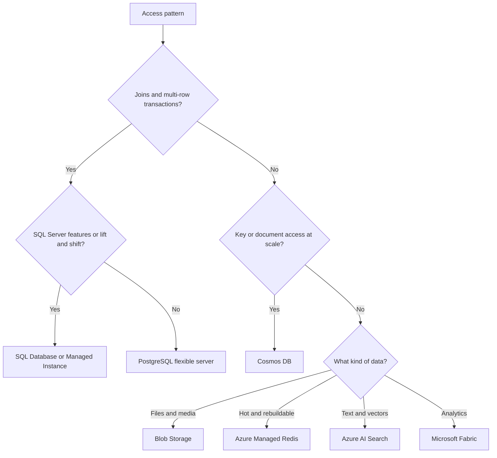

## TL;DR

- Start from the access pattern, not the product. Joins and multi-row transactions point to a relational store. Key-based reads and writes at global scale point to Cosmos DB. Rebuildable hot data goes in Azure Managed Redis. Files go in Blob Storage. Text and vector queries go in Azure AI Search.
- For relational, Azure SQL Database and Azure Database for PostgreSQL flexible server cover most new work. SQL Database Hyperscale grows to 128 TB with up to 30 named read replicas.
- Cosmos DB costs are measured in request units (RUs). A 1 KB point read by ID and partition key costs 1 RU. Each logical partition holds at most 20 GB, so the partition key is the most important design decision.
- Most systems use two or three stores. Keep one system of record per entity and treat the rest as derived copies.

## Why it matters

The data store is the hardest component to change after launch. Compute can be swapped in a sprint; a database migration takes a quarter and a careful cutover. The store also sets your consistency model, your scaling ceiling, and much of the bill. Picking Cosmos DB for a reporting workload full of ad hoc joins, or SQL Database for a globally distributed write-heavy session store, creates years of workarounds. The generic trade-offs are in [SQL vs NoSQL](../02-building-blocks/databases-sql-vs-nosql.md); this page maps them to Azure.

## How it works

Answer the questions in order. Each one removes most of the candidates.

### Relational

**Azure SQL Database** is the managed SQL Server engine. The Hyperscale tier separates compute from storage, autoscales storage to 128 TB, and supports up to 30 named replicas for read scale-out. The serverless compute tier bills per second and pauses idle databases so you pay only for storage, which fits dev environments and spiky internal apps. **SQL Managed Instance** is for lifting SQL Server estates that use instance-level features.

**Azure Database for PostgreSQL flexible server** runs community PostgreSQL. High availability keeps a warm standby that receives changes synchronously, either in another zone (zone-redundant) or the same zone. It supports pgvector for embeddings, and **elastic clusters** offer managed Citus for horizontal sharding when one server is not enough. MySQL flexible server is the equivalent for MySQL.

Neither relational option supports writes in more than one region. Multi-region relational designs use one primary and readable secondaries; see [Replication](../02-building-blocks/replication.md).

### Cosmos DB

Cosmos DB is a globally distributed database with an API for NoSQL (its native document model) plus MongoDB, Cassandra, Gremlin, and Table APIs. You choose a partition key per container. Items with the same key share a logical partition, capped at 20 GB. Throughput is provisioned in RU/s (fixed or autoscale) or billed per request in serverless mode.

It offers five consistency levels: Strong, Bounded staleness, Session, Consistent prefix, and Eventual. Session is the most widely used: a client reads its own writes, and other clients may lag. Accounts with multiple write regions cannot use Strong. The API for NoSQL also has an integrated vector store, which matters for RAG workloads that want vectors next to the documents.

**Azure DocumentDB** is the MongoDB-compatible service built on open-source foundations. Pick it when you have MongoDB code and want wire compatibility without the Cosmos DB RU model.

### Cache, blobs, search, analytics

**Azure Managed Redis** is the current managed Redis (Redis Enterprise based, Redis 7.4). Choose the tier by memory-to-vCPU ratio, covered on the [service map](./azure-service-map.md). **Blob Storage** holds anything addressed by a key and read as a whole, with hot, cool, cold, and archive tiers. **Azure AI Search** runs full-text, vector, and hybrid queries in one index. **Microsoft Fabric** covers analytics, and **Azure Data Explorer** fits large time-series and log analytics.

The Architecture Center comparison lists which services accept writes in several regions at once: Cosmos DB, Azure DocumentDB, Azure Managed Redis, and Managed Instance for Apache Cassandra. The relational services do not.

## Trade-offs

**SQL Database vs PostgreSQL.** Both are mature. Pick SQL Database when the team or tools are SQL Server native, or when Hyperscale's storage ceiling and named replicas solve a scale problem without sharding. Pick PostgreSQL for the open-source ecosystem (extensions like pgvector, PostGIS) and portability.

**Scale up, read replicas, or shard.** Scale up first; it is one setting. Add read replicas when reads dominate and slightly stale reads are fine. Shard (Citus elastic clusters, or application-level) only when the write volume or data size outgrows one primary. Sharding moves joins and transactions across nodes into your code. See [Sharding and partitioning](../02-building-blocks/sharding-and-partitioning.md).

**Cosmos DB throughput modes.**

| Mode | Billing | Fits | Limit to know |
| --- | --- | --- | --- |
| Provisioned (manual) | Fixed RU/s per hour | Steady, predictable load | You pay for idle RU/s |
| Autoscale | Highest RU/s used each hour, up to a max you set | Variable load | Saves money when you use the full max in 66% or fewer of the hours |
| Serverless | Per RU consumed | Dev, small or bursty apps | Single region only |

**Consistency vs latency.** Strong consistency across regions waits for remote replicas on every write. Session gives read-your-writes per client at much lower cost. Pick per workload: a balance ledger and a social feed need different answers. See [Consistency and CAP](../01-fundamentals/consistency-and-cap.md).

**One store vs several.** Each extra store is another backup policy, failover plan, and security review. Each one you avoid pushes a workload onto a store that does it badly. A common shape is SQL or PostgreSQL as the system of record, Redis for hot reads, Blob Storage for files, and AI Search fed from the database's change stream.

## On Azure

| Service | Choice that changes the design | Zone and region | Gotcha |
| --- | --- | --- | --- |
| SQL Database | General Purpose, Business Critical, or Hyperscale; serverless vs provisioned | Zone redundancy on all three tiers; failover groups across regions (RTO typically under 60 s) | Failover groups replicate asynchronously, so RPO can be above zero |
| PostgreSQL flexible server | Single server, or elastic clusters for sharding | Zone-redundant HA with a synchronous standby | No multi-region writes |
| Cosmos DB | Partition key; provisioned, autoscale, or serverless; consistency level | Zones enabled per region when the region is added; multi-region writes | 20 GB per logical partition; serverless is single region |
| Azure Managed Redis | Memory Optimized, Balanced, Compute Optimized, or Flash Optimized | Zone redundant by default; active geo-replication except Flash | Azure Cache for Redis tiers are retiring |
| Blob Storage | Access tier; LRS, ZRS, GZRS | ZRS in region; GZRS or RA-GZRS for a second region | Archive tier is not supported on ZRS, GZRS, or RA-GZRS accounts |

**Gotcha: the hot partition.** A Cosmos DB container keyed on `tenantId` works until one tenant grows past 20 GB or concentrates traffic on one physical partition. Throttling (HTTP 429) on one key while the container's total RU/s looks idle is the symptom. Pick a key with high cardinality that spreads both storage and requests, or use a synthetic or hierarchical key.

**Gotcha: retiring cache tiers.** Azure Cache for Redis Basic, Standard, and Premium retire on 30 September 2028, and Enterprise tiers on 31 March 2027. New designs should start on Azure Managed Redis.

For cross-region behavior, see [Regions, zones, and resiliency](./regions-zones-and-resiliency.md). For costs, see [Cost optimization](./cost-optimization.md).

## Interview tips

- Say the access pattern before the store: "reads by user ID, writes 5k per second, no joins" justifies Cosmos DB in one breath.
- For Cosmos DB, always name the partition key and why. It is the first follow-up question.
- Name the consistency level you need and what anomaly it allows. "Session, so a user sees their own post; followers may see it a second later."
- When you add a cache or search index, say how it stays in sync (change feed, outbox, or TTL) and what happens when it is stale. See [Caching](../02-building-blocks/caching.md).

## Further reading

- [Choose an Azure data store](https://learn.microsoft.com/azure/architecture/guide/technology-choices/data-options) (Architecture Center)
- [Cosmos DB consistency levels](https://learn.microsoft.com/azure/cosmos-db/consistency-levels) and [partitioning](https://learn.microsoft.com/azure/cosmos-db/partitioning)
- [Provisioned throughput vs serverless](https://learn.microsoft.com/azure/cosmos-db/throughput-serverless)
- [SQL Database Hyperscale](https://learn.microsoft.com/azure/azure-sql/database/service-tier-hyperscale)
- [Elastic clusters in PostgreSQL flexible server](https://learn.microsoft.com/azure/postgresql/elastic-clusters/concepts-elastic-clusters)
- [SQL vs NoSQL databases explained](https://thecodinggopher.substack.com/p/relational-vs-nosql-databases) (The Coding Gopher) and [PostgreSQL deep dive](https://www.hellointerview.com/learn/system-design/deep-dives/postgres) (Hello Interview)
