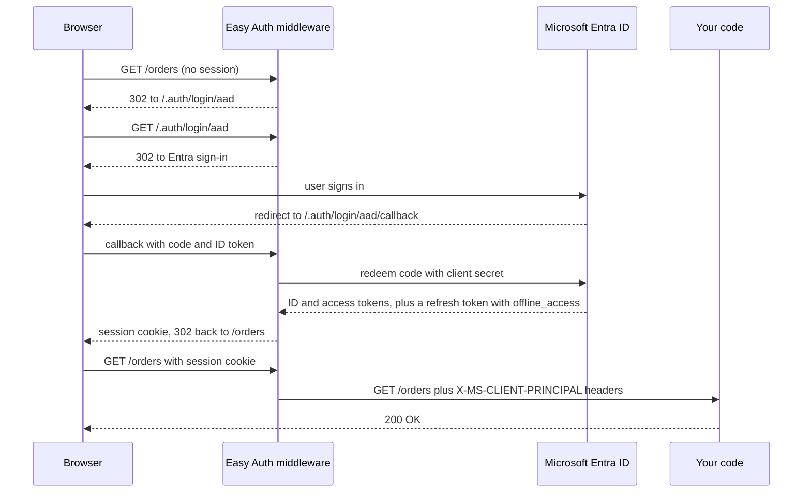

## TL;DR

- Easy Auth is the built-in authentication and authorization feature of App Service and Azure Functions. Container Apps runs the same system. You turn it on, pick an identity provider, and the platform signs users in before a request reaches your code.
- It runs as middleware next to your app. It does the OpenID Connect redirects, validates tokens, keeps the session, and hands your code the caller in `X-MS-CLIENT-PRINCIPAL` headers that outside callers can't forge.
- Set **Require authentication** with a 302 redirect for websites and a 401 for APIs. By default anyone in your Entra tenant gets in, so narrow it with user assignment in Entra or the built-in checks.
- It authenticates. Role checks and ownership checks still live in your code, which reads the claims from the headers.
- Use it for no-code sign-in on App Service, Functions, or Container Apps, in any language. Use MSAL or Microsoft.Identity.Web when you need custom authorization logic, incremental consent, Conditional Access handling, or sign-in during local development.

## Why it matters

Every web app you ship needs sign-in. Doing it in code means the OIDC redirect, state and nonce checks, token validation, an encrypted session cookie, refresh, and logout, written again in each language with that language's library and its own bugs. Easy Auth moves all of that into the hosting platform. The same setting protects a Node.js app, a Python API, a Java app, or a container image you can't modify.

That makes it the quickest way to add sign-in to an internal admin tool, a dashboard, a prototype you want to show three people, or a legacy app you are moving onto App Service. It also has hard limits. It knows who the caller is, not what they may do, and it exists only on the Azure hosts that offer it. An interviewer who hears "Easy Auth" will ask about both.

## How it works

The server-directed flow, which is what a browser gets when **Require authentication** is on with a 302 redirect and Microsoft Entra is the provider:



Your code only ever sees the last request. It never handles a redirect, a code, or a signing key.

### Where the middleware runs

| Host | How it runs |
| --- | --- |
| App Service and Functions on Windows | A native IIS module in the same sandbox as your app |
| App Service on Linux, and custom containers | A separate container in front of your app (the Ambassador pattern) |
| Container Apps | A sidecar container on each replica |

In every case, each incoming HTTP request passes through the middleware before your app handles it. Because it isn't in your process, it can't plug into your framework's auth objects. Everything it knows reaches you as request headers.

Turning the feature on also redirects every request to HTTPS, whatever the app's own HTTPS setting. The `requireHttps` setting can switch that off. Leave it on, because the session cookie and tokens must never cross plain HTTP.

### Requiring sign-in

Two settings decide what happens to a request with no session. **Restrict access** is either **Require authentication** (your code never sees an unauthenticated request) or **Allow unauthenticated access** (the request reaches your code with no identity headers, and your code decides). With **Require authentication**, the unauthenticated action picks the response:

| Action | What the caller gets | Use it for |
| --- | --- | --- |
| HTTP 302 redirect | A redirect to `/.auth/login/<provider>` | Websites |
| HTTP 401 Unauthorized | A 401, so the client fetches a token itself | APIs |
| HTTP 403 Forbidden | A 403 for every unauthenticated request | A plain refusal with no sign-in hint |
| HTTP 404 Not found | A 404, which hides that the path exists | Endpoints you don't want discovered |

A 302 on an API is a common mistake. The caller gets an HTML sign-in page instead of a status code it can act on. Container Apps offers the redirect, 401, and 403 options.

**Require authentication** covers every path, including a public home page or a `/health` probe. To leave some paths open, list them in `globalValidation.excludedPaths` in the `authsettingsV2` configuration or the auth config file. The CLI flag is `az webapp auth update --excluded-paths`.

**Allow unauthenticated access** is the right choice when you want a public landing page or several sign-in providers. The portal has no built-in provider picker, so you add a link per provider (`/.auth/login/aad`, `/.auth/login/google`, `/.auth/login/x`) and protect the private pages in code.

### What your code receives

On every authenticated request, the middleware adds these headers. External requests aren't allowed to set them, so a header that reaches your code came from the platform.

| Header | Contents |
| --- | --- |
| `X-MS-CLIENT-PRINCIPAL` | Base64-encoded JSON with every claim about the caller |
| `X-MS-CLIENT-PRINCIPAL-ID` | The caller's ID from the identity provider |
| `X-MS-CLIENT-PRINCIPAL-NAME` | A human-readable name, such as an email address or user principal name |
| `X-MS-CLIENT-PRINCIPAL-IDP` | Which identity provider signed the caller in |
| `X-MS-TOKEN-AAD-ACCESS-TOKEN`, `X-MS-TOKEN-AAD-ID-TOKEN` | The Entra tokens, when the token store is on (other providers use their own names, such as `X-MS-TOKEN-GOOGLE-ACCESS-TOKEN`) |

The decoded principal is `{ "auth_typ", "claims": [{ "typ", "val" }], "name_typ", "role_typ" }`. Claim names go through a default mapping, so they can differ from the token. Entra's `tid` claim, for example, arrives under a long claim-type URI that ends in `/claims/tenantid`. Reading the user takes a few lines in any language:

```js
function currentUser(req) {
  const header = req.headers['x-ms-client-principal'];
  if (!header) return null;
  const principal = JSON.parse(Buffer.from(header, 'base64').toString('utf8'));
  return {
    id: req.headers['x-ms-client-principal-id'],
    name: req.headers['x-ms-client-principal-name'],
    provider: principal.auth_typ,
    roles: principal.claims
      .filter((c) => c.typ === 'roles' || c.typ === principal.role_typ)
      .map((c) => c.val),
  };
}
```

Some frameworks do this for you. ASP.NET 4.6 gets `ClaimsPrincipal.Current` filled in, PHP gets `$_SERVER['REMOTE_USER']`, and ASP.NET Core can use Microsoft.Identity.Web's App Service integration.

The guarantee that the header is genuine comes from the middleware. Code that also runs somewhere without it, such as a laptop or another host, must not trust `X-MS-CLIENT-PRINCIPAL` there, because any client can send it.

### The built-in endpoints

Everything lives under `/.auth` on your app's own host name.

| Endpoint | What it does |
| --- | --- |
| `/.auth/login/<provider>` | Starts sign-in. Add `?post_login_redirect_uri=/path` to land the user somewhere specific. A `POST` here with a provider token starts a client-directed session. |
| `/.auth/login/<provider>/callback` | The redirect URI you register with the identity provider |
| `/.auth/me` | Returns the signed-in user's claims and tokens as JSON. Needs the token store. |
| `/.auth/refresh` | Refreshes the provider tokens in the token store and renews the session inside its grace period |
| `/.auth/logout` | Clears the session cookie, deletes the user's tokens from the store, and signs out at the provider for Microsoft Entra and Google. Add `?post_logout_redirect_uri=` to choose where the user lands. |

### Server-directed and client-directed sign-in

The diagram shows the server-directed flow. The platform runs the sign-in, and the browser carries a cookie. It fits browser apps and mobile apps that sign in through an embedded browser.

In the client-directed flow, your client signs in with the provider's own SDK (MSAL in a mobile app, for example). It then `POST`s the provider's token to `/.auth/login/<provider>`. For Entra the body is `{"access_token": "<token>"}`. Easy Auth validates the token and returns its own `authenticationToken`, which the client sends on each later call in the `X-ZUMO-AUTH` header. This fits native mobile apps, JavaScript clients, and REST APIs. The GitHub provider doesn't support customized sign-in and sign-out, so it has no client-directed option.

A service calling your API with no user takes a third path. It gets an Entra access token through the [client credentials flow](../02-building-blocks/identity-and-auth.md) and sends it in the standard `Authorization: Bearer` header. Easy Auth validates it, and the caller it reports is an application, not a user.

### Sessions and the token store

The authenticated session expires after 8 hours. A 72-hour grace period follows, in which a call to `/.auth/refresh` renews the session without a new sign-in. After that the user signs in again. You can lengthen the grace period with the `login.tokenStore.tokenRefreshExtensionHours` setting in `authsettingsV2`, but a longer window means a stolen session token stays useful longer.

The token store keeps the provider's ID, access, and refresh tokens for each session, readable only by that user. Turn it on when your code calls APIs as the user. On App Service it uses the file system by default and can point at a Blob Storage container through a SAS URL kept in an app setting. On Container Apps, a Blob Storage container is how you turn it on.

Refresh only works if the provider issued a refresh token:

- **Microsoft Entra.** Add `offline_access` to the login scopes, as in `"loginParameters": ["scope=openid profile email offline_access"]`.
- **Google.** Append `access_type=offline` to `/.auth/login/google`.
- **Facebook.** No refresh tokens. Long-lived tokens expire after 60 days.
- **X.** Access tokens don't expire.

Access tokens are only there if the provider is configured with a client secret. With a secret, Easy Auth acts as a confidential client and uses the hybrid flow (`code id_token`) for Entra, redeeming the code on the server. With no secret it falls back to the implicit flow, which is weaker. Configure the secret, or the managed identity credential below.

### Authorization is mostly yours

Out of the box, Easy Auth only authenticates. For Microsoft Entra, any user in the tenant can get a token for your app. Three layers narrow that:

1. **In Entra.** Turn on user assignment for the enterprise app, then assign users or groups. Everyone else fails at sign-in.
2. **Built-in checks.** The Entra provider can require a specific calling application (`allowedApplications`, which checks the token's `appid` or `azp`), specific users or apps by object ID (`allowedPrincipals.identities`, which checks `oid`, 500 characters total), and specific tenants (the `WEBSITE_AUTH_AAD_ALLOWED_TENANTS` app setting, up to 10 tenant IDs). A request that fails these checks gets a 403. Separately, **Allowed token audiences** lists the `aud` values the app accepts, and a token for any other audience is rejected.
3. **Your code.** App roles arrive in the `roles` claim, and Easy Auth doesn't validate them. Role checks, group checks, and "does this user own order 17" all read the claims and run in your code, as [Identity and auth](../02-building-blocks/identity-and-auth.md) describes.

A multitenant app gets no tenant check at all. If only signed-up organizations may use it, check the tenant ID claim yourself or use the allowed-tenants setting.

### Configuration surfaces

- **Portal.** The app's **Settings** > **Authentication** page.
- **CLI.** `az webapp auth` (the authV2 extension) and its per-provider subgroups such as `az webapp auth microsoft update`, and `az containerapp auth` for Container Apps.
- **Bicep and ARM.** The `Microsoft.Web/sites/config` resource named `authsettingsV2`. The V2 API is what the portal uses.
- **A file in your app.** Set `platform.configFilePath` (an absolute path such as `/home/site/wwwroot/auth.json` on Linux), and the file defines the behavior. It moves with your deployment between slots, which is usually wrong when each slot has its own app registration.

### Calling other services

Two identities are in play, and they answer different questions:

| | Easy Auth | Managed identity |
| --- | --- | --- |
| Answers | Who is calling my app? | Who is my app when it calls something else? |
| Token is for | Your app | Key Vault, Storage, SQL, or another API |
| Typical use | Sign users in to the app | Read a secret, write a blob, query a database |

To call a downstream API *as the user*, request its scope at sign-in (`scope=openid offline_access api://<backend-client-id>/user_impersonation`), read `X-MS-TOKEN-AAD-ACCESS-TOKEN` on the server, and send it as a bearer token. If the backend also runs Easy Auth, it validates that token. Your code can also trade the token for one with a different audience through the [on-behalf-of flow](https://learn.microsoft.com/entra/identity-platform/v2-oauth2-on-behalf-of-flow) with MSAL. Keep these tokens on the server. A backend-for-frontend that calls the API for the browser is safer than handing the access token to browser JavaScript.

To call Azure resources *as the app*, use a [managed identity](https://learn.microsoft.com/azure/app-service/overview-managed-identity) and grant it a role. See [Networking and security](./networking-and-security.md).

## Trade-offs

| | Easy Auth | MSAL or Microsoft.Identity.Web in code |
| --- | --- | --- |
| Code to write | None to sign in. A few lines to read the headers. | Library setup, middleware, token cache |
| Languages | Any, including apps you can't change | Per language. Microsoft.Identity.Web is ASP.NET Core. |
| Sign-in experience | The provider's page. Your own page only through provider links with anonymous access allowed. | Full control |
| Custom authorization | In your code, from headers | In your code, with framework integration |
| Incremental consent, Conditional Access handling in the app | No | Yes (Conditional Access needs Microsoft.Identity.Web) |
| Local development | No emulator. You deploy to test sign-in. | Works locally, with IDE sign-in for Microsoft.Identity.Web |
| Runs elsewhere | Only on App Service, Functions, and Container Apps | Anywhere |

**Speed vs control.** Easy Auth gets a correct sign-in running in minutes and keeps protocol and browser changes off your plate. You give up control of the sign-in UX and of how tokens are requested. For an internal tool or a prototype, that is a good trade. For a consumer product with a branded sign-in, it often isn't.

**Platform coupling.** Your app's identity contract becomes "trust these headers." Move the app to AKS or a VM and you write sign-in from scratch. A thin `currentUser()` function, like the one above, keeps the coupling in one place.

**SLA scope.** The Well-Architected Framework names Easy Auth as an App Service feature that the App Service SLA doesn't financially back. If sign-in is on your critical path, measure it as its own SLI.

**When not to use it.** Skip Easy Auth when you need sign-in to work in local runs and tests, when you need incremental consent or in-app Conditional Access handling, when your app runs on a host that doesn't offer it (AKS or VMs), or when the front end is a static site you host on Static Web Apps, which has its own built-in auth (below).

## On Azure

| Host | Built-in auth | Providers | Notes |
| --- | --- | --- | --- |
| App Service | Easy Auth | Microsoft Entra (workforce or External ID tenant), Apple (preview), Facebook, GitHub, Google, X, any OpenID Connect provider | Windows, Linux, and containers |
| Azure Functions | Easy Auth, same as App Service | Same as App Service | Configured on the function app, like a web app |
| Container Apps | The same system, as a sidecar | Microsoft Entra, Facebook, GitHub, Google, X, custom OpenID Connect | External ingress only. Turn off `allowInsecure` on ingress. Token store needs Blob Storage. |
| Static Web Apps | Its own built-in auth, not Easy Auth | GitHub and Microsoft Entra preconfigured. Custom providers need the Standard plan. | Roles and route rules in `staticwebapp.config.json` |

**Static Web Apps.** GitHub and Microsoft Entra ID work with no setup on every plan, and the preconfigured Entra provider lets any Microsoft account sign in. To restrict sign-in to one tenant, or to add Apple, Facebook, Google, X, or any OpenID Connect provider, register a custom provider. That needs the Standard plan and turns off all the preconfigured providers. Signed-in users get the `anonymous` and `authenticated` roles. Custom roles come from invitations or from an API function named in `rolesSource`, and route rules in `staticwebapp.config.json` decide which roles reach which paths.

### Add sign-in to any App Service web app

This is the recipe for a web app your organization's users sign in to. Swap step 3 for a customer-facing app.

1. Deploy the app to App Service.
2. In the portal, open the app and select **Settings** > **Authentication** > **Add identity provider**, then choose **Microsoft**.
3. Under the tenant choice, pick **Workforce configuration** for employees and business guests, or **External configuration** for consumers and customers. External configuration uses an External ID tenant and a user flow that sets the sign-in methods, such as email and password or email one-time passcode.
4. Select **Create new app registration** and choose the supported account types. The portal stores the client secret in a slot-sticky app setting named `MICROSOFT_PROVIDER_AUTHENTICATION_SECRET`.
5. Under additional checks, set **Client application requirement** to allow requests only from this application, and set the tenant requirement you want.
6. Set **Restrict access** to **Require authentication**. Set unauthenticated requests to **HTTP 302** for a website or **HTTP 401** for an API. Keep **Token store** on.
7. Select **Add**, then browse to the app. You land on the Microsoft sign-in page, and after sign-in, on your app.
8. In code, read the user from `X-MS-CLIENT-PRINCIPAL` and add a sign-out link to `/.auth/logout`.
9. In the Microsoft Entra admin center, require user assignment on the app and assign the users or groups who may sign in.
10. If the portal set the issuer URL to the legacy `https://sts.windows.net` endpoint, edit the provider and change it to `https://login.microsoftonline.com/<tenant-id>/v2.0`.

For any other provider, register an app with that provider using the redirect URI `https://<app-host>/.auth/login/<provider>/callback`, then add it on the same page. Script the same setup with `az webapp auth microsoft update` and `az webapp auth update`, or declare it in Bicep with `authsettingsV2`.

### Hardening and gotchas

**Gotcha: Front Door or another reverse proxy.** Easy Auth can build the redirect URI from the App Service host name instead of the Front Door host, which sends users around Front Door after sign-in. Set `httpSettings.forwardProxy.convention` to `Standard` so it reads `X-Forwarded-Host`. Application Gateway and other proxies can need the `Custom` convention with their own header names. The portal can't change this setting, so use `az rest` against `authsettingsV2` or `az webapp auth update --proxy-convention`. Also turn off Front Door caching for the sign-in flow, and register the Front Door host name in the provider's redirect URIs.

**Gotcha: replace the client secret.** The secret expires and can leak. For workforce tenants, give the app a user-assigned managed identity used only for this, and add a federated identity credential for it to the app registration. Then add a slot-sticky app setting named `OVERRIDE_USE_MI_FIC_ASSERTION_CLIENTID` that holds the managed identity's client ID (not the app registration's), and set the provider's **Client secret setting name** to `OVERRIDE_USE_MI_FIC_ASSERTION_CLIENTID`. Until then, keep the secret in [Key Vault](./networking-and-security.md) through a Key Vault reference.

**Gotcha: one app registration per slot.** Give each deployment slot its own app registration, so a staging change can't affect production's permissions.

**Gotcha: cross-origin form posts get rejected.** Easy Auth blocks a cookie-authenticated `POST` from a browser when the `Origin` or `Referer` header is missing or not in the allowed external redirect URLs or CORS origins. That stops cross-site request forgery. If your own front end on another domain posts to the app, add that domain under **Allowed external redirect URLs**.

**Gotcha: single-page app routers.** A client-side router can catch `/.auth/login/...` links before they reach the server. Make the router pass `/.auth` routes through.

The concepts behind all of this (OIDC, tokens, sessions vs tokens) are in [Identity and auth](../02-building-blocks/identity-and-auth.md). Picking the host is in [Compute choices](./compute-choices.md).

## Interview tips

- Say it in one sentence: "The admin tool runs on App Service with built-in auth against our Entra tenant, with authentication required, user assignment on, and role checks in code from the claims header."
- Say which layer does what. Easy Auth authenticates and can do coarse checks (calling app, allowed users, tenant). The app does role and ownership checks.
- Pick the unauthenticated action by caller. 302 for a website, 401 for an API.
- Separate the two identities. Easy Auth is who calls you. A managed identity is who you are when you call Key Vault or a database.
- Trap: assuming Easy Auth lets in only the people you meant. By default every user in the tenant gets a token. Require user assignment or configure `allowedPrincipals`.
- Trap: trusting `X-MS-CLIENT-PRINCIPAL` in code that also runs without the middleware, such as local runs or another host.
- Trap: handing the access token to browser JavaScript to call the backend. Keep it on the server and use a backend-for-frontend.
- Expect follow-ups:
  - How long does a session last? 8 hours, plus a 72-hour grace period renewable with `/.auth/refresh`.
  - How do you call Microsoft Graph as the user? Token store on, `offline_access` in the login scopes, read `X-MS-TOKEN-AAD-ACCESS-TOKEN`.
  - How does a daemon call your API? Client credentials token in the `Authorization` header, restricted with `allowedApplications` or an app role checked in code.
  - What breaks behind Front Door? The redirect URI, until `forwardProxy` is `Standard`.
  - How do you test it locally? You can't. There is no emulator, so the app needs a code path for local runs that never trusts the header.

## Further reading

- [Authentication and authorization in Azure App Service and Azure Functions](https://learn.microsoft.com/azure/app-service/overview-authentication-authorization)
- [Configure Microsoft Entra authentication for App Service](https://learn.microsoft.com/azure/app-service/configure-authentication-provider-aad)
- [Work with user identities in App Service authentication](https://learn.microsoft.com/azure/app-service/configure-authentication-user-identities)
- [Work with OAuth tokens in App Service authentication](https://learn.microsoft.com/azure/app-service/configure-authentication-oauth-tokens)
- [Customize sign-ins and sign-outs](https://learn.microsoft.com/azure/app-service/configure-authentication-customize-sign-in-out)
- [File-based configuration of App Service authentication](https://learn.microsoft.com/azure/app-service/configure-authentication-file-based)
- [Authentication scenarios and recommendations](https://learn.microsoft.com/azure/app-service/identity-scenarios)
- [Tutorial: Authenticate and authorize users end to end in App Service](https://learn.microsoft.com/azure/app-service/tutorial-auth-aad)
- [Authentication and authorization in Azure Container Apps](https://learn.microsoft.com/azure/container-apps/authentication)
- [Authenticate and authorize Static Web Apps](https://learn.microsoft.com/azure/static-web-apps/authentication-authorization)
- [Custom authentication in Static Web Apps](https://learn.microsoft.com/azure/static-web-apps/authentication-custom)
- [Restrict a Microsoft Entra app to a set of users](https://learn.microsoft.com/entra/identity-platform/howto-restrict-your-app-to-a-set-of-users)
- [authsettingsV2 resource reference](https://learn.microsoft.com/azure/templates/microsoft.web/sites/config-authsettingsv2)
- [az webapp auth CLI reference](https://learn.microsoft.com/cli/azure/webapp/auth)
