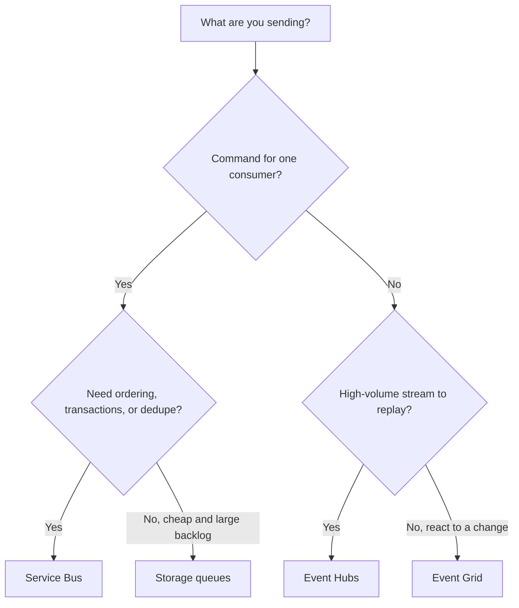

## TL;DR

- **Service Bus** is for commands and business transactions: one consumer per message, FIFO through sessions, transactions, duplicate detection, and dead-lettering.
- **Event Hubs** is for streams: high-volume append-only events, ordered per partition, replayable within retention, readable by many consumer groups, and reachable from Kafka clients.
- **Event Grid** is for reacting to discrete events ("a blob was created"), routed to handlers by push or pull, with retries and optional dead-lettering.
- **Storage queues** are the cheap option: 64 KB messages, no ordering guarantee, and a backlog that can grow to the storage account's capacity.
- All four deliver at least once. Every consumer must be idempotent.

## Why it matters

Picking the wrong messaging service shows up as missing features you rebuild by hand. Teams that put payment commands on Event Hubs end up writing per-message acknowledgment, dead-lettering, and retry bookkeeping. Teams that push clickstream through Service Bus pay for broker features they don't use and hit throughput ceilings. Teams that rely on Event Grid without configuring dead-lettering lose events after retries run out, silently.

The generic concepts are in [Message queues](../02-building-blocks/message-queues.md) and [Event streaming](../02-building-blocks/event-streaming.md). This page is the Azure decision.

## How it works

Start with what the message means. A **command** asks one service to do something and expects it done once ("charge order 123"). An **event** states a fact others may react to ("order 123 was paid"). A **stream** is a high-volume sequence of events where the history matters (clicks, telemetry, change logs).

### Service Bus

A namespace holds queues (point to point) and topics with subscriptions (publish-subscribe, up to 2,000 subscriptions per topic). Receivers lock a message, process it, and complete it; a message that fails too many times moves to the dead-letter queue. Sessions give FIFO per session ID, so all messages for one order are processed in order by one receiver while different orders run in parallel.

Tiers matter. Basic supports queues only. Standard adds topics, sessions, transactions, and duplicate detection, on shared capacity billed per operation. Premium runs on dedicated messaging units with CPU and memory isolation. Message size is 256 KB on Basic and Standard. Premium allows up to 100 MB over AMQP; over HTTP the limit is 1 MB.

### Event Hubs

An event hub is a partitioned log. Producers append; each consumer group reads every partition independently and tracks its own offset, so analytics and alerting can read the same stream at their own pace. Order is guaranteed only within a partition, so pick a partition key (device ID, user ID) that keeps related events together.

Capacity is bought in units. On Standard, one throughput unit allows up to 1 MB/s or 1,000 events/s in and 2 MB/s or 4,096 events/s out.

| | Basic | Standard | Premium | Dedicated |
| --- | --- | --- | --- | --- |
| Max event size | 256 KB | 1 MB | 1 MB | 20 MB |
| Max retention | 1 day | 7 days | 90 days | 90 days |
| Consumer groups per event hub | 1 | 20 | 100 | 1,000 |
| Partitions per event hub | 32 | 32 | 100 | 1,024 |
| Kafka endpoint | No | Yes | Yes | Yes |

Capture writes the stream to Blob Storage or Data Lake Storage, which gives cheap long-term history without a custom consumer.

### Event Grid

Event Grid routes events from Azure services or your apps to handlers (Functions, webhooks, Service Bus, Event Hubs) by push, or lets consumers pull. It uses CloudEvents 1.0 and, in namespaces, provides an MQTT broker for devices. On a delivery failure it retries with backoff (10 s, 30 s, 1 min, 5 min, 10 min, 30 min, 1 h, 3 h, 6 h, then every 12 h) up to 30 attempts or a 24-hour TTL by default. Event Grid gives no ordering guarantee and can deliver duplicates.

### Storage queues

A queue inside a storage account. Messages are up to 64 KB, a receiver hides a message for a visibility timeout (default 30 seconds, up to 7 days), and there is no ordering guarantee. Choose Service Bus instead when you need FIFO, duplicate detection, or AMQP and the queue stays under 80 GB.

## Trade-offs

| | Service Bus | Event Hubs | Event Grid | Storage queues |
| --- | --- | --- | --- | --- |
| Model | Queue, pub-sub | Partitioned log | Event routing | Simple queue |
| Ordering | FIFO with sessions | Per partition | None | None |
| Replay | No (consumed messages are gone) | Yes, within retention | No | No |
| Dedupe | Duplicate detection | No | No | No |
| Dead-letter | Built in | No (consumer tracks failures) | If configured | No (track dequeue count yourself) |
| Max message | 256 KB, or 100 MB on Premium | 1 MB, or 20 MB on Dedicated | 1 MB | 64 KB |

**Broker vs log.** A broker (Service Bus) tracks each message's state, which makes retries and poison handling easy and replay impossible. A log (Event Hubs) keeps everything for the retention window, which makes replay and fan-out cheap and per-message retries your problem. If you need both, publish to Event Hubs and route a filtered subset to Service Bus for the work that needs a broker.

**Push vs pull.** Event Grid push suits low-volume reactions where latency matters. A slow handler sees retries pile up and must cope with duplicates. Pull (Service Bus, Event Hubs, Storage queues, Event Grid pull delivery) lets consumers control their rate, which is better for backpressure.

**Ordering costs throughput.** FIFO through Service Bus sessions or Event Hubs partitions means one consumer per session or partition at a time. A hot key becomes the throughput limit for that key.

**Exactly once does not exist here.** All four are at least once. Pair a Service Bus duplicate detection window or an idempotency key in the consumer with the transactional outbox on the producer, so a database write and its message cannot diverge. See [Idempotency and retries](../03-patterns/idempotency-and-retries.md).

## On Azure

| Decision | Pick | Why |
| --- | --- | --- |
| Large payloads (images, documents) | Blob Storage plus a message that holds the blob URL | Keeps messages small on every service (claim check pattern) |
| Messages above 256 KB that must be in the broker | Service Bus Premium | Only Premium raises the size limit |
| Kafka clients | Event Hubs Standard or higher | Basic has no Kafka endpoint |
| More than 20 consumer groups or retention above 7 days | Event Hubs Premium or Dedicated | Standard caps at 20 groups and 7 days |
| Survive a region loss with no message loss | Service Bus Premium Geo-Replication in synchronous mode | Synchronous mode acknowledges a send only after both regions commit it, so sends pay a cross-region round trip and get throttled when the secondary falls behind. Asynchronous mode can lose recent messages on a forced promotion, and Geo-Disaster Recovery copies metadata only |

Service Bus namespaces are zone redundant automatically in supported regions, at no extra cost, on every tier. See [Regions, zones, and resiliency](./regions-zones-and-resiliency.md) for the multi-region options and [Compute choices](./compute-choices.md) for the consumers.

**Gotcha: Event Grid without dead-lettering drops events.** After the retry policy is exhausted, an undeliverable event is discarded unless the subscription has a dead-letter destination (a blob container). Configure one on every subscription that matters.

**Gotcha: TU throttling.** An Event Hubs Standard namespace with 2 throughput units accepts about 2 MB/s. Ingress above that is throttled, and producers get exceptions with a ServiceBusy reason instead of a slower queue. Size TUs for peak or enable auto-inflate, and make producers retry with backoff.

## Interview tips

- Classify the message first: command, event, or stream. The service follows from that.
- State the delivery guarantee and the dedupe strategy together: "Service Bus delivers at least once, so the consumer upserts by order ID."
- For streams, name the partition key and the ordering it gives you. Expect "what if one user is very hot?"
- Mention dead-lettering and who looks at the dead-letter queue. An unattended dead-letter queue is a slow data loss.

## Further reading

- [Compare Azure messaging services](https://learn.microsoft.com/azure/service-bus-messaging/compare-messaging-services)
- [Storage queues and Service Bus queues compared](https://learn.microsoft.com/azure/service-bus-messaging/service-bus-azure-and-service-bus-queues-compared-contrasted)
- [Service Bus quotas](https://learn.microsoft.com/azure/service-bus-messaging/service-bus-quotas) and [Event Hubs quotas](https://learn.microsoft.com/azure/event-hubs/event-hubs-quotas)
- [Event Grid delivery and retry](https://learn.microsoft.com/azure/event-grid/delivery-and-retry)
- [Service Bus Geo-Replication](https://learn.microsoft.com/azure/service-bus-messaging/service-bus-geo-replication)
- [The Outbox design pattern](https://thecodinggopher.substack.com/p/the-transactional-outbox-pattern) (The Coding Gopher)
- [Kafka deep dive](https://www.hellointerview.com/learn/system-design/deep-dives/kafka) (Hello Interview)
