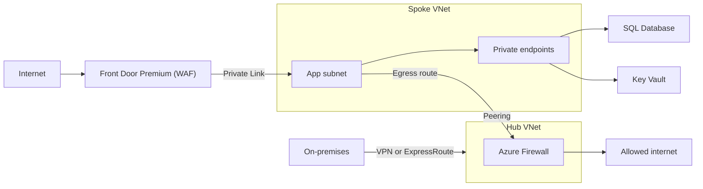

## TL;DR

- Identity is the first perimeter. Services authenticate with managed identities and Microsoft Entra ID tokens, and Azure RBAC decides what each identity can do. No connection strings with passwords.
- The network is the second layer. Put PaaS services behind private endpoints, filter subnets with NSGs, send egress through Azure Firewall in a hub VNet, and terminate public HTTP at a WAF (Front Door or Application Gateway).
- Key Vault holds the certificates, keys, and secrets that identity cannot replace. New vaults use Azure RBAC by default from API version 2026-02-01.
- Defender for Cloud watches posture (misconfigurations) and workloads (threats) across all of it.
- New VNets created with API versions after 31 March 2026 default to private subnets with no implicit outbound internet access. Plan egress explicitly.

## Why it matters

Most cloud incidents start with one of two things: a credential that leaked (a key in a repo, a connection string in a log) or an endpoint that was public when nobody meant it to be. Both are design choices. A design where no long-lived secret exists for an attacker to steal, and where data services have no public endpoint to reach, removes those two paths before any detection tooling is involved.

Interviewers ask about this layer late in a design ("how does the API talk to the database?"). The weak answer is "a connection string in config." The strong answer names the identity, the role, the private endpoint, and the DNS zone.

## How it works

### VNets, subnets, and NSGs

A VNet is a private address space in one region, split into subnets. A network security group (NSG) attaches to a subnet, a NIC, or both. Rules have a priority from 100 to 4096; lower numbers are evaluated first and the first match wins. NSGs are stateful: allow outbound port 443 and the responses come back without an inbound rule. Use service tags (for example `Storage.WestUS` or `AzureFrontDoor.Backend`) and application security groups instead of IP lists, so rules survive IP changes.

**Default outbound access is going away.** For VNets created with API versions released after 31 March 2026, subnets are private by default (`defaultOutboundAccess=false`), and VMs get no implicit internet access. The portal already creates private subnets. Give each subnet an explicit path out: a NAT Gateway, a load balancer outbound rule, or a route to Azure Firewall.

### Private endpoints and DNS

A private endpoint is a NIC in your subnet with a private IP that maps to one PaaS resource (a storage account, a SQL server, a Key Vault). The IP stays fixed for the endpoint's lifetime. Once it exists, you can turn off the resource's public network access entirely. Microsoft recommends Private Link and private endpoints over the older service endpoints, which leave the resource's public endpoint in place.

DNS is the part that breaks. Clients still connect to `myaccount.blob.core.windows.net`; a private DNS zone (`privatelink.blob.core.windows.net`) linked to the VNet makes that name resolve to the private IP. In hub-spoke designs, host the private DNS zones centrally and link them to every VNet that needs to resolve them, including the path from on-premises DNS.

### Hub-spoke and Azure Firewall

The hub VNet holds shared services: Azure Firewall, VPN or ExpressRoute gateways, and DNS. Each workload gets a spoke VNet peered to the hub. Peering is not transitive, so spoke-to-spoke traffic must route through the firewall, which is what you want for inspection. Azure Virtual Network Manager can apply connectivity, security, and routing configurations across groups of VNets, and Virtual WAN offers a Microsoft-managed hub as an alternative.

| Azure Firewall SKU | Throughput | Adds |
| --- | --- | --- |
| Basic | Up to 250 Mbps | Lowest cost, for small environments |
| Standard | Up to 30 Gbps | Threat intelligence, DNS proxy, web categories |
| Premium | Up to 100 Gbps | TLS inspection, IDPS, URL filtering |

All three SKUs support availability zones.

### Edge protection

Azure Web Application Firewall runs on Front Door (global) or Application Gateway (regional). On Front Door, the Premium tier gets the Microsoft-managed rule sets and bot protection; Standard supports only custom rules. Application Gateway's WAF is built on the OWASP Core Rule Set and adds a bot manager rule set. Azure DDoS Protection offers Network Protection (per VNet) and IP Protection (per public IP) on top of the default infrastructure-level protection every service gets.

### Identity and secrets

**Microsoft Entra ID** issues tokens for users and workloads. **Managed identities** give an Azure resource an Entra identity with no credential for you to store or rotate. A system-assigned identity lives and dies with its resource; a user-assigned identity is a standalone resource that several apps can share, which helps when you pre-grant roles before deployment. There is no extra charge. For workloads outside Azure (GitHub Actions, Kubernetes, other platforms), **workload identity federation** exchanges their tokens for Entra tokens, again without a secret. **Conditional Access** adds policy (device, location, risk) to user sign-ins.

**Key Vault** stores what identity can't replace: TLS certificates, customer-managed keys, third-party API keys. Grant access with Azure RBAC roles. Soft delete keeps deleted objects recoverable for 7 to 90 days (90 by default), and purge protection blocks permanent deletion during that window.

**Defender for Cloud** is a cloud-native application protection platform: cloud security posture management (misconfigurations, secure score), workload protection for VMs, containers, storage, databases, and serverless functions, and DevSecOps scanning.

## Trade-offs

**Private endpoints vs public endpoints with firewall rules.** Private endpoints remove the public attack surface and add per-endpoint cost, DNS zones to manage, and a harder local development story. Public endpoints with IP rules are simpler and leave a reachable surface that depends on every rule being right. For data stores holding customer data, use private endpoints.

**Hub-spoke vs Virtual WAN.** A self-managed hub gives full control of routing and firewall placement. Virtual WAN manages the hub and global transit for you, with less control. Hub-spoke is the common default; Virtual WAN suits many branches and regions.

**Central inspection vs latency and cost.** Routing every spoke's egress and east-west traffic through Azure Firewall gives one place to log and enforce policy. It adds a hop and firewall cost that grows with traffic, and makes the firewall a dependency for every flow. Premium's TLS inspection adds certificate management on top.

**System-assigned vs user-assigned identity.** System-assigned is simpler and cleans up with the resource. User-assigned survives redeployments and can be granted roles before the app exists, which matters for infrastructure as code and blue-green deployments.

**Edge WAF vs regional WAF.** Front Door WAF blocks attacks before they reach any region. Application Gateway WAF sits inside the VNet and can protect internal apps. Running both doubles rule tuning work; pick Front Door for public global apps.

## On Azure

| Concern | Default choice | Source |
| --- | --- | --- |
| Service-to-service auth | Managed identity plus Azure RBAC | [Managed identities](https://learn.microsoft.com/entra/identity/managed-identities-azure-resources/overview) |
| PaaS reachability | Private endpoint, public access disabled | [Private endpoints](https://learn.microsoft.com/azure/private-link/private-endpoint-overview) |
| Network topology | Hub-spoke with Azure Firewall | [Hub-spoke topology](https://learn.microsoft.com/azure/architecture/networking/architecture/hub-spoke) |
| Firewall SKU | Standard; Premium when you need TLS inspection or IDPS | [Choose a Firewall SKU](https://learn.microsoft.com/azure/firewall/choose-firewall-sku) |
| Public HTTP entry | Front Door Premium with WAF and Private Link to origins | [WAF on Front Door](https://learn.microsoft.com/azure/web-application-firewall/afds/afds-overview) |
| Secrets | Key Vault with RBAC, soft delete, purge protection | [Key Vault RBAC](https://learn.microsoft.com/azure/key-vault/general/rbac-guide) |
| Posture | Defender for Cloud | [Defender for Cloud](https://learn.microsoft.com/azure/defender-for-cloud/defender-for-cloud-introduction) |

**Gotcha: private DNS zones change resolution for everything of that type.** Once a VNet resolves through `privatelink.blob.core.windows.net`, a lookup for any storage account that has a private endpoint somewhere else (a partner's account, another team's subscription) hits your zone, finds no record, and returns NXDOMAIN. Accounts with no private endpoint still resolve publicly. Test resolution of every external storage account you call from inside the VNet before cutover, and add the extra DNS configuration Learn describes where needed.

**Gotcha: switching Key Vault to RBAC.** Moving an existing vault from access policies to the RBAC permission model invalidates its access policies immediately. Create the role assignments first, then flip the setting.

**Gotcha: soft delete settings are fixed.** Soft delete is on by default for new vaults and can't be disabled once enabled. The retention interval (7 to 90 days) is set when the vault is created and can't be changed afterward. Decide it in the template, along with purge protection, which is off by default and recommended when keys encrypt data.

Identity concepts are in [Identity and auth](../02-building-blocks/identity-and-auth.md), and the network basics in [Networking essentials](../01-fundamentals/networking-essentials.md). For the Security pillar checklist, see [Well-Architected Framework](./well-architected-framework.md).

## Interview tips

- Answer "how does service A call service B?" with identity first: managed identity, a scoped role, no stored secret.
- Draw the private endpoint and say the DNS zone name. It shows you have run this in production.
- Separate inbound (WAF, Front Door, Application Gateway) from outbound (Firewall, NAT Gateway). Candidates often design only one direction.
- Mention detection: Defender for Cloud alerts and the logs from Azure Firewall and WAF land in Log Analytics; see [Observability](./observability.md).

## Further reading

- [Hub-spoke network topology in Azure](https://learn.microsoft.com/azure/architecture/networking/architecture/hub-spoke)
- [Private endpoint DNS configuration](https://learn.microsoft.com/azure/private-link/private-endpoint-dns)
- [Default outbound access](https://learn.microsoft.com/azure/virtual-network/ip-services/default-outbound-access)
- [Network security groups overview](https://learn.microsoft.com/azure/virtual-network/network-security-groups-overview)
- [Key Vault soft delete](https://learn.microsoft.com/azure/key-vault/general/soft-delete-overview)
- [Workload identity federation](https://learn.microsoft.com/entra/workload-id/workload-identity-federation)
