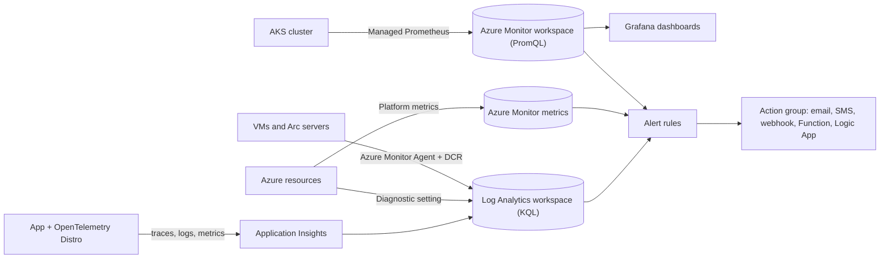

## TL;DR

- Azure Monitor is the umbrella service. Logs and traces land in a **Log Analytics workspace** and you query them with KQL. Prometheus and OpenTelemetry metrics land in an **Azure Monitor workspace** and you query them with PromQL. Despite the names, these are two different resources.
- **Application Insights** is the APM feature of Azure Monitor, fed by OpenTelemetry. New .NET, Node.js, and Python apps use the Microsoft OpenTelemetry Distro. Java uses the Azure Monitor OpenTelemetry Distro agent.
- Platform metrics arrive automatically and are kept 93 days. Resource logs are not collected until you create a **diagnostic setting**. The activity log is kept 90 days at no charge.
- Log ingestion drives the bill. Pick a table plan (Analytics, Basic, or Auxiliary) per table, sample traces at high volume, and use a commitment tier once volume is steady.
- An alert is an alert rule plus an action group. Alert on what users feel (errors, latency, saturation) and route it to a person or an automation.

## Why it matters

A distributed system fails in ways one dashboard can't show. One dependency slows down, callers retry, a queue backs up, and a user three hops away sees a timeout. You find the cause only if every hop emits telemetry with a shared trace ID and all of it lands where you can query it together.

Observability also carries other pillars. Recovery targets from [Availability and reliability](../01-fundamentals/availability-and-reliability.md) mean nothing if nobody notices the outage, and patterns like circuit breakers in [Resilience patterns](../03-patterns/resilience-patterns.md) are only useful if you can see when they trip. On the cost side, Log Analytics bills by data ingested, so verbose logging at scale shows up on the invoice.

In an interview, "we'll add monitoring" is filler. Naming the signals, where they go, which alert fires, and what the on-call engineer opens first is a design.

## How it works

### Where each signal goes

| Signal | Source | Store | Query |
| --- | --- | --- | --- |
| Platform metrics | Every Azure resource, automatically | Azure Monitor metrics (93 days) | Metrics explorer, metric alerts |
| Resource logs | Diagnostic setting per resource | Log Analytics workspace | KQL |
| Activity log | Subscription control plane | Kept 90 days free; route to a workspace for longer | KQL |
| App traces, requests, dependencies | OpenTelemetry Distro | Application Insights, backed by a workspace | KQL, Application map |
| Guest OS logs and counters | Azure Monitor Agent with a data collection rule (DCR) | Log Analytics workspace | KQL |
| Kubernetes and Prometheus metrics | Managed service for Prometheus | Azure Monitor workspace (up to 18 months) | PromQL, Grafana |

The Azure Monitor Agent is the supported agent for VMs and Arc-enabled servers. The legacy Log Analytics agent was retired on August 31, 2024. A data collection rule says which logs and counters to collect and which workspace receives them.

For AKS, Azure Monitor combines platform metrics, managed Prometheus metrics, Container insights logs, and Azure Managed Grafana. Managed Prometheus ships preconfigured alert rules, recording rules, and dashboards, so a cluster has useful coverage on day one.

### Application Insights and OpenTelemetry

Instrument once with the distro for your language:

| Language | Package |
| --- | --- |
| .NET | `Microsoft.OpenTelemetry` |
| Node.js | `@microsoft/opentelemetry` |
| Python | `microsoft-opentelemetry` |
| Java | Azure Monitor OpenTelemetry Distro (Java agent) |

The distro collects traces, metrics, and logs automatically and sends them to Application Insights using a connection string. It can also export to any OTLP endpoint, so the instrumentation in your code doesn't lock you to one backend. Apps on the Application Insights .NET SDK 2.x should move to 3.x. Azure Functions has its own OpenTelemetry setup.

Application Insights then gives you an Application map of components and their dependencies, Live metrics for real-time activity, a Search view to trace one transaction end to end, and Standard availability tests that probe an endpoint and check its TLS certificate. Create workspace-based resources; classic resources with no linked workspace are being retired.

**Sampling.** The distros support fixed-percentage and rate-limited sampling, and sampling decisions apply to traces (spans). Java 3.4.0 and later uses rate-limited sampling by default. Sample high-volume services; keep full fidelity for low-volume, high-value paths like checkout.

### Log Analytics table plans and retention

Each table in a workspace has a plan:

| Plan | Use it for | Querying |
| --- | --- | --- |
| Analytics | Data you alert on and query often | Full KQL, included in the ingestion price |
| Basic | Troubleshooting data you query occasionally | Extra charge per query, 30-day query window |
| Auxiliary | High-volume data you keep for audit or rare investigation | Extra charge per query, queryable for the full retention |

Default interactive retention is 30 days, and some tables default to 90. Analytics tables can keep interactive retention for up to two years, and 31 days are included in the ingestion price. Data older than interactive retention stays in long-term retention, and you reach it with a search job.

### Alerts

An alert rule watches a signal: metric alerts, log search alerts, activity log alerts, Prometheus alerts, and Service Health or Resource Health alerts. When it fires, an action group decides who hears about it (voice, SMS, push, email) and what runs (a webhook, a Function, a Logic App, an Automation runbook). Metric alerts evaluate precomputed data, so use them for fast thresholds. Use log search alerts when the condition needs a query across tables.

## Trade-offs

**One workspace vs many.** Learn's workspace design guide says to start with a single workspace and add more only when a criterion forces it. Criteria include data ownership, the region the workspace lives in, egress charges, and whether to mix operational and security data. Each extra workspace makes cross-workspace queries harder.

**Full fidelity vs sampling.** Keeping every trace makes rare failures easy to find and costs ingestion. Sampling cuts cost and can drop the one trace you needed. Sample by service, not globally.

**Analytics vs Basic or Auxiliary.** Cheaper plans lower the cost of verbose logs. You give up free queries, and Basic limits you to a 30-day query window. Keep the data your main alerts and dashboards depend on in Analytics.

**OpenTelemetry vs the classic SDKs.** The OpenTelemetry distro keeps instrumentation portable across backends. The cost is migration work for apps still on older Application Insights SDKs.

**Platform metrics vs Prometheus.** Platform metrics are free and cover every resource. Prometheus metrics cover what the platform can't see (pod and application internals) and add a workspace and ingestion to pay for. AKS designs usually need both.

## On Azure

| Concern | Choice | Source |
| --- | --- | --- |
| App telemetry | Workspace-based Application Insights with the OpenTelemetry Distro | [Enable OpenTelemetry](https://learn.microsoft.com/azure/azure-monitor/app/opentelemetry-enable) |
| Resource logs | Diagnostic settings to one Log Analytics workspace, enforced at scale with Azure Policy | [Diagnostic settings](https://learn.microsoft.com/azure/azure-monitor/platform/diagnostic-settings) |
| Kubernetes metrics | Managed Prometheus to an Azure Monitor workspace, with Grafana | [Managed Prometheus](https://learn.microsoft.com/azure/azure-monitor/metrics/prometheus-metrics-overview) |
| VMs | Azure Monitor Agent with a data collection rule | [Azure Monitor Agent](https://learn.microsoft.com/azure/azure-monitor/agents/azure-monitor-agent-overview) |
| Log cost | Table plan per table; commitment tier (up to 30% off, Analytics only) once volume is steady | [Table plans](https://learn.microsoft.com/azure/azure-monitor/logs/logs-table-plans) |
| Alerting | Metric and log search alert rules routed to action groups | [Alerts overview](https://learn.microsoft.com/azure/azure-monitor/alerts/alerts-overview) |

**Zones and regions.** Log Analytics workspaces are zone-redundant with no configuration in some regions. In others, you link the workspace to a dedicated cluster to get zone protection, so check your region. For a regional outage, workspace replication keeps a copy in a second region, and you trigger the switchover manually. Learn notes that a workspace per region can reduce egress charges, which trades against the one-workspace default.

**Gotcha: logs you didn't route don't exist.** Resource logs are collected only after a diagnostic setting exists. If you create the setting during an incident, the logs from before the incident are gone. Deploy diagnostic settings with the resource, or with an Azure Policy that applies them to every new resource.

**Gotcha: the daily cap blinds you.** A workspace daily cap stops collecting Analytics and Basic table data for the rest of the 24-hour period once it's reached, and alerts that depend on that data stop working. Learn says not to use it as the primary cost control. Use table plans and sampling to cut volume, and treat the cap as a backstop against runaway spikes.

For how observability fits the Operational Excellence pillar, see [Well-Architected Framework](./well-architected-framework.md). For the cost levers, see [Cost optimization](./cost-optimization.md).

## Interview tips

- Name all three signals and where each goes: metrics for fast alerts, logs in Log Analytics, traces in Application Insights joined by trace ID.
- Say "OpenTelemetry distro" and "connection string." It shows you know how instrumentation is wired today.
- Pick two or three alerts for the design you drew (error rate, p99 latency, queue depth) and say who gets paged.
- Mention cost when you mention logging: table plans and sampling.
- For Kubernetes, say managed Prometheus and Grafana for the cluster, Application Insights for the app.

## Further reading

- [Azure Monitor overview](https://learn.microsoft.com/azure/azure-monitor/fundamentals/overview)
- [Enable Azure Monitor OpenTelemetry](https://learn.microsoft.com/azure/azure-monitor/app/opentelemetry-enable)
- [Log Analytics workspace design](https://learn.microsoft.com/azure/azure-monitor/logs/workspace-design)
- [Configure data retention](https://learn.microsoft.com/azure/azure-monitor/logs/data-retention-configure)
- [Types of Azure Monitor alerts](https://learn.microsoft.com/azure/azure-monitor/alerts/alerts-types)
- [Monitor AKS](https://learn.microsoft.com/azure/aks/monitor-aks)
