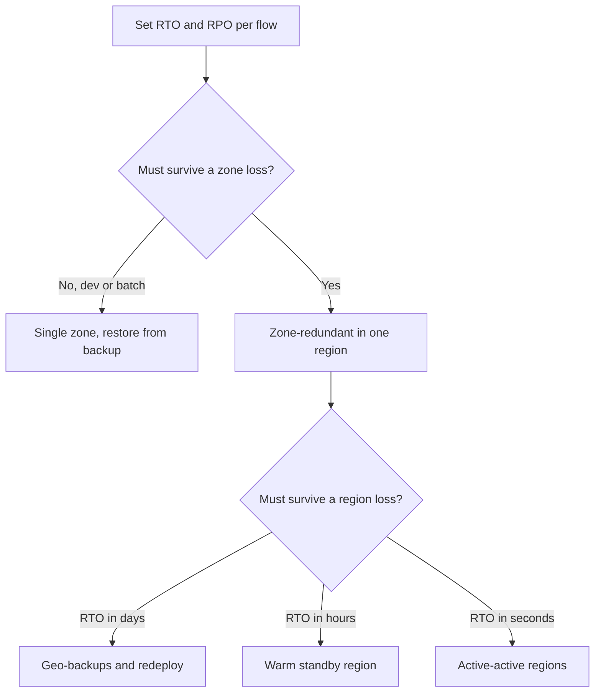

## TL;DR

- An Azure region contains availability zones: physically separate groups of datacenters with independent power, cooling, and networking, typically under about 2 ms round trip apart.
- **Zone-redundant** resources are spread across zones by the service, and Microsoft handles zone failover. **Zonal** resources are pinned to a zone you pick, and you handle failover. **Nonzonal** resources can land in any zone and are not protected from a zone outage.
- Region pairs give sequential platform updates, recovery priority, and data residency. They do **not** give automatic failover. Many newer regions are nonpaired and rely on zones.
- Start from RTO and RPO per user flow. Zone redundancy in one region covers most workloads. Add a second region only when the targets require surviving a region loss.

## Why it matters

Zone failures (a power or cooling event in one datacenter group) are the large failures you should expect to see. Region-wide outages are rarer but last longer and are harder to recover from. A design review on Azure asks two questions per component: what happens when one zone goes down, and what happens when the region goes down. "The platform handles it" is right for some services, wrong for others, and depends on a setting you chose at creation time for several.

The second reason is cost. Zone redundancy is often cheap or free (Service Bus enables it automatically at no extra cost). A second region roughly duplicates the replicated tiers and adds data transfer and operational work. Knowing exactly which targets need the second region keeps you from paying for it everywhere.

## How it works

### Availability zones

Many Azure regions provide availability zones, and some do not. A region can offer more zones than a given service uses (four zones, with a service spread across three), so read each service's reliability guide for its topology. Zones are usually several kilometers apart and within about 100 km of each other, close enough for synchronous replication with a round-trip latency target under about 2 ms. Microsoft rolls platform updates out one zone at a time, so a bad update should not hit every zone at once.

Zone numbers are logical. Zone 1 in your subscription may be a different physical zone than zone 1 in another subscription. If two subscriptions must share or avoid a physical zone, check the mapping with `az account list-locations`.

### Three deployment models

| Model | Who picks the zone | Who fails over | Examples |
| --- | --- | --- | --- |
| Zone-redundant | The service | Microsoft | Service Bus namespaces, SQL Database with zone redundancy, ZRS storage, Azure Managed Redis (zone redundant by default), Load Balancer zone-redundant frontends |
| Zonal | You | You | A VM or managed disk pinned to zone 2, one VM per zone behind a load balancer |
| Nonzonal (regional) | Azure, any zone | Nobody | Resources created without a zone setting in a region where the service does not spread them |

Compute often sits in between. A VM Scale Set in Flexible orchestration spreads instances across zones you list. An AKS node pool can span three zones, but only if you also run several pod replicas and set topology spread constraints. A single replica on a three-zone node pool still lives in one zone.

### Regions, pairs, and nonpaired regions

A region pair is two regions in the same geography that Microsoft links for three things: one region in each pair gets priority during a broad recovery, platform updates roll to one region of the pair at a time, and data stays in the geography. Examples are East US with West US, East US 2 with Central US, and Canada Central with Canada East. Some pairs are asymmetric: Brazil South pairs with South Central US, and West US 3 pairs one way with East US.

Pairing does not replicate your data or fail over your app. Geo-redundant storage replicates to the paired region, but a Microsoft-managed failover happens only in catastrophic situations. Plan a customer-managed failover instead.

Many recent regions have no pair, for example Italy North, Israel Central, Austria East, and Chile Central. They rely on availability zones, and multi-region designs there pick a second region explicitly. Service Bus, Cosmos DB, SQL Database, and AKS all support multi-region setups between any regions, paired or not.

### RTO, RPO, and the decision

The WAF reliability guidance (RE:04) defines **RTO** as the maximum acceptable downtime and **RPO** as the maximum acceptable duration of data loss. Set them per user flow, not per system. Checkout and the product catalog rarely share targets.

SQL Database publishes concrete numbers that make the ladder tangible:

| Option | RTO | RPO |
| --- | --- | --- |
| Zone redundancy (high availability) | Typically under 30 seconds | 0 |
| Failover groups or active geo-replication | Typically under 60 seconds | 0 or more, depending on unreplicated changes |
| Geo-restore from backup | Minutes to hours | Minutes to hours |

Asynchronous cross-region replication always means RPO above zero. Storage geo-replication is asynchronous; its Geo priority replication option targets an RPO of 15 minutes or less for block blobs. If a flow needs RPO 0 across regions, you need synchronous writes to two regions and you pay for that latency on every write.

## Trade-offs

**Zone-redundant vs zonal.** Zone redundancy hands failover to the platform and costs extra instances (App Service needs at least two). Zonal deployment lets you pin an app tier and its database to the same zone for the lowest latency, but you write the failover logic and test it. Prefer zone-redundant services unless a measured latency budget forces zonal pinning.

**Synchronous vs asynchronous replication.** Within a region, synchronous replication across zones costs about 2 ms per round trip and gives RPO 0. Across regions, synchronous replication adds tens of milliseconds per write, so most designs accept a small RPO instead. Cosmos DB makes this explicit: accounts with multiple write regions cannot use strong consistency.

**Warm standby vs active-active.** A warm standby region runs scaled-down copies and a replicated database. It costs less and has a failover step that someone must trigger and rehearse. Active-active serves traffic from both regions, so failover is a routing change, but you must handle write conflicts or partition writes by region. See [Multi-region active-active](../05-advanced/multi-region-active-active.md).

**Platform failover vs your own.** Microsoft-managed failover removes a decision from you and removes control of timing. Customer-managed failover lets you fail over the whole app together, which matters because a database that fails over without its app tier is still an outage.

## On Azure

| Service | Zone setting | Region-loss option | Source |
| --- | --- | --- | --- |
| App Service | Premium v2, v3, or v4, at least 2 instances, plan on a zone-capable scale unit | Two regional apps behind Front Door | [App Service reliability](https://learn.microsoft.com/azure/reliability/reliability-app-service) |
| SQL Database | Zone redundancy on General Purpose, Premium, Business Critical, Hyperscale | Failover groups with stable read-write and read-only listeners | [SQL Database reliability](https://learn.microsoft.com/azure/reliability/reliability-sql-database) |
| Cosmos DB | Availability zones, set when you create the account in a region | Add regions; service-managed failover or multi-region writes | [Cosmos DB reliability](https://learn.microsoft.com/azure/reliability/reliability-cosmos-db) |
| Storage | ZRS (12 nines durability per year) | GZRS or RA-GZRS, asynchronous to the secondary | [Storage redundancy](https://learn.microsoft.com/azure/storage/common/storage-redundancy) |
| Service Bus | Zone redundant automatically, all tiers, no extra cost | Premium only: Geo-Replication (messages and metadata) or Geo-Disaster Recovery (metadata only) | [Service Bus reliability](https://learn.microsoft.com/azure/reliability/reliability-service-bus) |
| AKS | Node pools across zones, multiple replicas, topology spread constraints, ZRS disks | A second cluster in another region | [AKS reliability](https://learn.microsoft.com/azure/reliability/reliability-aks) |
| VMs | Zonal VMs or a Flexible scale set across zones | Azure Site Recovery replication | [Site Recovery](https://learn.microsoft.com/azure/site-recovery/site-recovery-overview) |

The [regions list](https://learn.microsoft.com/azure/reliability/regions-list) shows each region's zone support and pair. Even in a zone-enabled region, check that each service you use supports zones there.

**Gotcha: creation-time settings.** Several zone settings cannot be added later. A Cosmos DB region's zone support is chosen when you add it, an App Service plan on a scale unit without zone support must be redeployed to a new plan, and a scale set's orchestration mode is fixed at creation. Put zone settings in your infrastructure as code from the first deployment.

**Gotcha: Service Bus Geo-DR loses messages.** Geo-Disaster Recovery replicates only entities and configuration. Messages in the primary at failover time are not in the secondary. Use Geo-Replication when message loss is not acceptable.

## Interview tips

- Ask for RTO and RPO before drawing a second region. "What happens if the region is down for four hours?" is a requirement question, not a design question.
- Use the precise words: zone-redundant, zonal, paired, nonpaired. Saying "the paired region takes over automatically" is a common and visible mistake.
- When you propose async geo-replication, say the RPO out loud and what the business loses in that window.
- Mention rehearsal. A failover that has never been run is a plan, not a capability. Chaos experiments and game days belong in the answer.

## Further reading

- [What are availability zones?](https://learn.microsoft.com/azure/reliability/availability-zones-overview)
- [Azure region pairs and nonpaired regions](https://learn.microsoft.com/azure/reliability/regions-paired)
- [Multi-region solutions in nonpaired regions](https://learn.microsoft.com/azure/reliability/regions-multi-region-nonpaired)
- [SQL Database business continuity overview](https://learn.microsoft.com/azure/azure-sql/database/business-continuity-high-availability-disaster-recover-hadr-overview)
- [Availability and reliability](../01-fundamentals/availability-and-reliability.md) and [Resilience patterns](../03-patterns/resilience-patterns.md)
