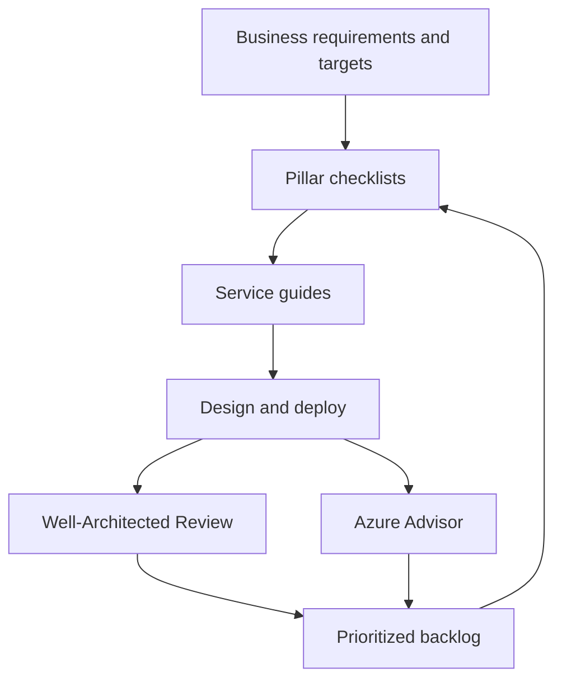

## TL;DR

- The Azure Well-Architected Framework (WAF) has five pillars: Reliability, Security, Cost Optimization, Operational Excellence, and Performance Efficiency.
- Each pillar ships design principles, a numbered design review checklist (RE:01, SE:05, CO:04, OE:07, PE:05 and so on), and a tradeoffs page that names what you give up in the other pillars.
- Service guides apply the pillars to one service, for example Cosmos DB, App Service, or Event Hubs, with a checklist, configuration recommendations, failure modes, and Azure Policy and Advisor hooks.
- The Azure Well-Architected Review is a questionnaire for a whole workload. Azure Advisor scans your deployed resources continuously and groups findings into the same five areas.
- Use the framework as a review checklist and a vocabulary for tradeoffs, not as a score to maximize.

## Why it matters

Most design failures on Azure are not exotic. A database deployed without zone redundancy, a secret in an app setting, a dev environment that runs at production size all weekend, a deployment with no rollback. The WAF exists so a team catches these with a checklist before an incident catches them.

It also gives architects a shared language. "This raises RE:05 (redundancy) at the cost of CO:07 (component cost)" is a faster review conversation than a debate about taste. Interviewers at Azure-heavy companies use the same pillars, so knowing them lets you close a design with a structured pass instead of a list of afterthoughts.

## How it works

The framework is a loop, not a one-time audit. You set targets, design against the pillar checklists and service guides, assess the result, and feed findings into the backlog.

### The five pillars

| Pillar | Question it answers | Checklist examples |
| --- | --- | --- |
| Reliability | Does the workload keep working, and recover, when parts fail? | RE:03 failure mode analysis, RE:04 reliability and recovery targets, RE:05 redundancy, RE:08 resiliency testing |
| Security | Are data, identities, and the network protected, and can you detect an attack? | SE:04 segmentation and perimeters, SE:05 identity and access management, SE:07 encryption, SE:09 secrets |
| Cost Optimization | Is spend tied to value, and are you paying the best rate for what you use? | CO:02 cost model, CO:04 spending guardrails, CO:05 best rates, CO:08 environment costs |
| Operational Excellence | Can the team deploy, observe, and fix the workload safely and repeatably? | OE:05 infrastructure as code, OE:06 automated pipelines, OE:07 monitoring, OE:08 incident management |
| Performance Efficiency | Does the workload meet its performance targets as load changes? | PE:01 performance targets, PE:02 capacity planning, PE:05 scaling and partitioning, PE:09 critical flows |

Each pillar also has design principles. Reliability's are design for business requirements, design for resilience, design for recovery, design for operations, and keep it simple. RE:01 says the same thing as the last principle: focus the design on simplicity and efficiency. Redundancy you cannot test or operate makes the workload less reliable, not more.

### Service guides

A service guide translates the pillars into settings for one service. The Cosmos DB for NoSQL guide is typical. Under Reliability it lists a design checklist and a failure mode table:

| Failure | Mitigation from the guide |
| --- | --- |
| Throttling after exceeding request units | Retry logic, RU monitoring, and throughput adjustment |
| Single-zone failure in one region | Enable availability zone support when you create the database |
| High latency for users in a new geography | Replicate to a region close to those users |

The guide then lists configuration recommendations, built-in Azure Policy definitions that can audit them (for example, that an account spans at least two regions), and the Advisor recommendations that apply. Read the guide for every service in your [service map](./azure-service-map.md) before you finalize tiers.

### Assessment and continuous checks

The **Azure Well-Architected Review** is a questionnaire on Microsoft Assessments. You answer per pillar for one workload, and it returns recommendations with links back to the guidance. It knows your intent (targets, criticality) but not your deployed resources.

**Azure Advisor** is the opposite. It reads your deployed resources and produces recommendations in five categories: Reliability, Security, Performance, Cost, and Operational excellence. Advisor score rolls them into a percentage per category so you can track progress. It knows your resources but not your intent.

Use both. The review catches design gaps such as an undefined RPO. Advisor catches drift such as a VM that has run at 3% CPU for weeks.

## Trade-offs

Every pillar pulls against the others. The WAF documents these as tradeoffs pages per pillar. Reliability's list is a good model:

- **Reliability vs Security.** More replicas, regions, and failover paths increase the surface area you must secure and patch.
- **Reliability vs Cost Optimization.** Redundancy is capacity you pay for and mostly do not use. A second region can double the bill for the components you replicate.
- **Reliability vs Operational Excellence.** Every recovery path is another thing to deploy, monitor, and rehearse.
- **Reliability vs Performance Efficiency.** Synchronous replication and cross-zone or cross-region hops add latency to each write.

Two failure modes come from treating the framework as a score. The first is gold-plating: applying mission-critical guidance (active-active across regions, chaos testing every release) to an internal tool whose RTO is a day. The second is checklist theater: marking items done because a feature is enabled, while nobody has tested the failover or read the alert. Tie each checklist item to a target from [availability and reliability](../01-fundamentals/availability-and-reliability.md), and accept the items you deliberately skip in writing.

## On Azure

| Tool | Scope | Use it for |
| --- | --- | --- |
| [Well-Architected Review](https://learn.microsoft.com/assessments/azure-architecture-review/) | One workload, your answers | Design reviews, before launch, after major changes |
| [Service guides](https://learn.microsoft.com/azure/well-architected/service-guides/) | One service | Choosing tiers and settings for each component |
| [Azure Advisor](https://learn.microsoft.com/azure/advisor/advisor-overview) | Deployed resources | Continuous checks, cost and reliability drift |
| [Advisor score](https://learn.microsoft.com/azure/advisor/advisor-score) | Subscriptions | Tracking progress per category over time |
| [Azure Chaos Studio](https://learn.microsoft.com/azure/chaos-studio/chaos-studio-overview) | Running workload | RE:08 resiliency testing with injected faults |
| [Mission-critical guidance](https://learn.microsoft.com/azure/well-architected/mission-critical/mission-critical-overview) | Highest-criticality workloads | Design patterns when downtime has severe business impact |

Map pillars to the rest of this level: Reliability to [Regions, zones, and resiliency](./regions-zones-and-resiliency.md), Security to [Networking and security](./networking-and-security.md), Operational Excellence to [Observability](./observability.md), and Cost Optimization to [Cost optimization](./cost-optimization.md).

**Gotcha: Advisor lags and lacks context.** Advisor can take up to a day to recognize that you implemented a recommendation, so do not use it as a deployment gate. It also judges resources in isolation. It may recommend shrinking a VM that is sized for a monthly batch peak, or flag a dev database for missing geo-replication. Dismiss or postpone those with a reason so the next reviewer sees the decision.

**Gotcha: some settings are creation-time only.** The Cosmos DB guide says to enable availability zone support when you create the database. Several other services (VM Scale Set orchestration mode, App Service plans on a scale unit without zone support) have the same property. Read the service guide before the first deployment, not after the review.

## Interview tips

- Close a design with a 60-second pillar pass: one risk and one mitigation per pillar. It shows breadth without derailing the deep dive.
- State tradeoffs in pillar terms. "Cosmos DB multi-region writes improve availability, add a second region to the bill, and rule out strong consistency" names reliability, cost, and data correctness in one sentence.
- Tie reliability work to numbers (SLO, RTO, RPO) before proposing redundancy. An interviewer will ask why you need a second region.
- Mention that the framework applies per workload. A batch reporting job and a checkout flow should get different answers to the same checklist.

## Further reading

- [Well-Architected Framework pillars](https://learn.microsoft.com/azure/well-architected/pillars)
- [Reliability design principles](https://learn.microsoft.com/azure/well-architected/reliability/principles)
- [Design review checklist for Reliability](https://learn.microsoft.com/azure/well-architected/reliability/checklist)
- [Reliability tradeoffs](https://learn.microsoft.com/azure/well-architected/reliability/tradeoffs)
- [Cosmos DB service guide](https://learn.microsoft.com/azure/well-architected/service-guides/cosmos-db)
- [Recommend reliability targets (RE:04)](https://learn.microsoft.com/azure/well-architected/reliability/metrics)
