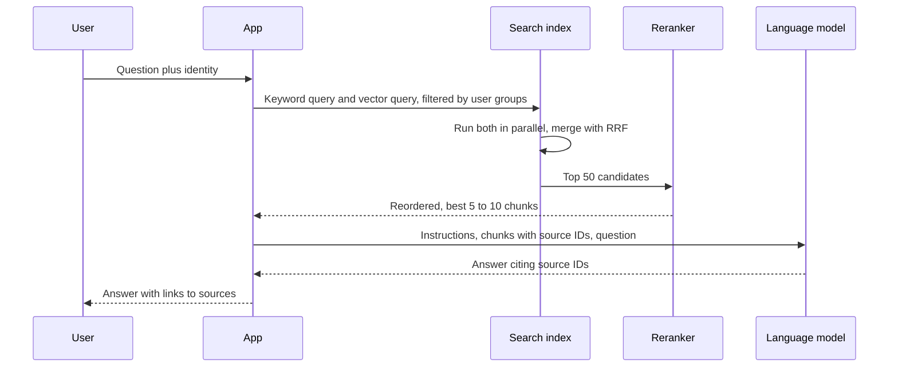

## TL;DR

- **Retrieval-augmented generation (RAG)** finds relevant passages from your data at query time and puts them in the prompt. The model answers from sources it never trained on and can cite them.
- Answer quality depends mostly on retrieval. When retrieval returns the wrong passage, or none, the model still writes a fluent answer and it is wrong.
- The standard retrieval pipeline is **hybrid search**: keyword and vector queries run in parallel and their results are merged, then a **reranker** reorders the top candidates.
- An **agent** is a loop: the model picks a tool and arguments, your code runs the tool, the result goes back to the model, and the loop repeats until it answers. Security and reliability problems show up in the tool calls.
- Evaluate retrieval and generation separately, offline against a labeled set before each change and online against production traces.

## Why it matters

A language model knows its training data up to a cutoff date. It knows nothing about your private documents, and when it doesn't know something it can still write a confident answer. Fine-tuning changes a model's style and format. It is a poor way to add facts that change weekly, and it gives no citations. RAG keeps the facts in an index you control, so updating knowledge means reindexing a document.

The failure modes are specific:

- **Hallucination after a retrieval miss.** The right passage existed but ranked 40th, so the model never saw it.
- **Permission leaks.** The index holds copies of documents from many sources. If retrieval ignores who is asking, the model quotes a document the user cannot open.
- **Prompt injection.** A retrieved web page or email contains "ignore previous instructions and ...". The model sees no hard boundary between your instructions and the data.
- **Cost and latency.** Every request may make several model calls, each billed by token. See [LLM serving and inference](./llm-serving-and-inference.md).

## How it works

### Indexing: parse, chunk, embed

Documents are split into **chunks**, because embedding models have input limits and one vector for a long page blurs many topics together. Azure's guidance gives fixed-size chunks of about 200 words with 10 to 15% overlap as an example, so a sentence split at a boundary appears in both chunks. Splitting on headings or paragraphs usually beats a fixed size, and prepending the document title keeps a chunk from the middle of a long document from losing its context.

Each chunk is passed through an **embedding model**, which maps text to a vector so that passages with similar meaning land near each other. Store each chunk with metadata: source URL, last-modified time, and the groups allowed to read it. Embeddings from different models are not comparable, so changing the embedding model means re-embedding the whole corpus.

### Retrieval: keyword, vector, hybrid, rerank

- **Keyword search** ([BM25](../02-building-blocks/search.md)) matches exact terms. It wins on product codes, error messages, and names.
- **Vector search** finds the nearest embeddings to the query's embedding. It wins on paraphrase ("can't sign in" versus "authentication failure"). Indexes such as HNSW are approximate: they trade a little recall for a large speedup.
- **Hybrid search** runs both and merges with **Reciprocal Rank Fusion (RRF)**: each document scores the sum of $1/(\text{rank} + k)$ across the lists, with $k$ around 60. RRF uses ranks because BM25 scores and cosine similarities are on different scales and cannot be added directly.
- **Reranking** reads the query and each candidate together, which judges relevance better than comparing two separately computed vectors. It is too slow to run over the corpus, so it runs over the top few dozen results only.

The app then builds a prompt from instructions, the chunks labeled with source IDs, and the question, and tells the model to answer only from the chunks and cite them.

### Agents and tool calling

The application describes each tool by name, a description, and a JSON schema for its arguments. The model returns either a final answer or a tool call. The application, not the model, executes the call, appends the result, and calls the model again. The ReAct paper describes this pattern of interleaving reasoning steps with actions.

Treat that loop like any distributed workflow:

- **Bound it.** Cap the number of steps, total tokens, and wall-clock time. Without limits, a model that keeps retrying a failing tool runs until something else stops it.
- **Make tools safe to retry.** The loop will repeat calls after timeouts, so write tools need [idempotency keys](../03-patterns/idempotency-and-retries.md). Slow tools should start a job and return a handle, as in [long-running tasks](../03-patterns/long-running-tasks.md).
- **Least privilege.** A tool runs with the caller's identity and the narrowest scope that works. Writes, payments, and outbound messages need human approval.
- **Treat tool output and retrieved text as data.** Data theft through injection needs an agent that reads untrusted content, can access private data, and can send data out. Remove one of the three.

**Retrieval as a tool.** Instead of always retrieving once, an agent can decide when to search, rewrite the query, split it into subqueries, and search again when results are thin. Recall improves, and each extra model call adds latency and cost.

The **Model Context Protocol (MCP)** is an open standard for exposing tools and data sources to AI applications, so one tool server works with many agent runtimes.

### Evaluation

- **Retrieval.** Build a labeled set of questions with the chunks that answer them, and measure recall at $k$: how often the right chunk is in the top $k$. If it is missing, no prompt change will fix the answer.
- **Generation.** Measure **groundedness** (every claim is supported by the retrieved chunks), relevance, and completeness.
- **Agents.** Measure tool-call accuracy and task completion.
- **LLM-as-judge.** A second model scores outputs at scale. It is itself a model, so check its scores against human labels before trusting them.
- **Offline and online.** Run the labeled set on every change to prompts, chunking, models, or index settings, as a regression gate. In production, trace each request (query, retrieved chunk IDs, prompt, output, tokens, latency) and score a sample.

## Trade-offs

| Decision | Choose the first when | Choose the second when |
| --- | --- | --- |
| Small chunks vs large chunks | Questions target specific facts | Answers need surrounding context, such as procedures |
| Vector only vs hybrid | Queries are conversational and the corpus has few exact identifiers | Users search codes, names, and error strings, which is most corpora |
| Reranker off vs on | Latency budget is tight and results are already good | Precision in the top 5 matters, which is usual for RAG |
| RAG vs fine-tuning | Facts change, need citations, or need per-user permissions | You need a consistent format or style the prompt cannot produce |
| Fixed pipeline vs agent loop | One retrieval answers most questions | Questions need several lookups or actions |

A sound default: structure-aware chunks with overlap, hybrid search with a reranker, 5 to 10 chunks in the prompt, and a fixed pipeline. Add an agent loop when the evaluation set shows multi-step questions failing.

## On Azure

**Azure AI Search.** The retrieval layer. It supports vector search with HNSW or exhaustive KNN, and a single hybrid request runs full-text and vector queries in parallel and merges them with RRF. The **semantic ranker** reranks the top 50 results with multilingual models adapted from Bing, using text fields only, and can return captions. **Integrated vectorization** uses indexers and skillsets to chunk (the Text Split skill) and embed content during indexing, and a vectorizer embeds the query at query time with the same model. See [search](../02-building-blocks/search.md).

**Agentic retrieval.** An AI Search feature that powers knowledge bases for agents. LLM-based query planning (preview) splits a complex question into subqueries, runs them in parallel, reranks each, and merges the results. The generally available REST API covers extractive retrieval, while query planning and answer synthesis remain in preview, so check which parts you depend on.

**Microsoft Foundry.** The platform formerly named Azure AI Studio and then Azure AI Foundry. **Azure OpenAI in Microsoft Foundry Models** serves the chat and embedding models. **Foundry Agent Service** hosts prompt agents and hosted agents running your own code, and manages conversations and tool calls. Tools include web search, file search, code interpreter, custom functions, and MCP servers. For MCP tools, Learn recommends requiring approval for operations that write data or change resources, and using servers hosted by the provider rather than proxies.

**Evaluation and safety.** Foundry's built-in evaluators cover quality (coherence, fluency), RAG (groundedness, relevance), safety, and agents (tool-call accuracy, task completion). AI-assisted evaluators use a judge model. Production monitoring feeds Application Insights. **Prompt Shields** in Azure AI Content Safety detect user prompt attacks and document attacks, the second being instructions hidden in retrieved content. See [observability](../04-azure/observability.md).

**Gotcha.** Permissions are not inherited from the source system. With the security filter pattern, you store the allowed Microsoft Entra group IDs on every chunk and filter with `search.in` on every query. Built-in document-level access control exists but is in preview. Either way, permission changes at the source must reach the index, or a user who lost access can still retrieve the content. See [identity and auth](../02-building-blocks/identity-and-auth.md).

## Interview tips

- Draw the indexing pipeline and the query pipeline separately. Interviewers look for chunking, metadata, and refresh on one side and hybrid search, reranking, and citations on the other.
- When answers are wrong, diagnose retrieval first: "Was the right chunk in the top $k$?"
- Put permission filtering inside the search query, never after generation.
- For agents, talk about step limits, idempotent tools, approvals for writes, and prompt injection before model choice.
- Propose an evaluation set and a regression gate. "We would measure recall at 10 and groundedness on 200 labeled questions" is a stronger answer than naming a model.

## Further reading

- [Retrieval-augmented generation in Azure AI Search](https://learn.microsoft.com/azure/search/retrieval-augmented-generation-overview)
- [Hybrid search overview](https://learn.microsoft.com/azure/search/hybrid-search-overview) and [hybrid search ranking with RRF](https://learn.microsoft.com/azure/search/hybrid-search-ranking)
- [Semantic ranking overview](https://learn.microsoft.com/azure/search/semantic-search-overview)
- [Chunk documents](https://learn.microsoft.com/azure/search/vector-search-how-to-chunk-documents)
- [Agentic retrieval overview](https://learn.microsoft.com/azure/search/agentic-retrieval-overview)
- [Security filters for trimming results](https://learn.microsoft.com/azure/search/search-security-trimming-for-azure-search)
- [What is Microsoft Foundry?](https://learn.microsoft.com/azure/foundry/what-is-foundry) and [Foundry Agent Service](https://learn.microsoft.com/azure/foundry/agents/overview)
- [Observability in generative AI](https://learn.microsoft.com/azure/foundry/concepts/observability)
- [Prompt Shields](https://learn.microsoft.com/azure/ai-services/content-safety/concepts/jailbreak-detection)
- [Design and develop a RAG solution](https://learn.microsoft.com/azure/architecture/ai-ml/guide/rag/rag-solution-design-and-evaluation-guide) (Azure Architecture Center)
- [Retrieval-Augmented Generation for Knowledge-Intensive NLP Tasks](https://arxiv.org/abs/2005.11401) (Lewis et al., 2020)
- [ReAct: Synergizing Reasoning and Acting in Language Models](https://arxiv.org/abs/2210.03629)
- [Model Context Protocol](https://modelcontextprotocol.io/introduction)
- [Vector databases](https://www.hellointerview.com/learn/system-design/deep-dives/vector-databases) (Hello Interview)
- [Precision vs. Recall vs. F1 Score vs. ROC-AUC](https://thecodinggopher.substack.com/p/precision-vs-recall-vs-f1-score-vs) (The Coding Gopher)
