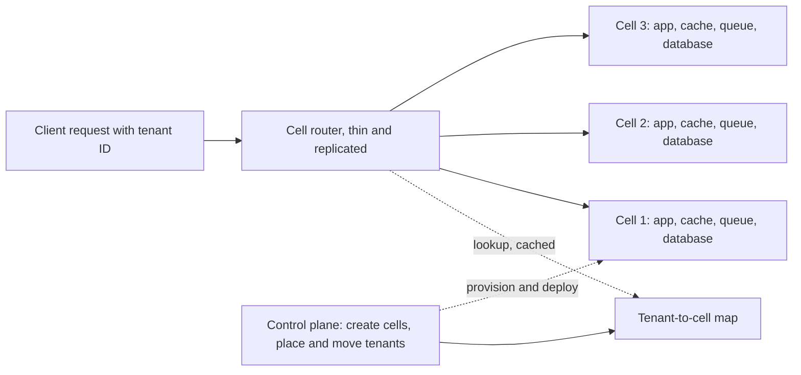

## TL;DR

- A **cell** is a complete, independent copy of your stack, data stores included, that serves a fixed subset of customers. Azure's guidance calls it a **deployment stamp** or **scale unit**.
- A failure, bad deployment, or poison request inside one cell affects only that cell's customers. With 20 equal cells, that is about 5%.
- Scale by adding cells of a size you have load-tested, instead of growing one deployment past limits nobody has tried.
- A thin **router** maps each request's partition key, usually the tenant ID, to a cell. The router and its mapping become the most critical component, so keep them simple, replicated, and cached.
- The costs are copies of infrastructure, harder cross-cell queries, tenant migration, and fleet-wide operations.

## Why it matters

A single shared deployment fails as a unit. The incidents that cells contain are common ones:

- **Bad deploys and config pushes.** A change that reaches every server at once takes down every customer at once.
- **Poison requests.** A malformed input that crashes a worker will crash every worker it is retried on. In a shared pool, that is all of them.
- **Noisy neighbors.** One tenant's batch job saturates a shared database and every tenant's latency rises.
- **Scale ceilings.** Every resource has limits. An AKS cluster supports up to 5,000 nodes, and a single database has a maximum size and connection count. Past those, you need more copies anyway.

The [bulkhead pattern](../03-patterns/resilience-patterns.md) isolates thread pools or connection pools inside a service. Cells apply the same idea to the whole stack, so the isolation covers data stores, caches, and queues too.

## How it works

### Anatomy

- **Partition key.** Every request carries the key that decides its cell: tenant, account, or user ID. Pick a key whose data rarely needs joining with another key's data, as in [sharding](../02-building-blocks/sharding-and-partitioning.md).
- **Cells.** Each cell shares nothing on the request path with other cells. A cell never makes a synchronous call to another cell, because that call would couple their failures.
- **Router.** Looks up the key, forwards the request, and does nothing else. It caches the mapping so it can keep routing while the mapping store is unavailable. Business logic in the router turns it into a shared component that can fail everywhere at once.
- **Control plane.** Creates cells, assigns new tenants, migrates tenants, and rolls out changes. It sits off the request path, so its outages delay operations without failing requests.
- **Global services.** Identity, billing, and the tenant directory are usually shared. Keep the list short and make each one more available than the cells.

### Blast radius

With $N$ equal cells, a failure confined to one cell reaches about $1/N$ of customers. Smaller cells mean a smaller blast radius and more copies to run.

**Shuffle sharding** shrinks the blast radius further inside a shared pool. Give each tenant a random combination of $k$ workers out of $n$. With 8 workers and 2 per tenant, there are 28 possible pairs. A poison tenant that crashes its two workers fully overlaps with only the tenants that drew the same pair, about 1 in 28. Every other tenant keeps at least one healthy worker.

### Sizing and placement

Set a maximum cell size from load tests, expressed as a proxy such as tenants or requests per second per cell. When cells approach the limit, open new ones and send new tenants there. Large customers may get a dedicated cell. Run at least two cells from the start, so code never assumes there is only one.

Moving a tenant between cells is a [multi-step process](../03-patterns/multi-step-processes.md): copy data, catch up on changes, briefly freeze writes, flip the mapping, verify, then delete the old copy. Build it before you need it, because the first time you need it is usually when a hot tenant is hurting its cellmates.

### Deployment waves

Cells make progressive rollout natural. Deploy to an internal or canary cell, wait, check health, then deploy to growing waves of cells. Each wave limits how many customers a bad change can reach, and the health model gates the next wave automatically. Some teams go further and deploy a new version as fresh cells, shift traffic, and delete the old ones.

## Trade-offs

| Approach | Blast radius | Cost | Operational load |
| --- | --- | --- | --- |
| One shared deployment | Everyone | Lowest, best utilization | One thing to run, but every change is global |
| Bulkheads inside one deployment | One pool's users, shared data still global | Low | Moderate |
| Multitenant cells | One cell's tenants | Infrastructure copies, idle headroom per cell | Fleet automation, router, migrations |
| Single-tenant cells | One tenant | Highest | Many small deployments to keep in sync |

A sound default: start with two multitenant cells behind a simple router, automate cell creation as code, and give the largest tenants their own cells only when their load or contracts justify it.

## On Azure

**Deployment Stamps pattern.** The Azure Architecture Center describes a stamp as an independent copy of application components, including data stores, also called a service unit, scale unit, or cell. Its guidance:

- Deploy at least two stamps, so single-stamp assumptions do not creep into code and configuration.
- Stamps implicitly shard your data. A stamp can shard further inside.
- Define capacity with a proxy metric such as tenants per stamp, monitor it, and deploy new stamps ahead of demand.
- Moving tenants between stamps needs custom logic and possibly a backplane between stamps.
- Stamps are not redundant across regions by themselves. If a stamp's region fails, its tenants are down until the region recovers or you move them.
- Use Bicep or Terraform modules so every stamp is identical.

**Routing.** The reference architecture puts Azure Front Door in front of Azure API Management gateways in several regions. API Management looks up the tenant-to-stamp mapping in a geo-replicated Azure Cosmos DB container and sets the backend URL to the right stamp. Front Door health probes steer traffic away from unhealthy API Management regions. The router is itself an instance of the Geode pattern: every copy can route any tenant. A simpler alternative gives each stamp its own name in Azure DNS, such as `unit1.eu.api.contoso.com`, and makes clients connect to their stamp directly. A router can also answer with an HTTP 307 to that name instead of proxying. A 307 keeps the method and body, while clients may resend a POST as a GET after a 302. Some clients, including .NET's `HttpClient`, also drop the `Authorization` header when they follow a redirect, so treat the redirect as a one-time lookup and have clients call their stamp's name directly after that. See [API gateway](../02-building-blocks/api-gateway.md) and [multi-region active-active](./multi-region-active-active.md).

**Mission-critical guidance.** The Well-Architected mission-critical design area recommends scale units for compartmentalization. Its example: if one AKS cluster can have only 5,000 nodes, two units raise the ceiling to 10,000. It also recommends ephemeral blue/green deployment, in which infrastructure and application ship together as a new stamp, are validated end to end, and only then receive traffic.

**Safe deployment.** The Well-Architected safe deployment guidance calls for progressive exposure gated by a health model, with bake times between rollout groups measured in hours and days rather than minutes. Stamps are the units those rollout groups are made of. See [the Well-Architected Framework](../04-azure/well-architected-framework.md).

**Gotcha.** Shared dependencies quietly reconnect the cells. A single container registry, Key Vault, DNS zone, identity tenant, or tenant directory that every cell calls at startup or on each request is a fleet-wide blast radius. List every resource the cells share, decide which are acceptable, and make the rest per-cell or cached with a fallback.

## Interview tips

- Bring up cells when asked how to limit blast radius or how to scale past one cluster or database. Then do the math: 20 cells means a cell incident reaches 5% of customers.
- Name the partition key and the router, and say what happens when the router's mapping store is down: the router serves from cache.
- Distinguish cells from active-active regions. A cell serves a fixed subset of customers. An active-active region serves anyone.
- Mention tenant migration and hot tenants before the interviewer does. They are the hard parts.
- Tie cells to deployment safety: canary cell first, then waves, with automated health gates.

## Further reading

- [Deployment Stamps pattern](https://learn.microsoft.com/azure/architecture/patterns/deployment-stamp)
- [Bulkhead pattern](https://learn.microsoft.com/azure/architecture/patterns/bulkhead)
- [Architectural approaches for a multitenant solution](https://learn.microsoft.com/azure/architecture/guide/multitenant/approaches/overview)
- [Noisy Neighbor antipattern](https://learn.microsoft.com/azure/architecture/antipatterns/noisy-neighbor/noisy-neighbor)
- [Application design of mission-critical workloads](https://learn.microsoft.com/azure/well-architected/mission-critical/mission-critical-application-design)
- [Deployment and testing for mission-critical workloads](https://learn.microsoft.com/azure/well-architected/mission-critical/mission-critical-deployment-testing)
- [Architecture strategies for safe deployment practices](https://learn.microsoft.com/azure/well-architected/operational-excellence/safe-deployments)
- [AKS Free, Standard, and Premium pricing tiers](https://learn.microsoft.com/azure/aks/free-standard-pricing-tiers)
- [HttpClientHandler.AllowAutoRedirect](https://learn.microsoft.com/dotnet/api/system.net.http.httpclienthandler.allowautoredirect)
