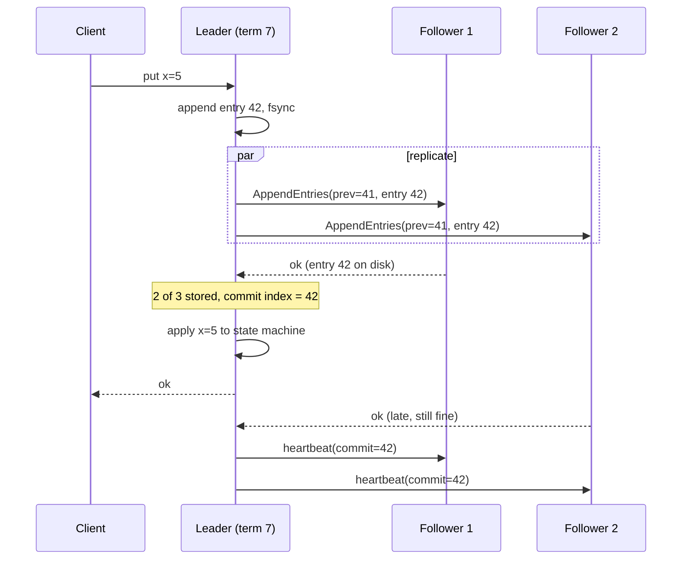

## TL;DR

- Consensus lets a group of servers agree on one ordered log of commands. Every member applies the same log to the same state machine, so the group acts like one reliable server.
- A group of 2f+1 members survives f failures. Three members tolerate one failure, five tolerate two. A fourth member adds cost and no extra tolerance.
- Raft elects one leader per term with randomized timeouts. The leader appends commands, replicates them with `AppendEntries`, and commits an entry once a majority has stored it.
- Every committed write pays one round trip to the nearest majority plus a disk flush. Keep the group inside one region, and keep bulk data out of it.
- You rarely write consensus code. You consume it through etcd under AKS, Kafka's KRaft controllers, ZooKeeper, or the replica sets inside Azure Cosmos DB and Azure SQL Database.

## Why it matters

Replication without agreement breaks in predictable ways. A primary pauses for a long garbage collection, a monitor promotes a replica, and the old primary wakes up and keeps accepting writes. Now two nodes both think they lead, and both acknowledge writes that will conflict (split brain). Or a failover promotes a replica that missed the last few acknowledged writes, and those writes vanish.

Consensus closes both holes. A write counts only after a majority stores it, and any two majorities overlap in at least one member. A new leader must win votes from a majority, so it always meets at least one member that holds every committed write. That overlap is what makes failover safe. Every "who is the leader", "what is the current config", and "which node owns shard 17" question in a large system ends at a small consensus group. The FLP result proves that no deterministic protocol can guarantee progress in a fully asynchronous network with even one crash. Raft and Paxos accept that. They never return a wrong answer, and they make progress whenever timeouts let a majority talk.

## How it works

### Replicated state machine

Each member stores a log of commands and a state machine, such as a key-value map. The protocol's job is to make every member's log identical up to a commit index. Members apply committed entries in order, so they reach the same state without ever comparing state directly.

### Terms and leader election

Raft divides time into numbered terms. Each term has at most one leader. Followers expect a heartbeat from the leader. If none arrives before a randomized election timeout (the Raft paper uses 150 to 300 ms), the follower increments the term, becomes a candidate, votes for itself, and sends `RequestVote` to the others.

A member grants at most one vote per term, and only to a candidate whose log is at least as up to date as its own (compare the last entry's term, then its index). The candidate that collects a majority becomes leader. Randomized timeouts make split votes rare, and a split vote just starts a new term. Any message carrying a higher term makes the receiver step down, which is how a deposed leader learns it lost. Many implementations add a pre-vote round so a member that was briefly partitioned cannot force an election when it rejoins.

### Log replication and commit

The leader appends a client command to its log and sends `AppendEntries` to every follower. Each request carries the index and term of the entry just before the new ones. A follower rejects the request if its log does not match at that point, and the leader backs up and retries until the logs agree. Once a majority has written the entry to disk, the leader advances its commit index, applies the entry, and answers the client. Followers learn the new commit index on the next `AppendEntries` or heartbeat.

### Quorum math

| Members | Majority | Failures tolerated |
| --- | --- | --- |
| 1 | 1 | 0 |
| 3 | 2 | 1 |
| 4 | 3 | 1 |
| 5 | 3 | 2 |
| 7 | 4 | 3 |

Even sizes buy nothing. Larger groups tolerate more failures but every commit waits for more acknowledgments, which is why etcd's own FAQ suggests no more than seven members.

### Reads

A leader cannot answer a read from local state and call it linearizable. A partitioned old leader may not know it was replaced. Two fixes exist. With ReadIndex, the leader records its commit index, confirms it is still leader with one heartbeat round, waits until it has applied that index, and then answers. With a leader lease, the leader skips the round trip and trusts that no rival can be elected before the lease expires, which assumes bounded clock drift (see [time, clocks, and ordering](./time-clocks-and-ordering.md)). Followers can serve reads by asking the leader for a ReadIndex. etcd also offers serializable reads that any member answers from local state, and those can be stale.

### Membership changes

Adding or removing members changes what a majority is. Raft changes membership one server at a time, or uses joint consensus, where a decision needs majorities of both the old and new configurations. etcd adds new members as non-voting learners first, so a slow catch-up does not count against quorum.

### Paxos in one paragraph

Single-decree Paxos picks one value. A proposer chooses a ballot number and sends `prepare`. Acceptors promise to ignore lower ballots and report any value they already accepted. With promises from a majority, the proposer sends `accept` with the highest-ballot value it heard of, or its own value if none. A value is chosen once a majority accepts it. Multi-Paxos runs many instances with a stable leader so phase one runs once, not per entry. Raft is close to Multi-Paxos with stricter rules. Log entries flow only from leader to followers, and the log has no gaps. Those rules make Raft easier to implement correctly, and etcd, Consul, CockroachDB, TiKV, and Kafka's KRaft controllers all chose it.

### Where it runs

- **Kubernetes.** etcd stores all cluster state and uses Raft. On AKS, Azure runs etcd for you.
- **Kafka.** Kafka 4.0 removed ZooKeeper. A KRaft controller quorum now stores cluster metadata.
- **ZooKeeper.** Uses ZAB, a leader-based atomic broadcast protocol close to Raft.
- **Distributed SQL and key-value stores.** CockroachDB and TiKV run one Raft group per data range ("multi-Raft"), so writes scale with the number of groups.
- **Azure Cosmos DB.** Each physical partition is a replica set that commits writes with a majority quorum.

## Trade-offs

| You gain | You pay |
| --- | --- |
| Linearizable writes and no split brain | Each write waits for a majority round trip plus an fsync |
| Automatic failover that loses no acknowledged write | Writes stop for at least one election timeout after the leader dies |
| Survives f failures with 2f+1 members | The minority side of a partition rejects writes (a CP choice, see [consistency and CAP](../01-fundamentals/consistency-and-cap.md)) |
| One simple ordering for all commands | One leader handles every write, so a group's throughput tops out at one machine. Shard into many groups to scale. |
| More members tolerate more failures | More members slow every commit, and cross-region members add WAN latency to every write |

Use consensus for small, critical state: leader election, locks with fencing tokens, configuration, shard maps, and metadata. For bulk data, use a database that already runs consensus per partition, and pick [replication](../02-building-blocks/replication.md) and [sharding](../02-building-blocks/sharding-and-partitioning.md) settings on top of it.

## On Azure

Most designs consume consensus rather than run it. Pick the managed service that already holds a quorum.

| Need | Azure choice | What provides agreement |
| --- | --- | --- |
| Kubernetes cluster state | AKS control plane | Azure-managed etcd (Raft) |
| Leader election among your pods | Kubernetes `Lease` objects on AKS | etcd behind the API server |
| Leader election outside Kubernetes | Blob Storage blob leases (15 to 60 seconds, or infinite) | Azure Storage's internal replication |
| Strongly consistent records | Azure Cosmos DB | Majority quorum per replica set |
| Relational primary with automatic failover | Azure SQL Database Business Critical | A primary plus up to three secondaries, quorum-based failover run by Azure Service Fabric |
| Kafka-compatible log | Azure Event Hubs Kafka endpoint, or Kafka with KRaft on AKS | Managed by the service, or a KRaft controller quorum you run |

**AKS tier.** AKS runs kube-apiserver, etcd, the scheduler, and the controllers for you in both AKS Automatic and AKS Standard. The Free tier has no financially backed SLA and Microsoft recommends it for clusters under 10 nodes. The Standard and Premium tiers include an uptime SLA of 99.95% for the Kubernetes API server when the cluster uses availability zones, and 99.9% without. Premium adds long-term support versions. A production cluster belongs on Standard or Premium, because the API server and etcd are the control plane every deployment and autoscaling decision depends on.

**Self-hosted quorums.** If you run etcd, ZooKeeper, or Kafka KRaft controllers on AKS yourself, use three or five voters spread across three availability zones with pod topology spread constraints. Microsoft targets an inter-zone round trip under about 2 ms, so a zone-spread group still commits in a few milliseconds. Put the data directory on SSD-backed managed disks. etcd's FAQ calls disk latency the main driver of its performance.

**Gotcha.** A quorum split across two failure domains always leaves one domain holding the majority. Three members in two zones survive the loss of the smaller zone and halt if the larger one fails. The same rule bites in two-region designs. Use three zones in one region, or add a third region or a witness, as [regions, zones, and resiliency](../04-azure/regions-zones-and-resiliency.md) explains.

## Interview tips

- Do not offer to implement Paxos. Say "leader election and the shard map live in a consensus store such as etcd or ZooKeeper", then explain why a majority matters.
- Do the quorum math out loud. Five voters across three zones (2, 2, 1) survive a full zone outage, because three voters remain.
- Separate consensus from [two-phase commit](./distributed-transactions.md). Consensus replicates one log and needs a majority. Two-phase commit needs every participant to vote yes and blocks if the coordinator dies.
- Expect "what happens during a partition". The majority side elects a leader and continues. The minority side cannot commit, and an old leader there steps down when it sees a higher term.
- Expect "how do you scale writes". Shard the keyspace into many independent Raft groups, as CockroachDB and TiKV do.
- A lock from a consensus store still needs a fencing token. A paused client can wake up holding an expired lock, so the protected resource must reject writes carrying an older token.

## Further reading

- [The Raft consensus algorithm](https://raft.github.io/), with the paper and visualizations
- [Paxos Made Simple](https://lamport.azurewebsites.net/pubs/paxos-simple.pdf), Leslie Lamport
- [etcd FAQ](https://etcd.io/docs/v3.6/faq/), on cluster size, failure tolerance, and disks
- [Apache Kafka 4.0.0 release announcement](https://kafka.apache.org/blog/2025/03/18/apache-kafka-4.0.0-release-announcement/)
- [AKS core concepts](https://learn.microsoft.com/azure/aks/core-aks-concepts)
- [AKS Free, Standard, and Premium pricing tiers](https://learn.microsoft.com/azure/aks/free-standard-pricing-tiers)
- [Azure Cosmos DB global distribution under the hood](https://learn.microsoft.com/azure/cosmos-db/global-distribution)
- [Azure SQL Database availability through local and zone redundancy](https://learn.microsoft.com/azure/azure-sql/database/high-availability-sla-local-zone-redundancy)
- [Lease Blob REST API](https://learn.microsoft.com/rest/api/storageservices/lease-blob)
- [Hello Interview, ZooKeeper deep dive](https://www.hellointerview.com/learn/system-design/deep-dives/zookeeper)
- [The Coding Gopher, MVCC, WAL, Raft, and 7 more database concepts](https://thecodinggopher.substack.com/p/mvcc-wal-raft-and-7-more-database)
