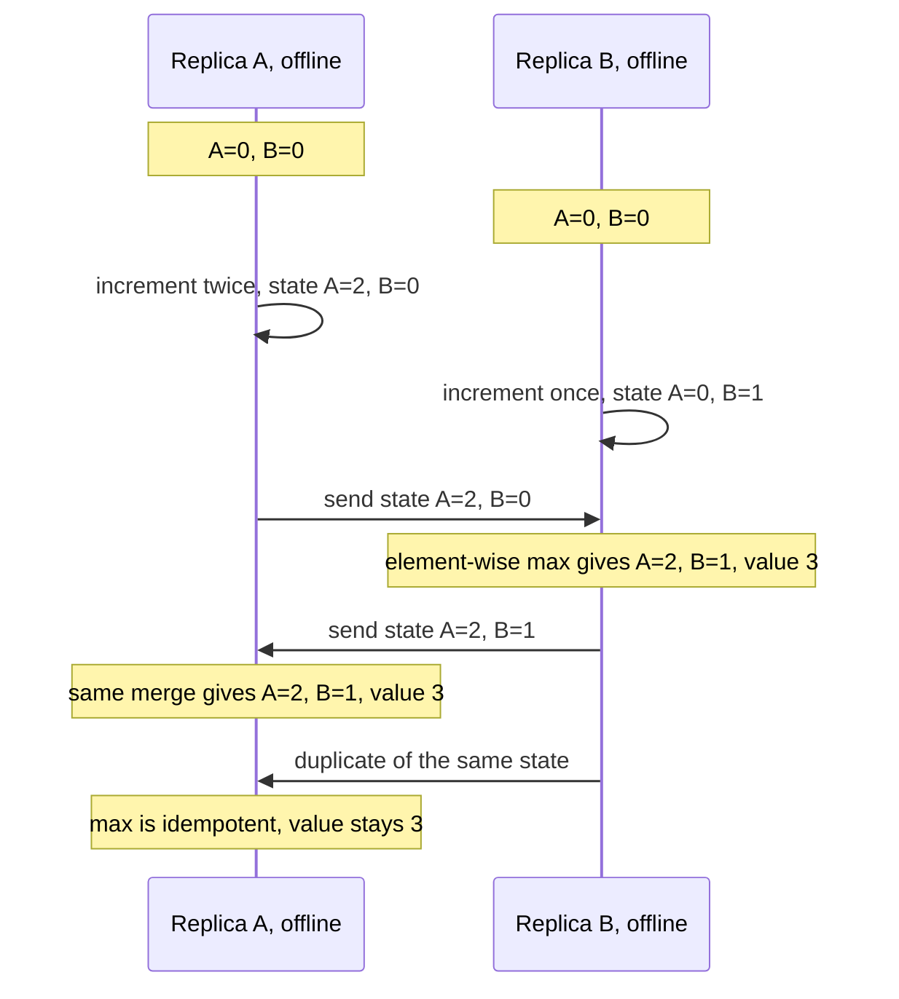
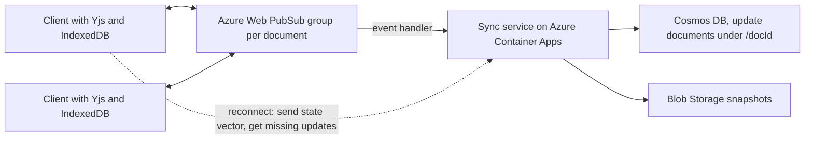

## TL;DR

- A **CRDT** (conflict-free replicated data type) is a data type whose replicas accept writes with no coordination and still converge. Any two replicas that have received the same updates hold the same state, whatever the delivery order. This guarantee is called **strong eventual consistency**.
- **State-based** CRDTs ship whole states and merge them with a function that is commutative, associative, and idempotent, so duplicates and reordering are harmless. **Operation-based** CRDTs ship small operations and need a delivery layer that hands each operation over exactly once, in causal order.
- CRDTs cannot enforce invariants that need agreement, such as a unique username or a balance that never goes negative. Those still need a single owner or [consensus](./consensus-raft-paxos.md).
- **Local-first** software keeps the primary copy on the user's device and treats the server as a relay and backup. CRDTs make that workable.
- On Azure, Azure Web PubSub relays updates and Azure Cosmos DB stores them. Cosmos DB's default last-writer-wins policy is itself a simple CRDT that discards concurrent edits. Azure Managed Redis active geo-replication uses CRDTs between regions.

## Why it matters

Three product requirements push you toward CRDTs: editing while offline, several people editing one document at once, and accepting writes in more than one region. Each one means two replicas can change the same data before either hears about the other.

The usual fallbacks fail in recognizable ways:

- **Last-writer-wins** keeps one write and silently drops the other, and "last" depends on [clocks you cannot trust](./time-clocks-and-ordering.md).
- **Locks or a central sequencer** stop working the moment a user goes offline or a region is cut off.
- **Hand-written merge code** tends to be order-dependent. The Dynamo paper's shopping cart, which merged concurrent versions by union, let deleted items reappear.

CRDTs replace ad hoc merging with data types whose merge is proven to converge. The remaining work is choosing types whose merge matches what users expect.

## How it works

### State-based CRDTs

Each replica holds a full state and periodically sends it to peers. The receiver merges with a function that is:

- **Commutative**: $\operatorname{merge}(a, b) = \operatorname{merge}(b, a)$, so delivery order does not matter.
- **Associative**: $\operatorname{merge}(\operatorname{merge}(a, b), c) = \operatorname{merge}(a, \operatorname{merge}(b, c))$, so gossip through any topology works.
- **Idempotent**: $\operatorname{merge}(a, a) = a$, so duplicate delivery is harmless.

Local updates may only move the state "upward" in the order the merge defines. The **G-Counter** (grow-only counter) is the standard example. Each replica keeps a map from replica ID to that replica's count, increments only its own entry, and merges by taking the element-wise maximum. The value is the sum.

The cost is bandwidth: the state grows with the number of replicas and ships whole. **Delta-state** CRDTs send only the part of the state that changed and keep the same merge.

### Operation-based CRDTs

Replicas broadcast operations instead of states, such as "insert character `x` after element `id-17`". Concurrent operations must commute. The delivery layer must deliver every operation exactly once and after the operations it depends on. Messages are small, but the reliability burden moves to the transport. In practice, libraries attach unique IDs to operations and track a **state vector** (a version vector of what each replica has seen) so they can deduplicate and request what is missing.

### Common types

- **PN-Counter.** Two G-Counters, one for increments and one for decrements. The value is the difference.
- **LWW-Register.** Keeps the value with the highest timestamp, ties broken by replica ID. Simple, and it loses one of two concurrent writes by design.
- **Multi-value register.** Keeps all concurrent values and lets the application or the user pick.
- **OR-Set** (observed-remove set). Each add carries a unique tag, and a remove deletes only the tags it has seen. A concurrent add and remove leave the element present, so the set is "add-wins".
- **Sequence CRDTs** for text, such as RGA and the YATA algorithm in Yjs. Every character gets a unique, ordered ID, so concurrent inserts at the same position land in a deterministic order. Deleted characters become tombstones.
- **JSON documents.** Automerge composes maps, lists, text, and counters into one nested document.

### Sync and storage

A replica that reconnects sends its state vector. The peer replies with the updates it lacks. A server in the middle can do the same job without understanding the document, which is why a stateless relay plus durable storage is enough for many products. Updates accumulate, so systems periodically compact the log into a snapshot.

A central server also lets you relax the model. Figma's multiplayer system is inspired by CRDTs but is not a true CRDT. The server is the authority and keeps the latest value any client sent for each property of each object, so only edits to the same property of the same object conflict. Offline edits are reapplied on top of a fresh copy when the client reconnects. That is simpler and faster than a fully decentralized design.

### What CRDTs cannot do

- **Global invariants.** Two offline replicas can each withdraw the last 100 units. Preventing that requires coordination, or escrow that splits the budget between replicas in advance.
- **Semantic conflicts.** Two users rewriting one sentence converge to the same text, which may read as nonsense. Convergence is not intent.
- **Free garbage collection.** Tombstones can be dropped only when every replica has seen the delete, and knowing that is a coordination problem. Long-lived documents grow.
- **Authorization.** A replica that accepts any well-formed operation accepts malicious ones too. Validate operations at the server before you relay them.

## Trade-offs

| Approach | Offline writes | Server role | Main cost |
| --- | --- | --- | --- |
| State-based CRDT | Yes | Optional relay | Bandwidth and state size |
| Operation-based CRDT | Yes | Reliable causal delivery | Transport complexity, tombstones |
| Operational transformation, popularized by Google Docs | Limited | Required, transforms and orders every operation | Hard to get right, server on the critical path |
| Server-ordered, CRDT-inspired, as in Figma | Yes, replayed on reconnect | Authority that orders all changes | Edits commit only when the server sees them |
| Single owner with locks or consensus | No | Required | Unavailable during partitions, but enforces invariants |

A sound default: use a library such as Yjs or Automerge for collaborative documents, keep invariant-bearing data (payments, inventory, identity) on a single-owner store, and do not write your own sequence CRDT.

## On Azure

**Azure Web PubSub as the relay.** Put each document's collaborators in one group. Grant clients the scoped roles `webpubsub.joinLeaveGroup.<group>` and `webpubsub.sendToGroup.<group>` so a token works for one document only. The reliable subprotocols let a publisher resend with the same `ackId` and get a `Duplicate` acknowledgment instead of a second delivery, and let subscribers acknowledge by `sequenceId`. Recovery is meant for brief drops. A client that has failed to recover for more than a minute should start a new connection and resync from storage. Web PubSub relays messages; it is not the system of record. See [real-time updates](../03-patterns/real-time-updates.md) for the connection model.

**Azure Cosmos DB as the store.** Store each update as an immutable document with a unique ID, partitioned by document ID, and compact into snapshots. Inserts with distinct IDs never conflict, so this layout stays safe under multi-region writes. With multiple write regions, Cosmos DB commits a write in the local region, then sends it asynchronously to the hub region (the first region of the account) for conflict resolution. Until then the write is tentative. The default policy is last writer wins on `_ts`. A custom merge stored procedure, API for NoSQL only and set when you create the container, receives `incomingItem`, `existingItem`, and `conflictingItems` and can run a real CRDT merge, such as element-wise max for a counter. If the procedure is missing or throws, the conflict lands in the conflicts feed.

**Azure Managed Redis active geo-replication.** Up to five instances in different regions form one active-active cache, replicated with CRDTs. Sync is eventually consistent with no SLA on sync time. Redis's documentation for this feature says counters updated with `INCR` merge by accumulating every region's increments, while plain strings resolve last-writer-wins on OS time. Use it for counters, sets, and session data that tolerate convergence delay. `FLUSHALL` and `FLUSHDB` are blocked, every instance in the group must share one configuration, and the Balanced B0 and B1 and Flash Optimized SKUs do not support it.

**Gotcha.** Storing a document's whole CRDT state as one Cosmos DB item and replacing it on every edit puts last writer wins back in charge. Two regions each replace the item with a correctly merged state, and the resolver keeps one, dropping every edit only the other contained. Append updates instead, or register a merge procedure that merges. See [multi-region active-active](./multi-region-active-active.md).

## Interview tips

- For collaborative editors, say which family you are using: operational transformation with a central server, or CRDTs with any topology. Then justify it by offline needs.
- Explain convergence by naming the three merge properties and showing a G-Counter. It takes thirty seconds and answers "how do replicas agree".
- Volunteer the limits. A CRDT will not stop double-spending, so route invariant checks to a single owner.
- Mention tombstones and compaction before the interviewer asks how storage grows.
- When multi-region writes come up, say what the conflict policy is. "Last writer wins" is a valid answer only if losing a concurrent write is acceptable.

## Further reading

- [Conflict-free Replicated Data Types](https://inria.hal.science/inria-00609399), Shapiro, Preguiça, Baquero, and Zawirski
- [Local-first software](https://www.inkandswitch.com/essay/local-first/), Ink & Switch
- [Yjs documentation](https://docs.yjs.dev/)
- [Automerge](https://automerge.org/)
- [How Figma's multiplayer technology works](https://www.figma.com/blog/how-figmas-multiplayer-technology-works/)
- [Azure Cosmos DB multi-region writes](https://learn.microsoft.com/azure/cosmos-db/multi-region-writes)
- [Manage conflicts between regions in Azure Cosmos DB](https://learn.microsoft.com/azure/cosmos-db/how-to-manage-conflicts)
- [Configure active geo-replication for Azure Managed Redis](https://learn.microsoft.com/azure/redis/how-to-active-geo-replication)
- [Redis Active-Active strings and counters](https://redis.io/docs/latest/operate/rs/databases/active-active/develop/data-types/strings/)
- [Create reliable WebSocket clients with Azure Web PubSub](https://learn.microsoft.com/azure/azure-web-pubsub/howto-develop-reliable-clients)
- [Hello Interview, Google Docs breakdown](https://www.hellointerview.com/learn/system-design/problem-breakdowns/google-docs)
- [Hello Interview, how Figma built multiplayer editing](https://www.hellointerview.com/learn/system-design/in-the-wild/figma-multiplayer)
