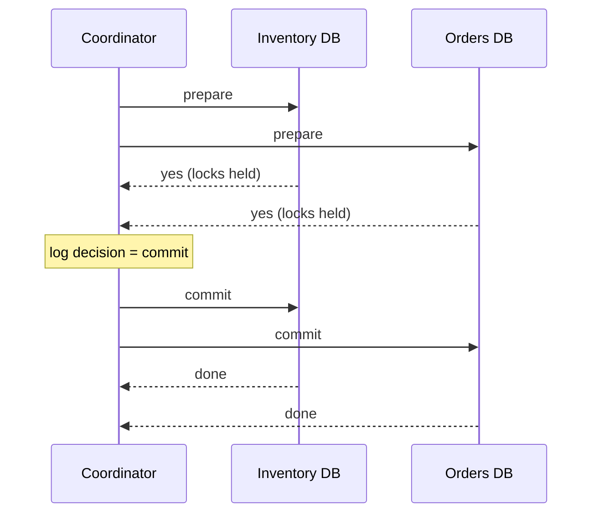
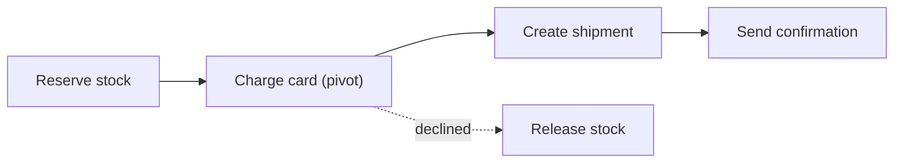

## TL;DR

- A change that spans two databases, or a database and a broker, has no shared commit log. You choose between blocking atomicity (two-phase commit) and eventual consistency with compensation (sagas).
- Two-phase commit (2PC) is atomic, but every participant holds locks until the coordinator decides. A coordinator crash after the vote leaves participants stuck in doubt.
- A saga runs a chain of local transactions and undoes completed steps with compensating actions. It gives up isolation, so other requests can see half-finished work.
- The transactional outbox fixes the dual-write bug. Write the state change and the event in one local transaction, and let a relay publish the event later.
- On Azure, Cosmos DB transactional batch is ACID only inside one logical partition key, with at most 100 operations, 2 MB, and 5 seconds. Model data so each invariant fits in one partition.

## Why it matters

A checkout reserves stock in the inventory service, charges a card through the payments service, and creates a shipment. Each service owns its database. If the charge succeeds and the shipment insert fails, the customer pays for nothing. If the order row commits and the "order placed" event never reaches the broker, no downstream service ever hears about the order. Both bugs come from the same cause. Two systems each committed independently, and nothing ties their outcomes together.

The first move is to avoid the problem. If the rows that must change together live in one database partition, a local transaction handles it and nothing on this page applies. Reach for the patterns below only when the data really has to live apart, usually because separate teams own the services or the data sits in different stores. The [multi-step processes](../03-patterns/multi-step-processes.md) page covers the workflow side. This page covers the correctness guarantees.

## How it works

### Two-phase commit

A coordinator runs two rounds. In the prepare phase, each participant writes enough to its log to either commit or roll back, takes its locks, and votes yes or no. If every vote is yes, the coordinator writes "commit" to its own log, then tells every participant to commit. Any no vote, or a timeout, means abort.

The weak point is the gap between voting yes and hearing the decision. A participant that voted yes cannot decide alone, because another participant may have voted no. If the coordinator crashes in that gap, the participant keeps its locks until the coordinator recovers and replays its log. That is the "blocking" in blocking protocol. Other costs follow. Every transaction pays two round trips and forced log writes on every participant, and the transaction's availability is the product of every participant's availability. Systems such as Spanner reduce the blocking risk by making the coordinator and each participant a [consensus group](./consensus-raft-paxos.md), so no single crash stalls the decision.

### Sagas

A saga splits the operation into local transactions T1 to Tn. Each step commits on its own. If step k fails, the saga runs compensating actions for steps k-1 down to 1. A compensation is a new business action, not a rollback. Refunding a charge is not the same as never charging, and the customer may see both on a statement.

Classify each step before you write it.

- **Compensable steps** come before the pivot and have an undo, such as releasing reserved stock.
- **The pivot** is the point of no return. Here it is the card charge. Put the step most likely to fail as early as you can, so fewer steps need compensating.
- **Retryable steps** come after the pivot. They must eventually succeed, so make them idempotent and retry them until they do.

Two coordination styles exist. In orchestration, one durable workflow calls each step and records progress, so a crash resumes from the last completed step. In choreography, each service reacts to the previous service's event and emits its own. Orchestration keeps the flow in one readable place. Choreography avoids a central component but scatters the flow across subscriptions, so a long saga becomes hard to trace and easy to turn into an event loop.

### The missing I in ACID

Sagas give up isolation. Between T1 and the compensation, other requests see stock that is reserved but may be released. Design for it.

- **Semantic lock.** Write a status such as `PENDING` in T1, and have readers treat pending rows differently, for example by excluding them from "available" counts.
- **Commutative updates.** Use increments and decrements rather than read-modify-write, so interleaved sagas cannot lose each other's changes.
- **Reread before acting.** A retryable step checks that its input still holds, and fails into a compensation if it does not.

### Transactional outbox

The dual-write bug is "save the row, then publish the event". Either call can fail alone. The outbox puts the event in the same database transaction as the state change, as a row or document in an outbox table. A relay process reads committed outbox entries and publishes them to the broker. The relay can poll, or it can tail the database's change log (change data capture).

The relay can crash after publishing and before marking the entry done, so delivery is at least once. Every consumer must be idempotent. Store processed message IDs in an inbox table inside the consumer's own transaction, or make the handler naturally idempotent. [Idempotency and retries](../03-patterns/idempotency-and-retries.md) covers the consumer side.

Ordering matters too. Publish events for one aggregate (one order, one account) in commit order, and partition the broker by that aggregate's key, so `OrderUpdated` never overtakes `OrderCreated`.

## Trade-offs

| Approach | Consistency | Latency and availability | When to use it |
| --- | --- | --- | --- |
| Local transaction in one partition | ACID | One write, no coordination | Always try first |
| Two-phase commit | Atomic and isolated | Two round trips, locks held across them, blocks if the coordinator dies | Few participants inside one vendor's stack, short transactions, low contention |
| Saga with orchestration | Eventual, no isolation | Each step commits alone, so the flow survives slow or down services | Long-running or cross-team business flows |
| Saga with choreography | Eventual, no isolation | No central workflow, but the flow is implicit | Two or three services with a simple linear flow |
| Outbox plus idempotent consumers | Atomic between state and event, consumers converge later | One local transaction plus asynchronous relay lag | Any service that both writes state and publishes events |

A sound default for cross-service work is an orchestrated saga whose steps each use an outbox. 2PC earns its place only when every participant natively supports it and the transaction is short.

## On Azure

| Need | Azure service | Scope and limits |
| --- | --- | --- |
| Atomic multi-item write in a document store | Azure Cosmos DB transactional batch | Same partition key, snapshot isolation, at most 100 operations, 2 MB payload, 5 seconds of execution |
| Atomic writes across relational databases | Azure SQL Database elastic database transactions | Two-phase commit across Azure SQL databases, coordinated from .NET `System.Transactions` |
| Saga orchestrator | Durable Functions, or the Durable Task SDKs on Azure Container Apps or AKS | Durable Task Scheduler is the recommended state backend |
| Event transport for choreography and outbox relays | Azure Service Bus Standard or Premium | Transactions and duplicate detection are not available on Basic |
| Outbox relay | Cosmos DB change feed processor | Ordered per partition key, at least once |

**Cosmos DB.** Choose the partition key so that the documents an invariant covers share it. An order and its line items under `/orderId` can change atomically. An order and the customer's loyalty balance under different keys cannot. Microsoft's reference implementation of the outbox writes the entity and its event document in one transactional batch. A change feed processor then publishes each event to a Service Bus topic, with `MessageId` set to the event document's ID and `SessionId` set to the partition key. Sessions keep per-aggregate order. A time-to-live on event documents cleans up the outbox.

**Service Bus.** Duplicate detection drops a message whose `MessageId` the entity already saw inside a window. The window defaults to 10 minutes and ranges from 20 seconds to 7 days. A larger window costs throughput. Service Bus transactions cover operations on one messaging entity, plus the send-via pattern, so receive-process-send can be atomic inside Service Bus. They cannot enlist your database, which is exactly why the outbox exists.

**Azure SQL.** Elastic database transactions support only Azure SQL Database participants, and only client-coordinated .NET code. Azure SQL Managed Instance supports distributed transactions inside a server trust group. If a design needs 2PC across a relational store and anything else, treat that as a signal to switch to a saga.

**Gotcha.** Change feed items written in one transactional batch share a modification time and may arrive in any order. In latest version mode, the feed shows only the newest version of an item, so an updated outbox document can hide an earlier event. Insert each event as a new, immutable document with a per-aggregate sequence number, and order by that number in the relay. See [messaging choices](../04-azure/messaging-choices.md) for picking between Service Bus and Event Hubs as the relay's target.

## Interview tips

- Name the dual-write bug as soon as a design says "write to the database, then publish to Kafka". Offer the outbox before anyone asks.
- Do not say "we'll use a distributed transaction" for microservices. Say which participants would block, then propose a saga with a named pivot step.
- Walk through a failure at each step and say what the compensation is. Interviewers check that compensations are business actions (refund, release, notify) and are idempotent.
- Expect "what does another user see mid-saga". Answer with a semantic lock, for example a `PENDING` reservation that expires.
- Expect "exactly once". The honest answer is at-least-once delivery plus idempotent consumers, which gives exactly-once effects.
- Contrast with [consensus](./consensus-raft-paxos.md). 2PC needs every participant to vote yes. Consensus needs a majority to store an entry.

## Further reading

- [Saga design pattern](https://learn.microsoft.com/azure/architecture/patterns/saga), Azure Architecture Center
- [Compensating Transaction pattern](https://learn.microsoft.com/azure/architecture/patterns/compensating-transaction), Azure Architecture Center
- [Transactional Outbox pattern with Azure Cosmos DB](https://learn.microsoft.com/azure/architecture/databases/guide/transactional-out-box-cosmos)
- [Transactional batch operations in Azure Cosmos DB](https://learn.microsoft.com/azure/cosmos-db/transactional-batch)
- [Change feed in Azure Cosmos DB](https://learn.microsoft.com/azure/cosmos-db/change-feed)
- [Distributed transactions across cloud databases](https://learn.microsoft.com/azure/azure-sql/database/elastic-transactions-overview)
- [Transactions in Azure Service Bus](https://learn.microsoft.com/azure/service-bus-messaging/service-bus-transactions)
- [Service Bus duplicate message detection](https://learn.microsoft.com/azure/service-bus-messaging/duplicate-detection)
- [Durable Task Scheduler](https://learn.microsoft.com/azure/durable-task/scheduler/durable-task-scheduler)
- [Hello Interview, multi-step processes](https://www.hellointerview.com/learn/system-design/patterns/multi-step-processes)
- [The Coding Gopher, the outbox design pattern](https://thecodinggopher.substack.com/p/the-transactional-outbox-pattern)
- [The Coding Gopher, saga pattern vs two-phase commit](https://thecodinggopher.substack.com/p/saga-pattern-vs-two-phase-commit) (paid post)
