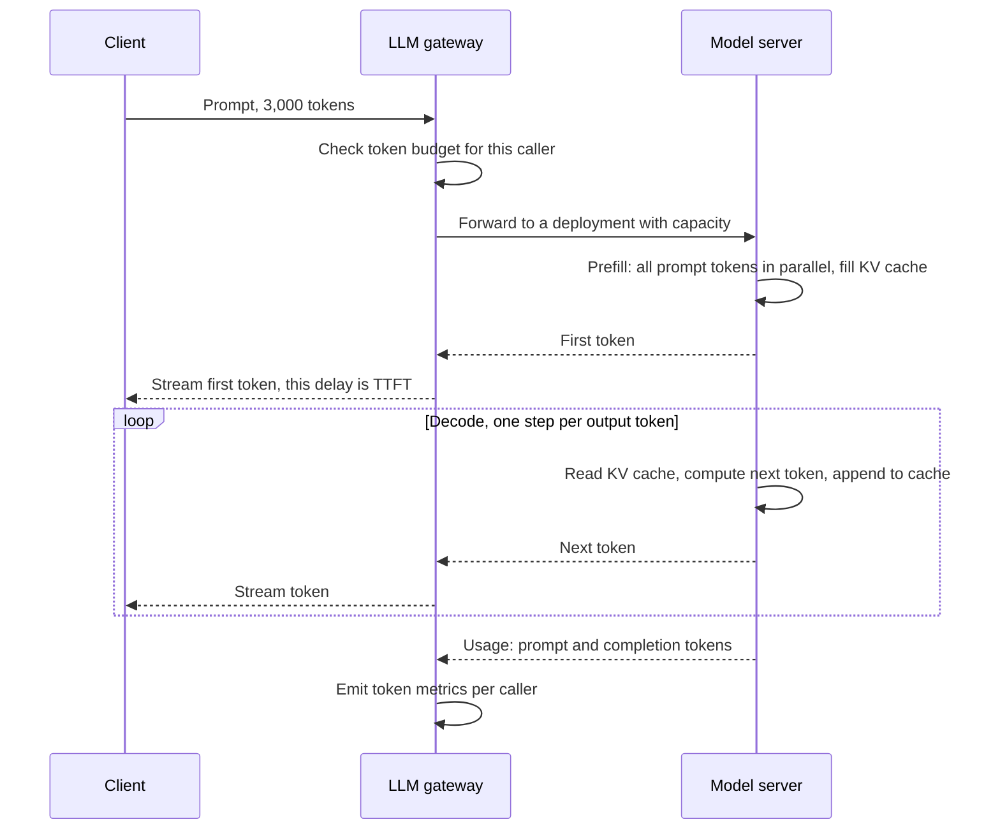

## TL;DR

- Models read and write **tokens**, about four characters of English each. Cost, rate limits, and latency are all counted in tokens.
- A request has two phases. **Prefill** processes the whole prompt in parallel and produces the first token. **Decode** generates the rest one token at a time. Total time is roughly time to first token (TTFT) plus time between tokens (TBT) times output tokens.
- Each in-flight request holds a **KV cache** in GPU memory. That memory limits how many requests run together, and the number running together sets throughput. Continuous batching and paged KV memory are how modern servers raise it.
- On Azure OpenAI in Microsoft Foundry Models, **standard** deployments bill per token under a tokens-per-minute (TPM) quota with no latency SLA. **Provisioned throughput units (PTU)** reserve capacity per hour and come with a latency target.
- Put an **LLM gateway** in front of every model call: per-consumer token limits, token metrics, failover across deployments, and one place for auth and content safety. Azure API Management's AI gateway features do this.

## Why it matters

A model call takes seconds, not milliseconds, and its cost grows with prompt and output length. Designs that treat it like an ordinary API call fail in predictable ways:

- **Shared quota exhaustion.** One team's batch job or a runaway [agent loop](./ai-systems-rag-and-agents.md) consumes the region's TPM and every other app gets HTTP 429.
- **False latency regressions.** Responses got longer, so total time rose, and someone scales infrastructure that was fine.
- **GPU memory pressure.** Longer contexts mean bigger KV caches, fewer concurrent requests, and lower throughput on the same hardware.
- **Cost drift.** A 3,000-token system prompt resent on every call costs more than the answers.

## How it works

### Tokens and capacity math

Estimate in tokens, as in [back-of-the-envelope](../01-fundamentals/back-of-the-envelope.md) sizing. A chat feature with 1,000 requests per minute, 3,000 prompt tokens (instructions, retrieved chunks, history), and 300 output tokens needs about 3.3 million TPM. Prompt tokens dominate the count in RAG apps. Output tokens dominate latency, because they are generated one at a time.

### Prefill and decode

The vLLM paper describes the split. Prefill knows every prompt token up front, so it runs as matrix-matrix multiplication and uses the GPU's parallelism well. Decode depends on the previous token, runs as matrix-vector multiplication, is memory-bound, and accounts for most of a single request's latency.

That gives the latency model, where TTLT is time to last token:

$$
\text{TTLT} = \text{TTFT} + \text{TBT} \times \text{tokens generated}
$$

- **TTFT** grows with prompt length and with queueing on a busy deployment.
- **TBT** depends on model size and load.
- **Output length** is usually the biggest lever. With illustrative values of 500 ms TTFT and 20 ms TBT, 300 output tokens take 6.5 seconds and 1,000 take 20.5. Ask for shorter output and cap it.
- **Streaming** does not change total time. It shows text after TTFT instead of TTLT, and it keeps long responses from hitting client and proxy timeouts.

### The KV cache

Attention compares each new token with every earlier token. To avoid recomputing the whole prefix at every step, the server keeps a key vector and a value vector per token per layer: the **KV cache**. The vLLM paper's example: for a 13B-parameter model, one token's KV cache is 800 KB, and one 2,048-token sequence can need 1.6 GB. On a 40 GB GPU serving that model, about 65% of memory holds weights and close to 30% holds request state.

So GPU memory, not compute, usually caps concurrency. Memory consumed by long contexts is memory unavailable for more requests.

### Batching

Decode is memory-bound, so running many sequences through the same step shares each read of the model weights across all of them. Throughput rises with batch size until the KV cache fills memory.

- **Static batching** waits for the longest sequence in the batch. Finished requests cannot return, and new arrivals wait for the whole batch.
- **Continuous batching**, introduced as iteration-level scheduling by the Orca paper, adds and removes sequences at every decode step, so the GPU stays full and short requests leave early.
- **PagedAttention**, from vLLM, stores the KV cache in fixed-size blocks, like operating-system pages. The paper measured earlier systems using only 20.4% to 38.2% of KV cache memory for actual token state. Paging brings waste near zero, fits more sequences, and reported 2 to 4 times the throughput at the same latency.
- **Prefix caching** reuses the KV cache for an identical prompt prefix, such as a shared system prompt, skipping that part of prefill. Managed services expose this as prompt caching.

Bigger batches raise tokens per second per GPU and lower tokens per second per user. Pick the operating point from your latency target, as with any [load-balanced](../02-building-blocks/load-balancing.md) pool.

### Why a gateway

Quota belongs to a deployment in a region, while consumers are many apps and teams. A gateway enforces per-consumer token budgets, routes across deployments and regions, records who used what, and holds the [resilience](../03-patterns/resilience-patterns.md) logic. Limit tokens, not requests: one request can be 50 tokens or 100,000.

## Trade-offs

| Option | Billing | Latency | Fits | Watch for |
| --- | --- | --- | --- | --- |
| Standard (global, data zone, regional) | Per token | No SLA, varies with shared demand | Variable or unknown traffic, development | 429s at the TPM quota |
| Priority processing | Per token, higher rate | Latency target per model | Latency-sensitive traffic without a commitment | Higher unit cost |
| Provisioned (PTU) | Per PTU per hour, or reservation | Latency target per model | Steady, high-volume, interactive workloads | Paying for idle capacity, capacity availability |
| Batch | Per token, discounted | Asynchronous | Bulk jobs with no user waiting | Results are not immediate |
| Self-hosted open model on AKS | GPU nodes | Yours to tune | Open-weight models, full control | GPU capacity and operations are yours |

A sound default: start on Global Standard behind a gateway, measure TPM and latency, then move the steady base load to PTU and keep standard as overflow.

## On Azure

**Deployment types.** Foundry Models offer standard (pay per token), provisioned (reserved capacity), and batch (discounted, asynchronous). Standard and provisioned come in global, data zone (US, EU, or Asia Pacific), and geography-based processing. Learn recommends starting with Global Standard and moving only for data residency, reserved throughput, or batch processing. See [data residency in multi-region designs](./multi-region-active-active.md).

**Quota.** TPM quota is assigned per subscription, region, model, and deployment type, and you split it across deployments. An RPM limit is set in proportion, often 6 RPM per 1,000 TPM, varying by model. The limiter adds each request's estimated maximum tokens, including `max_tokens`, to a per-minute counter and returns 429 once it passes the limit. A 3,000-token prompt with `max_tokens` of 4,000 counts as 7,000 even if the answer is 200 tokens, so set `max_tokens` close to what you need.

**Provisioned throughput.** A PTU is a fixed amount of model processing capacity. PTU quota is model-independent but scoped to a region and deployment type, and each model has a minimum deployment size. Quota does not guarantee capacity: a deployment fails if the region lacks free PTUs, and capacity released by scaling down may not come back. **Spillover** sends requests that a fully used provisioned deployment would reject to a standard deployment in the same resource.

**Prompt caching.** Prompts with an identical prefix of at least 1,024 tokens can hit the cache. Cache reads are discounted on standard deployments and up to 100% on provisioned. In-memory caches usually clear after 5 to 10 minutes of inactivity. Extended retention keeps them up to 24 hours by offloading KV tensors to GPU-local storage. Caches are never shared across subscriptions. Put static instructions first and variable content last.

**Latency metrics.** Azure Monitor reports Time to Response (TTFT), Time Between Tokens, Time to Last Byte, and Generated Completion Tokens. Check token counts before declaring a regression. See [observability](../04-azure/observability.md).

**API Management AI gateway.** These features extend the [API gateway](../02-building-blocks/api-gateway.md):

- `llm-token-limit` limits tokens per key, such as subscription or app ID. Exceeding the TPM rate returns 429, and exceeding a quota over a period returns 403.
- `llm-emit-token-metric` sends token counts to Azure Monitor with dimensions such as user and API, for chargeback.
- Backend pools balance across deployments with round-robin, weighted, priority-based, or session-aware rules. Priorities fill PTU deployments first. Circuit breakers stop traffic to a failing backend, with a trip duration that can follow the backend's `Retry-After` header.
- Semantic caching stores completions in Azure Managed Redis or another RediSearch-compatible cache and returns them for prompts whose embeddings are close enough.
- Content safety policies moderate prompts with Azure AI Content Safety.

**Self-hosting.** The AI toolchain operator add-on for AKS runs KAITO, which deploys open-source models on vLLM behind an OpenAI-compatible API. The add-on typically lags upstream KAITO by one release. See [compute choices](../04-azure/compute-choices.md).

**Gotcha.** Semantic caching matches by similarity, and Learn warns it can return responses that are incorrect, outdated, or unsafe for the current request. A cached answer built from one user's retrieved documents can reach another user. Partition the cache with `vary-by` on tenant or user, start from the low `score-threshold` Learn suggests (0.05) and tune it against real traffic, and skip caching for answers grounded in per-user data. See [caching](../02-building-blocks/caching.md).

## Interview tips

- Do the token math out loud: requests per minute times prompt and output tokens gives TPM, and output tokens times TBT gives most of the latency.
- Say TTFT and tokens per second separately, and say streaming improves the first, not the second.
- Explain that GPU memory for the KV cache caps concurrency and that continuous batching keeps the GPU busy.
- Propose PTU for the steady baseline, standard for overflow, and a gateway with priority routing between them.
- Treat model calls as a shared, rate-limited dependency: per-consumer budgets, retries honoring `Retry-After`, and a fallback when every deployment is throttled.

## Further reading

- [Azure OpenAI performance and latency](https://learn.microsoft.com/azure/foundry/openai/how-to/latency)
- [Manage Azure OpenAI quota](https://learn.microsoft.com/azure/foundry/openai/how-to/quota)
- [Deployment types in Microsoft Foundry Models](https://learn.microsoft.com/azure/foundry/foundry-models/concepts/deployment-types)
- [Provisioned throughput for Foundry Models](https://learn.microsoft.com/azure/foundry/openai/concepts/provisioned-throughput)
- [Prompt caching](https://learn.microsoft.com/azure/foundry/openai/how-to/prompt-caching)
- [AI gateway capabilities in Azure API Management](https://learn.microsoft.com/azure/api-management/genai-gateway-capabilities)
- [llm-token-limit policy](https://learn.microsoft.com/azure/api-management/llm-token-limit-policy) and [llm-semantic-cache-lookup policy](https://learn.microsoft.com/azure/api-management/llm-semantic-cache-lookup-policy)
- [AI toolchain operator add-on for AKS](https://learn.microsoft.com/azure/aks/ai-toolchain-operator)
- [Efficient Memory Management for Large Language Model Serving with PagedAttention](https://arxiv.org/abs/2309.06180) (Kwon et al., SOSP 2023)
- [Orca: A Distributed Serving System for Transformer-Based Generative Models](https://www.usenix.org/conference/osdi22/presentation/yu) (OSDI 2022)
- [vLLM documentation](https://docs.vllm.ai/en/latest/)
