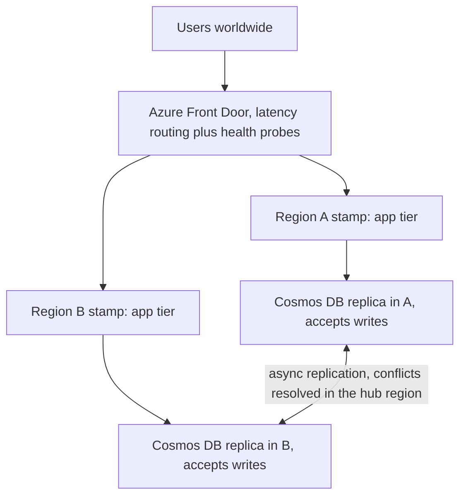

## TL;DR

- **Active-active** means every region serves production reads and writes all the time. There is no standby to promote, so the failover path is the normal path and gets exercised every day.
- Stateless tiers are easy to run everywhere. The design question is where writable data lives. Pick one of three: a single global writer, a home region per record, or multiple writers with conflict resolution.
- Each region needs headroom to absorb a failed region's traffic. With two regions, each must stay under about 50% of capacity; with three, under about 67%.
- You cannot have strong consistency and local-latency writes in several regions at once. Multi-writer means asynchronous replication, conflicts, and a recovery point objective (RPO) above zero.
- **Data residency** limits which regions may hold a user's data. That turns "home region per record" from an optimization into a requirement.
- On Azure: Front Door Standard or Premium routes users to the nearest healthy region. Cosmos DB multi-region writes gives local writes everywhere, without strong consistency. Azure Policy enforces allowed locations.

## Why it matters

Teams adopt active-active for lower latency and for resilience. The resilience argument is the stronger one: a passive region that never takes traffic tends to fail when you finally need it, because of stale config, cold caches, or missing quota. The failure modes are specific:

- **Cascading overload.** One region fails, the others receive its traffic, and they were already at 80%.
- **Lost writes.** Two regions accept conflicting updates and the conflict policy silently keeps one.
- **Split brain on an invariant.** Two regions each sell the last seat because each checked its local copy.
- **Residency violations.** A replica, a backup, or a log pipeline copies regulated data to a region it must not reach.
- **Fail-open routing.** Every origin's health probe fails at once, and the router sends traffic everywhere anyway.

## How it works

### Global routing

A global entry point picks a region for each request. Two families exist:

- **Anycast layer 7 proxy** (Azure Front Door). Clients connect to the nearest edge, which forwards to a healthy origin. Failover happens at the edge, without waiting for DNS caches to expire.
- **DNS-based** (Azure Traffic Manager). The DNS answer points at a region. Failover waits until clients and resolvers drop their cached answers.

Routing combines health probes with a policy: lowest latency, priority, weight, or session affinity.

### Three ways to place writable data

1. **Single writer, read everywhere.** One region accepts writes and the rest serve reads. Compute is active-active, data is active-passive. Writes from far regions pay a cross-region round trip, and losing the write region needs a failover. This is the right default for relational data.
2. **Home region per record.** Every user, tenant, or order has one region that owns its writes. Other regions route writes for it to the home or forward them. There are no write conflicts, invariants stay local, and residency falls out naturally. The router must know each record's home, from a token claim, a cookie, or a small global directory. This is [sharding](../02-building-blocks/sharding-and-partitioning.md) with geography as the key.
3. **Multiple writers.** Any region accepts any write and replicates asynchronously. Writes are local everywhere, and you must define what happens when two regions change the same item. Use it for data where a deterministic merge is acceptable, or where [CRDTs](./crdts-and-local-first.md) model the data.

### Capacity math

With $N$ equal regions and a requirement to survive one regional loss, each survivor takes $1/(N-1)$ of the load instead of $1/N$. The steady-state ceiling per region is $(N-1)/N$: 50% for two regions, 67% for three, 75% for four. More regions waste less headroom but add more replication paths and more places for conflicts. Quotas must already exist in the surviving regions, because a regional outage is when everyone else asks for capacity too.

### Consistency across regions

Cross-region round trips run tens to hundreds of milliseconds. Synchronous replication puts that on every write. Asynchronous replication gives local latency and a window in which regions disagree. A user who writes in one region and is then routed to another can miss their own write. Fix that with sticky routing (session affinity) or by carrying a session token the second region can wait for. Per [CAP and PACELC](../01-fundamentals/consistency-and-cap.md), this choice is not avoidable, only movable.

### Data residency

Residency rules say where data may be stored and sometimes processed. Treat each geography (such as the EU) as a separate deployment boundary: its own stamps, its own data stores, and replication only between regions inside it. Global routing sends each user to a stamp in their home geography. Then audit the side channels: backups, geo-redundant storage, logs and telemetry workspaces, search indexes, caches, and AI services. Each one is another copy.

## Trade-offs

| Data strategy | Write latency | Conflicts | Region loss | Fits |
| --- | --- | --- | --- | --- |
| Active-passive everything | Local in primary only | None | Failover of compute and data | Cost-sensitive, RTO in minutes to hours |
| Single writer, active-active compute | Cross-region for remote users | None | Data failover, compute already live | Relational data, strict invariants |
| Home region per record | Local for home users | None | Records homed there need failover | Multitenant SaaS, residency rules |
| Multiple writers | Local everywhere | Yes, need a policy | Writes continue, unreplicated writes at risk | Profiles, carts, counters, collaborative data |

A sound default: active-active compute with home-region data. Move individual datasets to multi-writer only when their merge semantics are clear.

## On Azure

**Azure Front Door.** Use the Standard or Premium tier. Front Door (classic) retires on March 31, 2027, and no longer accepts new profiles. Latency routing is the default: it picks the origins with the lowest probe latency and spreads traffic among those within the configured latency sensitivity. Priority routing gives active-passive, weighted routing gives gradual shifts, and session affinity keeps a user on one origin. Health probes run from every edge location, by default every 30 seconds, so expect about two probes per minute per edge on each origin. New profiles probe with `HEAD`. If every origin in a group fails its probes, Front Door treats them all as unhealthy and round-robins across all of them.

**Azure Cosmos DB multi-region writes.** Any region can be a write region.

- Writes commit in the local region and replicate asynchronously. Strong consistency is not available with multiple write regions.
- The first region in the account is the **hub**. Writes from other regions are tentative until the hub resolves conflicts and confirms them.
- For session, consistent prefix, and eventual consistency, the documented RPO for a region outage is under 15 minutes.
- During an outage, the SDK redirects reads and writes to the next region in the preferred-regions list.
- Documented antipatterns: sending the same write to every region for speed, passing session tokens between clients for writes (the receiving region must first catch up to the token), and rapid updates to one document.

Provision throughput for the loss of a region, or use autoscale, and pick a conflict policy per container (see [time, clocks, and ordering](./time-clocks-and-ordering.md)).

**Azure SQL Database.** Active geo-replication gives one writable primary and up to four readable geo-secondaries, replicated asynchronously. Pair it with home-region routing so most writes stay local.

**Residency controls.** The built-in Azure Policy definition *Allowed locations* denies resources outside listed regions, and *Azure Cosmos DB allowed locations* restricts Cosmos DB regions. Allowed locations excludes resources in the `global` region, such as Front Door, so review global services separately. Region pairs are usually in the same geography, which matters for geo-redundant storage that replicates to the pair.

**Well-Architected guidance.** The mission-critical guidance calls for an active/active model across regions built from scale units, typically [deployment stamps](./cell-based-architecture.md). The Geode pattern describes the same shape with a geo-replicated read-write store behind a global load balancer. See [regions, zones, and resiliency](../04-azure/regions-zones-and-resiliency.md).

**Gotcha.** A health endpoint that returns 200 whenever the process runs will report a region healthy while its database is unreachable. Make the probe check the region's critical dependencies, keep it cheap because every edge calls it, and alert on all-origins-unhealthy, because Front Door then fails open.

## Interview tips

- Ask which data must be writable in every region. Usually it is a small subset, and the rest can use a single writer or a home region.
- Do the headroom math out loud: three regions at 60% each survive one loss, two regions at 60% each do not.
- Name the conflict policy for any multi-writer data, and keep invariants (inventory, balances, unique names) on a single owner.
- Say how a user gets read-your-writes when routed to a different region: affinity, or a session token the region waits for.
- Raise residency early. It changes the topology, not only the configuration.

## Further reading

- [Azure Front Door routing methods](https://learn.microsoft.com/azure/frontdoor/routing-methods)
- [Azure Front Door health probes](https://learn.microsoft.com/azure/frontdoor/health-probes)
- [Azure Front Door (classic) retirement FAQ](https://learn.microsoft.com/azure/frontdoor/classic-retirement-faq)
- [Azure Traffic Manager endpoint monitoring](https://learn.microsoft.com/azure/traffic-manager/traffic-manager-monitoring)
- [Azure Cosmos DB multi-region writes](https://learn.microsoft.com/azure/cosmos-db/multi-region-writes)
- [Reliability in Azure Cosmos DB](https://learn.microsoft.com/azure/reliability/reliability-cosmos-db)
- [Azure SQL Database active geo-replication](https://learn.microsoft.com/azure/azure-sql/database/active-geo-replication-overview)
- [Azure Policy built-in definitions](https://learn.microsoft.com/azure/governance/policy/samples/built-in-policies)
- [Azure region pairs and nonpaired regions](https://learn.microsoft.com/azure/reliability/regions-paired)
- [Application design of mission-critical workloads](https://learn.microsoft.com/azure/well-architected/mission-critical/mission-critical-application-design)
- [Geode pattern](https://learn.microsoft.com/azure/architecture/patterns/geodes)
- [Hello Interview, CAP theorem](https://www.hellointerview.com/learn/system-design/core-concepts/cap-theorem)
- [The Coding Gopher, understanding strong vs. eventual consistency](https://thecodinggopher.substack.com/p/understanding-strong-vs-eventual)
